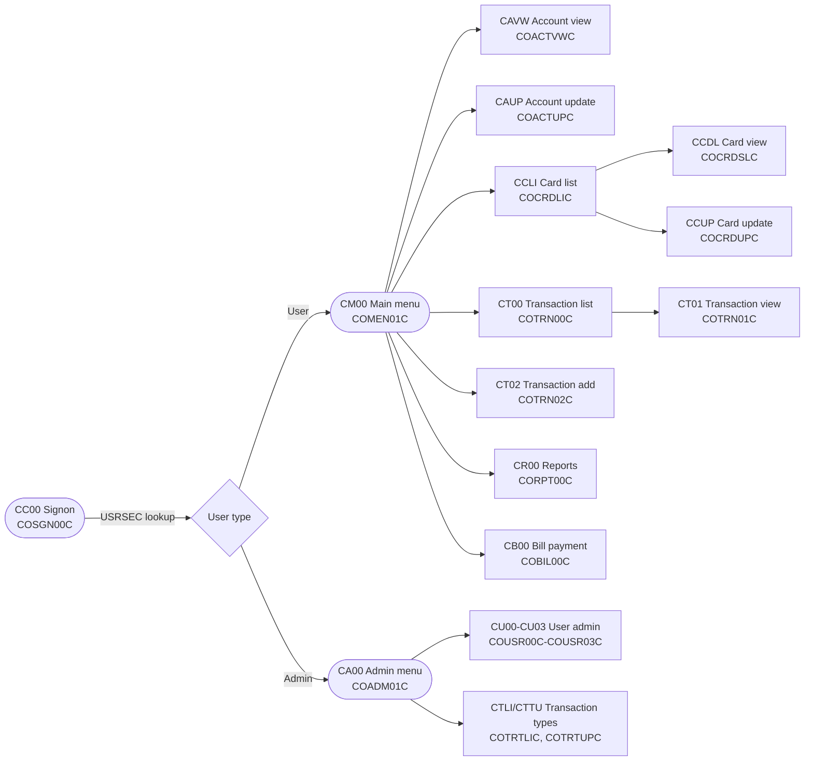
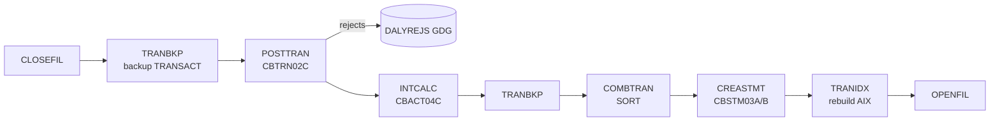

# Architecture and service flows

CardDemo is a CICS online application plus a JCL batch cycle that share VSAM files. Optional
modules add Db2, IMS DB, and MQ. Program-level details (copybooks, calls, complexity) are in
the generated `docs/INVENTORY.md`; record layouts are in `docs/data-model.md`.

## Online flow (CICS)

Every screen is a pseudo-conversational program: it sends a BMS map, ends with
`EXEC CICS RETURN TRANSID(...) COMMAREA(...)`, and is re-entered when the user presses a key.
State travels between programs in the `CARDDEMO-COMMAREA` defined by `app/cpy/COCOM01Y.cpy`
(signed-on user, user type, current account and card, calling program). Programs move between
screens with `EXEC CICS XCTL`.

The menu options are tables in `app/cpy/COMEN02Y.cpy` (user) and `app/cpy/COADM02Y.cpy`
(admin). CR00 does not print online: CORPT00C writes JCL for the TRANREPT job to an internal
reader TDQ, so reports run in batch (CBTRN03C).

### Data access by screen

| Programs | VSAM files (CICS FCT names) |
|:--|:--|
| COSGN00C, COUSR00C-COUSR03C, COADM01C | USRSEC |
| COACTVWC, COACTUPC | ACCTDAT, CUSTDAT, CARDDAT, CARDAIX, CXACAIX |
| COCRDLIC, COCRDSLC, COCRDUPC | CARDDAT, CARDAIX |
| COTRN00C, COTRN01C, CORPT00C | TRANSACT |
| COTRN02C | TRANSACT, ACCTDAT, CCXREF, CXACAIX |
| COBIL00C | TRANSACT, ACCTDAT, CXACAIX |

## Batch cycle

The daily cycle closes the CICS files, posts the day's transactions, applies interest,
produces statements, and reopens the files. Schedules are defined in `app/scheduler`; the
operating procedure, including restart and recovery, is in `docs/runbooks/batch-operations.md`.

| Step | Program | Reads | Writes |
|:--|:--|:--|:--|
| POSTTRAN | CBTRN02C | DALYTRAN, XREFFILE, ACCTFILE, TCATBALF | TRANFILE, ACCTFILE, TCATBALF, DALYREJS |
| INTCALC | CBACT04C | TCATBALF, XREFFILE, DISCGRP, ACCTFILE | ACCTFILE, system transactions GDG |
| COMBTRAN | SORT | transaction backup, system transactions | combined TRANSACT |
| CREASTMT | CBSTM03A, CBSTM03B | sorted copy of TRANSACT, XREFFILE, ACCTFILE, CUSTFILE | statements (text and HTML) |
| TRANREPT | CBTRN03C | TRANSACT, XREFFILE, TRANTYPE, TRANCATG | transaction report |

CBTRN02C validates each daily transaction (card in the cross-reference, account exists,
within credit limit, before account expiry), writes valid ones to TRANSACT, and updates
account and category balances. It sets RC=4 when any transaction is rejected.

You can run POSTTRAN and the listing programs locally with `make run-batch`, see `AGENTS.md`.

## Optional modules

| Module | Entry points | Technology |
|:--|:--|:--|
| `app/app-authorization-ims-db2-mq` | CP00 (COPAUA0C, MQ-triggered), CPVS/CPVD screens, CBPAUP0J purge job | MQ request/response, IMS DB for pending authorizations, Db2 for fraud records |
| `app/app-transaction-type-db2` | CTLI, CTTU screens, MNTTRDB2 and TRANEXTR jobs | Db2 tables for transaction types and categories, extracted to VSAM for batch |
| `app/app-vsam-mq` | CDRD (CODATE01), CDRA (COACCT01) | MQ request/response over VSAM account data |

Each module has its own README with setup steps. Modules may use base copybooks but the base
application never depends on a module (lint rule CD040).
