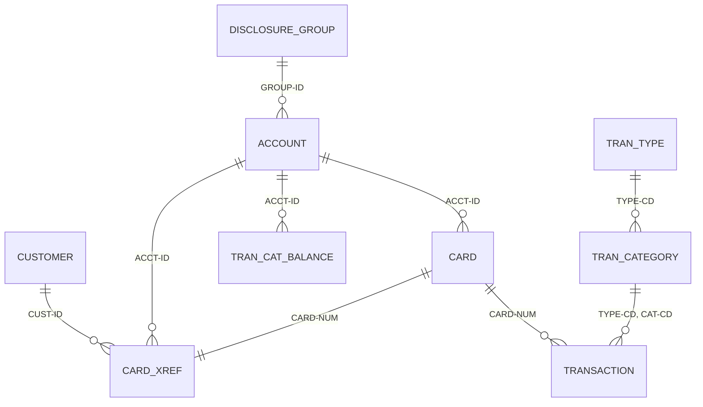

# Data model

All base application data lives in VSAM files whose record layouts are COBOL copybooks in
`app/cpy`. Sample data is in `app/data/EBCDIC` (binary, upload as-is) and `app/data/ASCII`
(readable, used by the local batch runner). Record lengths below are checked against the
copybooks and the sample files by `tests/integration/test_data_layouts.py`. The entity
diagram source is `diagrams/CARDDEMO-DataModel.drawio`.

## VSAM files

| Dataset (HLQ `AWS.M2.CARDDEMO`) | CICS file | Copybook | Record | Key (offset, length) | Alternate index |
|:--|:--|:--|--:|:--|:--|
| ACCTDATA.VSAM.KSDS | ACCTDAT | CVACT01Y | 300 | ACCT-ID (0, 11) | |
| CARDDATA.VSAM.KSDS | CARDDAT | CVACT02Y | 150 | CARD-NUM (0, 16) | CARDAIX: CARD-ACCT-ID (16, 11) |
| CUSTDATA.VSAM.KSDS | CUSTDAT | CVCUS01Y | 500 | CUST-ID (0, 9) | |
| CARDXREF.VSAM.KSDS | CCXREF | CVACT03Y | 50 | XREF-CARD-NUM (0, 16) | CXACAIX: XREF-ACCT-ID (25, 11) |
| TRANSACT.VSAM.KSDS | TRANSACT | CVTRA05Y | 350 | TRAN-ID (0, 16) | TRAN-PROC-TS (304, 26) |
| USRSEC.VSAM.KSDS | USRSEC | CSUSR01Y | 80 | SEC-USR-ID (0, 8) | |
| TCATBALF.VSAM.KSDS | | CVTRA01Y | 50 | account, type, category (0, 17) | |
| DISCGRP.VSAM.KSDS | | CVTRA02Y | 50 | group, type, category (0, 16) | |
| TRANTYPE.VSAM.KSDS | | CVTRA03Y | 60 | TRAN-TYPE (0, 2) | |
| TRANCATG.VSAM.KSDS | | CVTRA04Y | 60 | type, category (0, 6) | |
| DALYTRAN.PS | | CVTRA06Y | 350 | sequential input to POSTTRAN | |

Keys come from the IDCAMS `DEFINE CLUSTER` and `DEFINE ALTERNATEINDEX` statements in the
`app/jcl` member with the same name as the file (for example `app/jcl/CARDFILE.jcl`).

## Relationships

The card cross-reference (CVACT03Y) is the hub: transactions carry only a card number, and
batch programs use the cross-reference to find the account and customer.

## Optional module schemas

| Module | Objects | Definitions |
|:--|:--|:--|
| Transaction type (Db2) | `CARDDEMO.TRANSACTION_TYPE`, `CARDDEMO.TRANSACTION_TYPE_CATEGORY` | `app/app-transaction-type-db2/ddl`, host variables in `app/app-transaction-type-db2/dcl` |
| Authorizations (Db2) | `AUTHFRDS` fraud table | `app/app-authorization-ims-db2-mq/ddl`, `app/app-authorization-ims-db2-mq/dcl` |
| Authorizations (IMS) | Pending authorization summary and detail segments | DBDs and PSBs in `app/app-authorization-ims-db2-mq/ims` |

The generated `docs/INVENTORY.md` lists every copybook with its computed record length.
