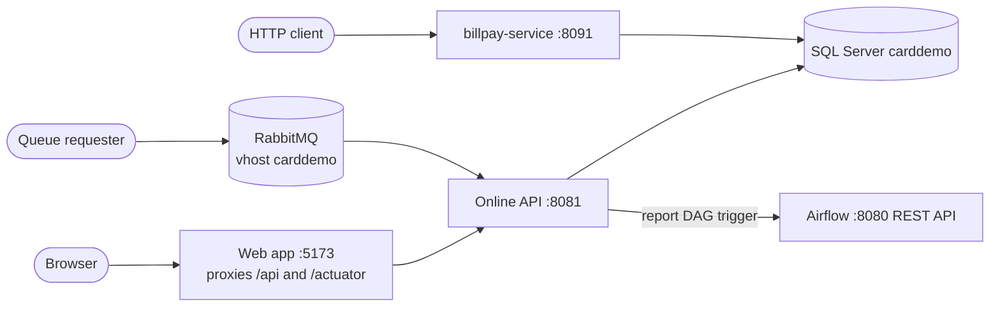

# API

The modern CardDemo stack exposes three kinds of interface: the screen API, which carries every CICS screen as one HTTP resource per program; a small set of plain REST endpoints for sessions, report runs, inquiries, and authorizations; and RabbitMQ request/reply queues that keep the COBOL MQ queue names. This page says which process serves what and links to one page per interface style.

## Overview

| Style | Base path or broker | Served by | Format | Page |
|:--|:--|:--|:--|:--|
| Screen API | `/api/screens/<PROGRAM>` | Online API (8081); a subset in billpay-service (8091) | JSON `ScreenResponse` envelope, COBOL message texts verbatim | [Screen API](screen-api.md) |
| Plain REST | `/api/session`, `/api/reports`, `/api/inquiry/...`, `/api/authorizations`, `/actuator/health`, `/v3/api-docs` | Online API (8081); `/api/session` and actuator also in billpay-service | JSON (decimal amounts, ISO 8601 dates), one plain-text download | [REST endpoints](rest-endpoints.md) |
| Message queues | RabbitMQ vhost `carddemo`, 127.0.0.1:5672 | Online API (listeners start with the API) | Fixed text layouts copied from the COBOL | [Message queues](message-queues.md) |

The web app never calls the API across origins: `modernization/web/vite.config.ts` proxies `/api` and `/actuator` from 127.0.0.1:5173 to the API, so cookies stay same-origin.

## Which service exposes what

| Process | Source | Endpoints |
|:--|:--|:--|
| Online API, 127.0.0.1:8081 | `modernization/backend/app/src/main/java/com/carddemo/app/CardDemoApplication.java` scans every `com.carddemo` package | All 21 screen endpoints, `/api/session`, `/api/reports/**`, `/api/inquiry/**`, `POST /api/authorizations`, `/actuator/health`, `/v3/api-docs`, and the RabbitMQ listeners |
| Bill-payment service, 127.0.0.1:8091 | `modernization/backend/billpay-service/src/main/java/com/carddemo/billpayservice/BillPayServiceApplication.java` scans `common`, `iam`, `billpay`, and only the `api` and `internal` packages of account, card, and transaction | IAM screens (COSGN00C, COMEN01C, COADM01C, COUSR00C-COUSR03C), COBIL00C, `/api/session`, `/actuator/health`, `/v3/api-docs`. Menu options of contexts that are not deployed answer "not installed" (`carddemo.features.disabled-programs` in `modernization/backend/billpay-service/src/main/resources/application.properties`) |

Sessions are not shared between the two services; a client signs on to each separately (`modernization/README.md`). See [Bill-payment service](../applications/billpay-service.md).

## OpenAPI contract

Both services include springdoc (`springdoc-openapi-starter-webmvc-ui` 2.8.17, declared in `modernization/backend/pom.xml` and pulled in by `modernization/backend/common/pom.xml`). The live document is at `GET /v3/api-docs` and the Swagger UI under `/swagger-ui/**`; both are open without a session (`modernization/backend/iam/src/main/java/com/carddemo/iam/security/SecurityConfig.java`). Controllers carry `@Tag` (usually the COBOL program name, for example `COBIL00C`) and `@Operation` summaries that state the key handling.

The OpenAPI document is also the test inventory: `modernization/backend/app/src/test/java/com/carddemo/app/SecurityMatrixTest.java` reads every operation from it and fails when an operation has no classification line. There is no checked-in OpenAPI file; the contract is generated from the controllers.

## Authentication requirements in brief

| Request | Without a session | USER session | ADMIN session |
|:--|:--|:--|:--|
| `/api/screens/COSGN00C`, `/actuator/health`, `/v3/api-docs`, Swagger UI | allowed | allowed | allowed |
| `/api/session` | 401 (the path is open, the controller answers 401) | 200 | 200 |
| Admin screens (COADM01C, COUSR00C-03C, COTRTLIC, COTRTUPC) | 401 | 403 with a navigate-to-menu `ScreenResponse` | allowed |
| `POST /api/authorizations` | 401 | 403 | allowed |
| Every other `/api/**` path | 401 | allowed, scoped to linked accounts | allowed |
| Anything outside `/api/**` and the listed infrastructure paths | denied | denied | denied |

State-changing requests (every `POST`) must send the `X-XSRF-TOKEN` header with the value of the `XSRF-TOKEN` cookie. Queue requesters authenticate to RabbitMQ as a broker user; there is no CardDemo session on the queue path. The full rules are on the [Security](../security.md) page and in [Sign-on and sessions](../features/sign-on-and-sessions.md).

## Related pages

- [Online API](../applications/online-api.md) for how the service is assembled and configured
- [Account scoping](../features/account-scoping.md) for what "scoped to linked accounts" means per endpoint
- [Configuration](../reference/configuration.md) for ports and properties
