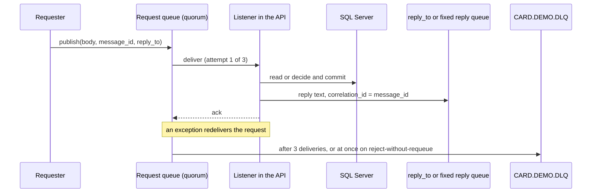

# Message queues

The online API replaces the two MQ-based optional modules with RabbitMQ: it consumes authorization requests (COPAUA0C) and account and date inquiries (COACCT01, CODATE01) from queues named as in the COBOL, and answers with the same fixed text layouts. This page lists every queue, the reply and dead-letter rules, and how the stack check confirms the queues exist. Code-level detail is on [Authorization](../modules/authorization.md) and [Inquiry](../modules/inquiry.md).

## Overview

- Broker: RabbitMQ 3.12 as the systemd service `rabbitmq-server`, listening on 127.0.0.1:5672, management UI on 127.0.0.1:15672 (`modernization/README.md`).
- Vhost `carddemo`, user `carddemo`. The API connects with `spring.rabbitmq.*` in `modernization/backend/app/src/main/resources/application.properties`; the password comes from `RABBITMQ_PASSWORD` in the environment.
- The API declares its queues when its broker connection opens (`Declarables` beans). No queue is created by hand or by a script.
- Decision D-MQ (`modernization/decisions/README.md`, and `modernization/architecture.md` section 3 "Messaging") sets the rules: COBOL queue names kept, reply to `reply_to` or the fixed reply queue, `correlation_id` = request `message_id`, quorum request queues with a delivery limit of 3 and a dead-letter queue, bounded reply queues.
- The billpay-service declares no queues and has no listeners.

## Queues

| Queue | Kind | Declared by | Arguments | Consumer or producer |
|:--|:--|:--|:--|:--|
| `AWS.M2.CARDDEMO.PAUTH.REQUEST` | Request | `modernization/backend/authorization/src/main/java/com/carddemo/authorization/messaging/AuthMessagingConfig.java` | Durable, quorum, delivery limit 3, dead-letter to `CARD.DEMO.DLQ` via the default exchange | `AuthRequestListener` consumes |
| `AWS.M2.CARDDEMO.PAUTH.REPLY` | Fixed reply | same | Durable, max length 10,000, overflow `reject-publish` | Authorization replies when the request has no `reply_to` |
| `CARD.DEMO.REQUEST.DATE` | Request | `modernization/backend/inquiry/src/main/java/com/carddemo/inquiry/internal/InquiryMessagingConfig.java` | Durable, quorum, delivery limit 3, dead-letter to `CARD.DEMO.DLQ` | `DateInquiryListener` consumes |
| `CARD.DEMO.REPLY.DATE` | Fixed reply | same | Durable, max length 10,000, `reject-publish` | Date replies without `reply_to` |
| `CARD.DEMO.REQUEST.ACCT` | Request | same | Durable, quorum, delivery limit 3, dead-letter to `CARD.DEMO.DLQ` | `AccountInquiryListener` consumes |
| `CARD.DEMO.REPLY.ACCT` | Fixed reply | same | Durable, max length 10,000, `reject-publish` | Account replies without `reply_to` |
| `CARD.DEMO.ERROR` | Error records | same | Durable | Inquiry error records (MQ-ERR-DISPLAY layout) |
| `CARD.DEMO.DLQ` | Dead letters | both configs (same name, so the second declare is a no-op) | Durable | Requests rejected without requeue or past the delivery limit |

Names are constants in `modernization/backend/authorization/src/main/java/com/carddemo/authorization/messaging/AuthQueues.java` and `modernization/backend/inquiry/src/main/java/com/carddemo/inquiry/internal/InquiryQueues.java`. Both append the optional property `carddemo.mq.queue-suffix`, which the tests use to get private queues on a shared broker. The authorization names come from the module README (BR-COPAUA0C-01). The inquiry request queue names are not in the COBOL sources (they lived in CICS trigger definitions not in the repository), so the Java names them after the reply queues (Javadoc of `InquiryQueues`).

## Request and reply flow

### Reply addressing

| Rule | Authorization | Inquiries |
|:--|:--|:--|
| Reply queue | Request `reply_to`, else `AWS.M2.CARDDEMO.PAUTH.REPLY` (`AuthRequestListener.replyQueue`) | Request `reply_to`, else the fixed reply queue (`InquiryReplies.replyQueue`, Q-COACCT01-02, Q-CODATE01-04) |
| `correlation_id` | Request `message_id`, else its `correlation_id` (BR-COPAUA0C-12) | Same (Q-COACCT01-03, Q-CODATE01-05) |
| Reply properties | `text/plain`, ISO-8859-1, `type=reply`, non-persistent, `expiration` 5000 ms, new UUID `message_id` | `text/plain`, US-ASCII, `type=reply` or `error`, persistent, new UUID `message_id`, publisher confirms |
| Missing reply queue | Checked with a passive declare (`modernization/backend/authorization/src/main/java/com/carddemo/authorization/messaging/ReplyQueueCheck.java`; an exclusive queue of another connection counts as existing). If absent or the publish fails, error M004 is logged and the request is still acknowledged, because the authorization is already committed (ERR-COPAUA0C-08) | Published as mandatory; a returned or unconfirmed reply is a failed MQPUT and an error record goes to `CARD.DEMO.ERROR` (`modernization/backend/inquiry/src/main/java/com/carddemo/inquiry/internal/InquiryReplies.java`) |

A requester that wants its own replies should declare a reply queue (exclusive is fine), set `reply_to` and `message_id`, and match replies on `correlation_id`.

### Dead-lettering

| Case | Effect |
|:--|:--|
| Authorization request over 500 bytes (the COBOL buffer) | Error M003 logged, `AmqpRejectAndDontRequeueException`, dead-lettered at once (ERR-COPAUA0C-02) |
| Authorization whose transaction fails to commit | No reply, dead-lettered at once (Q-COPAUA0C-06) |
| Inquiry whose error record cannot be written to `CARD.DEMO.ERROR` | Exception, redelivered, dead-lettered after 3 deliveries (ERR-COACCT01-08, ERR-CODATE01-07) |
| Any other unexpected exception in a listener | Redelivered up to the quorum delivery limit of 3, then dead-lettered |

Nothing consumes `CARD.DEMO.DLQ`. Messages there wait for an operator; see [How to monitor](../how-to-monitor.md).

## Message layouts

The queues carry text, not JSON. The REST twins in [REST endpoints](rest-endpoints.md) return JSON with the same data.

| Service | Request body | Reply body |
|:--|:--|:--|
| Authorization (COPAUA0C) | Up to 500 bytes, read as ISO-8859-1 (one character per byte). 18 comma-separated fields in ENT-AUTH-REQUEST order, split as COBOL `UNSTRING` does: text after the 18th field is ignored, missing fields are blank (`AuthRequest.parse`) | Comma-separated reply with a trailing comma: card number, transaction ID, auth ID code, response code, reason code, approved amount (`AuthReply.text`). Control characters and high bytes in the request are echoed as received |
| Account inquiry (COACCT01) | `INQA` in bytes 1-4 and the 11-digit account ID in bytes 5-15; shorter than 15 or longer than 1000 bytes is invalid | 1000 bytes: labelled account fields with signed zoned amounts, or `INVALID REQUEST PARAMETERS ACCT ID : <key>`, or an error record on a read failure |
| Date inquiry (CODATE01) | Any body; it is not read | 1000 bytes: `SYSTEM DATE : MM-dd-yyyy` followed by `SYSTEM TIME : HH:mm:ss`, local time when the request is processed |

Field-level detail, including the reason codes and the overpunch encoding of amounts, is in [Authorization](../modules/authorization.md) and [Inquiry](../modules/inquiry.md).

## Rate limit and authentication

- Requesters authenticate to the broker; RabbitMQ verifies a published `user_id` against the connection user. The COBOL services had no authentication (Q-COACCT01-15).
- The inquiry listeners apply a fixed-window rate limit per requester, keyed on `user_id` + `app_id`: by default 100 requests per 1 second (`carddemo.mq.rate-limit.requests`, `carddemo.mq.rate-limit.window` in `modernization/backend/inquiry/src/main/java/com/carddemo/inquiry/internal/RequesterRateLimit.java`). A request over the limit gets an error reply with `REQUEST RATE EXCEEDED` and an error record on `CARD.DEMO.ERROR` (Q-CODATE01-14).
- The authorization queue has no rate limit in code.

## How the stack check verifies the queues

`modernization/ops/check_stack.py` lists the eight queue names in `QUEUES`. Its `amqp_queues()` function opens a raw AMQP 0-9-1 connection with only the Python standard library, signs on as `carddemo` to vhost `carddemo`, and sends a passive `Queue.Declare` for each name on its own channel. A `Declare-Ok` returns the message count; a channel close (404) marks the queue missing. It uses AMQP instead of the management HTTP API because the application user lacks the management tag (comment in the function). A passing run prints an `OK` line for `rabbitmq queues` with `8/8 declared in vhost carddemo`, and because the API declares the queues on connect, a failure usually means the API has not connected to the broker. See [Deployment](../deployment.md).

## Entry points for modification

- Queue names or arguments: `AuthQueues`, `AuthMessagingConfig`, `InquiryQueues`, `InquiryMessagingConfig`, and the `QUEUES` tuple in `modernization/ops/check_stack.py` (keep them in step).
- Reply layouts: `AuthReply.text` and `AccountInquiryService.legacyReply`; the REST error bodies reuse the inquiry text, so both paths change together.
- Tests that run against a real broker: `modernization/backend/authorization/src/test/java/com/carddemo/authorization/AuthorizationMessagingTest.java`, `modernization/backend/inquiry/src/test/java/com/carddemo/inquiry/AccountInquiryMessagingTest.java`, `modernization/backend/inquiry/src/test/java/com/carddemo/inquiry/DateInquiryMessagingTest.java`.
