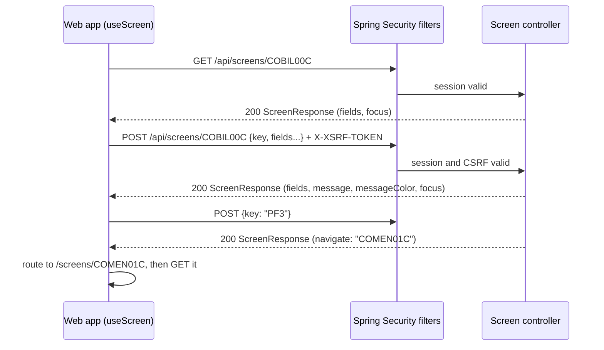

# Screen API

Every CICS program that owns a BMS map is one HTTP resource, `/api/screens/<PROGRAM>`. `GET` is the program's first entry, `POST` is one pseudo-conversational turn carrying the attention key and the input fields, and every answer is the same `ScreenResponse` envelope. The server decides what each key means, so the web app in `modernization/web` only renders fields, the message line, and the F-key bar.

## Overview



The contract is decision C-RENDER in `modernization/decisions/ledger-online.md`: one request produces one response showing the final screen state the COBOL user would see after the last SEND of the task. `modernization/architecture.md` section 2 describes the same design.

## Request

### First entry: GET

`GET /api/screens/<PROGRAM>` takes no body and returns the screen as the program shows it on first entry, usually blank fields and a focus field (for example `BillPaymentController.show()` in `modernization/backend/billpay/src/main/java/com/carddemo/billpay/web/BillPaymentController.java`). Some programs use server-session state on first entry, such as the account in view for COPAUS0C (see [Authorization](../modules/authorization.md)).

### A turn: POST

`POST /api/screens/<PROGRAM>` takes a JSON object with `key` plus the screen's input fields at the top level. Each controller declares its own `Request` record; for COBIL00C it is `Request(Key key, String accountId, String confirm, String shownBalance)`. The web client builds the body as `{ ...input, key }` (`screenTurn` in `modernization/web/src/api.ts`).

- A missing `key` is treated as `ENTER`; all 21 screen controllers do this (`req.key() == null ? Key.ENTER : ...`).
- Input longer than the BMS field is cut to the field length, as a 3270 field would hold it (for example `cut(req.accountId(), 11)` in `BillPaymentController`, and the 8-character cut in `modernization/backend/iam/src/main/java/com/carddemo/iam/web/SignonController.java`).
- Key fields follow C-KEYLEN: account IDs must be typed as exactly 11 digits and card and transaction IDs as 16; they are never left-padded (`modernization/decisions/ledger-online.md`).

### Keys

`modernization/backend/common/src/main/java/com/carddemo/common/screen/Key.java` lists the attention identifiers the API accepts: `ENTER`, `CLEAR`, `PA1`-`PA3`, `PF1`-`PF24`.

| Rule | Behavior | Source |
|:--|:--|:--|
| PF13-PF24 folding | `Key.folded()` maps PF13-PF24 to PF1-PF12, as the COBOL copybook CSSTRPFY does. Only the programs that used CSSTRPFY fold: COACTVWC, COACTUPC, COCRDLIC, COCRDSLC, COCRDUPC, COTRTLIC, COTRTUPC | `Key.java`; calls to `folded()` in those controllers and in `modernization/backend/refdata/src/main/java/com/carddemo/refdata/web/ListTurn.java`, `MaintTurn.java` |
| CLEAR and PA1-PA3 (C-SHORTREAD) | On a 3270 these keys send no field data. The API answers them exactly as the program answers its other unaccepted keys: the invalid-key answer, or processing as ENTER, using the fields in the request. The web UI offers no CLEAR or PA key | C-SHORTREAD in `modernization/decisions/ledger-online.md`; tests tagged `@Covers("C-SHORTREAD")` in `modernization/backend/iam/src/test/java/com/carddemo/iam/UserListTest.java` and others |
| Invalid key | A key the program does not handle gets the CSMSG01Y text `Invalid key pressed. Please see below...` (50 bytes, trailing spaces kept) in red, with the screen re-sent | `CommonMessages.INVALID_KEY` in `modernization/backend/common/src/main/java/com/carddemo/common/msg/CommonMessages.java` |
| Unknown key value | A `key` value outside the enum cannot be deserialized; there is no `@ControllerAdvice` in the backend, so Spring's default 400 error applies | No custom handler under `modernization/backend/*/src/main` |

The web app maps its F-key legend to these values with `aid()` in `modernization/web/src/screens.ts` (`F3` becomes `PF3`).

## Response: the ScreenResponse envelope

`modernization/backend/common/src/main/java/com/carddemo/common/screen/ScreenResponse.java` is a generic record `ScreenResponse<F>(F fields, String message, MessageColor messageColor, String focus, String navigate)` serialized with `@JsonInclude(NON_NULL)`, so absent parts are left out of the JSON.

| Field | Meaning |
|:--|:--|
| `fields` | Screen-specific output fields, a record per controller (`BillPaymentController.Fields`, for example). Card numbers and SSNs arrive masked (C-MASK, see [Security](../security.md)) |
| `message` | The message line, verbatim COBOL text including trailing spaces; omitted when empty |
| `messageColor` | `RED`, `GREEN`, or `NEUTRAL` (`modernization/backend/common/src/main/java/com/carddemo/common/screen/MessageColor.java`). Red is the BMS default for ERRMSG; programs set green for success. `error(text)` sets red |
| `focus` | The field that gets the cursor. The web app focuses it and, for a red message about that field, marks it in error (`fieldInError` in `modernization/web/src/useScreen.ts`) |
| `navigate` | The program to show next, replacing CICS XCTL. `EXIT` means signed off; only the PF3 path of `SignonController` returns it, with the thank-you message |

When `navigate` is set, `useScreen` routes to `/screens/<navigate>` (or `/signed-off` for `EXIT`) and carries `message` and `messageColor` to the next screen, which shows them over its own first entry.

## Errors and status codes

| Situation | Status | Body | Source |
|:--|:--|:--|:--|
| Normal turn, including business errors | 200 | `ScreenResponse` with a red `message` | Every controller |
| No session, or the session idled out | 401 | none | `authenticationEntryPoint` in `modernization/backend/iam/src/main/java/com/carddemo/iam/security/SecurityConfig.java`; `modernization/backend/iam/src/main/java/com/carddemo/iam/security/IdleTimeoutFilter.java` |
| USER session on an admin screen | 403 | `ScreenResponse` with `navigate: "COMEN01C"`, message `No access - Admin Only option... `, color RED | `accessDeniedHandler` in `SecurityConfig` (C-ROLE) |
| Missing or wrong CSRF token | 403 | servlet error page, not JSON | `accessDeniedHandler` excludes `CsrfException` from the JSON answer |
| Unparseable body or unknown `key` | 400 | Spring default error | No custom handler |

The web client treats 401 as "show a clean sign-on screen" (`Unauthorized` in `modernization/web/src/api.ts`), and reads a JSON 403 as a normal screen response so the user lands on the main menu with the admin-only message.

A request with an out-of-scope account key is not an HTTP error: it gets the program's own not-found message with status 200, so existence is not revealed (C-SCOPE, see [Account scoping](../features/account-scoping.md)).

## CSRF and cookies

The session cookie is `JSESSIONID` (HttpOnly, SameSite=Strict, 15-minute timeout in `modernization/backend/app/src/main/resources/application.properties`). Spring's `CookieCsrfTokenRepository.withHttpOnlyFalse()` issues the token in a readable `XSRF-TOKEN` cookie, and `modernization/backend/iam/src/main/java/com/carddemo/iam/security/CsrfCookieFilter.java` loads it on every request so the first `GET` already sets it. Every `POST`, including the sign-on turn, must echo it in `X-XSRF-TOKEN`; `csrfToken()` in `modernization/web/src/api.ts` does this.

## All screen endpoints

All paths are `GET` and `POST` on the same resource. Transaction IDs come from `modernization/web/src/screens.ts`; roles come from `SecurityConfig.ADMIN_SCREENS` and the classification in `modernization/backend/app/src/test/java/com/carddemo/app/SecurityMatrixTest.java`. "Scoped" means a USER reaches only linked accounts on `POST`.

| Program | Tran | Title | Controller | Access | Also in billpay-service |
|:--|:--|:--|:--|:--|:--|
| COSGN00C | CC00 | Sign on | `modernization/backend/iam/src/main/java/com/carddemo/iam/web/SignonController.java` | Public | yes |
| COMEN01C | CM00 | Main Menu | `modernization/backend/iam/src/main/java/com/carddemo/iam/web/MainMenuController.java` | Signed on | yes |
| COADM01C | CA00 | Admin Menu | `modernization/backend/iam/src/main/java/com/carddemo/iam/web/AdminMenuController.java` | ADMIN | yes |
| COUSR00C | CU00 | List Users | `modernization/backend/iam/src/main/java/com/carddemo/iam/web/UserListController.java` | ADMIN | yes |
| COUSR01C | CU01 | Add User | `modernization/backend/iam/src/main/java/com/carddemo/iam/web/UserAddController.java` | ADMIN | yes |
| COUSR02C | CU02 | Update User | `modernization/backend/iam/src/main/java/com/carddemo/iam/web/UserUpdateController.java` | ADMIN | yes |
| COUSR03C | CU03 | Delete User | `modernization/backend/iam/src/main/java/com/carddemo/iam/web/UserDeleteController.java` | ADMIN | yes |
| COACTVWC | CAVW | View Account | `modernization/backend/account/src/main/java/com/carddemo/account/web/AccountViewController.java` | Signed on, scoped | no |
| COACTUPC | CAUP | Update Account | `modernization/backend/account/src/main/java/com/carddemo/account/web/AccountUpdateController.java` | Signed on, scoped | no |
| COCRDLIC | CCLI | List Credit Cards | `modernization/backend/card/src/main/java/com/carddemo/card/web/CardListController.java` | Signed on, scoped | no |
| COCRDSLC | CCDL | View Credit Card Detail | `modernization/backend/card/src/main/java/com/carddemo/card/web/CardViewController.java` | Signed on, scoped | no |
| COCRDUPC | CCUP | Update Credit Card Details | `modernization/backend/card/src/main/java/com/carddemo/card/web/CardUpdateController.java` | Signed on, scoped | no |
| COTRN00C | CT00 | List Transactions | `modernization/backend/transaction/src/main/java/com/carddemo/transaction/web/TransactionListController.java` | Signed on, scoped | no |
| COTRN01C | CT01 | View Transaction | `modernization/backend/transaction/src/main/java/com/carddemo/transaction/web/TransactionViewController.java` | Signed on, scoped | no |
| COTRN02C | CT02 | Add Transaction | `modernization/backend/transaction/src/main/java/com/carddemo/transaction/web/TransactionAddController.java` | Signed on, scoped | no |
| COBIL00C | CB00 | Bill Payment | `modernization/backend/billpay/src/main/java/com/carddemo/billpay/web/BillPaymentController.java` | Signed on, scoped | yes |
| CORPT00C | CR00 | Transaction Reports | `modernization/backend/reporting/src/main/java/com/carddemo/reporting/web/ReportRequestController.java` | Signed on (a USER's report covers linked accounts only, D-REPORT) | no |
| COTRTLIC | CTLI | Maintain Transaction Type (list) | `modernization/backend/refdata/src/main/java/com/carddemo/refdata/web/TranTypeListController.java` | ADMIN | no |
| COTRTUPC | CTTU | Maintain Transaction Type (detail) | `modernization/backend/refdata/src/main/java/com/carddemo/refdata/web/TranTypeMaintController.java` | ADMIN | no |
| COPAUS0C | CPVS | View Authorizations | `modernization/backend/authorization/src/main/java/com/carddemo/authorization/web/PendingAuthListController.java` | Signed on, scoped | no |
| COPAUS1C | CPVD | View Authorization Details | `modernization/backend/authorization/src/main/java/com/carddemo/authorization/web/PendingAuthDetailController.java` | Signed on (works on the authorization already selected in the session) | no |

COPAUS2C (the fraud-row update) and CSUTLDTC (date validation) have no map and no endpoint; their logic runs inside COPAUS1C and the transaction context. The per-program behavior is on the module pages, for example [IAM](../modules/iam.md), [Card](../modules/card.md), and [Bill payment](../modules/billpay.md).

## Worked example: bill payment

The values below are placeholders, not sample data. All three requests carry the session cookie and the `X-XSRF-TOKEN` header.

First entry:

```http
GET /api/screens/COBIL00C
```

```json
{ "fields": { "accountId": "", "currentBalance": "", "confirm": "" }, "focus": "accountId" }
```

Show the balance:

```http
POST /api/screens/COBIL00C
Content-Type: application/json

{ "key": "ENTER", "accountId": "00000000001", "confirm": "" }
```

```json
{ "fields": { "accountId": "00000000001", "currentBalance": "+00000000194.00", "confirm": "" },
  "message": "Confirm to make a bill payment...", "messageColor": "RED", "focus": "confirm" }
```

Confirm. `shownBalance` echoes the balance the screen showed; the server compares it with the current balance and asks again if it changed (Q-COBIL00C-08):

```http
POST /api/screens/COBIL00C
Content-Type: application/json

{ "key": "ENTER", "accountId": "00000000001", "confirm": "Y", "shownBalance": "+00000000194.00" }
```

```json
{ "fields": { "accountId": "", "currentBalance": "", "confirm": "",
              "receipt": { "tranId": "<new id>", "accountId": "00000000001", "amountPaid": "194.00", "newBalance": "0.00" } },
  "message": "Payment successful.  Your Transaction ID is <new id>.", "messageColor": "GREEN", "focus": "accountId" }
```

`{ "key": "PF3" }` then returns `{ "navigate": "COMEN01C" }`, and any other key returns the invalid-key message. The response shapes follow `BillPaymentController`; the exact receipt formatting comes from `Pic.accountId` and `plain()` in that file.

## Entry points for modification

- A new screen: add a controller under the context's `web` package with `@RequestMapping("/api/screens/<PROGRAM>")`, a `Request` record with `Key key`, and `ScreenResponse` results; register the program in `modernization/web/src/screens.ts`; add one line to the classification in `SecurityMatrixTest` (the test fails until you do). Admin-only screens also go in `SecurityConfig.ADMIN_SCREENS`.
- Envelope changes touch `ScreenResponse.java` and the TypeScript mirror `ScreenResponse<F>` in `modernization/web/src/api.ts` together.

See [Patterns and conventions](../how-to-contribute/patterns-and-conventions.md) for the controller style and [Web app](../applications/web-app.md) for the client side.
