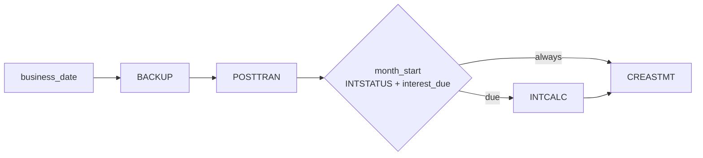

# Airflow

Active contributors: factory-aj-pahl

`modernization/airflow` holds the Apache Airflow 3 DAGs that replace the JCL job streams and the CA7 and Control-M schedules, plus the scripts that start and stop Airflow on 127.0.0.1:8080. Every task does the same thing: it runs one command of the [batch jar](batch-jar.md) and turns the exit code into task success or failure.

## Purpose

On the mainframe, CA7 or Control-M submits JCL in a fixed order (`app/scheduler`). Here the order lives in DAGs, the business logic stays in the batch jar, and Airflow only decides when and in what order to run it. Airflow has no database connection of its own; the jar reads `CARDDEMO_DB` and `CARDDEMO_DB_PASSWORD` from the environment Airflow was started with (`modernization/ops/up.sh`).

## Directory layout

```
modernization/airflow/
├── env.sh                                # AIRFLOW_HOME, DAGs folder, port, auth, inbox/outbox
├── start.sh                              # migrate, reserialize, pause/unpause, start 3 services
├── stop.sh                               # stop the 3 process groups
├── dags/
│   ├── carddemo_batch.py                 # helper: run the jar, map exit codes, calendar, reports dir
│   ├── carddemo_daily_cycle.py           # BACKUP -> POSTTRAN -> month_start -> [INTCALC] -> CREASTMT
│   ├── carddemo_transaction_report.py    # TRANREPT on request (CORPT00C)
│   ├── carddemo_auth_purge.py            # CBPAUP0C daily
│   └── carddemo_trantype_maintenance.py  # COBTUPDT on request
└── tests/
    ├── run_tests.py                      # unittest runner that writes JUnit XML
    ├── test_carddemo_batch.py            # 12 tests of the helper
    ├── test_carddemo_dags.py             # 6 tests of the cycle DAG
    └── test_carddemo_schedules.py        # 5 tests against the CA7/Control-M rules
```

DAG code is 414 lines; tests are 463 lines with 23 test methods.

## DAGs

| DAG | Schedule | Paused | Tasks | Params / conf |
|:--|:--|:--|:--|:--|
| `carddemo_daily_cycle` | 22:00 UTC Monday to Friday (`CronTriggerTimetable("0 22 * * 1-5", timezone="UTC")`), `catchup=False`, `max_active_runs=1` | Created paused; `modernization/airflow/start.sh` pauses it on every start unless `CARDDEMO_CYCLE_SCHEDULE=on` | `business_date`, `BACKUP`, `POSTTRAN`, `month_start` (branch), `INTCALC`, `CREASTMT` | `business_date` (YYYY-MM-DD or null) |
| `carddemo_transaction_report` | None (triggered) | `modernization/airflow/start.sh` unpauses it | `TRANREPT` | `start_date`, `end_date`, `user_id` |
| `carddemo_auth_purge` | `@daily`, `catchup=False`, `max_active_runs=1` | Not paused by the scripts | `purge_expired_authorizations` | `expiry_days` (5), `checkpoint_frequency` (5), `display_frequency` (10), `debug` (false) |
| `carddemo_trantype_maintenance` | None (on request) | Not paused by the scripts | `MNTTRDB2` | `input_file` |

`modernization/airflow/env.sh` sets `AIRFLOW__CORE__DAGS_ARE_PAUSED_AT_CREATION=False` so the report DAG can be triggered as soon as it is parsed. `carddemo_daily_cycle` overrides this with `is_paused_upon_creation=True`. As a result `carddemo_auth_purge` is active as soon as Airflow runs; nothing in `modernization/airflow/start.sh` pauses it.

### carddemo_daily_cycle



`modernization/airflow/dags/carddemo_daily_cycle.py`:

- **Business date.** `resolve_business_date` takes the `business_date` param exactly as given, even on a weekend or holiday. Without it, the run uses its logical date. A scheduled run's logical date is its trigger time, so the Friday 2022-07-01 22:00 UTC run posts 2022-07-01. If that date is not a business day, the task raises `AirflowSkipException` and every downstream task is skipped; the run succeeds and posts nothing.
- **Holidays.** Business days are Monday to Friday minus the comma-separated dates in `CARDDEMO_HOLIDAYS` (none by default), read by `holidays()` in `modernization/airflow/dags/carddemo_batch.py`.
- **No catchup, no start date.** Dates missed while the DAG was paused are not re-run, apart from the most recent one on unpause. The comment explains that leaving out `start_date` makes a DAG that never ran wait for the next 22:00 weekday after unpause instead of running the latest past one at once. Missed dates are triggered by hand with conf `{"business_date": "YYYY-MM-DD"}`.
- **BACKUP first.** POSTTRAN runs only after BACKUP succeeds. A repeated trigger for a posted date fails at BACKUP with exit 8 and changes nothing.
- **INTCALC branch.** `month_start` is a `@task.branch`. It runs the jar's `INTSTATUS` through `interest_status(day)`, which parses the printed line into "already calculated?" and "last calculated month". It then calls `interest_due`, which returns true when the month is not calculated and the date is a business day, and either the date is the first business day of the month or some earlier month has already been calculated on this database. That last condition means a missed first business day is caught up on a later date in the month. A freshly loaded database with no INTCALC history does not charge a month in the middle. The branch returns `["INTCALC", "CREASTMT"]` or `["CREASTMT"]`, so INTCALC never runs into its own exit 8.
- **CREASTMT** has `trigger_rule="none_failed_min_one_success"`, so it runs whether INTCALC ran or was skipped.
- **No COMBTRAN.** Interest rows go straight into the transaction table, so the mainframe's COMBTRAN merge step has no counterpart.
- **Restart after an abend.** Either clear the failed POSTTRAN task and its downstream tasks in the same run, which resumes from the last committed record, or run `RESTORE businessDate=<date>` and trigger the date again.

The flow and its recovery options are explained end to end on [Daily batch cycle](../features/daily-batch-cycle.md).

### carddemo_transaction_report

`modernization/airflow/dags/carddemo_transaction_report.py` is triggered by the API when a user confirms a report on CORPT00C (`modernization/backend/reporting/src/main/java/com/carddemo/reporting/internal/AirflowReportLauncher.java`). Its single task runs `TRANREPT startDate=... endDate=... reportFile=... [userId=...]`. The output goes to `$CARDDEMO_OUTBOX/reports/<dag_run_id>/TRANREPT.txt`; `report_dir` refuses a run ID that contains `/` or is `.` or `..`. If the jar fails and the directory is empty, the directory is removed. After a success, `prune_reports()` keeps the last 10 reports by file time and deletes the rest (DF-3, Q-ENT-16). A missing or reversed range fails the run with exit 12. See [Transaction reports](../features/transaction-reports.md).

### carddemo_auth_purge

`modernization/airflow/dags/carddemo_auth_purge.py` runs CBPAUP0C on its own daily schedule, outside the base cycle (Q-CA7-04). `sysin_card` builds the SYSIN card `EE,CCCCC,DDDDD,F`:

- A numeric `expiry_days` is zero-padded to two digits; above 99 fails the task. A non-numeric value becomes `XX`, which the program replaces with 5 (D-PURGE, BR-CBPAUP0C-01). The JCL's `00` default is not carried over.
- `checkpoint_frequency` and `display_frequency` must be 1 to 99999.
- `debug=true` sets the flag to `Y` and adds `--logging.level.com.carddemo.authorization.internal.PurgeJob=DEBUG`.

Exit 16 from the program's 9999-ABEND path fails the task. Checkpoints committed before the error stay, so a rerun is the restart (Q-CBPAUP0C-07).

### carddemo_trantype_maintenance

`modernization/airflow/dags/carddemo_trantype_maintenance.py` runs `COBTUPDT inputFile=<path>` for JOB-MNTTRDB2. The path is the `input_file` param, or `$CARDDEMO_INBOX/mnttrdb2/inpfile.txt`. Each record has the action in column 1 (`A`, `U`, `D`, or `*`), the type code in columns 2-3, and the description in columns 4-53; 80-byte card images are accepted. It has no schedule and is never a prerequisite of the cycle (`test_transaction_type_maintenance_runs_on_request_only`).

## The batch helper: carddemo_batch.py

`modernization/airflow/dags/carddemo_batch.py` is imported by every DAG.

| Function | Behavior |
|:--|:--|
| `run_batch(*args)` | Runs `java -jar <jar> args...` and returns the exit code, or raises `AirflowFailException` |
| `_run_jar` | Jar path from `CARDDEMO_BATCH_JAR`, else `modernization/backend/batch/target/carddemo-batch.jar` relative to the DAG file. Sets `CARDDEMO_LOG_DIR=$CARDDEMO_OUTBOX/logs` and decodes output as Latin-1. Logs each stdout line as `SYSOUT ...` (info) and each stderr line as `STDERR ...` (warning) |
| `failure_label(command, rc, stderr)` | Text for the failure message, below |
| `interest_status(day)` | Runs `INTSTATUS` and parses its line; fails the task if no status line is printed |
| `holidays()`, `is_business_day()`, `is_first_business_day()`, `interest_due()` | Calendar rules for B-CYCLE and D-INTEREST |
| `inbox()`, `outbox()` | `CARDDEMO_INBOX` and `CARDDEMO_OUTBOX`, default `~/.carddemo/inbox` and `~/.carddemo/outbox` |
| `report_dir(run_id)`, `prune_reports(keep=10)` | Report location and retention |

### Exit code mapping

| Exit | Task result | Failure text |
|:--|:--|:--|
| 0 | Success, logged as "completed" | |
| 4 | Success, logged as "completed with warnings" (like a JCL step RC 4) | |
| 8 | Fails, no retry | `refused` |
| 12 | Fails, no retry | `invalid date or date range`; for COBTUPDT `stopped and rolled back` |
| 16 | Fails, no retry | `usage error`; for CBPAUP0C, PAUDBUNL, PAUDBLOD, and DBUNLDGS without a `usage:` line on stderr, `ended with program return code 16 (9999-ABEND)` |
| 99 | Fails, no retry | `abend` |
| other | Fails, no retry | `failed` |

The task fails with a message such as `BACKUP refused (exit 8)`. `AirflowFailException` is used instead of a plain exception so Airflow does not retry. The module docstring gives the intended recovery: after an abend the operator fixes the input and clears the task, and Spring Batch then restarts the job from its last committed record.

## Inbox and outbox

| Path | Written by | Contents |
|:--|:--|:--|
| `$CARDDEMO_INBOX/<business date>/dailytran.txt` | Operator or test harness | POSTTRAN input |
| `$CARDDEMO_INBOX/mnttrdb2/inpfile.txt` | Operator | Default COBTUPDT input |
| `$CARDDEMO_OUTBOX/<business date>/dalyrejs.txt` | POSTTRAN | Rejected daily records |
| `$CARDDEMO_OUTBOX/<business date>/STATEMNT.txt`, `STATEMNT.html` | CREASTMT | Statements |
| `$CARDDEMO_OUTBOX/reports/<run id>/TRANREPT.txt` | TRANREPT | Report, served by the API for download |
| `$CARDDEMO_OUTBOX/logs/carddemo-batch.log` | Every jar run from Airflow | Application log (SYSOUT goes to the task log instead) |

## Starting and stopping

`modernization/airflow/env.sh` must be sourced before any `airflow` command (`. modernization/airflow/env.sh`). Every setting keeps a value already in the environment, so a second instance can use its own home, DAGs folder, and port:

- `AIRFLOW_HOME=~/.carddemo/airflow`. Runtime state, the SQLite metadata database, and logs live outside the repository.
- `AIRFLOW__CORE__DAGS_FOLDER` is `modernization/airflow/dags`, and example DAGs are off.
- `AIRFLOW__API__HOST=127.0.0.1` and `AIRFLOW__API__PORT=${CARDDEMO_AIRFLOW_PORT:-8080}`. `AIRFLOW__CORE__EXECUTION_API_SERVER_URL` follows the port so task workers can reach the execution API.
- The simple auth manager has one user, `carddemo:admin`. Its generated password is in `$AIRFLOW_HOME/simple_auth_manager_passwords.json.generated`, and the API reads it to get a REST token. The file is never printed.
- `PATH` is prefixed with `~/.carddemo/airflow-venv/bin`.

`modernization/airflow/start.sh` runs, in order:

1. `airflow db migrate`
2. `airflow dags reserialize`
3. `airflow dags unpause carddemo_transaction_report`
4. `airflow dags pause carddemo_daily_cycle`, or `unpause` when `CARDDEMO_CYCLE_SCHEDULE=on`
5. `api-server`, `scheduler`, and `dag-processor`, each with `setsid nohup` so it gets its own process group; a service whose pid file points at a live process is skipped

Pids and logs are in `$AIRFLOW_HOME/run`. `modernization/airflow/stop.sh` sends TERM to each process group, waits up to 30 seconds, then sends KILL.

A paused DAG also leaves manual runs queued, so `carddemo_daily_cycle` must be unpaused (`airflow dags unpause carddemo_daily_cycle`) before a hand trigger runs (`modernization/README.md`). The stack-level start and stop (`make -C modernization up` / `down`) is on [Deployment](../deployment.md); monitoring the Airflow UI is on [How to monitor](../how-to-monitor.md).

## Tests

`make -C modernization test-airflow` runs `modernization/airflow/tests/run_tests.py` with the Airflow venv's Python. The runner discovers `test_*.py` with `unittest` and writes `modernization/airflow/tests/junit.xml` (git-ignored). Each test case is named `<method> › <first docstring line>`, so the spec IDs at the start of a docstring become traceability tags for `modernization/verification/trace.py --junit` (see [Traceability](../verification/traceability.md)). Examples:

- `test_the_cycle_is_scheduled_at_22_utc_monday_to_friday_and_created_paused` (B-CYCLE)
- `test_a_missed_first_business_day_moves_the_interest_to_the_next_cycle_date_of_the_month` (Q-CBACT04C-08)
- `test_one_ordered_cycle_replaces_the_ca7_trigger_chains` (Q-CA7-01, Q-CONTROLM-01, and others)
- `test_no_job_definition_holds_clear_text_credentials` (Q-FTPJCL-01)

## Entry points for modification

- **New scheduled job:** add a DAG in `modernization/airflow/dags/` that calls `run_batch`, add a schedule test in `modernization/airflow/tests/test_carddemo_schedules.py`, and add it to `OWED_DAGS` in `modernization/ops/check_stack.py` if the stack check should require it.
- **Calendar rules:** `is_first_business_day` and `interest_due` in `modernization/airflow/dags/carddemo_batch.py`.
- **New exit code meaning:** `SUCCESS`, `FAILURE`, `PROGRAM_RC16`, and `failure_label` in the same file, kept in step with `modernization/backend/batch/src/main/java/com/carddemo/batch/ExitCodes.java`.

## Key source files

| File | Purpose |
|:--|:--|
| `modernization/airflow/dags/carddemo_batch.py` | Jar runner, exit code mapping, calendar, report directories |
| `modernization/airflow/dags/carddemo_daily_cycle.py` | Daily cycle DAG |
| `modernization/airflow/dags/carddemo_transaction_report.py` | Report DAG |
| `modernization/airflow/dags/carddemo_auth_purge.py` | Pending-authorization purge DAG |
| `modernization/airflow/dags/carddemo_trantype_maintenance.py` | Transaction type maintenance DAG |
| `modernization/airflow/env.sh` | Environment for every Airflow command |
| `modernization/airflow/start.sh`, `modernization/airflow/stop.sh` | Service lifecycle |
| `modernization/airflow/tests/run_tests.py` | Test runner with JUnit output |

## Related pages

- [Applications](index.md)
- [Batch jar](batch-jar.md)
- [Cycle, data, and report checks](../verification/cycle-data-and-report.md) for `modernization/verification/cycle/verify_cycle.py`, which runs the cycle DAG against the GnuCOBOL chain
- [Batch and JCL](../mainframe/batch-and-jcl.md) for the CA7 and Control-M definitions these DAGs replace
