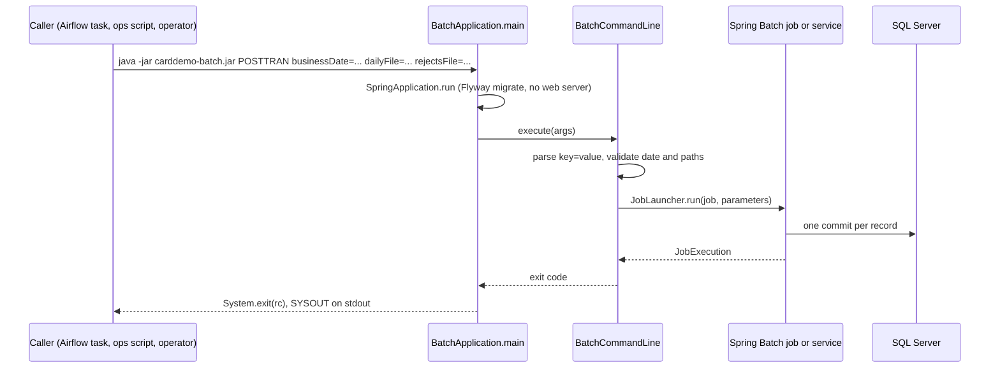
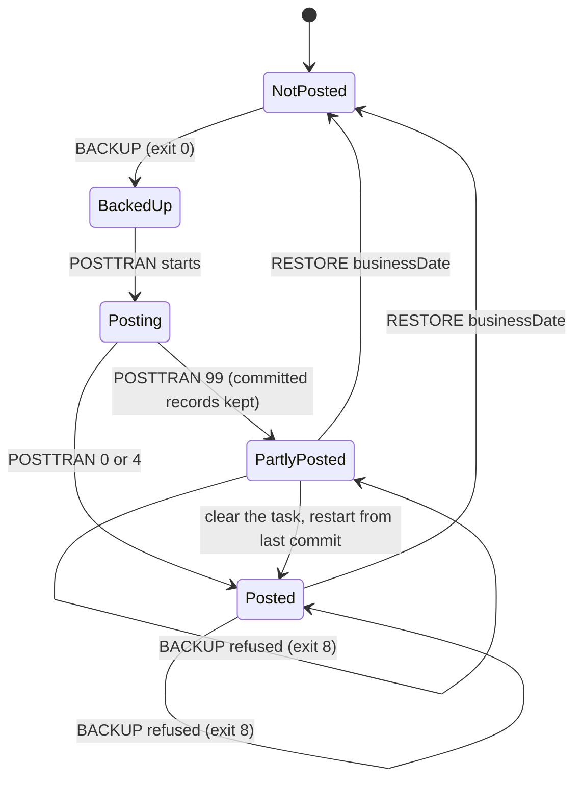

# Batch jar

Active contributors: factory-aj-pahl

`modernization/backend/batch` builds `carddemo-batch.jar`, a Spring Boot command-line program that runs one batch command per process and exits with a JCL-style return code. Airflow tasks call it for every scheduled job; the ops scripts call it to reset the schema and load data; operators call it by hand for RESTORE and one-off jobs.

## Purpose

The jar replaces the batch JCL steps of the mainframe. Each command corresponds to a COBOL program or JCL job (POSTTRAN for CBTRN02C, INTCALC for CBACT04C, and so on). Its standard output is the job's SYSOUT, and its exit code plays the part of the step's RETURN-CODE. Spring Batch runs the restartable jobs (POSTTRAN, INTCALC, CREASTMT, TRANVERIFY, TRANREPT) and keeps their history in the `BATCH_*` tables. The other commands call context services directly. How the commands are chained into the nightly run is on [Daily batch cycle](../features/daily-batch-cycle.md).

## Directory layout

```
modernization/backend/batch/
├── pom.xml                                     # finalName carddemo-batch
└── src/main/
    ├── java/com/carddemo/batch/
    │   ├── BatchApplication.java               # Spring context + System.exit(rc)
    │   ├── BatchCommandLine.java               # command parser and dispatcher (593 lines)
    │   ├── ExitCodes.java                      # 0, 4, 8, 12, 16, 99
    │   ├── backup/CycleBackupService.java      # BACKUP and RESTORE
    │   ├── cycle/CycleJobsConfig.java          # INTCALC, CREASTMT, TRANVERIFY, TRANREPT jobs
    │   ├── cycle/IntcalcStep.java              # CBACT04C loop as a chunk step
    │   ├── cycle/AbendListener.java            # 9999-ABEND-PROGRAM output for failed steps
    │   ├── posting/PosttranJobConfig.java      # POSTTRAN job, STEP15
    │   └── posting/PosttranStep.java           # CBTRN02C loop as a chunk step
    └── resources/application.properties
```

Main code is 1,297 lines in 9 files. Test code is 2,187 lines in 16 files with 95 test methods, so the test-to-code ratio is about 1.7 to 1. The tests are in `modernization/backend/batch/src/test/java/com/carddemo/batch/`.

## How it starts



`modernization/backend/batch/src/main/java/com/carddemo/batch/BatchApplication.java` builds a Spring context without a web server and scans only the packages batch needs: `common`, `account`, `card`, `transaction`, `refdata`, `reporting`, `cycle`, `dataexchange`, `authorization`, and `batch`. It excludes every `.web.` package and `com.carddemo.authorization.messaging`, the online RabbitMQ consumer. From `iam` it imports only `JdbcAccountScope` and `JdbcUserRoles`, which TRANREPT needs to scope a regular user's report. `billpay` and `inquiry` are not on the classpath.

`modernization/backend/batch/src/main/resources/application.properties` sets:

- `spring.main.web-application-type=none`
- `spring.batch.job.enabled=false`, so no job runs at startup; the command line picks one
- `spring.batch.jdbc.initialize-schema=never`, because the Spring Batch tables come from Flyway migration V2
- `spring.flyway.clean-disabled=true`, which protects the schema except for `reset`
- `logging.threshold.console=OFF` and `logging.file.name=${CARDDEMO_LOG_DIR:${java.io.tmpdir}}/carddemo-batch.log`

Standard output carries only job SYSOUT, written through `JobLog.display` (`modernization/backend/common/src/main/java/com/carddemo/common/batch/JobLog.java`). The datasource uses `CARDDEMO_DB` and `CARDDEMO_DB_PASSWORD` like the API.

## Command syntax

```
java -jar modernization/backend/batch/target/carddemo-batch.jar <COMMAND> [key=value ...] [--spring.property=value ...]
```

`BatchCommandLine.execute` ignores arguments that start with `--` (Spring Boot reads them as properties). The first remaining word is the command; the rest are `key=value` pairs. A word without `=` is stored under the empty key, which is how `load DIR` and `export DIR` get their directory. Paths are made absolute before they become job parameters. Dates use strict `uuuu-MM-dd`, so `2022-02-30` is rejected.

## Commands

All commands are dispatched in `modernization/backend/batch/src/main/java/com/carddemo/batch/BatchCommandLine.java`.

### Daily cycle and reports

| Command | Parameters | COBOL / JCL | Behavior and exit codes |
|:--|:--|:--|:--|
| `BACKUP` | `businessDate=YYYY-MM-DD` | TRANBKP (Q-TRANBKP-01) | Snapshots everything the cycle changes. Prints `BACKUP <id> TAKEN FOR <date>: n ACCOUNTS, n TRANSACTIONS, n CATEGORY BALANCES`. **Exit 8** with `BACKUP REFUSED: POSTING ALREADY STARTED FOR <date>` when any POSTTRAN run exists for the date. 12 on a bad date |
| `POSTTRAN` | `businessDate=`, `dailyFile=PATH`, `rejectsFile=PATH` | CBTRN02C, JOB-POSTTRAN STEP15 | Posts or rejects each daily record. 0 when nothing was rejected, **4** when at least one record was rejected, 8 with `POSTING ALREADY COMPLETED FOR <date>` when the job instance already completed, 12 on a bad date, 99 on abend |
| `INTSTATUS` | `businessDate=` | none (B-CYCLE helper) | Read-only. Prints `INTEREST ALREADY CALCULATED FOR YYYY-MM`, or `INTEREST NOT CALCULATED FOR YYYY-MM; LAST CALCULATED FOR YYYY-MM` or `...; NO EARLIER MONTH CALCULATED`. Always 0 for a valid date |
| `INTCALC` | `businessDate=` | CBACT04C, JOB-INTCALC | Monthly interest. The job instance is the calendar month, so a second completed run in the month gets **8** with `INTEREST ALREADY CALCULATED FOR <month>` (Q-CBACT04C-08) |
| `CREASTMT` | `businessDate=`, `stmtFile=PATH`, `htmlFile=PATH` | CBSTM03A/B, STEP040 | Text and HTML statements. A repeat for the same date gets 8, with the refusal on stderr only so SYSOUT stays as the COBOL writes it |
| `TRANVERIFY` | `dailyFile=PATH` | CBTRN01C, STEP05 | Read-only check of a daily file. Each run gets a random `run` parameter, so it is never refused |
| `TRANREPT` | `startDate=`, `endDate=`, `reportFile=PATH`, optional `userId=ID` | CBTRN03C, STEP10R | Transaction detail report. **12** with `INVALID OR MISSING REPORT DATE RANGE` when a date is missing or invalid or start is after end (Q-CBTRN03C-06/-07). With `userId` of a regular user, only that user's linked accounts are included; an admin or no user means all accounts; an unknown user means no accounts (D-REPORT) |
| `RESTORE` | `backupId=N` or `businessDate=` | none | Puts a backup back. By date it uses the latest backup for that date. Prints `RESTORED BACKUP <id> OF <date>`. 8 with `NO SUCH BACKUP` on stderr; 16 when `backupId` is not a number |
| `PRTCATBL` | `reportFile=PATH` | JOB-PRTCATBL | Category balance listing, sorted by account, type, category, 40 bytes per line, trailing `-` for negatives (Q-PRTCATBL-01/-02) |
| `WAITSTEP` | `wait=NNNNNNNN` | COBSWAIT | Sleeps that many hundredths of a second. 12 with `INVALID WAIT TIME` unless the value is 1 to 8 digits (Q-COBSWAIT-01) |

### Data exchange and listings

| Command | Parameters | COBOL / JCL | Behavior |
|:--|:--|:--|:--|
| `READCARD`, `READXREF`, `READCUST` | none | CBACT02C, CBACT03C, CBCUS01C | Masked listings of cards, cross-references, customers. 0, or 99 when the job abends |
| `READACCT` | `outFile=`, `arryFile=`, `vbrcFile=` | CBACT01C | Account listing and the three extract files |
| `CBEXPORT` | `exportFile=PATH` | CBEXPORT | Branch migration export |
| `CBIMPORT` | `exportFile=`, `custOut=`, `acctOut=`, `xrefOut=`, `trnxOut=`, `cardOut=`, `errOut=` | CBIMPORT | Splits an export file into per-entity files plus an error file |

### Optional-module jobs

| Command | Parameters | COBOL / JCL | Behavior |
|:--|:--|:--|:--|
| `COBTUPDT` | `inputFile=PATH` | COBTUPDT, JOB-MNTTRDB2 | Applies transaction type add, update, and delete records. 0 applied, 4 applied with a rejected record, 12 stopped and rolled back (Q-COBTUPDT-01, -04) |
| `CBPAUP0C` | optional `sysin=EE,CCCCC,DDDDD,F` | CBPAUP0C, CBPAUP0J | Purges expired pending authorizations. 0, or 16 from the program's 9999-ABEND path |
| `PAUDBUNL`, `DBUNLDGS` | `rootFile=`, `childFile=` | PAUDBUNL (UNLDPADB), DBUNLDGS (UNLDGSAM) | Unload the pending-authorization tables to IMS-style root and child files. 0 or 16 |
| `PAUDBLOD` | `rootFile=`, `childFile=` | PAUDBLOD (LOADPADB) | Loads a PAUDBUNL unload. 0 or 16 |

### Operational commands

| Command | Parameters | Behavior |
|:--|:--|:--|
| `load` | `DIR`, optional `usrsec=FILE`, `ims=FILE` | Loads every sample-format file in `DIR`. Prints `LOADED <file> <rows>` and `GROUP IDS MOVED n`; with `usrsec`, `USERS n ACCOUNT LINKS n`; with `ims`, the counts of IMS roots and children loaded and skipped. `modernization/ops/load.sh` calls it with `app/data/ASCII` |
| `loaddb2` | `types=FILE` and/or `categories=FILE` | Replaces transaction types and categories with the Db2 module seed files (`DB2LTTYP.ctl`, `DB2LTCAT.ctl`) |
| `export` | `DIR`, optional `files=a.txt,b.txt`, `ims=NAME` | Writes tables back in their legacy layouts (all base layouts by default). `DB2LTTYP.ctl` and `DB2LTCAT.ctl` are written as Db2 seed SQL. `ims=NAME` writes the pending-authorization tables as an IMS unload; alone it writes only that file |
| `reset` | none; needs `--spring.flyway.clean-disabled=false` | Flyway `clean` then `migrate`; prints `SCHEMA RESET`. `modernization/ops/db-reset.sh` runs it this way |

With no command, an unknown command, or a missing parameter, the jar prints `carddemo-batch: <problem>` and a one-line `usage:` summary on stderr and exits 16. Any `IOException` that escapes a command exits 99.

## Exit codes

`modernization/backend/batch/src/main/java/com/carddemo/batch/ExitCodes.java`:

| Code | Constant | Meaning |
|:--|:--|:--|
| 0 | `OK` | Completed |
| 4 | `WARNING` | Completed with warnings: POSTTRAN rejected a record (CBTRN02C RETURN-CODE 4), or COBTUPDT rejected a record |
| 8 | `REFUSED` | Refused: the job already completed (POSTTRAN, INTCALC, CREASTMT), BACKUP after posting started, or RESTORE of an unknown backup |
| 12 | `INVALID_DATE`, `STOPPED`, `INVALID_WAIT` | Missing or invalid business date or report range (B-DATE); COBTUPDT stopped and rolled back; bad WAITSTEP value |
| 16 | `USAGE`, `PROGRAM_RC16` | Unknown command or missing parameter; or RETURN-CODE 16 from an IMS-module program's 9999-ABEND paragraph |
| 99 | `ABEND` | The COBOL would have abended (B-ABEND). Prints `ABEND CODE U999` on stderr |

Airflow treats 0 and 4 as success and fails the task on anything else without retry. It tells a usage 16 from a program 16 by looking for a `usage:` line on stderr (`modernization/airflow/dags/carddemo_batch.py`, see [Airflow](airflow.md)).

## Spring Batch jobs

| Job | Defined in | Step | Identifying parameters | Unit of work |
|:--|:--|:--|:--|:--|
| `POSTTRAN` | `modernization/backend/batch/src/main/java/com/carddemo/batch/posting/PosttranJobConfig.java` | `STEP15`, chunk size 1 | `businessDate`, `dailyFile` (`rejectsFile` is not identifying) | One daily record with its posting or reject and the restart position (B-UOW, Q-CBTRN02C-07) |
| `INTCALC` | `modernization/backend/batch/src/main/java/com/carddemo/batch/cycle/CycleJobsConfig.java` | `STEP15`, chunk size 1 | `interestMonth` | One account's interest rows, account update, and month marker |
| `CREASTMT` | same | `STEP040` tasklet | `businessDate` | One transaction for the whole statement run (Q-CREASTMT-04) |
| `TRANVERIFY` | same | `STEP05` tasklet | `dailyFile`, random `run` | Read-only |
| `TRANREPT` | same | `STEP10R` tasklet | `startDate`, `endDate`, `reportFile`, random `run`, optional `userId` | Read-only |

**PosttranStep** (`modernization/backend/batch/src/main/java/com/carddemo/batch/posting/PosttranStep.java`) reads DALYTRAN as ISO-8859-1 and skips empty lines. It passes each record to `DailyPosting.post` in the `cycle` context. The step context saves lines read, processed, and rejected with every commit, so a restart skips the committed lines. The rejects file is created with mode `rw-------`, and the reject records are written at the end from the database. On success it prints `TRANSACTIONS PROCESSED :` and `TRANSACTIONS REJECTED  :` with 9-digit counts, and the exit status becomes `COMPLETED WITH REJECTS` when any record was rejected. That status is what `BatchCommandLine` maps to exit 4. On failure it prints the abend's DISPLAY lines, then `ABENDING PROGRAM`, and deletes the rejects file. A missing DALYTRAN is reported as `ERROR OPENING DALYTRAN` with file status 35.

**IntcalcStep** (`modernization/backend/batch/src/main/java/com/carddemo/batch/cycle/IntcalcStep.java`) reads the next account that has category balances and no interest for the month yet. A restart after an abend therefore continues after the accounts already charged.

**AbendListener** (`modernization/backend/batch/src/main/java/com/carddemo/batch/cycle/AbendListener.java`) is attached to the tasklet steps. For a failed step it prints the `BatchAbend` SYSOUT lines and then `ABENDING PROGRAM`, matching the COBOL 9999-ABEND-PROGRAM paragraph.

## BACKUP and RESTORE

`modernization/backend/batch/src/main/java/com/carddemo/batch/backup/CycleBackupService.java` implements the pre-cycle snapshot (B-CYCLE, Q-TRANBKP-01, Q-ACCTFILE-02).



**BACKUP** runs in one SERIALIZABLE transaction:

1. It checks the Spring Batch tables for any POSTTRAN execution whose identifying `businessDate` equals the date, whatever its status. If one exists it writes nothing and returns empty, and the command exits 8. A backup taken then would hold a posted or partly posted state, and RESTORE by date would be useless.
2. It inserts a `cycle_backup` row with high-water marks: the highest `reject_id`, `statement_run_id`, and `JOB_INSTANCE_ID`. With no job instance yet the mark is -1, because `BATCH_JOB_SEQ` starts at 0.
3. It copies `account` balances and cycle fields, the `card_transaction` IDs with their `statement_run_id`, `tran_cat_balance`, and `interest_account` into the `cycle_backup_*` tables.

**RESTORE**, also SERIALIZABLE:

- puts the saved account fields back
- deletes transactions that were not in the snapshot and resets statement marks
- replaces category balances and interest markers
- deletes rejects and statement runs above the high-water marks
- deletes every Spring Batch instance, execution, step, and context row created after the backup

Forgetting those job rows is what lets POSTTRAN, INTCALC, and CREASTMT run again for the date. It also makes `INTSTATUS` report a restored month as not calculated. The restore sets `restored_at` on the backup row. `CycleBackupTest` covers a restore after an abended posting and a second restore that keeps online changes made after the first.

## Entry points for modification

- **Add a command:** add a `case` in `BatchCommandLine.execute`, a method that validates parameters and returns an `ExitCodes` value, and a fragment in `usage()`. If Airflow should run it, add a DAG and, if the command can return 16 from the program, add it to `PROGRAM_RC16` in `modernization/airflow/dags/carddemo_batch.py`.
- **Add a Spring Batch job:** define it in `CycleJobsConfig` (or its own `@Configuration`), add it to the `jobs` map in the `BatchCommandLine` constructor, and choose identifying parameters with care, because they decide when a rerun is refused.
- **Extend the backup:** if the cycle starts changing a new table, add it to both `backup` and `restore` in `CycleBackupService`.

## Key source files

| File | Purpose |
|:--|:--|
| `modernization/backend/batch/src/main/java/com/carddemo/batch/BatchCommandLine.java` | All commands, parameter checks, exit-code mapping |
| `modernization/backend/batch/src/main/java/com/carddemo/batch/ExitCodes.java` | Exit code constants |
| `modernization/backend/batch/src/main/java/com/carddemo/batch/BatchApplication.java` | Component scan and process exit |
| `modernization/backend/batch/src/main/java/com/carddemo/batch/backup/CycleBackupService.java` | BACKUP and RESTORE |
| `modernization/backend/batch/src/main/java/com/carddemo/batch/posting/PosttranStep.java` | CBTRN02C posting loop |
| `modernization/backend/batch/src/main/java/com/carddemo/batch/cycle/CycleJobsConfig.java` | INTCALC, CREASTMT, TRANVERIFY, TRANREPT jobs |
| `modernization/backend/batch/src/test/java/com/carddemo/batch/CycleFailuresTest.java` | 24 tests of failure and restart cases |
| `modernization/backend/batch/src/test/java/com/carddemo/batch/CycleBackupTest.java` | BACKUP refusal and RESTORE cases |

## Related pages

- [Daily batch cycle](../features/daily-batch-cycle.md)
- [Cycle](../modules/cycle.md) for the posting, interest, and statement services the jobs call
- [Batch parity](../verification/batch-parity.md) for how the outputs are compared with GnuCOBOL
- [Batch and JCL](../mainframe/batch-and-jcl.md) for the original jobs
