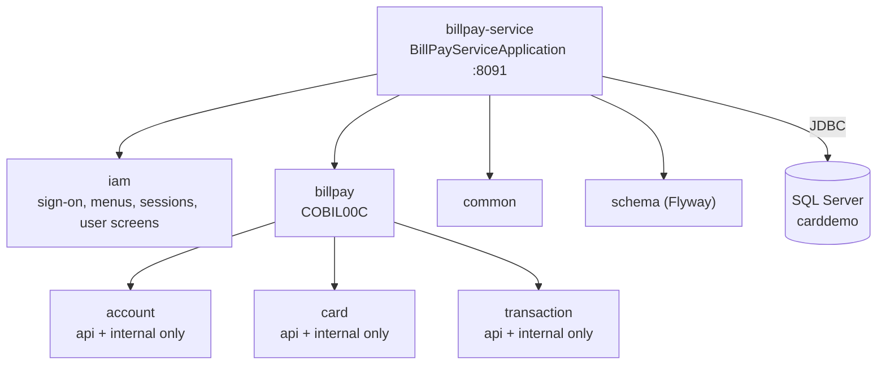

# Bill-payment service

Active contributors: factory-aj-pahl

`modernization/backend/billpay-service` packages bill payment (COBIL00C, bounded context BC-5) as its own Spring Boot service on 127.0.0.1:8091. It reuses the same Maven modules as the online API, shares the `carddemo` database, and runs nothing else. It exists to show that the modular monolith can be split one context at a time ("selective conversion").

## Purpose

`modernization/architecture.md` section 3 states the design goal: a context reaches another only through its `api` package, so a context can be deployed separately. `modernization/spec/components.md` lists what each context needs from the others; for BC-5 that is the account (read and update) and card cross-reference (by account) APIs, plus write access to transactions. The same file notes that BC-5 cannot be converted alone without a data bridge, because it writes account and transaction data. This service avoids the bridge by pointing at the same SQL Server database as the API, so payments made here show up at once in the full application.

## Directory layout

```
modernization/backend/billpay-service/
├── pom.xml                                     # common, schema, iam, billpay; failsafe ITs on port 8092
└── src/
    ├── main/java/com/carddemo/billpayservice/BillPayServiceApplication.java
    ├── main/resources/application.properties   # port 8091, disabled menu programs
    └── test/java/com/carddemo/billpayservice/
        ├── BillPayServiceSmokeTest.java        # MockMvc, in-process
        └── it/
            ├── StandaloneBillPaymentIT.java    # HTTP against the started jar
            ├── StandaloneSecurityMatrixIT.java # HTTP security matrix with leak scan
            ├── StandaloneDatabase.java         # JDBC access and sample reload for the ITs
            └── ServiceClient.java              # HTTP client with session and XSRF handling
```

Main code is 24 lines (one class and a properties file); test code is 652 lines with 6 test methods.

## What is included



`modernization/backend/billpay-service/pom.xml` declares `common`, `schema`, `iam`, and `billpay`, plus `spring-boot-starter-actuator` and `flyway-core`. `account`, `card`, and `transaction` arrive transitively through `modernization/backend/billpay/pom.xml`. The jar is `modernization/backend/billpay-service/target/carddemo-billpay-service.jar`.

`modernization/backend/billpay-service/src/main/java/com/carddemo/billpayservice/BillPayServiceApplication.java` limits the component scan to `com.carddemo.common` and `com.carddemo.iam`, the `api` and `internal` packages of `account`, `card`, and `transaction`, and `com.carddemo.billpay`. Leaving out the `web` packages of account, card, and transaction means their screen controllers (and the beans those need) are not deployed.

| Deployed | Not deployed |
|:--|:--|
| COSGN00C sign-on, `GET /api/session` | Account, card, and transaction screens (COACTVWC, COACTUPC, COCRDLIC, COCRDSLC, COCRDUPC, COTRN00C to COTRN02C) |
| COMEN01C main menu, COADM01C admin menu | Reporting (CORPT00C, `/api/reports`), no Airflow client |
| COBIL00C bill payment | Pending authorizations, inquiry, and every RabbitMQ listener (no AMQP starter on the classpath) |
| COUSR00C to COUSR03C endpoints (part of the `iam` module) | Reference data (COTRTLIC, COTRTUPC), cycle, data exchange |
| `/actuator/health`, `/v3/api-docs` | |

## "Not installed" menu options

The menus come from `MenuCatalog` in the `iam` module (`modernization/backend/iam/src/main/java/com/carddemo/iam/internal/MenuCatalog.java`), which reads `carddemo.features.disabled-programs`. The service's `modernization/backend/billpay-service/src/main/resources/application.properties` disables every program except bill payment:

```
carddemo.features.disabled-programs=COACTVWC,COACTUPC,COCRDLIC,COCRDSLC,COCRDUPC,COTRN00C,COTRN01C,COTRN02C,CORPT00C,COPAUS0C,COUSR00C,COUSR01C,COUSR02C,COUSR03C,COTRTLIC,COTRTUPC
```

Choosing a disabled option gets an answer instead of a navigate:

- **Main menu** (`modernization/backend/iam/src/main/java/com/carddemo/iam/web/MainMenuController.java`): red `This option <name> is not installed...`, for example `This option Account View is not installed...` (checked in `BillPayServiceSmokeTest`). Option 10 still navigates to COBIL00C.
- **Admin menu** (`modernization/backend/iam/src/main/java/com/carddemo/iam/web/AdminMenuController.java`): green `This option is not installed ...` without the option name (Q-COADM01C-03). All six admin options are disabled here.

The flag only affects the menus. The COUSR00C to COUSR03C controllers come with the `iam` module and are still served to an admin who calls them directly, which is why `StandaloneSecurityMatrixIT` classifies them as `ADMIN_ONLY`. `modernization/README.md` describes the service as carrying "user maintenance from the IAM module" for the same reason.

The same mechanism is how the full API would switch off an optional module's menu entries (Q-COMEN01C-05).

## Configuration

`modernization/backend/billpay-service/src/main/resources/application.properties`:

| Property | Value |
|:--|:--|
| `server.address`, `server.port` | `127.0.0.1`, `${SERVER_PORT:8091}` |
| `server.servlet.session.timeout` | `15m`; cookie `http-only=true`, `same-site=strict` |
| `spring.datasource.*` | Same as the API: `CARDDEMO_DB` (default `carddemo`), user `carddemo_app`, `${CARDDEMO_DB_PASSWORD}` |
| `spring.flyway.locations` | `classpath:db/migration` |
| `management.endpoints.web.exposure.include` | `health` |
| `carddemo.features.disabled-programs` | The list above |

There are no RabbitMQ or Airflow settings.

## Sessions and authentication

Because the service carries the `iam` module, it signs users on itself against the shared `app_user` table (BCrypt), creates its own server-side session (`JSESSIONID`, HttpOnly, SameSite=Strict, 15-minute idle timeout), and requires the `XSRF-TOKEN` cookie value in `X-XSRF-TOKEN` on state-changing requests. Sessions are not shared with the API on 8081, so a user signs on to each service separately (`modernization/README.md`). Account scoping (D-USER-ACCT) applies here too: a regular user can pay only linked accounts, and an unlinked account gets the same `Account ID NOT found...` answer as one that does not exist. Details are on [Security](../security.md) and [Account scoping](../features/account-scoping.md).

No script points the web app at this service. It is used over HTTP directly, for example with `POST /api/screens/COSGN00C` and `{"key":"ENTER","userId":...,"password":...}`.

## Running it

| Command | What it does |
|:--|:--|
| `make -C modernization billpay` | Runs `modernization/ops/billpay.sh`: requires `CARDDEMO_DB_PASSWORD` and the jar, starts `java -Xmx384m -jar` with `SERVER_PORT=$CARDDEMO_BILLPAY_PORT` (default 8091) under `setsid nohup`, writes `~/.carddemo/run/billpay.pid` and `billpay.log`, and waits up to 120 seconds for `/actuator/health` to contain `"UP"` |
| `make -C modernization down` | Stops it together with the rest of the stack |
| `make -C modernization test-billpay` | `mvn -f backend -pl billpay-service -am verify`: builds only the service and its dependencies, runs the unit test, then the HTTP integration tests |

`modernization/ops/billpay.sh` does not need `RABBITMQ_PASSWORD`, unlike `modernization/ops/up.sh`. Ports and process management are on [Deployment](../deployment.md).

## Tests

| Test | How it runs | What it checks |
|:--|:--|:--|
| `modernization/backend/billpay-service/src/test/java/com/carddemo/billpayservice/BillPayServiceSmokeTest.java` | In-process MockMvc with `SampleData` and `TestDatabaseConfig` | Option 1 answers `This option Account View is not installed...`; option 10 navigates to COBIL00C; paying account 1 returns `Payment successful.  Your Transaction ID is 0000000000000001.`; `/v3/api-docs` lists COBIL00C and not COACTVWC |
| `modernization/backend/billpay-service/src/test/java/com/carddemo/billpayservice/it/StandaloneBillPaymentIT.java` | Failsafe, over HTTP | Pays the positive balance of a linked account (balance 0, transaction type `02`, description `BILL PAYMENT - ONLINE`); a zero balance gets `You have nothing to pay...` and writes nothing; an unknown account gets `Account ID NOT found...`; an out-of-scope account gets the same body as an unknown one and stays unpaid |
| `modernization/backend/billpay-service/src/test/java/com/carddemo/billpayservice/it/StandaloneSecurityMatrixIT.java` | Failsafe, over HTTP | Every operation in the service's own `/v3/api-docs` has one of 17 `CLASSIFICATION` lines and is called as anonymous, USER0001, and ADMIN001, with a scan for passwords, BCrypt hashes, card numbers, and SSNs. Report in `modernization/backend/billpay-service/target/billpay-security-matrix.txt` |

The integration tests run against the packaged jar, not an in-process context. In `pre-integration-test` the Spring Boot plugin's `start` goal launches the service:

- on port 8092 (`billpay.it.port`), with JMX on 9092
- with `-Xmx384m`
- with `CARDDEMO_DB` set to `billpay.it.db`: `CARDDEMO_TEST_DB` if set, else `carddemo_test` through the `default-it-database` profile

`stop` shuts it down in `post-integration-test`. `StandaloneDatabase` clears and reloads that database with `app/data/ASCII` and the USRSEC users once per test JVM. This proves the jar works with only the modules it declares, which an in-process test on the full classpath could not. The security matrix pattern is shared with the API's `SecurityMatrixTest`; see [Online API](online-api.md).

## Entry points for modification

- **Deploy a different context alone:** copy this module's shape. Depend on the context and `iam`, restrict `scanBasePackages` to the `api` and `internal` packages of the contexts it calls, list the other programs in `carddemo.features.disabled-programs`, and write a standalone security matrix IT.
- **Add a dependency to bill payment:** if `billpay` starts calling another context's `api`, add that context's `api` and `internal` packages to `scanBasePackages` here, or the service fails at startup with a missing bean.

## Key source files

| File | Purpose |
|:--|:--|
| `modernization/backend/billpay-service/pom.xml` | Module list, jar name, IT start/stop and port |
| `modernization/backend/billpay-service/src/main/java/com/carddemo/billpayservice/BillPayServiceApplication.java` | Narrowed component scan |
| `modernization/backend/billpay-service/src/main/resources/application.properties` | Port and disabled programs |
| `modernization/backend/iam/src/main/java/com/carddemo/iam/internal/MenuCatalog.java` | Menu tables and `installed()` |
| `modernization/ops/billpay.sh` | Start script |
| `modernization/backend/billpay-service/src/test/java/com/carddemo/billpayservice/it/StandaloneSecurityMatrixIT.java` | Access rules over HTTP |

## Related pages

- [Applications](index.md)
- [Bill payment](../modules/billpay.md) for the COBIL00C logic itself
- [Modules](../modules/index.md) for the boundary rules
- [Design decisions](../background/design-decisions.md)
