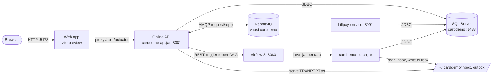

# Applications

Active contributors: factory-aj-pahl

The modern CardDemo stack is five runnable processes plus two infrastructure services, all on one machine and all bound to 127.0.0.1. This page lists each process, its port, the Maven modules or source tree it is built from, and how the processes talk to each other. Each process has its own page below.

## Overview

| Process | Source | Artifact | Address | Started by |
|:--|:--|:--|:--|:--|
| [Web app](web-app.md) | `modernization/web` | `modernization/web/dist` (vite build) | 127.0.0.1:5173 | `modernization/ops/up.sh` (`vite preview`) |
| [Online API](online-api.md) | `modernization/backend/app` | `modernization/backend/app/target/carddemo-api.jar` | 127.0.0.1:8081 | `modernization/ops/up.sh` |
| [Batch jar](batch-jar.md) | `modernization/backend/batch` | `modernization/backend/batch/target/carddemo-batch.jar` | none (one command per process) | Airflow tasks, `modernization/ops/load.sh`, `modernization/ops/db-reset.sh`, or by hand |
| [Airflow](airflow.md) | `modernization/airflow` | DAG files, run by Airflow 3 from `~/.carddemo/airflow-venv` | 127.0.0.1:8080 | `modernization/airflow/start.sh` (called by `modernization/ops/up.sh`) |
| [Bill-payment service](billpay-service.md) | `modernization/backend/billpay-service` | `modernization/backend/billpay-service/target/carddemo-billpay-service.jar` | 127.0.0.1:8091 | `modernization/ops/billpay.sh` (`make -C modernization billpay`) |
| SQL Server 2025 Developer, database `carddemo` | none | systemd service `mssql-server` | 127.0.0.1:1433 | systemd |
| RabbitMQ, vhost `carddemo` | none | systemd service `rabbitmq-server` | 127.0.0.1:5672 (management 15672) | systemd |

The table of addresses comes from `modernization/README.md`; the port defaults and jar paths come from `modernization/ops/stack-env.sh`, where each one can be overridden from the environment (`CARDDEMO_API_PORT`, `CARDDEMO_WEB_PORT`, `CARDDEMO_AIRFLOW_PORT`, `CARDDEMO_BILLPAY_PORT`, `CARDDEMO_API_JAR`, `CARDDEMO_BATCH_JAR`, `CARDDEMO_BILLPAY_JAR`).

## How the processes connect

- The browser only talks to the web app. `modernization/web/vite.config.ts` proxies `/api` and `/actuator` to `CARDDEMO_API_URL` (default `http://127.0.0.1:8081`), so the session cookie and the CSRF cookie are same-origin.
- The API reads and writes SQL Server as login `carddemo_app` (`modernization/backend/app/src/main/resources/application.properties`). It also listens on RabbitMQ request queues for the authorization and inquiry contexts (`modernization/backend/authorization/src/main/java/com/carddemo/authorization/messaging/AuthRequestListener.java`, `modernization/backend/inquiry/src/main/java/com/carddemo/inquiry/internal/AccountInquiryListener.java`, `modernization/backend/inquiry/src/main/java/com/carddemo/inquiry/internal/DateInquiryListener.java`). See [Message queues](../api/message-queues.md).
- When a user confirms a report on CORPT00C, the API gets a token from Airflow (`POST /auth/token`) and starts a `carddemo_transaction_report` DAG run (`POST /api/v2/dags/carddemo_transaction_report/dagRuns`), as written in `modernization/backend/reporting/src/main/java/com/carddemo/reporting/internal/AirflowReportLauncher.java`. The report file lands in the outbox, which the API serves for download (`carddemo.reports.outbox`). See [Transaction reports](../features/transaction-reports.md).
- Airflow never touches the database itself. Each task runs `java -jar carddemo-batch.jar <COMMAND> ...` through `modernization/airflow/dags/carddemo_batch.py` and turns the exit code into task success or failure.
- The bill-payment service shares the database with the API but keeps its own sessions; it does not call the API.

`modernization/ops/up.sh` starts Airflow first, because the API needs the Airflow password that Airflow's api-server generates on first start (`simple_auth_manager_passwords.json.generated`). It then starts the API, waits for `/actuator/health` to report UP, starts the web app, and runs `modernization/ops/check_stack.py`. Start, stop, and status are covered in [Deployment](../deployment.md); health checks and logs in [How to monitor](../how-to-monitor.md).

## Which modules each process assembles

The backend reactor (`modernization/backend/pom.xml`) has 18 Maven modules. Three of them produce runnable Spring Boot jars, and each picks a different subset of the bounded contexts.

| Bounded-context module | Online API (`app`) | Batch jar (`batch`) | Bill-payment service (`billpay-service`) |
|:--|:--|:--|:--|
| common, schema | yes | yes | yes |
| migration | no | yes (`load`, `export`, `loaddb2`) | no |
| iam | yes | only `JdbcAccountScope` and `JdbcUserRoles` | yes |
| account, card, transaction | yes | yes, without `web` packages | `api` and `internal` packages only (through `billpay`) |
| billpay | yes | no | yes |
| refdata, reporting, cycle, dataexchange | yes | yes, without `web` packages | no |
| authorization | yes | yes, without `web` and `messaging` | no |
| inquiry | yes | no | no |

Sources: `modernization/backend/app/pom.xml`, `modernization/backend/batch/pom.xml` and the component scan in `modernization/backend/batch/src/main/java/com/carddemo/batch/BatchApplication.java`, `modernization/backend/billpay-service/pom.xml` and the scan in `modernization/backend/billpay-service/src/main/java/com/carddemo/billpayservice/BillPayServiceApplication.java`. The module rules that make these subsets possible are described in [Modules](../modules/index.md).

## Shared settings

All three jars read the same database settings: `CARDDEMO_DB` (default `carddemo`) and `CARDDEMO_DB_PASSWORD`. Secrets live only in `~/.carddemo/secrets.env`, which `modernization/ops/stack-env.sh` sources when the variables are not already set. Each jar has Flyway on its classpath with `spring.flyway.locations=classpath:db/migration`, so the schema migrations in `modernization/backend/schema` are applied by whichever process starts first. The full list of properties and environment variables is in [Configuration](../reference/configuration.md).

## Sub-pages

- [Web app](web-app.md): the React SPA, routing, the screen hook, and the shared frame
- [Online API](online-api.md): the Spring Boot service that assembles every context, and its security and boundary tests
- [Batch jar](batch-jar.md): every command, its parameters, exit codes, and backup/restore
- [Airflow](airflow.md): the four DAGs, the batch helper, schedules, and start/stop scripts
- [Bill-payment service](billpay-service.md): bill payment deployed alone as a selective-conversion example

## Related pages

- [Architecture](../overview/architecture.md)
- [Screen API](../api/screen-api.md)
- [Daily batch cycle](../features/daily-batch-cycle.md)
