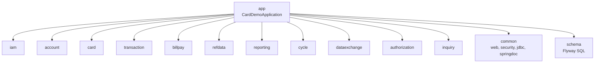

# Online API

Active contributors: factory-aj-pahl

`modernization/backend/app` is the Spring Boot 3.5 service on 127.0.0.1:8081 that the web app calls. It holds almost no code of its own: it assembles every bounded-context module into one process (a modular monolith), sets the runtime configuration, and carries the tests that check the assembled whole.

## Purpose

Every CICS screen, the REST equivalents of the MQ programs, report runs, and the RabbitMQ listeners run in this one process. The module carries:

- the dependency list that decides which contexts are deployed (`modernization/backend/app/pom.xml`)
- the main class (`modernization/backend/app/src/main/java/com/carddemo/app/CardDemoApplication.java`, 13 lines)
- runtime settings (`modernization/backend/app/src/main/resources/application.properties`)
- tests of the assembled service: smoke, menu navigation, the security matrix, the security extras, and the module boundaries

Main code is 13 lines; test code is 1,195 lines in six files with 14 test methods. Screen behavior lives in the context modules; see [Modules](../modules/index.md).

## Directory layout

```
modernization/backend/app/
├── pom.xml                                   # artifact app, finalName carddemo-api
└── src/
    ├── main/java/com/carddemo/app/CardDemoApplication.java
    ├── main/resources/application.properties
    └── test/java/com/carddemo/app/
        ├── ApplicationSmokeTest.java         # health, OpenAPI, sign-on -> menu -> bill payment
        ├── MenuNavigationTest.java           # control passing between the menu and function screens
        ├── ModuleBoundariesTest.java         # ArchUnit rules between contexts
        ├── SecurityTestBase.java             # shared context: settable clock, temp outbox, no Airflow
        ├── SecurityMatrixTest.java           # every OpenAPI operation x anonymous/USER/ADMIN + leak scan
        └── SecurityExtrasTest.java           # generic sign-on failure, lockout, idle timeout, audit rows
```

## How the modules are assembled



`modernization/backend/app/pom.xml` declares `common`, `schema`, and all eleven context modules, plus `spring-boot-starter-actuator` and `flyway-core`. Test scope adds `archunit-junit5` and `test-support`. The Spring Boot Maven plugin repackages the result as `modernization/backend/app/target/carddemo-api.jar` (`<finalName>carddemo-api</finalName>`).

The starters come in transitively. `modernization/backend/common/pom.xml` brings `spring-boot-starter-web`, `spring-boot-starter-security`, `spring-boot-starter-jdbc`, and `springdoc-openapi-starter-webmvc-ui` (version 2.8.17 from `modernization/backend/pom.xml`). `modernization/backend/authorization/pom.xml` and `modernization/backend/inquiry/pom.xml` bring `spring-boot-starter-amqp`.

`CardDemoApplication` is a plain `@SpringBootApplication(scanBasePackages = "com.carddemo")`. Because the scan covers every `com.carddemo` package on the classpath, the set of deployed contexts is decided only by the POM. The batch jar and the bill-payment service narrow the scan instead (see [Batch jar](batch-jar.md) and [Bill-payment service](billpay-service.md)).

## Configuration

`modernization/backend/app/src/main/resources/application.properties`:

| Property | Value | Notes |
|:--|:--|:--|
| `server.address`, `server.port` | `127.0.0.1`, `8081` | `modernization/ops/up.sh` overrides the port with `SERVER_PORT=$CARDDEMO_API_PORT` |
| `server.servlet.session.timeout` | `15m` | Container session timeout. The 15-minute idle rule is also enforced by `IdleTimeoutFilter` with the application clock |
| `server.servlet.session.cookie.http-only`, `.same-site` | `true`, `strict` | |
| `spring.datasource.url` | `jdbc:sqlserver://127.0.0.1:1433;databaseName=${CARDDEMO_DB:carddemo};encrypt=true;trustServerCertificate=true` | |
| `spring.datasource.username` / `.password` | `carddemo_app` / `${CARDDEMO_DB_PASSWORD}` | Password only from the environment |
| `spring.flyway.locations` | `classpath:db/migration` | Migrations from `modernization/backend/schema` run at startup |
| `management.endpoints.web.exposure.include` | `health` | Only `/actuator/health` is exposed; probes enabled |
| `spring.rabbitmq.*` | `127.0.0.1:5672`, user `carddemo`, vhost `carddemo`, password `${RABBITMQ_PASSWORD}` | |
| `carddemo.airflow.base-url`, `.username`, `.password` | `${AIRFLOW_BASE_URL:http://127.0.0.1:8080}`, `${AIRFLOW_USERNAME:admin}`, `${AIRFLOW_PASSWORD:}` | `modernization/ops/up.sh` reads the generated Airflow password and exports it before starting the API |
| `carddemo.reports.outbox` | `${CARDDEMO_OUTBOX:${user.home}/.carddemo/outbox}` | Where TRANREPT files are read for download |

Security settings with defaults in code: `carddemo.security.idle-timeout` (15 minutes), `lockout-threshold` (5), `lockout-duration` (15 minutes), and `bcrypt-cost`, in `modernization/backend/iam/src/main/java/com/carddemo/iam/security/SecurityProperties.java`. All properties are listed in [Configuration](../reference/configuration.md).

## OpenAPI, Swagger UI, and actuator

- `GET /v3/api-docs` is the live OpenAPI document generated by springdoc. Every controller is annotated with `@Tag` (the program name) and `@Operation`, for example `modernization/backend/iam/src/main/java/com/carddemo/iam/web/AdminMenuController.java`.
- `/swagger-ui/**` and `/swagger-ui.html` are permitted without a session, as are `/actuator/health` and `/v3/api-docs/**` (`modernization/backend/iam/src/main/java/com/carddemo/iam/security/SecurityConfig.java`).
- `GET /actuator/health` is what `modernization/ops/up.sh` and `modernization/ops/check_stack.py` wait on (`"UP"`). See [How to monitor](../how-to-monitor.md).

The OpenAPI document matters beyond documentation: the security matrix test takes its list of operations from it. The endpoint list is on [REST endpoints](../api/rest-endpoints.md), and the screen contract is on [Screen API](../api/screen-api.md).

## Sessions and security, in brief

Security is configured once in the `iam` module and applies to every context in this process: server-side sessions with a new session on sign-on, roles from the session, a CSRF token in the `XSRF-TOKEN` cookie that the SPA echoes in `X-XSRF-TOKEN`, 401 for requests without a session, and 403 for a regular user on an admin screen. A regular user can only reach linked accounts. Details and rationale are on [Security](../security.md), [Sign-on and sessions](../features/sign-on-and-sessions.md), and [Account scoping](../features/account-scoping.md).

## Tests

All tests in this module boot the full `CardDemoApplication` with MockMvc against the test database (`CARDDEMO_TEST_DB`, default `carddemo_test`), which they reload with `SampleData.load()`. They run with `make -C modernization test-backend`.

| Test | What it checks |
|:--|:--|
| `modernization/backend/app/src/test/java/com/carddemo/app/ApplicationSmokeTest.java` | `/actuator/health` returns 200 without a session; `/v3/api-docs` lists COSGN00C, COMEN01C, COADM01C, and COBIL00C; USER0001 signs on, picks option 10, and lands on COBIL00C with focus on `accountId` |
| `modernization/backend/app/src/test/java/com/carddemo/app/MenuNavigationTest.java` | Option 11 opens COPAUS0C; returning from COBIL00C or COTRN02C with PF3 shows a fresh menu (11 options, no message) and the same USER session, which still gets 403 on COADM01C |
| `modernization/backend/app/src/test/java/com/carddemo/app/SecurityTestBase.java` | Base class: a settable `Clock` (fixed at 2022-06-15 10:30), a temporary report outbox, and a `ReportLauncher` stub so no request reaches Airflow |
| `modernization/backend/app/src/test/java/com/carddemo/app/SecurityMatrixTest.java` | The security matrix, below |
| `modernization/backend/app/src/test/java/com/carddemo/app/SecurityExtrasTest.java` | D-SEC-EXTRAS: unknown user and wrong password get the identical answer; 5 consecutive failures lock the ID for 15 minutes even for the right password; only consecutive failures count; a session idle for more than 15 minutes is rejected; each sign-on and each user, account, and card change writes one `audit_log` row without secrets |
| `modernization/backend/app/src/test/java/com/carddemo/app/ModuleBoundariesTest.java` | ArchUnit, below |

### Security matrix

`SecurityMatrixTest` treats the live `/v3/api-docs` as the list of operations it must cover. `CLASSIFICATION` gives every operation one access category:

| Category | Expected behavior | Operations |
|:--|:--|:--|
| `PUBLIC` | Anyone | 2 (COSGN00C GET and POST) |
| `AUTHENTICATED` | Anonymous gets 401 | 19 |
| `ADMIN_ONLY` | Anonymous 401; USER 403 with a screen response that navigates to COMEN01C with the admin-only message | 15 |
| `ACCOUNT_SCOPED` | USER: an unlinked key is answered exactly like a key that does not exist (A-2); ADMIN reaches every key (A-1) | 13 |

The test fails in four ways:

- an operation in the OpenAPI document has no classification line (`UNCLASSIFIED`)
- a classified operation is gone (`STALE`)
- a `com.carddemo` handler is served but missing from the document (`UNDOCUMENTED`), for example one hidden with `@Hidden`
- any outcome is wrong

Every response is scanned for sample passwords, BCrypt hashes, full sample card numbers, and SSNs. `/actuator/health` and `/v3/api-docs` are also called anonymously and must return 200. Screen POST bodies are a single read-only ENTER turn, so the matrix changes no data. The report goes to `modernization/backend/app/target/security-matrix.txt`.

A new endpoint therefore fails this test until it gets a line in `CLASSIFICATION`. The error message suggests the line to add.

### Module boundaries

`ModuleBoundariesTest` imports all non-test classes under `com.carddemo` and checks three rules (`@Covers("ARCH-BOUNDARIES")`):

1. A class in one of the eleven contexts depends on another context only through that context's `api` package.
2. `com.carddemo.common..` depends on no context.
3. Classes in `api` packages are interfaces or records.

Because the test runs in the `app` module, which has every context on its classpath, it sees all cross-context dependencies at once. These rules are what allow [Bill-payment service](billpay-service.md) to run without the other contexts. More on the module rules is on [Modules](../modules/index.md).

## Entry points for modification

- **Deploy a new context:** add the module to `modernization/backend/pom.xml` and as a dependency in `modernization/backend/app/pom.xml`, and add its name to `CONTEXTS` in `ModuleBoundariesTest`.
- **Add an endpoint:** write the controller in the owning context's `web` package with `@Tag` and `@Operation`, add an access rule in `SecurityConfig` if it is admin-only, then add its line to `SecurityMatrixTest.CLASSIFICATION`.
- **Change a runtime setting:** `modernization/backend/app/src/main/resources/application.properties`, or override it from the environment.

## Key source files

| File | Purpose |
|:--|:--|
| `modernization/backend/app/pom.xml` | Which modules the API deploys; jar name |
| `modernization/backend/app/src/main/java/com/carddemo/app/CardDemoApplication.java` | Main class, scan of `com.carddemo` |
| `modernization/backend/app/src/main/resources/application.properties` | Port, session cookie, datasource, RabbitMQ, Airflow, outbox |
| `modernization/backend/iam/src/main/java/com/carddemo/iam/security/SecurityConfig.java` | Security filter chain for the whole API |
| `modernization/backend/app/src/test/java/com/carddemo/app/SecurityMatrixTest.java` | Access rules for every documented operation |
| `modernization/backend/app/src/test/java/com/carddemo/app/ModuleBoundariesTest.java` | ArchUnit module rules |

## Related pages

- [Applications](index.md)
- [Testing](../how-to-contribute/testing.md)
- [Deployment](../deployment.md)
