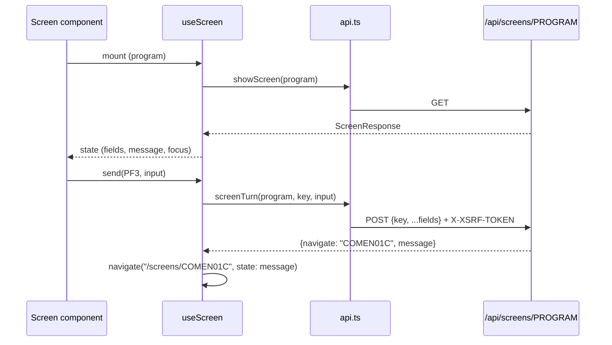

# Web app

Active contributors: factory-aj-pahl

`modernization/web` is a React 19 + TypeScript single-page app built with Vite. It draws one page per CICS screen and sends every key press to the screen API; the server decides what each key means, so the browser code is mostly layout, input fields, and focus handling.

## Purpose

The web app replaces the 3270 terminal and the BMS maps. Each CICS program with a map becomes a route `/screens/<PROGRAM>`, and each screen turn is one `POST /api/screens/<PROGRAM>` with the attention key and the field values. The app keeps the mainframe conventions that users of CardDemo know: transaction IDs in the header, a message line, an F-key bar, and the cursor (focus) placed where the server says. The look follows decision D-UI-LOOK in `modernization/decisions/README.md`: "The clickable prototype's look and interaction style (layout, palette, type, message bar, F-key bar) is the standard for all screens".

## Directory layout

```
modernization/web/
├── index.html            # single <div id="root">, loads src/main.tsx
├── package.json          # react, react-dom, react-router; vite, typescript
├── tsconfig.json         # strict, noEmit, bundler resolution
├── vite.config.ts        # 127.0.0.1, port 5173, proxy /api and /actuator
└── src/
    ├── main.tsx          # createRoot + StrictMode
    ├── App.tsx           # routes and the program -> component registry
    ├── screens.ts        # transaction ID, title, F-key legend per program
    ├── useScreen.ts      # one pseudo-conversational screen (first entry, turns, navigate, focus)
    ├── api.ts            # fetch wrapper: XSRF header, 401, 403
    ├── ScreenFrame.tsx   # header, main, message bar, key bar, keyboard handling
    ├── Field.tsx         # labelled input and textarea
    ├── format.ts         # card-number masking helpers
    ├── session.ts        # signed-on user context
    ├── styles.css        # prototype styles (D-UI-LOOK)
    └── screens/          # 22 components, one per screen plus NotAvailable and SignedOff
```

`src` holds 3,627 lines across 32 files (`wc -l` at commit 467e0f0). The web app has no unit tests of its own; it is tested end to end by the Playwright suite in `modernization/e2e` (see [End-to-end suite](../verification/e2e-suite.md)) and type-checked by `make -C modernization test-web`.

## Key abstractions

| Abstraction | File | What it does |
|:--|:--|:--|
| `REGISTRY` | `modernization/web/src/App.tsx` | Maps 21 program names to screen components. Unknown programs render `NotAvailable` |
| `SCREENS`, `aid()` | `modernization/web/src/screens.ts` | Per-program transaction ID, title, and F-key legend copied from the BMS map; `aid('F3')` returns `PF3` |
| `useScreen<F>(program)` | `modernization/web/src/useScreen.ts` | Loads first entry, sends turns, follows `navigate`, moves focus |
| `fieldInError()` | `modernization/web/src/useScreen.ts` | Marks the focused field invalid when the message is red and is about that field |
| `showScreen`, `screenTurn`, `currentSession` | `modernization/web/src/api.ts` | `GET` / `POST /api/screens/<PROGRAM>`, `GET /api/session` |
| `Unauthorized` | `modernization/web/src/api.ts` | Thrown on HTTP 401; `useScreen` sends the user to a clean sign-on screen |
| `ScreenFrame` | `modernization/web/src/ScreenFrame.tsx` | The layout every screen shares, plus Enter and F1-F12 key handling |
| `Field`, `AreaField` | `modernization/web/src/Field.tsx` | Inputs with labels, hints, `aria-invalid`, optional upper-casing |
| `maskCard`, `keepTyped` | `modernization/web/src/format.ts` | Card-number masking as the server applies it |
| `SessionContext`, `useSessionTracker` | `modernization/web/src/session.ts` | The signed-on user, re-read on every route change |

## Routing and the screen registry

`modernization/web/src/App.tsx` defines four routes with `react-router`:

| Path | Renders |
|:--|:--|
| `/` | Redirect to `/screens/COSGN00C` |
| `/signed-off` | `SignedOff`: the farewell text COSGN00C sends on PF3, with ENTER to sign on again |
| `/screens/:program` | `REGISTRY[program]`, or `NotAvailable` when the program is not registered |
| `*` | Redirect to `/screens/COSGN00C` |

The registered programs and their components:

| Program | Transaction | Component |
|:--|:--|:--|
| COSGN00C | CC00 | `SignOn` |
| COMEN01C, COADM01C | CM00, CA00 | `Menu` (one component, two option catalogs) |
| COBIL00C | CB00 | `BillPayment` |
| COUSR00C to COUSR03C | CU00 to CU03 | `UserList`, `UserAdd`, `UserUpdate`, `UserDelete` |
| COCRDLIC, COCRDSLC, COCRDUPC | CCLI, CCDL, CCUP | `CardList`, `CardView`, `CardUpdate` |
| COACTVWC, COACTUPC | CAVW, CAUP | `AccountView`, `AccountUpdate` |
| COTRN00C to COTRN02C | CT00 to CT02 | `TransactionList`, `TransactionView`, `TransactionAdd` |
| CORPT00C | CR00 | `TransactionReports` |
| COTRTLIC, COTRTUPC | CTLI, CTTU | `TranTypeList`, `TranTypeMaint` |
| COPAUS0C, COPAUS1C | CPVS, CPVD | `PendingAuthList`, `PendingAuthDetail` |

That is 21 routed programs, one for each of the 21 BMS maps, served by 20 components (the two menus share `Menu`). The route element is keyed by program (`<Screen key={program} />`), so navigating to another program always mounts a fresh instance and starts with first entry.

Two legends are not static. COACTUPC adds F5 Save and F12 Cancel when the server shows them (BR-COACTUPC-21), and COTRTUPC has an empty static legend because its keys depend on the state (BR-COTRTUPC-26); both screens pass their own `keys` to `ScreenFrame` (comments in `modernization/web/src/screens.ts`).

## The screen turn: `useScreen`



`useScreen` in `modernization/web/src/useScreen.ts` handles one pseudo-conversational screen:

- **First entry.** On mount it calls `GET /api/screens/<PROGRAM>`. If the previous screen navigated here with a message (the COBOL often passes a message across `XCTL`), that "flash" message from the router state replaces the first-entry message once.
- **Keyboard lock.** An `inFlight` ref blocks `send` until first entry has arrived and while a turn is running, "like a 3270 keyboard lock", so a late first-entry response cannot overwrite a turn result.
- **Navigate.** A response with `navigate` changes the route instead of updating state. `navigate: "EXIT"` goes to `/signed-off`; anything else goes to `/screens/<navigate>`. The message and color travel in the router state.
- **401.** `Unauthorized` replaces the route with `/screens/COSGN00C` and clears the state. Other errors show in the message bar in red.
- **Focus.** A layout effect focuses the element whose `id` equals `focus` and selects its text when the message is red. If the named field is protected (`readonly` or disabled) or no field is named and focus was lost, focus goes to the form's submit button so Enter still sends ENTER. The comment explains why it is not the primary button: in a confirm state that can be F5 Save.

`fieldInError(state, id)` returns true only when the message is red, focus is on that field, and the message is not in `NOT_ABOUT_FIELD`. That list holds COBOL messages that put the cursor on a field without being about its value, such as `Invalid key pressed`, paging boundaries, "is not installed", "Confirm to ...", and file errors. Screens can pass extra patterns.

## HTTP client

`modernization/web/src/api.ts` wraps `fetch` with `credentials: 'same-origin'`:

- **CSRF.** For every `POST` it reads the `XSRF-TOKEN` cookie and sends it as the `X-XSRF-TOKEN` header. The server side is `CookieCsrfTokenRepository` in `modernization/backend/iam/src/main/java/com/carddemo/iam/security/SecurityConfig.java`.
- **401** throws `Unauthorized`.
- **403 with a JSON body** is returned as a normal screen response. A regular user who calls an admin screen gets 403 with a screen response that navigates to the main menu, so the app follows it like any other turn.
- Any other non-2xx status throws `Error("<METHOD> <path> failed with HTTP <status>")`.

`screenTurn` posts `{ ...input, key }`. The `Key` type allows `ENTER`, `CLEAR`, `PA1` to `PA3`, and `PF<n>`; `MessageColor` is `RED`, `GREEN`, or `NEUTRAL`. The full contract is on [Screen API](../api/screen-api.md); session and CSRF rules are on [Security](../security.md) and [Sign-on and sessions](../features/sign-on-and-sessions.md).

## Shared frame: `ScreenFrame`

`modernization/web/src/ScreenFrame.tsx` renders the parts of the 3270 screen every program has:

- **Header:** CardDemo brand, `<tran> · <program>` (for example `CB00 · COBIL00C`), the signed-on user ID and role from `useSession()`, and a clock in `MM/DD/YY  HH:MM:SS` format that ticks every second.
- **Main:** `<main id="main" tabIndex={-1}>` with `aria-busy` while a turn runs and a `data-ready` attribute when idle. The Playwright tests wait on it.
- **Message bar:** `role="status"` and `aria-live="polite"`. Green messages get the `success` style, red the `error` style, others `info`. An empty bar shows "No messages" through CSS.
- **Key bar:** one button per legend entry, `aria-keyshortcuts` set, ENTER styled as primary.

Keyboard handling is attached to `document`:

- **F1 to F12** (no Ctrl, Alt, or Meta) are captured with `preventDefault()`, so the browser's own F5 reload or F3 search does not fire. The matching key button shows a short pressed state, and `onKey` is called.
- **Enter** acts as the ENTER AID from any cursor position, as on a 3270. Buttons, links, selects, and text areas keep their own Enter, and an input inside a form with a submit button submits natively. Otherwise the handler calls `form.requestSubmit()`, or `onKey('ENTER')` when there is no form.

## Fields, formatting, and session

- `Field` in `modernization/web/src/Field.tsx` renders a label, an input, and an optional hint. `maxLength` values mirror the BMS field lengths, and `upper` upper-cases the value as the user types. `AreaField` is a two-row textarea where Enter submits the form.
- `maskCard` in `modernization/web/src/format.ts` shows a 16-digit card number as twelve asterisks plus the last four digits (C-MASK). `keepTyped` keeps what the user typed when the server echoes back the masked form of the same number, so the full number is not replaced by asterisks in the input.
- `useSessionTracker` in `modernization/web/src/session.ts` calls `GET /api/session` on every path change. Sign-on, sign-off, and expiry all change the route, so the header stays current.

## Styles (D-UI-LOOK)

`modernization/web/src/styles.css` (200 lines) is copied from the approved UI prototype; its header comment says `--subtle` was darkened and key captions made opaque for WCAG AA contrast. One rule set (`.input[readonly], .input:disabled`) styles 3270 protected fields, and `.input[aria-invalid="true"]` styles fields in error. Some screens add display-only elements that have no BMS counterpart. An example is the bill-payment receipt panel (D-RECEIPT in `modernization/web/src/screens/BillPayment.tsx`), which formats amounts as US dollars.

## Build, preview, and proxy

| Command | What it does |
|:--|:--|
| `npm --prefix modernization/web run dev` | Vite dev server on 127.0.0.1:5173 with the proxy |
| `npm --prefix modernization/web run build` | `tsc -p . && vite build` into `modernization/web/dist` (run by `make -C modernization setup`) |
| `npm --prefix modernization/web run preview` | Serves `dist` on the same host, port, and proxy. `modernization/ops/up.sh` starts `./node_modules/.bin/vite preview` this way |
| `npm --prefix modernization/web run typecheck` | `tsc -p .` (part of `make -C modernization test-web`) |

`modernization/web/vite.config.ts` uses the same settings for `server` and `preview`: host `127.0.0.1`, port `CARDDEMO_WEB_PORT` (default 5173) with `strictPort`, and a proxy from `/api` and `/actuator` to `CARDDEMO_API_URL` (default `http://127.0.0.1:8081`). Because the API is reached through the proxy, the browser sees one origin and the `SameSite=Strict` session cookie works.

## Entry points for modification

- **Add a screen:** add a component under `modernization/web/src/screens/`, register it in `REGISTRY` in `modernization/web/src/App.tsx`, and add its transaction ID, title, and legend to `SCREENS` in `modernization/web/src/screens.ts`. Use `useScreen` and `ScreenFrame`, and give inputs the `id` the server uses in `focus`. The server-side controller and its line in the security matrix come first (see [Online API](online-api.md)).
- **Add a message that should not mark the focused field:** extend `NOT_ABOUT_FIELD` in `modernization/web/src/useScreen.ts`, or pass a screen-specific pattern to `fieldInError`.
- **Change keyboard behavior:** `modernization/web/src/ScreenFrame.tsx`.

## Key source files

| File | Purpose |
|:--|:--|
| `modernization/web/src/App.tsx` | Routes and the program registry |
| `modernization/web/src/screens.ts` | Transaction IDs, titles, and F-key legends |
| `modernization/web/src/useScreen.ts` | Screen turn hook, focus rules, error marking |
| `modernization/web/src/api.ts` | HTTP client with CSRF and 401/403 handling |
| `modernization/web/src/ScreenFrame.tsx` | Shared layout and keyboard shortcuts |
| `modernization/web/src/Field.tsx` | Input components |
| `modernization/web/src/format.ts` | Card masking helpers |
| `modernization/web/src/session.ts` | Signed-on user context |
| `modernization/web/src/screens/Menu.tsx` | Main and admin menus |
| `modernization/web/src/screens/TransactionReports.tsx` | Report request form and run list with download links |
| `modernization/web/vite.config.ts` | Host, port, and proxy |

## Related pages

- [Applications](index.md)
- [Screen API](../api/screen-api.md)
- [Patterns and conventions](../how-to-contribute/patterns-and-conventions.md)
- [Online programs](../mainframe/online-programs.md) for the CICS screens these pages replace
