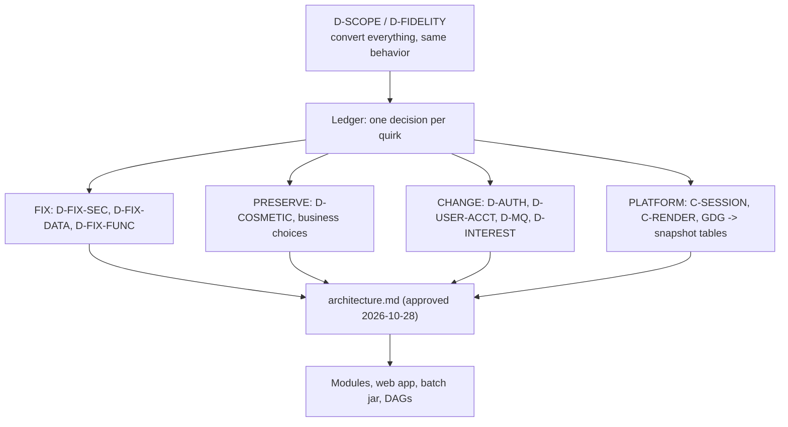

# Design decisions

This page collects the architectural decisions that shape the modernized CardDemo and the reasons recorded for each. Every decision is tied to an ID in `modernization/decisions/` or a section of `modernization/architecture.md`, so you can read the full text at the source before changing anything it governs.

## Overview

The decisions fall into four groups: how the code is split, how screens behave, how data and security are handled, and how batch runs. The user decisions (`D-` IDs) were taken on 2026-10-28 and are listed in `modernization/decisions/README.md:7-34`. Recorded defaults (`DF-` IDs) follow at `modernization/decisions/README.md:36-52`. The online conventions (`C-` IDs) are at `modernization/decisions/ledger-online.md:14-27` and the batch conventions (`B-` IDs) at `modernization/decisions/ledger-batch-data.md:16-25`. Where `modernization/architecture.md` and a decision disagree, the decision governs (`modernization/architecture.md:3-5`).

The decision values themselves (FIX, PRESERVE, CHANGE, PLATFORM, NOT-PORTED) are explained on the [fidelity ledger](../verification/fidelity-ledger.md) page.

## Structure

### Modular monolith with `api` package boundaries

- **Context.** The original application is a set of CICS and batch programs that share VSAM files. The rebuild had to stay deployable as one process while still allowing one business area to be split out later.
- **Decision.** Each bounded context is a Maven module under `modernization/backend/` with `web`, `internal`, and `api` packages. All contexts run together in the `app` Spring Boot service, and a context may reach another only through that context's `api` package (`modernization/architecture.md:58-69`). The ArchUnit test `modernization/backend/app/src/test/java/com/carddemo/app/ModuleBoundariesTest.java` enforces this and also requires `api` packages to hold only interfaces and records.
- **Consequence.** Selective conversion becomes possible: `modernization/backend/billpay-service` runs bill payment alone on port 8091 against the same modules (`modernization/README.md:121-136`). Cross-context needs that have no published API yet show up as documented deviations, for example user screens reading the `account` table directly (`modernization/architecture.md:96-97`).
- **Source.** `modernization/architecture.md` section 3. See [Modules](../modules/index.md) and [Bill-payment service](../applications/billpay-service.md).

### Plain JDBC with row locks instead of an ORM

- **Context.** COBOL programs read a record for update, change fields, and rewrite it. The fidelity rules need exact control over which columns are written and which rows are locked.
- **Decision.** Repositories use Spring's JDBC support (`spring-boot-starter-jdbc` in `modernization/backend/common/pom.xml:25`) with hand-written SQL Server statements. Reads that precede an update take `WITH (UPDLOCK, ROWLOCK)`, for example `modernization/backend/account/src/main/java/com/carddemo/account/internal/AccountCustomerStore.java:55` and `modernization/backend/card/src/main/java/com/carddemo/card/internal/CardRepository.java:96`. No module declares JPA or Hibernate.
- **Consequence.** Columns are written by name, which is how the group-ID overwrite (Q-ENT-01) is fixed. Lock scope is visible in each query. No ledger ID records this choice; the evidence is the code itself.
- **Source.** `modernization/architecture.md` section 4 ("database transactions with row locks", also `modernization/architecture.md:54-56`) and B-UOW.

## Screens and messages

### Server-owned screen behavior (C-RENDER)

- **Context.** A CICS program decides what every attention key means and may issue several SENDs in one task.
- **Decision.** Each program with a map is one resource `/api/screens/<PROGRAM>`. The server decides what each key means, including the invalid-key message, and one request returns one envelope with the final screen state the COBOL user would see; intermediate SENDs are not reproduced (`modernization/architecture.md:33-49`, C-RENDER at `modernization/decisions/ledger-online.md:24`). `navigate` replaces XCTL.
- **Consequence.** The React app stays thin: it renders fields and sends keys. Key folding such as PF13-PF24 behaving as PF1-PF12 lives on the server in `modernization/backend/common/src/main/java/com/carddemo/common/screen/Key.java:12-16`.
- **Source.** C-RENDER, D-UI. See [Screen API](../api/screen-api.md).

### Verbatim messages (D-COSMETIC)

- **Context.** COBOL messages contain typos, odd spacing, and trailing spaces.
- **Decision.** Cosmetic quirks are not fixed: user-visible message and label text stays verbatim (`modernization/decisions/README.md:16`, classification policy rule 4 at `modernization/decisions/README.md:71`).
- **Consequence.** Strings such as `No access - Admin Only option... ` (with the trailing space) are constants in `modernization/backend/common/src/main/java/com/carddemo/common/msg/CommonMessages.java:13`, and tests assert the exact text. New text that has no COBOL counterpart is marked **NEW** in the ledger.
- **Source.** D-COSMETIC, D-FIDELITY.

### Server sessions instead of COMMAREA (C-SESSION)

- **Context.** CICS passes state between programs in the CARDDEMO-COMMAREA, which is never initialized at sign-on and is reset by several PF3 paths (Q-COSGN00C-06, Q-COACTVWC-03).
- **Decision.** The COMMAREA is replaced by the server-side session plus explicit request parameters. Navigation never changes the signed-on user ID or role (`modernization/decisions/ledger-online.md:23`). The account and selected authorization of the pending-authorization screens are kept in the session too (`modernization/architecture.md:125-127`).
- **Consequence.** Several "PF3 forces user type U" defects disappear without visible change. Each service holds its own sessions, so the API on 8081 and the bill-payment service on 8091 do not share sign-on (`modernization/README.md:136`).
- **Source.** C-SESSION, D-AUTH.

## Security

### BCrypt, roles, and security extras (D-AUTH, D-SEC-EXTRAS)

- **Context.** The COBOL stores 8-character passwords in clear text in USRSEC and performs no authorization checks (`modernization/architecture.md:17`, Q-ENT-17).
- **Decision.** D-AUTH requires a server-side session, BCrypt hashes, and roles enforced in the API (`modernization/decisions/README.md:17`). D-SEC-EXTRAS adds a generic sign-on failure message, a 15-minute lockout after 5 failed sign-ons, a 15-minute idle timeout, and an audit log (`modernization/decisions/README.md:30`). C-ROLE takes the role from the session only (`modernization/decisions/ledger-online.md:20`).
- **Consequence.** `modernization/backend/iam/src/main/java/com/carddemo/iam/security/SecurityConfig.java:87` builds the `BCryptPasswordEncoder`; `modernization/backend/iam/src/main/java/com/carddemo/iam/internal/SignonService.java` implements lockout; `modernization/backend/iam/src/main/java/com/carddemo/iam/security/IdleTimeoutFilter.java` and `modernization/backend/app/src/main/resources/application.properties:4` set the timeout; `modernization/backend/iam/src/main/java/com/carddemo/iam/internal/JdbcAuditLog.java` writes audit rows. Screens mask card numbers and SSNs (C-MASK).
- **Source.** D-AUTH, D-FIX-SEC, D-SEC-EXTRAS, C-ROLE, C-MASK, C-AUDIT. See [Sign-on and sessions](../features/sign-on-and-sessions.md) and [Security](../security.md).

### Linked accounts (D-USER-ACCT)

- **Context.** In the COBOL every user can see every account.
- **Decision.** A new user-to-account link restricts regular users to their linked accounts and to the cards, transactions, bill payments, and pending authorizations of those accounts; admins are unrestricted (`modernization/decisions/README.md:21`). Sample accounts are linked round-robin (D-SEED, implemented at `modernization/backend/migration/src/main/java/com/carddemo/migration/SampleDataLoader.java:130`). An out-of-scope key is answered exactly as if it did not exist (C-SCOPE, `modernization/decisions/ledger-online.md:21`).
- **Consequence.** Every context that reads accounts goes through `AccountScope`, implemented in `modernization/backend/iam/src/main/java/com/carddemo/iam/internal/JdbcAccountScope.java`. Transaction reports for a regular user are filtered too (D-REPORT).
- **Source.** D-USER-ACCT, D-SEED, D-REPORT, C-SCOPE. See [Account scoping](../features/account-scoping.md).

### PII kept in files and the database (D-PII-FILES)

- **Context.** Exports, imports, and IMS unloads carry full card numbers, CVVs, and SSNs as data-interchange contracts, and the COBOL keeps CVVs in the card file.
- **Decision.** Those files keep the full values but are written owner-only (mode 600); the database keeps CVVs as the COBOL does; screens and job-log listings stay masked (`modernization/decisions/README.md:32`, Q-ENT-33).
- **Consequence.** `cvv_cd` is a column in `modernization/backend/schema/src/main/resources/db/migration/V1__core_schema.sql:83`. File writers such as `modernization/backend/dataexchange/src/main/java/com/carddemo/dataexchange/internal/FileSinks.java` set the file mode.
- **Source.** D-PII-FILES, B-MASK.

## Batch

### Online stays available during batch (D-BATCH-WINDOW)

- **Context.** The mainframe cycle closes CICS files (CLOSEFIL), runs batch, and reopens them (OPENFIL).
- **Decision.** Online stays available during the cycle; database transactions with row locks keep data consistent, and there is no maintenance flag (`modernization/decisions/README.md:24`, `modernization/architecture.md:54-56`).
- **Consequence.** CLOSEFIL, OPENFIL, and WAITSTEP have no target step (B-CYCLE). Batch and online code share the same locking repositories.
- **Source.** D-BATCH-WINDOW, B-CYCLE.

### Per-record commit (B-UOW)

- **Context.** VSAM batch updates have no transaction; an abend leaves whatever was rewritten.
- **Decision.** POSTTRAN commits one transaction per daily record, INTCALC one per account, and load and maintenance jobs once per input file. A failure rolls back only the current unit of work (`modernization/decisions/ledger-batch-data.md:22`). An abend exits 99 with code `U999` (B-ABEND, `modernization/decisions/ledger-batch-data.md:20`).
- **Consequence.** A failed POSTTRAN can restart from its last committed record by clearing the failed Airflow task, or be undone with `RESTORE` (`modernization/architecture.md:180-185`).
- **Source.** B-UOW, B-ABEND, D-FIX-DATA.

### BACKUP snapshot tables replace GDGs, and BACKUP refusal

- **Context.** The mainframe takes a GDG backup (TRANBKP) of the transaction file and reloads seed files to roll back (Q-ACCTFILE-02).
- **Decision.** The BACKUP step of the daily DAG writes snapshot tables before posting (`cycle_backup` and its child tables in `modernization/backend/schema/src/main/resources/db/migration/V20__batch_cycle.sql:26-84`). BACKUP for a date that has any POSTTRAN run is refused with exit 8 and `BACKUP REFUSED: POSTING ALREADY STARTED FOR <date>`, so no backup of a posted or partly posted state can exist (`modernization/architecture.md:172-179`).
- **Consequence.** `RESTORE businessDate=<date>` always returns to the state just before the latest posting of that date. The logic is in `modernization/backend/batch/src/main/java/com/carddemo/batch/backup/CycleBackupService.java`.
- **Source.** `modernization/architecture.md` section 4, Q-TRANBKP-01, B-CYCLE. See [Daily batch cycle](../features/daily-batch-cycle.md).

### Airflow follows the runbook, not CA7 or Control-M

- **Context.** The repository has CA7 and Control-M definitions (`app/scheduler/`) and a runbook (`docs/runbooks/batch-operations.md`), and they disagree with each other.
- **Decision.** `carddemo_daily_cycle` follows the runbook order; the CA7 and Control-M definitions are not ported (`modernization/architecture.md:209-211`, `modernization/spec/jobs.md:107`, B-CYCLE).
- **Consequence.** The DAG runs BACKUP, POSTTRAN, INTCALC when due, and CREASTMT (`modernization/airflow/dags/carddemo_daily_cycle.py:1-31`). COMBTRAN, TRANBKP, and TRANIDX disappear because interest rows go straight into the transaction table.
- **Source.** D-CYCLE, B-CYCLE, Q-CA7-*, Q-CONTROLM-*. See [Airflow](../applications/airflow.md).

### Interest monthly (D-INTEREST) and full history (D-HISTORY)

- **Context.** The runbook runs INTCALC daily while Control-M runs it monthly, and the COBOL formula (annual rate / 1200) is a monthly charge (`modernization/spec/jobs.md:139-141`, Q-RUNBOOK-01).
- **Decision.** D-INTEREST amends D-CYCLE: posting and statements run daily, interest runs monthly on the first business day after that day's posting, with the formula unchanged (`modernization/decisions/README.md:28`). D-HISTORY keeps full history in the transaction table while statements cover only the current cycle, so statement output equals the COBOL's (`modernization/decisions/README.md:29`).
- **Consequence.** The DAG asks the jar's `INTSTATUS` whether the month's interest is due, so a missed first day is caught up on the next run in the month (`modernization/airflow/dags/carddemo_daily_cycle.py:19-23`). INTCALC refuses a second completed run in a month with exit 8.
- **Source.** D-INTEREST, D-HISTORY, B-CYCLE, Q-CBACT04C-08.

### Fixed-width outputs kept for parity (B-PARITY)

- **Context.** The only reliable way to prove batch fidelity is to compare outputs with the original COBOL.
- **Decision.** Spring Batch jobs emit the same files (reject file, transaction report, statements, export file) in the same byte layout (`modernization/architecture.md:196-198`). Parity runs compile the original and patched scratch copies with `cobc -x -std=ibm -fsign=EBCDIC -I app/cpy`; reference patches are applied to copies under `/tmp`, never to `app/` (`modernization/decisions/ledger-batch-data.md:25`).
- **Consequence.** The `common` codecs (`modernization/backend/common/src/main/java/com/carddemo/common/codec/FixedWidth.java`, `Overpunch.java`, `Packed.java` in the same directory) exist mainly for these layouts. Fixes in batch programs need a reference patch so the patched COBOL produces the expected output.
- **Source.** B-PARITY, `modernization/architecture.md` section 6. See [Batch parity](../verification/batch-parity.md).

## Messaging and the optional modules

### RabbitMQ with the COBOL queue names (D-MQ)

- **Context.** The VSAM-MQ and authorization modules use IBM MQ request/reply.
- **Decision.** RabbitMQ (vhost `carddemo`) keeps the COBOL queue names; replies go to `reply_to` with `correlation_id` set to the request `message_id`; request queues are quorum queues with a delivery limit of 3 and dead-letter to `CARD.DEMO.DLQ`. REST equivalents return JSON (`modernization/architecture.md:139-159`, `modernization/decisions/README.md:19`).
- **Consequence.** Queue definitions live in `modernization/backend/authorization/src/main/java/com/carddemo/authorization/messaging/AuthQueues.java` and `modernization/backend/inquiry/src/main/java/com/carddemo/inquiry/internal/InquiryQueues.java`. Queue replies keep the legacy text layouts.
- **Source.** D-MQ. See [Message queues](../api/message-queues.md).

### IMS becomes two tables with `auth_id` and `auth_ts`

- **Context.** Pending authorizations are an IMS HIDAM database with a root summary and child details keyed by an inverted time.
- **Decision.** The database becomes `pending_auth_summary` and `pending_auth_detail`. The inverted-time key is replaced by an identity `auth_id` and the insert timestamp `auth_ts`; "IMS key order" is `auth_ts DESC, auth_id DESC` (`modernization/architecture.md:106-110`, `modernization/backend/schema/src/main/resources/db/migration/V60__authorization.sql:10-31`).
- **Consequence.** Purge age is computed in real days (Q-ENT-27). The unload rebuilds the IMS key from `auth_ts`. The sample loads 21 summaries and 202 details because the all-spaces root is rejected.
- **Source.** `modernization/architecture.md` section 3, Q-ENT-27, Q-COPAUA0C-11. See [Pending authorizations](../features/pending-authorizations.md).

## Documented deviations in IAM, Card, and Authorizations

`modernization/architecture.md:88-137` lists deviations the implementers chose and explained. In summary:

| Area | Deviation | Reason |
|:--|:--|:--|
| User update (COUSR02C) | Concurrency version is a SHA-256 fingerprint of names, type, hash, and account links | Links live in `user_account` rows, so a `rowversion` on the user row would miss a link change |
| Card update (COCRDUPC) | Keeps read-compare-rewrite on CVV, name, expiry, and status under an update lock | The spec makes only those fields part of the check (BR-COCRDUPC-06) |
| User screens | Check linked accounts by reading the `account` table directly | The Account context publishes no existence check yet |
| Card components | Resolve `AccountScope` and `AuditLog` per call through `ObjectProvider` | Contexts that depend on Card without IAM still start |
| IAM and Card APIs | Only screen endpoints exist; `/api/users` and `/api/cards` sketches are not built | No reason is recorded |
| Authorization status codes | Show SQLSTATE or exception class instead of DL/I status; `GE` kept for not found | No DL/I in the target |
| COPAUS2C | SQL Server error number shown with the Db2 negative sign as `+9(06)` plus the SQLSTATE | SQL Server has no Db2 SQLCODE; the display format is kept |
| COPAUS0C, COPAUA0C | Read accounts and cross-reference through `account/api` and `card/api` only | Module boundaries |
| PAUDBUNL, DBUNLDGS | Read both tables in one SERIALIZABLE read-only transaction | Snapshot isolation is not enabled on the database |

Some of these are candidates for later work; see [Cleanup opportunities](../cleanup-opportunities.md).

## Key source files

| File | Purpose |
|:--|:--|
| `modernization/decisions/README.md` | User decisions, recorded defaults, decision values, classification policy |
| `modernization/decisions/ledger-online.md` | C- conventions and Q- rows for online programs |
| `modernization/decisions/ledger-batch-data.md` | B- conventions, Q- rows for batch, entities, jobs, modules, reference patches |
| `modernization/architecture.md` | Approved target architecture and deviations |
| `modernization/backend/app/src/test/java/com/carddemo/app/ModuleBoundariesTest.java` | Enforces the `api` package boundaries |
