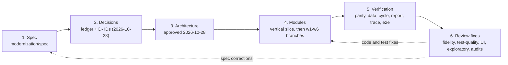

# Migration context

The modernization rebuilt CardDemo from a written specification rather than by translating COBOL line by line. Every program was restated in structured English, every quirk got a recorded decision, the target architecture was approved, the code was built context by context, and the result was checked against the original with differential tests, traceability, and several review rounds. This page reconstructs that process from what the repository contains.

## Overview

The whole modernization sits on the `modernization` branch. In the git history it spans three days: one commit on 2026-10-27 adds the root agent tooling ("Add agent-ready tooling, docs, and CI for CardDemo"), then 73 commits on 2026-10-28 and 65 on 2026-10-29 build and verify the rebuild (`git log --format='%ad' --date=short`). Of the 139 commits since 2026-10-27, 32 are merges of work branches. The original application under `app/` is the input and is not modified.

The dotted edges matter: review findings were fed back into the spec and ledger first, then into code and tests, so the spec stays the source of truth.

## Phase 1: Specification

`modernization/spec/` is "the intermediate representation of CardDemo used for modernization" (`modernization/spec/README.md:1-6`). It describes what the source does, including defects; where the code looks wrong the behavior is recorded as written and flagged as a quirk (`Q-` ID) so a person can decide (`modernization/spec/README.md:8-11`).

| File | Contents |
|:--|:--|
| `modernization/spec/programs/` | One file per COBOL program: 44 files, base and optional modules |
| `modernization/spec/entities.md` | Data dictionary: record layouts, keys, data-format rules |
| `modernization/spec/jobs.md` | JCL jobs, procedures, control cards, CA7 and Control-M schedules |
| `modernization/spec/components.md` | Bounded contexts, CRUD matrix, cross-cutting concerns |

Rules carry IDs such as `BR-` (business rule), `VR-` (validation), `NAV-` (navigation), `ERR-` (error handling), and `Q-` (quirk), defined in `modernization/spec/README.md`. Code and tests cite these IDs. See [Specification](../verification/specification.md).

## Phase 2: Decisions

The fidelity ledger in `modernization/decisions/` gives every `Q-` ID exactly one decision: FIX, PRESERVE, CHANGE, PLATFORM, or NOT-PORTED (`modernization/decisions/README.md:3-5,54-62`). A classification policy says which category of quirk gets which decision; security, data corruption, and clear functional bugs are fixed, cosmetic quirks and business choices are preserved (`modernization/decisions/README.md:64-78`).

The user decisions that steer the policy are dated 2026-10-28 (`modernization/decisions/README.md:7`). They include D-SCOPE (convert everything, including the three optional modules), D-FIDELITY (same behavior except approved fixes), the D-FIX-* families, D-AUTH, D-USER-ACCT, D-MQ, and D-INTEREST. Thirteen recorded defaults (`DF-1` to `DF-13`) cover smaller questions and say "object if wrong" (`modernization/decisions/README.md:36-52`).

| Ledger | Rows | FIX | PRESERVE | CHANGE | PLATFORM | NOT-PORTED |
|:--|--:|--:|--:|--:|--:|--:|
| `modernization/decisions/ledger-online.md` | 226 | 103 | 60 | 6 | 37 | 20 |
| `modernization/decisions/ledger-batch-data.md` | 395 | 156 | 63 | 32 | 114 | 30 |

The batch ledger ends with "Still open: none" in its resolved-questions section. When a FIX changes the output of a batch program that is compared with GnuCOBOL, the ledger also names a reference patch (`RP-*`) applied only to scratch copies (`modernization/decisions/README.md:80-82`). See [Fidelity ledger](../verification/fidelity-ledger.md) and [Design decisions](design-decisions.md).

## Phase 3: Architecture

`modernization/architecture.md` was derived from the spec and records its status as "approved (2026-10-28) and being implemented" (`modernization/architecture.md:3-5`). It maps each mainframe layer to its target (section 1), defines the screen API and runtime view (section 2), the bounded contexts and module rule (section 3), data handling (section 4), batch and scheduling (section 5), and the verification approach (section 6). The spec, architecture, and ledger arrived together in the commit "Add structured natural-language spec, architecture, and fidelity ledger". Later commits added documented deviations ("Document IAM and card deviations in architecture.md", "Document authorization deviations and correct the IMS sample counts") and corrections ("Correct stale architecture and ledger wording").

## Phase 4: Implementation by bounded context

Work started with thin vertical slices that proved each layer end to end:

- "Add backend vertical slice and POSTTRAN batch parity harness"
- "Add React web slice (sign-on, menus, bill payment) with Playwright tests"
- "Add Airflow daily-cycle DAG and RabbitMQ date inquiry slice"
- "Add spec completeness and traceability checkers" and "Add data round-trip verification and owed data file list"

The remaining contexts were then built on separate branches and merged into `modernization` (branch names come from merge commits; their contents are inferred from the commits merged with them): `w1-data` (data exchange jobs and harness qualification), `w2-batch` (INTCALC, CREASTMT, TRANREPT, cycle backup), `w3-iam-card` (user maintenance and card screens), `w4-acct-tran` (account and transaction screens, report request), `w5-trantype-inquiry` (transaction-type module and MQ inquiry), and a sixth line of work merged through `merge-w6` and `merge-w5` (pending authorizations). A `stage6` merge added the run-from-scratch stack scripts, smoke test, standalone bill-payment tests, and the browser report check. Each context maps to one Maven module; see [Modules](../modules/index.md).

## Phase 5: Verification

The verification approach in `modernization/architecture.md:222-235` has five parts, each with its own tooling:

| Part | What is compared | Where |
|:--|:--|:--|
| Batch | Each Java job against the original COBOL under GnuCOBOL, record for record | `modernization/verification/parity/` |
| Online | Spec test scenarios as API and browser tests; every BR, VR, NAV, ERR rule traced | `modernization/verification/trace.py`, `modernization/e2e/` |
| Data | Every sample file loads; byte-for-byte export round trip | `modernization/verification/data/verify_data.py` |
| Schedule | A full Airflow cycle reaches the same end state as the GnuCOBOL chain | `modernization/verification/cycle/verify_cycle.py` |
| Independent review | Spec against COBOL, delivered app against spec | git history (below) |

The generated matrix `modernization/verification/traceability.md` reports 1883 of 1883 owed IDs covered or resolved, from 1051 tests (1029 passed, 22 skipped). See [Verification](../verification/index.md), [Batch parity](../verification/batch-parity.md), and [Traceability](../verification/traceability.md).

## Phase 6: Review rounds and fixes

Commit messages name a series of reviews, each followed by fix branches and a regenerated traceability matrix (`git log --format='%ad %s' --date=short | grep -i review`, plus audit and re-check commits):

| Date | Review | Evidence in commit messages |
|:--|:--|:--|
| 2026-10-28 | Fidelity review of the spec | "Correct batch spec findings from the fidelity review", "Correct online spec findings from the fidelity review" |
| 2026-10-28 | Spec delta review | "Correct spec wording found by the spec delta review" |
| 2026-10-28 | Test-quality review | "Merge fix-tqr: resolve test-quality review findings", "Tighten backend tests that over-claimed their spec IDs" |
| 2026-10-28 | Dataset-coverage review | "Merge fix-dcr: resolve dataset-coverage review findings" |
| 2026-10-29 | UI review (three rounds) | "Merge ui-fixes: UI review findings UIR-1..20, UIR2-1..3, UIR3-1" |
| 2026-10-29 | Exploratory review | "Merge exp-fixes: exploratory review findings EXP-1..EXP-3", EXP-4, late X-1 and X-2 |
| 2026-10-29 | Test-quality delta reviews | "Tighten tests flagged by the test-quality delta review", "Tighten tests T-1, T-3, T-4 from the late test-quality delta review" |
| 2026-10-29 | Full spec audit | E2 to E6 findings, for example "Correct COACTVWC, COCRDSLC, and COCRDLIC specs after the E4 audit" |
| 2026-10-29 | Resolution re-checks | "Apply the resolution re-check items R-1 to R-5", "Apply resolution re-check 2 spec fixes S-1 to S-6" |

Some fixes from this phase changed behavior decisions rather than wording, for example "Refuse BACKUP once a date is posted; restore the latest backup" and "Schedule the daily cycle and catch up a missed month's interest". The last commit on the branch is "Regenerate traceability after the late review fixes". The repository does not contain the review reports themselves, only the commits that resolve them.

## What is out of scope

- **No z/OS build.** The repository cannot compile the CICS, Db2, IMS, or MQ programs; that needs a z/OS environment (`AGENTS.md:65-67`). Parity runs use GnuCOBOL on the batch programs only.
- **No cloud deployment.** Everything runs on one machine and binds to 127.0.0.1 (`modernization/README.md:6`). There are no container, infrastructure, or cloud deployment files in `modernization/`. See [Deployment](../deployment.md).
- **No modernization suites in CI.** `.github/workflows/ci.yml:44` runs only the root targets `lint-python typecheck lint syntax docs-check coverage`, plus a gitleaks scan. The backend, e2e, Airflow, and verification suites run locally through `modernization/Makefile`.
- **Not ported.** CA7 and Control-M definitions, CLOSEFIL/OPENFIL, TRANIDX, FTP, and internal-reader jobs have no target equivalent (`modernization/architecture.md:219-220`, B-CYCLE).

## Related pages

- [Design decisions](design-decisions.md)
- [Pitfalls](pitfalls.md)
- [Lore](../lore.md)
