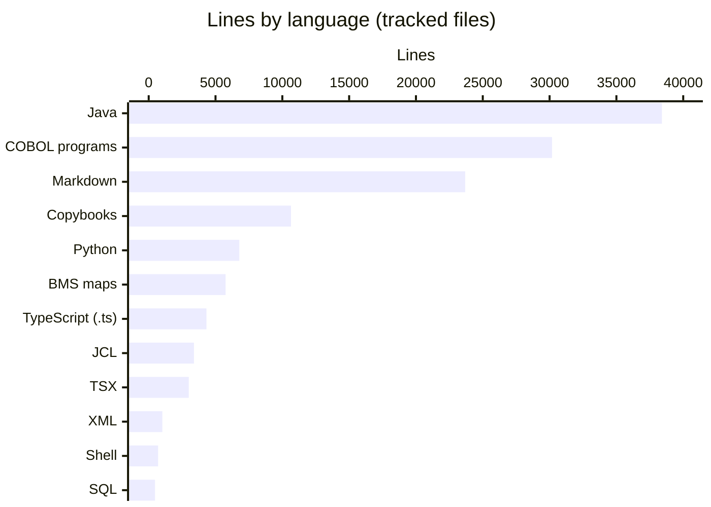
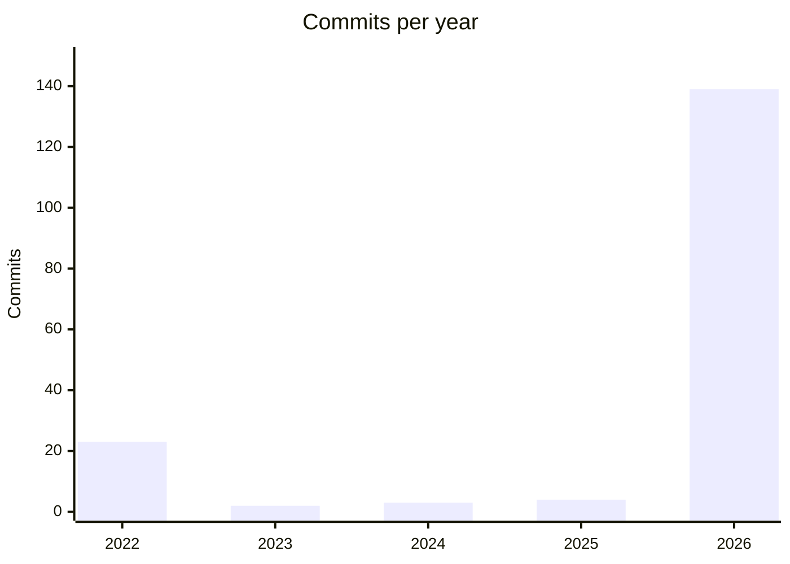

# By the numbers

Data collected on 2026-10-29 at commit 467e0f0 (branch `modernization`). All counts cover files tracked by git, so the untracked `droid-wiki/` directory is excluded. Line counts are newline counts, the same as `wc -l`.

## Overview

The repository holds 909 tracked files. About half of them (526) live under `modernization/`, the rebuilt application and its evidence, and 240 live under `app/`, the original COBOL application. Java is now the largest language by lines, just ahead of COBOL. Almost all history since 2023 happened in two days of October 2026. For how the two halves fit together, see [Architecture](overview/architecture.md).

## Size

### Lines by language

| Language (extension) | Files | Lines |
|:--|--:|--:|
| Java (`.java`) | 320 | 38,405 |
| COBOL programs (`.cbl`, `.CBL`) | 44 | 30,181 |
| Markdown (`.md`) | 73 | 23,683 |
| COBOL copybooks (`.cpy`, `.CPY`, including generated BMS copybooks) | 62 | 10,650 |
| Python (`.py`) | 49 | 6,782 |
| BMS maps (`.bms`) | 21 | 5,756 |
| TypeScript (`.ts`) | 25 | 4,323 |
| JCL (`.jcl`) plus procedures (`.prc`) | 55 + 6 | 3,385 + 588 |
| TSX (`.tsx`) | 26 | 3,000 |
| XML (mostly Maven `pom.xml`) | 19 | 1,022 |
| Shell (`.sh`) | 18 | 704 |
| SQL (`.sql`, Flyway migrations) | 6 | 473 |

The 30,181 COBOL lines match the total in the specification's context table (`modernization/spec/components.md`, line 54).

### Files by role

Files were sorted by path and extension: anything under a `tests/`, `test/`, `src/test/`, `e2e/`, or `verification/` directory is a test; Markdown, images, `docs/`, and `diagrams/` are docs; JSON, YAML, XML, TOML, properties, Makefiles, and `.github/` are config; sample datasets and archives are data; everything else is source.

| Role | Files | Lines |
|:--|--:|--:|
| Source (COBOL, JCL, BMS, Java main, TypeScript, Python tooling, scripts) | 569 | 78,296 |
| Test and verification | 175 | 29,522 |
| Docs (Markdown and diagrams) | 86 | 23,683 Markdown lines, plus 11 PNG images |
| Config and build | 52 | 7,643 |
| Data (sample datasets, runtime archives) | 27 | 3,726 |

The source count includes 45 small marker files under `scripts/markers/`, which the mainframe upload helpers use. They add almost no lines.

### Backend modules

`modernization/backend/pom.xml` lists 18 Maven modules. The table counts Java files under `src/main/java` and `src/test/java` of each module. The `schema` module holds only Flyway SQL, so it has no Java files. Module roles are described in [Modules](modules/index.md).

| Module | Main files | Main lines | Test files | Test lines |
|:--|--:|--:|--:|--:|
| account | 29 | 1,845 | 6 | 1,407 |
| iam | 25 | 1,986 | 10 | 1,954 |
| authorization | 25 | 2,754 | 10 | 3,118 |
| refdata | 23 | 2,200 | 7 | 2,132 |
| common | 20 | 812 | 0 | 0 |
| dataexchange | 19 | 1,240 | 5 | 1,138 |
| card | 13 | 1,320 | 6 | 1,592 |
| transaction | 13 | 1,097 | 8 | 1,396 |
| cycle | 12 | 1,086 | 2 | 279 |
| inquiry | 11 | 687 | 3 | 990 |
| reporting | 10 | 877 | 4 | 737 |
| batch | 9 | 1,297 | 16 | 2,187 |
| migration | 9 | 1,028 | 0 | 0 |
| test-support | 7 | 283 | 0 | 0 |
| billpay | 2 | 336 | 3 | 743 |
| app | 1 | 13 | 6 | 1,195 |
| billpay-service | 1 | 24 | 5 | 652 |
| schema | 0 | 0 | 0 | 0 |
| Total | 229 | 18,885 | 91 | 19,520 |

The modules with no tests of their own (`common`, `migration`, `test-support`) are exercised through the other modules' tests. The `cycle` module has few tests because most cycle behaviour is tested from the `batch` module, which runs the jobs.

### Other parts of the modern stack

| Directory | Files | Lines | Average lines per file |
|:--|--:|--:|--:|
| `modernization/backend` (all files, including SQL and properties) | 349 | 39,967 | 115 |
| `modernization/web` (of which `src` is 32 files, 3,627 lines) | 38 | 5,051 | 133 |
| `modernization/e2e` (Playwright) | 25 | 4,553 | 182 |
| `modernization/verification` | 40 | 6,401 | 160 |
| `modernization/airflow` | 13 | 964 | 74 |
| `modernization/ops` | 7 | 383 | 55 |
| `modernization/spec` | 48 | 17,771 | 370 |
| `modernization/decisions` | 3 | 1,348 | 449 |

### Specification size

`modernization/spec/programs/` has 44 program files, one per COBOL program (31 base programs and 13 in the optional modules). The summary table in `modernization/spec/components.md` counts 2,191 unique specification IDs, including 444 business rules (BR), 171 validation rules (VR), 150 navigation rules (NAV), 287 error rules (ERR), and 611 quirks (Q). The two ledgers in `modernization/decisions/` hold 621 rows that start with a Q- ID (226 in `modernization/decisions/ledger-online.md`, 395 in `modernization/decisions/ledger-batch-data.md`). The generated matrix in `modernization/verification/traceability.md` reports 1,883 of 1,883 owed IDs covered or resolved, from 1,051 tests. See [Specification](verification/specification.md) and [Traceability](verification/traceability.md).

## Activity

### Commits per year and month

The branch has 171 commits in total: 32 inherited from the upstream default branch (`origin/main`) and 139 added on `modernization`.

| Month | Commits | Where |
|:--|--:|:--|
| 2022-08 | 1 | upstream |
| 2022-09 | 8 | upstream |
| 2022-10 | 11 | upstream |
| 2022-11 | 1 | upstream |
| 2022-12 | 2 | upstream |
| 2023-01 | 1 | upstream |
| 2023-02 | 1 | upstream |
| 2024-09 | 2 | upstream |
| 2024-12 | 1 | upstream |
| 2025-08 | 1 | upstream |
| 2025-09 | 1 | upstream |
| 2025-10 | 2 | upstream |
| 2026-10 | 139 | `modernization` branch |

Months not listed had no commits.

### The October 2026 burst

Upstream history is slow and spread out: 32 commits over about three years, from 2022-08-22 to 2025-10-16, six of them pull-request merges. The `modernization` branch adds 139 commits in three days: 1 on 2026-10-27, 73 on 2026-10-28, and 65 on 2026-10-29. Of these, 32 are merge commits, because the work ran in parallel branches (for example `w1-data`, `w2-batch`, `w3-iam-card`) that were merged back. The non-merge branch commits added 83,561 lines and deleted 2,723. For comparison, the whole upstream history added 71,126 lines and deleted 11,974 (text files only). The [Lore](lore.md) page walks through the phases of the burst.

### Churn hotspots (last 90 days)

The last 90 days contain only branch commits, which touched 590 distinct files. Counts are file changes, so one commit that edits three files under a directory counts three times.

| Directory | File changes |
|:--|--:|
| `modernization/spec/programs` | 124 |
| `modernization/web/src` | 75 |
| `modernization/backend/authorization` | 67 |
| `modernization/backend/batch` | 60 |
| `modernization/e2e/tests` | 57 |
| `modernization/verification/parity` | 51 |
| `modernization/backend/refdata` | 50 |
| `modernization/backend/iam` | 49 |
| `modernization/backend/account` | 42 |
| `modernization/backend/card` | 33 |
| `modernization/backend/transaction` | 33 |

| File | Commits touching it |
|:--|--:|
| `modernization/architecture.md` | 14 |
| `modernization/decisions/ledger-batch-data.md` | 12 |
| `modernization/backend/batch/src/main/java/com/carddemo/batch/BatchCommandLine.java` | 12 |
| `modernization/decisions/ledger-online.md` | 11 |
| `modernization/spec/components.md` | 10 |
| `modernization/web/src/screens.ts` | 7 |
| `modernization/spec/entities.md` | 7 |
| `modernization/airflow/dags/carddemo_daily_cycle.py` | 7 |

The specification and the decision ledgers changed more often than any code file. That fits the review rounds described in [Migration context](background/migration-context.md), where audit findings were fixed in the spec first and then in code and tests.

## Bot-attributed commits

139 of 171 commits (81.3 percent) carry a `Co-authored-by: factory-droid[bot]` trailer. One more commit, the 2022 initial commit, has the author name "Amazon GitHub Automation". Together that is 140 of 171 commits (81.9 percent) with some automation attribution. Every branch commit has the trailer; no upstream commit does.

Treat this as a lower bound. It only counts commits where a tool left a trailer or used a bot-like author name. Commits made with tool help but without a trailer are not detectable from git metadata.

## Complexity

### Average file size by directory

| Directory | Files | Average lines per file |
|:--|--:|--:|
| `app/cbl` (base COBOL programs) | 31 | 666 |
| `modernization/decisions` | 3 | 449 |
| `modernization/spec` | 48 | 370 |
| `modernization/e2e` | 25 | 182 |
| `modernization/verification` | 40 | 160 |
| `tools/carddemo` | 12 | 150 |
| `modernization/backend` | 349 | 115 |
| `modernization/web/src` | 32 | 113 |
| `app/cpy` | 30 | 93 |
| `modernization/airflow` | 13 | 74 |
| `app/jcl` | 38 | 64 |
| `tests` (root pytest) | 13 | 52 |

A base COBOL program is on average almost six times longer than a backend Java file.

### Largest COBOL programs

| Program | Lines |
|:--|--:|
| `app/cbl/COACTUPC.cbl` | 4,236 |
| `app/app-transaction-type-db2/cbl/COTRTLIC.cbl` | 2,098 |
| `app/app-transaction-type-db2/cbl/COTRTUPC.cbl` | 1,702 |
| `app/cbl/COCRDUPC.cbl` | 1,560 |
| `app/cbl/COCRDLIC.cbl` | 1,459 |
| `app/app-authorization-ims-db2-mq/cbl/COPAUS0C.cbl` | 1,032 |
| `app/app-authorization-ims-db2-mq/cbl/COPAUA0C.cbl` | 1,026 |
| `app/cbl/COACTVWC.cbl` | 941 |
| `app/cbl/CBSTM03A.CBL` | 924 |
| `app/cbl/COCRDSLC.cbl` | 887 |

The smallest is `app/cbl/COBSWAIT.cbl` at 41 lines. The largest copybook is `app/cpy/CSLKPCDY.cpy` (1,318 lines), a lookup table of North American phone area codes and US state codes.

### Largest Java files

| File | Lines |
|:--|--:|
| `modernization/backend/refdata/src/test/java/com/carddemo/refdata/TranTypeListScreenTest.java` | 772 |
| `modernization/backend/account/src/test/java/com/carddemo/account/AccountUpdateScreenTest.java` | 709 |
| `modernization/backend/refdata/src/main/java/com/carddemo/refdata/web/ListTurn.java` | 709 |
| `modernization/backend/app/src/test/java/com/carddemo/app/SecurityMatrixTest.java` | 669 |
| `modernization/backend/authorization/src/test/java/com/carddemo/authorization/AuthorizationMessagingTest.java` | 669 |
| `modernization/backend/batch/src/main/java/com/carddemo/batch/BatchCommandLine.java` | 593 |

The largest main-code Java files trace back to the largest COBOL programs: `modernization/backend/refdata/src/main/java/com/carddemo/refdata/web/ListTurn.java` implements the COTRTLIC list screen, and the account update tests cover COACTUPC.

### Test-to-code ratio

For backend Java, test lines (19,520) slightly exceed main lines (18,885), a ratio of 1.03. By file count the ratio is 91 test files to 229 main files (0.40), because test classes are fewer and longer than the small controller and repository classes. Verification scripts, Playwright specs, and Airflow tests add another 11,417 lines of test and harness files outside the backend (`modernization/verification`, `modernization/e2e`, and `modernization/airflow/tests`). See [Testing](how-to-contribute/testing.md).
