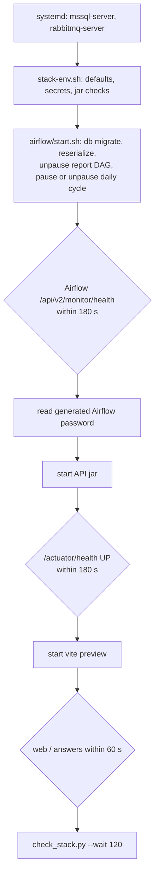

# Deployment

The modern CardDemo stack is deployed in one way only: every process on one Linux machine, bound to 127.0.0.1, started and stopped by the shell scripts in `modernization/ops` and `modernization/airflow`. There are no containers, no cloud templates, and no continuous deployment. This page covers the scripts, ports, files, and the order things start in.

## What gets deployed where

| Component | Address | How it runs | Started by |
|:--|:--|:--|:--|
| SQL Server 2025 Developer, database `carddemo` | 127.0.0.1:1433 | systemd service `mssql-server` | the OS (installed once, `modernization/README.md`) |
| RabbitMQ 3.12, vhost `carddemo` | 127.0.0.1:5672, management 127.0.0.1:15672 | systemd service `rabbitmq-server`, bound by `/etc/rabbitmq/rabbitmq.conf` | the OS |
| Airflow 3 api-server, scheduler, dag-processor | 127.0.0.1:8080 | three `airflow` processes from the venv in `~/.carddemo/airflow-venv` | `modernization/airflow/start.sh`, called by `up.sh` |
| Online API | 127.0.0.1:8081 | `java -Xmx512m -jar modernization/backend/app/target/carddemo-api.jar` | `modernization/ops/up.sh` |
| Web app | 127.0.0.1:5173 | `vite preview` of `modernization/web/dist`, proxying `/api` and `/actuator` | `modernization/ops/up.sh` |
| Bill-payment service | 127.0.0.1:8091 | `java -Xmx384m -jar modernization/backend/billpay-service/target/carddemo-billpay-service.jar` | `modernization/ops/billpay.sh` (separate, optional) |
| Batch jar | none (a command) | `java -jar modernization/backend/batch/target/carddemo-batch.jar <COMMAND>` | Airflow tasks, `db-reset.sh`, `load.sh` |

The Makefile targets in `modernization/Makefile` wrap the scripts: `setup`, `db-reset`, `load`, `up`, `down`, `status`, `smoke`, `billpay`. The app ports can be moved with `CARDDEMO_API_PORT`, `CARDDEMO_WEB_PORT`, `CARDDEMO_AIRFLOW_PORT`, and `CARDDEMO_BILLPAY_PORT`; the API's own `server.port` is overridden through `SERVER_PORT` by `up.sh`.

## Startup order



Airflow starts first because its api-server writes the generated password file that the API needs to trigger report runs (comment in `modernization/ops/up.sh`). The API declares its RabbitMQ queues when it connects, so the queue check only passes after the API is up.

## The scripts

| Script | What it does |
|:--|:--|
| `modernization/ops/stack-env.sh` | Sourced by every other script. Sets defaults that keep any value already in the environment (`CARDDEMO_DB=carddemo`, the four ports, `CARDDEMO_RUN=~/.carddemo/run`, `AIRFLOW_HOME=~/.carddemo/airflow`, inbox and outbox, jar paths, `AIRFLOW_USERNAME=carddemo`). Reads `~/.carddemo/secrets.env` only when `CARDDEMO_DB_PASSWORD` is not set, and prints no secret. Defines `require_secrets`, `require_file`, `batch`, `pid_alive`, `stop_group`, `wait_http` |
| `modernization/ops/db-reset.sh` | As `sa`, drops and re-creates `$CARDDEMO_DB`, adds login `carddemo_app` as `db_owner`, then runs `carddemo-batch.jar reset` to apply every Flyway migration. Refuses names that are not plain identifiers and the system databases. Stop the stack first: open connections are rolled back |
| `modernization/ops/load.sh` | `carddemo-batch.jar load` of `app/data/ASCII`, the USRSEC users (`usrsec=`), and the IMS pending-authorization unload (`ims=`). Run once on a fresh database; a second load fails on duplicate keys |
| `modernization/ops/up.sh` | Starts Airflow, the API, and the web app in the order above, each in its own process group (`setsid nohup`), and ends with the stack check. Needs `CARDDEMO_DB_PASSWORD`, `RABBITMQ_PASSWORD`, both jars, and `web/dist/index.html` |
| `modernization/ops/billpay.sh` | Starts the bill-payment service alone and waits up to 120 s for its health |
| `modernization/ops/down.sh` | Stops web, API, billpay, then Airflow. Each `stop_group` sends TERM to the process group, waits up to 30 s, then KILL, and removes the pid file. Safe when nothing runs |
| `modernization/ops/check_stack.py` | Prints one line per check and `stack check: N/8 passed`; exit 1 on any failure. `--wait N` retries for N seconds |
| `modernization/airflow/env.sh` | Airflow settings: `AIRFLOW_HOME`, DAGs folder `modernization/airflow/dags`, no examples, new DAGs unpaused, api-server on 127.0.0.1, simple auth manager user `carddemo:admin`, the venv on `PATH`. Source it before any manual `airflow` command |
| `modernization/airflow/start.sh` | `airflow db migrate`, `airflow dags reserialize`, unpauses `carddemo_transaction_report`, pauses `carddemo_daily_cycle` unless `CARDDEMO_CYCLE_SCHEDULE=on`, then starts api-server, scheduler, and dag-processor (skipping any already running) |
| `modernization/airflow/stop.sh` | Stops the three Airflow process groups the same way as `stop_group` |

### The eight stack checks

`modernization/ops/check_stack.py`, run at the end of `up` and by `make -C modernization status`:

1. **api health**: `GET /actuator/health` on the API returns 200 with `"UP"`.
2. **web app**: `GET /` on the web port returns the page with `<div id="root"`.
3. **web proxy to api**: `GET /actuator/health` through the web port returns `"UP"`.
4. **airflow health**: `/api/v2/monitor/health` reports `metadatabase` and `scheduler` healthy.
5. **airflow owed DAGs**: `carddemo_daily_cycle`, `carddemo_transaction_report`, `carddemo_auth_purge`, and `carddemo_trantype_maintenance` are listed (with a token from `POST /auth/token`).
6. **report DAG unpaused**: `carddemo_transaction_report` has `is_paused=false`.
7. **airflow import errors**: `/api/v2/importErrors` has zero entries.
8. **rabbitmq queues**: all eight queues exist in vhost `carddemo`, checked by passive declare over AMQP (see [Message queues](api/message-queues.md)).

If the Airflow token cannot be obtained, checks 5-7 collapse into one failing `airflow REST API` line.

## Files outside the repository

| Path | Contents |
|:--|:--|
| `~/.carddemo/secrets.env` | `MSSQL_SA_PASSWORD`, `CARDDEMO_DB_PASSWORD`, `RABBITMQ_PASSWORD`; mode 600, never committed. See [Security](security.md) |
| `~/.carddemo/run/` (`CARDDEMO_RUN`) | `api.pid`, `web.pid`, `billpay.pid`; `api.log`, `web.log`, `billpay.log`; `carddemo-batch.log` from `db-reset` and `load` |
| `~/.carddemo/airflow/` (`AIRFLOW_HOME`) | `airflow.cfg`, SQLite metadata `airflow.db`, `logs/` (task logs), `run/` (pid files and logs of the three Airflow services, `db-migrate.log`, `reserialize.log`), and the generated simple-auth password file |
| `~/.carddemo/inbox/<date>/` | Batch inputs, for example `dailytran.txt` for a cycle date |
| `~/.carddemo/outbox/<date>/`, `outbox/reports/<run id>/`, `outbox/logs/` | Batch outputs (rejects, statements), report files, and the batch jar's log when run by Airflow |
| `~/.carddemo/airflow-venv/` | Python 3.12 venv with Airflow 3.3.2 |

## Idempotence and starting over

`up.sh` checks each pid file with `kill -0` and leaves a running service alone, so `make -C modernization up` can be repeated; `airflow/start.sh` does the same per Airflow service. It does not restart a service whose code changed: run `down` first for that.

To start over from a clean database:

```sh
make -C modernization down
make -C modernization db-reset
make -C modernization load
make -C modernization up
```

## The daily cycle schedule

`carddemo_daily_cycle` is scheduled at 22:00 UTC Monday to Friday but is paused at every start, so the stack never posts on its own. Start the stack with `CARDDEMO_CYCLE_SCHEDULE=on` to unpause it, or run `airflow dags unpause carddemo_daily_cycle` after sourcing `modernization/airflow/env.sh` (lasts until the next start). There is no catchup; missed dates are triggered by hand with conf `{"business_date": "YYYY-MM-DD"}`. Details are in [Daily batch cycle](features/daily-batch-cycle.md) and [Airflow](applications/airflow.md).

## What does not exist

- No Dockerfile, compose file, Kubernetes manifest, Terraform, or cloud template for the modern stack.
- No CD. `.github/workflows/release.yml` runs on a pushed `v*` tag and publishes a GitHub release with a `git archive` tarball of the whole repository and generated notes; it builds and deploys nothing. `.github/workflows/ci.yml` runs only the root COBOL tooling checks and gitleaks, not the modernization suites (see [Tooling](how-to-contribute/tooling.md)).
- No TLS on any port, and no reverse proxy. Everything relies on loopback binding.
- For the original COBOL application, deployment to a real mainframe is manual: the `README.md` Installation section and the helpers in `scripts/` (see [Local tooling](mainframe/local-tooling.md)).

## Related pages

- [Getting started](overview/getting-started.md) for the build and first run
- [How to monitor](how-to-monitor.md) for logs and health once it is running
- [Configuration](reference/configuration.md) for every environment variable and property
- [Debugging](how-to-contribute/debugging.md) for failed starts
