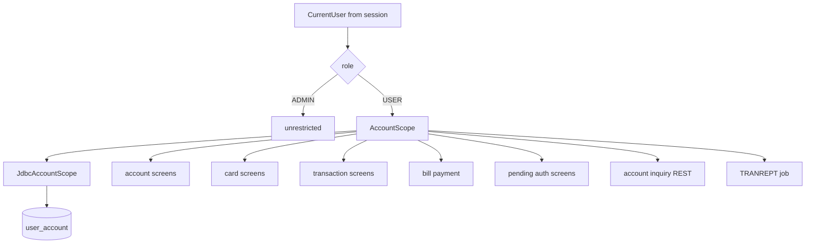

# Account scoping

Active contributors: factory-aj-pahl

A regular user sees only the accounts linked to their user ID, and only the cards, transactions, bill payments, reports, and pending authorizations of those accounts; an admin is unrestricted. This is user decision D-USER-ACCT (`modernization/decisions/README.md`), applied in code as convention C-SCOPE (`modernization/decisions/ledger-online.md`). The COBOL had no such rule: any signed-on user could open any account.

## Overview

The rule has three parts:

1. **Links.** The table `user_account (user_id, account_id)` in `modernization/backend/schema/src/main/resources/db/migration/V1__core_schema.sql` holds which accounts a regular user owns. Deleting a user cascades to the links.
2. **One check.** The interface `AccountScope` in `modernization/backend/common/src/main/java/com/carddemo/common/security/AccountScope.java` has `canAccess(user, accountId)` and `linkedAccounts(userId)`. Its only implementation, `JdbcAccountScope` in the IAM module, returns `true` for every admin and otherwise counts the matching `user_account` rows.
3. **Same answer as missing.** C-SCOPE requires that an out-of-scope key is answered exactly like a key that does not exist, with the program's own not-found message. Lists, paging, and "last record" lookups are computed over the in-scope rows only, so a user cannot learn that another account exists.

## Where the links come from

- **Seed (D-SEED).** `SampleDataLoader.linkAccountsRoundRobin` in `modernization/backend/migration/src/main/java/com/carddemo/migration/SampleDataLoader.java` links account *i*, in key order, to regular user *i mod n*, in user-ID order. It runs after the USRSEC users are loaded, when `modernization/ops/load.sh` calls the batch jar `load` command with `usrsec=`. The sample USRSEC file has 5 regular users and 5 admins, so each regular user gets 10 of the 50 sample accounts, and `modernization/verification/data/owed-files.md` expects 50 links.
- **User maintenance.** The user add and update screens (COUSR01C, COUSR02C) have a linked-accounts field that is not in the COBOL. `modernization/backend/iam/src/main/java/com/carddemo/iam/internal/UserMaintenance.java` checks it (rule A-3): entries must be 11-digit account numbers (`Linked accounts must be 11 digit numbers...`), only regular users can have links (`Only regular users can have linked accounts...`), and each account must exist. `UserAdminRepository.replaceLinks` replaces the whole set. The existence check reads the `account` table directly because the Account context publishes no existence check yet (`modernization/architecture.md`, section 3).
- **Concurrency.** User update uses a SHA-256 fingerprint of names, type, password hash, and account links as its version, so a concurrent change to the links is detected even though the links live in another table (`modernization/architecture.md`, section 3).

## Enforcement points

Every call of `canAccess` or `linkedAccounts` outside tests, found with `rg "canAccess|linkedAccounts" modernization`:

| Context | Screen or job | File | How scope is applied |
|:--|:--|:--|:--|
| Account | COACTVWC view, COACTUPC update | `modernization/backend/account/src/main/java/com/carddemo/account/web/AccountLookup.java` | Out of scope means no cross-reference is read, so the screen shows its normal account-not-found path |
| Card | COCRDLIC list | `modernization/backend/card/src/main/java/com/carddemo/card/web/CardListController.java` | The list filter carries the user's linked accounts (null for admins), so paging covers only in-scope cards |
| Card | COCRDSLC view, COCRDUPC update | `modernization/backend/card/src/main/java/com/carddemo/card/internal/CardLookup.java` | A card is found only when it belongs to the typed account and that account is in scope |
| Transaction | COTRN00C list, COTRN01C view | `modernization/backend/transaction/src/main/java/com/carddemo/transaction/web/TransactionReader.java` | `scopeOf` turns linked accounts into their cards; `cardInScope` checks one transaction's card through the cross-reference |
| Transaction | COTRN02C add | `modernization/backend/transaction/src/main/java/com/carddemo/transaction/web/TransactionAddController.java` | A typed account out of scope gets the account-not-found message; a typed card whose account is out of scope gets the card-not-found message |
| Bill payment | COBIL00C balance and pay | `modernization/backend/billpay/src/main/java/com/carddemo/billpay/internal/BillPaymentService.java` | `balance` returns empty and `pay` returns `NotFound` for an out-of-scope account |
| Authorization | COPAUS0C list | `modernization/backend/authorization/src/main/java/com/carddemo/authorization/web/PendingAuthListController.java` | Out of scope means no card is looked up, so the account is answered as not in the cross-reference |
| Authorization | COPAUS1C detail and fraud toggle | `modernization/backend/authorization/src/main/java/com/carddemo/authorization/web/PendingAuthDetailController.java` | `inScope` is checked before showing, paging (PF8), and marking fraud (PF5); out of scope shows `Authorization not found...` |
| Inquiry | `GET /api/inquiry/account/{id}` | `modernization/backend/inquiry/src/main/java/com/carddemo/inquiry/internal/AccountInquiryService.java` | Out of scope returns `NotFound`, answered 404 like a missing account |
| Reporting | TRANREPT job (D-REPORT) | `modernization/backend/batch/src/main/java/com/carddemo/batch/cycle/CycleJobsConfig.java` | The job reads the requester's role; a USER's report covers `linkedAccounts`, an unknown user ID gets no accounts, an admin or a run without a user covers all |

Two related rules are not account checks but follow the same idea:

- **Report runs.** `ReportService.visibleRuns` and `visibleRun` in `modernization/backend/reporting/src/main/java/com/carddemo/reporting/internal/ReportService.java` show a regular user only their own runs and let an admin see every run. See [Transaction reports](transaction-reports.md).
- **Queue requests.** The RabbitMQ account inquiry and the authorization request queue have no signed-on user, so `AccountInquiryService.answer(byte[])` and the authorization engine do not apply `AccountScope`. Ledger row Q-COACCT01-15 in `modernization/decisions/ledger-batch-data.md` instead requires broker requesters to authenticate and have permission on the request queue.

## Wiring across modules

`AccountScope` is defined in `common` and implemented in `iam`, so contexts that run without IAM must still start. The card and authorization components take it as an `ObjectProvider<AccountScope>` and resolve it per call (`CardLookup`, `CardListController`, `PendingAuthListController`, `PendingAuthDetailController`); `modernization/architecture.md` explains that this lets contexts that depend on Card, such as cycle, start without IAM. The batch jar imports `JdbcAccountScope` explicitly for the report job (`modernization/backend/batch/src/main/java/com/carddemo/batch/BatchApplication.java`). `TransactionReader` lives in the transaction `web` package because the batch jar scans `transaction.internal` without an account scope (comment in `TransactionReader.java`).

## Entry points for modification

- **A new screen that reads account data:** inject `AccountScope` (or `ObjectProvider<AccountScope>` if the module can run without IAM), call `canAccess` before any read that could reveal existence, and return the screen's own not-found message when it fails.
- **A new list:** filter by `linkedAccounts` in the query itself so paging and boundary messages count only in-scope rows.
- **A different ownership model:** replace `JdbcAccountScope`; the callers depend only on the interface.

## Tests

Scope tests sit next to each screen's tests, for example `modernization/backend/card/src/test/java/com/carddemo/card/CardListTest.java`, `modernization/backend/transaction/src/test/java/com/carddemo/transaction/TransactionListScreenTest.java`, `modernization/backend/billpay/src/test/java/com/carddemo/billpay/BillPaymentLookupTest.java`, `modernization/backend/inquiry/src/test/java/com/carddemo/inquiry/AccountInquiryMessagingTest.java`, and `modernization/backend/batch/src/test/java/com/carddemo/batch/TranreptJobTest.java`. In the browser, `modernization/e2e/tests/authorizations.spec.ts` has the test "A-2 C-SCOPE an account that is not linked to the user is answered as not in the cross-reference". `modernization/verification/schedule/verify_report.py` filters the reference input to the user's linked cards when it checks a regular user's report.

## Key source files

| File | Purpose |
|:--|:--|
| `modernization/backend/common/src/main/java/com/carddemo/common/security/AccountScope.java` | The scope interface |
| `modernization/backend/iam/src/main/java/com/carddemo/iam/internal/JdbcAccountScope.java` | Implementation over `user_account` |
| `modernization/backend/iam/src/main/java/com/carddemo/iam/internal/UserAdminRepository.java` | Reads and replaces a user's links |
| `modernization/backend/iam/src/main/java/com/carddemo/iam/internal/UserMaintenance.java` | Link field validation on user add and update |
| `modernization/backend/migration/src/main/java/com/carddemo/migration/SampleDataLoader.java` | D-SEED round-robin links |
| `modernization/backend/schema/src/main/resources/db/migration/V1__core_schema.sql` | `user_account` table and index |

## Related pages

- [Sign-on and sessions](sign-on-and-sessions.md) for where `CurrentUser` comes from
- [Security](../security.md) for scoping as part of the trust model
- [IAM](../modules/iam.md) and [Data models](../reference/data-models.md)
