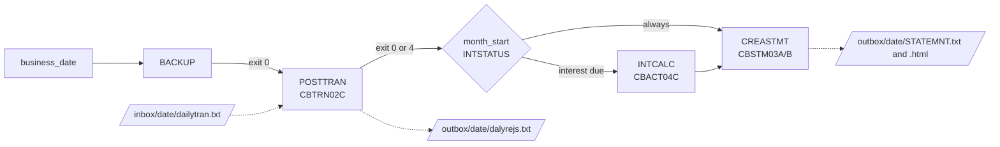
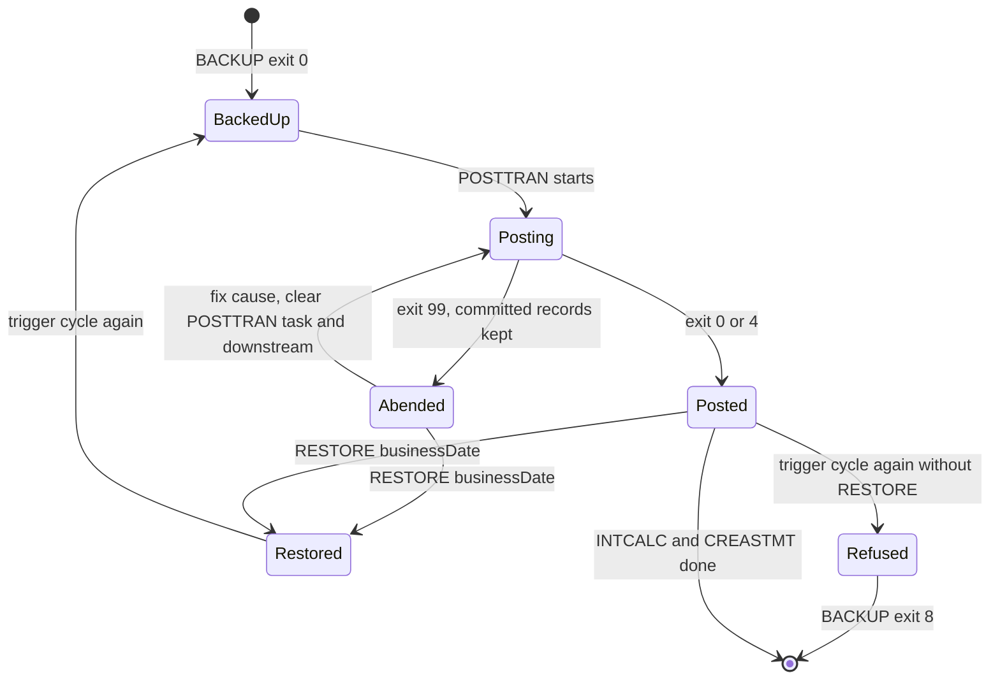

# Daily batch cycle

Active contributors: factory-aj-pahl

The daily batch cycle posts the day's card transactions, charges monthly interest on the first business day of a month, and writes customer statements. It is the Airflow DAG `carddemo_daily_cycle`, which runs the batch jar once per step against SQL Server and the inbox and outbox directories. It replaces the JCL jobs POSTTRAN, INTCALC, COMBTRAN, and CREASTMT and their CA7 and Control-M schedules.

## Overview

The step order follows the runbook (decision D-CYCLE, amended by D-INTEREST): posting and statements every business day, interest once a month after that day's posting and before its statements. The CA7 and Control-M definitions in `app/scheduler` disagree with each other and with the runbook, which is why `modernization/spec/jobs.md` and `modernization/architecture.md` (section 5) pick the runbook order. Online screens stay available during the cycle (D-BATCH-WINDOW); database transactions and row locks keep both sides consistent.

## The DAG

`modernization/airflow/dags/carddemo_daily_cycle.py`:

| Task | Command run by `run_batch` | Notes |
|:--|:--|:--|
| `business_date` | none | The `business_date` param of a manual run as given; otherwise the logical date, and the run is skipped if that is not a business day |
| `BACKUP` | `BACKUP businessDate=<d>` | Snapshot before posting; must exit 0 |
| `POSTTRAN` | `POSTTRAN businessDate=<d> dailyFile=$CARDDEMO_INBOX/<d>/dailytran.txt rejectsFile=$CARDDEMO_OUTBOX/<d>/dalyrejs.txt` | Exit 4 means some records were rejected and still succeeds |
| `month_start` | `INTSTATUS businessDate=<d>` | Branch: `INTCALC` and `CREASTMT`, or only `CREASTMT` |
| `INTCALC` | `INTCALC businessDate=<d>` | At most one completed run per calendar month |
| `CREASTMT` | `CREASTMT businessDate=<d> stmtFile=.../STATEMNT.txt htmlFile=.../STATEMNT.html` | Trigger rule `none_failed_min_one_success`, so it runs whether or not INTCALC was skipped |

Settings in the `@dag` decorator: `max_active_runs=1`, `catchup=False`, `is_paused_upon_creation=True`, and no `start_date`, so unpausing a DAG that never ran waits for the next 22:00 weekday instead of running a past date at once.

### Schedule, business date, and holidays

- The schedule is `CronTriggerTimetable("0 22 * * 1-5", timezone="UTC")`. A scheduled run's logical date is its trigger time, so the Friday 22:00 UTC run posts that Friday.
- Business days are Monday to Friday minus the dates in the `CARDDEMO_HOLIDAYS` environment variable (comma-separated `YYYY-MM-DD`, empty by default), read by `holidays()` in `modernization/airflow/dags/carddemo_batch.py`. A scheduled run on a holiday skips every task and succeeds.
- A manual run with conf `{"business_date": "YYYY-MM-DD"}` posts that date whatever the calendar says.
- Dates missed while the DAG was paused are not re-run automatically; an operator triggers them by hand.
- `modernization/airflow/start.sh` pauses the DAG on every start unless `CARDDEMO_CYCLE_SCHEDULE=on`, so a developer stack never posts on its own. `airflow dags unpause carddemo_daily_cycle` turns the schedule on until the next start.

### When interest runs

`interest_due` in `modernization/airflow/dags/carddemo_batch.py` decides the branch (B-CYCLE, D-INTEREST, Q-CBACT04C-08). The `INTSTATUS` command (`modernization/backend/batch/src/main/java/com/carddemo/batch/BatchCommandLine.java`) reads completed INTCALC job instances from the Spring Batch tables and prints either `INTEREST ALREADY CALCULATED FOR <month>` or `INTEREST NOT CALCULATED FOR <month>; LAST CALCULATED FOR <month>` (or `NO EARLIER MONTH CALCULATED`). Interest is due when the month is not yet calculated and the date is a business day, and either the date is the month's first business day or an earlier month has been calculated on this database. The second condition is the catch-up: if the first business day's cycle was missed, the next business-day run charges the month. A freshly loaded database has no record of months the mainframe already charged, so a mid-month date there does not charge the month again.

INTCALC inserts its interest transactions directly into `card_transaction`, so the COMBTRAN sort and merge and the TRANBKP and TRANIDX steps have no equivalent. The formula (annual rate / 1200) is unchanged.

## Inbox, outbox, and logs

`inbox()` and `outbox()` in `modernization/airflow/dags/carddemo_batch.py` default to `~/.carddemo/inbox` and `~/.carddemo/outbox` and are overridden by `CARDDEMO_INBOX` and `CARDDEMO_OUTBOX`. The daily file is delivered to `<inbox>/<business date>/dailytran.txt`. Outputs land in `<outbox>/<business date>/`: `dalyrejs.txt` (rejects), `STATEMNT.txt` (text statements), and `STATEMNT.html` (HTML statements). The jar's job log goes to `<outbox>/logs` through `CARDDEMO_LOG_DIR`, and `run_batch` copies each SYSOUT line into the Airflow task log as `SYSOUT ...`.

## Exit codes in Airflow

`modernization/backend/batch/src/main/java/com/carddemo/batch/ExitCodes.java` defines the codes, and `_run_jar` in `carddemo_batch.py` maps them. 0 and 4 succeed; anything else raises `AirflowFailException`, which fails the task without retry.

| Code | Meaning in the cycle |
|:--|:--|
| 0 | Completed |
| 4 | POSTTRAN completed with at least one reject (step exit status `COMPLETED WITH REJECTS`) |
| 8 | Refused: `BACKUP REFUSED: POSTING ALREADY STARTED FOR <date>`, `POSTING ALREADY COMPLETED FOR <date>`, `INTEREST ALREADY CALCULATED FOR <month>`, or a repeated CREASTMT |
| 12 | `INVALID OR MISSING BUSINESS DATE` (B-DATE) |
| 16 | Usage error (unknown command or missing parameter) |
| 99 | Abend (B-ABEND): `ABEND CODE U999` on stderr after the step's abend lines and `ABENDING PROGRAM` |

## Units of work and restart (B-UOW)

`modernization/backend/batch/src/main/java/com/carddemo/batch/posting/PosttranJobConfig.java` builds POSTTRAN as a Spring Batch chunk step with a commit interval of 1. Each daily record, its posting or reject, and the step's restart position (lines read, processed and rejected counts, saved in the step execution context by `modernization/backend/batch/src/main/java/com/carddemo/batch/posting/PosttranStep.java`) commit together. After an abend the committed records stay, and a restart of the same job instance skips to the first uncommitted record. INTCALC is also a chunk step of size 1, one account per commit (`modernization/backend/batch/src/main/java/com/carddemo/batch/cycle/CycleJobsConfig.java`). CREASTMT is one tasklet whose transaction is the statement run's transaction (Q-CREASTMT-04).

The business logic itself is in the [Cycle](../modules/cycle.md) module: `PostingService` validates and posts one record, `InterestService` handles one account, and `StatementService` writes the statements.

### Rejects

`PostingService` (`modernization/backend/cycle/src/main/java/com/carddemo/cycle/internal/PostingService.java`) keeps the COBOL reason codes: 100 `INVALID CARD NUMBER FOUND`, 101 `ACCOUNT RECORD NOT FOUND`, 102 `OVERLIMIT TRANSACTION`, 103 `TRANSACTION RECEIVED AFTER ACCT EXPIRATION`, and 109 for an account rewrite that failed. Each reject is stored in `posting_reject` (`modernization/backend/cycle/src/main/java/com/carddemo/cycle/internal/PostingRejects.java`) and written to `dalyrejs.txt` in the DALYREJS layout. With the sample `dailytran.txt`, 300 records are processed and 38 are rejected with reason 102 (Q-CBTRN02C-08 in `modernization/decisions/ledger-batch-data.md`). The root `AGENTS.md` quotes 43 rejects because the root runner compiles without `-fsign=EBCDIC` and misreads the overpunched signs. The Java run is compared record for record with the GnuCOBOL reference built with `-fsign=EBCDIC` (see [Batch parity](../verification/batch-parity.md)).

### Statements and history (D-HISTORY)

`card_transaction` keeps full history, so online lists show earlier cycles. Each statement run is a row in `statement_run`, and `card_transaction.statement_run_id` marks the rows a run covered. A statement covers only transactions of the current cycle, which keeps the statement output identical to the COBOL's (`modernization/backend/cycle/src/main/java/com/carddemo/cycle/internal/StatementService.java`). Statements get no due date or minimum payment (DF-4).

## Backup, restore, and recovery

`modernization/backend/batch/src/main/java/com/carddemo/batch/backup/CycleBackupService.java` replaces the TRANBKP generation data group with snapshot tables from `modernization/backend/schema/src/main/resources/db/migration/V20__batch_cycle.sql` (`cycle_backup`, `cycle_backup_account`, `cycle_backup_transaction`, `cycle_backup_category`, `cycle_backup_interest`).

- **BACKUP** runs in one SERIALIZABLE transaction. It copies account balances and cycle totals, the list of transaction IDs with their statement marks, category balances, and interest markers, and records high-water marks for rejects, statement runs, and Spring Batch job instances.
- **Refusal.** BACKUP is refused with exit 8 when any POSTTRAN run for the date exists in the Spring Batch tables, whatever its status. A backup taken then would capture a posted or partly posted state, so a repeated trigger of the cycle stops at BACKUP with nothing changed.
- **RESTORE** (`RESTORE businessDate=<d>` takes the newest backup for the date; `RESTORE backupId=<n>` a specific one) puts the snapshot back in one SERIALIZABLE transaction. It deletes transactions, rejects, and statement runs added after the backup, restores changed values, and deletes the Spring Batch job runs started after the backup so POSTTRAN, INTCALC, and CREASTMT can run again. Online changes made before the backup are kept.

After a POSTTRAN abend an operator has two choices (`modernization/architecture.md`, section 4):

1. Fix the cause and clear the failed POSTTRAN task and its downstream tasks in the same DAG run. Spring Batch restarts the job from its last committed record on top of the backup already taken.
2. Run `RESTORE businessDate=<date>`, which returns to the state before the posting and forgets its job runs, then trigger the whole cycle for the date again. BACKUP is accepted again.

A new trigger without the restore stops at BACKUP with exit 8. The operating procedure for the original mainframe cycle is in `docs/runbooks/batch-operations.md`.

## Integration points

- **Database.** The cycle reads and writes the same tables as the online API, through the published `api` interfaces of the account, card, and transaction contexts (`modernization/backend/cycle/src/main/java/com/carddemo/cycle/api/`).
- **Spring Batch metadata.** The job tables from `modernization/backend/schema/src/main/resources/db/migration/V2__spring_batch.sql` carry the refusal rules: the POSTTRAN job instance is identified by the business date and the daily file path, and the INTCALC job instance by the interest month (`BatchCommandLine.posttran` and `BatchCommandLine.intcalc`).
- **Verification.** `modernization/verification/cycle/verify_cycle.py` (`make -C modernization verify-cycle`) runs the DAG for 2022-06-10 and the month start 2022-07-01 and compares the end state with the GnuCOBOL chain. See [Cycle, data, and report checks](../verification/cycle-data-and-report.md).

## Entry points for modification

| Change | Where |
|:--|:--|
| Step order or a new step | `modernization/airflow/dags/carddemo_daily_cycle.py` and a command in `BatchCommandLine.java` |
| Business-day or interest rule | `is_business_day`, `is_first_business_day`, `interest_due` in `modernization/airflow/dags/carddemo_batch.py` |
| Posting, interest, or statement logic | `modernization/backend/cycle/src/main/java/com/carddemo/cycle/internal/` |
| What BACKUP saves | `CycleBackupService.java` and `V20__batch_cycle.sql` (both backup and restore) |

## Key source files

| File | Purpose |
|:--|:--|
| `modernization/airflow/dags/carddemo_daily_cycle.py` | The DAG, schedule, branch |
| `modernization/airflow/dags/carddemo_batch.py` | Jar runner, exit-code mapping, holidays, interest rule, inbox/outbox |
| `modernization/backend/batch/src/main/java/com/carddemo/batch/BatchCommandLine.java` | Command parsing, refusals, INTSTATUS, BACKUP/RESTORE |
| `modernization/backend/batch/src/main/java/com/carddemo/batch/posting/PosttranStep.java` | POSTTRAN chunk step and restart state |
| `modernization/backend/batch/src/main/java/com/carddemo/batch/cycle/CycleJobsConfig.java` | INTCALC, CREASTMT, TRANVERIFY, TRANREPT jobs |
| `modernization/backend/batch/src/main/java/com/carddemo/batch/cycle/AbendListener.java` | Abend lines on a failed step |
| `modernization/backend/batch/src/main/java/com/carddemo/batch/backup/CycleBackupService.java` | Snapshot and restore |

## Tests

- `modernization/airflow/tests/test_carddemo_dags.py`, `test_carddemo_schedules.py`, `test_carddemo_batch.py` for the DAG shape, schedule, and helper rules (`make -C modernization test-airflow`)
- `modernization/backend/batch/src/test/java/com/carddemo/batch/PosttranJobTest.java`, `IntcalcJobTest.java`, `StatementJobTest.java`, `CycleBackupTest.java`, `CycleFailuresTest.java` (same directory) for the jobs, abends, and restore

See also [Batch jar](../applications/batch-jar.md), [Airflow](../applications/airflow.md), and [Batch and JCL](../mainframe/batch-and-jcl.md) for the original jobs.
