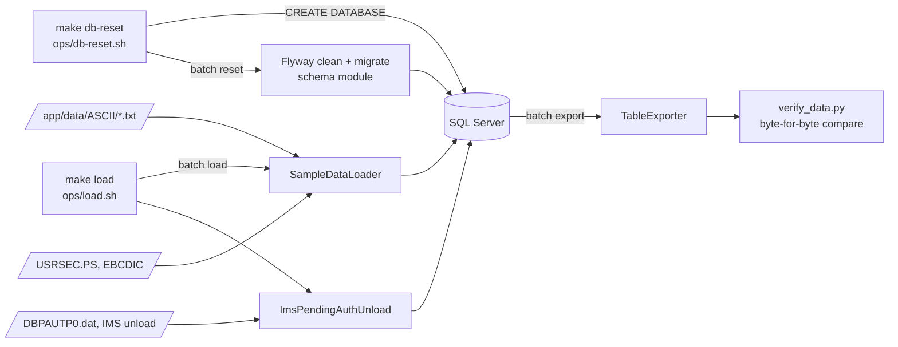

# Data migration

Active contributors: factory-aj-pahl

Data reaches SQL Server in two steps: Flyway migrations create the schema, and the batch jar's `load` command reads the mainframe sample files (fixed-width ASCII, EBCDIC users, and an IMS unload) into the tables. A reverse exporter writes the tables back in their legacy layouts so that a round-trip check can prove the load lost nothing. Flyway replaces the IDCAMS DEFINE jobs, and the loader replaces the setup JCL such as ACCTFILE, CARDFILE, and DUSRSECJ (`modernization/architecture.md`, section 4).

## Overview



## Step 1: schema (Flyway)

`modernization/ops/db-reset.sh` (`make -C modernization db-reset`) refuses system database names, drops and re-creates `$CARDDEMO_DB` (default `carddemo`) as `sa`, maps the `carddemo_app` login as `db_owner`, and runs `batch reset --spring.flyway.clean-disabled=false`. The `reset` command (`BatchCommandLine.reset` in `modernization/backend/batch/src/main/java/com/carddemo/batch/BatchCommandLine.java`) calls `flyway.clean()` and `flyway.migrate()` and prints `SCHEMA RESET`. Clean is disabled by default in `modernization/backend/batch/src/main/resources/application.properties`, so `reset` only works with that explicit flag.

The migrations are in the schema module, `modernization/backend/schema/src/main/resources/db/migration/`:

| File | Content |
|:--|:--|
| `V1__core_schema.sql` | Users, `user_account`, `audit_log`, customer, account, card, cross-reference, transactions, id counter, category balances, rejects, reference data |
| `V2__spring_batch.sql` | Spring Batch job repository tables |
| `V20__batch_cycle.sql` | Interest markers, statement runs, cycle backup tables |
| `V40__report_run.sql` | Report runs |
| `V50__transaction_category_type_fk.sql` | Foreign key from category to type |
| `V60__authorization.sql` | Pending authorizations, fraud reports, authorization error log |

Type choices follow `modernization/spec/entities.md`: DECIMAL for signed zoned amounts, DATE and DATETIME2 for text dates and timestamps, CHAR for fixed codes, binary collation on character keys so browse order matches the reference runs, and a `rowversion` on rows edited online. Columns named `legacy_filler`, `legacy_status`, and `legacy_rba` keep bytes of loaded records that have no column of their own, so an export can reproduce the source exactly. Rows created by the target leave them blank or NULL. See [Data models](../reference/data-models.md) for the tables and [Schema and migration](../modules/schema-and-migration.md) for the module.

## Step 2: sample-data load

`modernization/ops/load.sh` (`make -C modernization load`) runs on a freshly reset database, because a second load fails on duplicate keys:

```
batch load app/data/ASCII \
    usrsec=app/data/EBCDIC/AWS.M2.CARDDEMO.USRSEC.PS \
    ims=app/app-authorization-ims-db2-mq/data/EBCDIC/AWS.M2.CARDDEMO.IMSDATA.DBPAUTP0.dat
```

`BatchCommandLine.load` runs three loaders from the migration module (`modernization/backend/migration/src/main/java/com/carddemo/migration/`) and prints `LOADED <file> <rows>`, `GROUP IDS MOVED <n>`, `USERS <n> ACCOUNT LINKS <n>`, and the IMS counts.

### Fixed-width files

`SampleDataLoader.loadDirectory` loads every file of `Layouts.BASE` that exists in the directory, reference data first: `trantype.txt`, `trancatg.txt`, `discgrp.txt`, `custdata.txt`, `acctdata.txt`, `carddata.txt`, `cardxref.txt`, `tcatbal.txt`. Each `Layout` in `Layouts.java` lists the columns with their offset, length, and kind. `RecordCodec.decode` turns one line into column values:

| Kind | Decoding |
|:--|:--|
| Text | Trailing spaces removed (`FixedWidth.text`) |
| Unsigned number | `Long.parseLong` |
| Signed zoned | `Overpunch.decode` from `modernization/backend/common/src/main/java/com/carddemo/common/codec/Overpunch.java`: the last byte carries the sign, `{` and `A`-`I` for +0 to +9, `}` and `J`-`R` for -0 to -9, a plain digit is positive |
| Date | `YYYY-MM-DD`, blank as NULL |
| Timestamp text | Kept as text and also parsed into a separate column (`LegacyTimestamps`) |

Examples that `modernization/verification/data/verify_data.py` checks in the database: `00000001940{` in `acctdata.txt` is 194.00, `0000009190}` in `dailytran.txt` is -919.00, and `00150{` in `discgrp.txt` (an `S9(04)V99` rate) is 15.00.

Two recorded defaults decide which sample is the source:

- **DF-1.** Transaction types and categories come from the ASCII `trantype.txt` and `trancatg.txt`, not the Db2 module seed, so `load.sh` does not load the Db2 seed on top.
- **DF-2.** Where the ASCII and EBCDIC samples disagree, the ASCII set is the migration baseline. The EBCDIC twins are listed as `not-owed` in `modernization/verification/data/owed-files.md`.

`dailytran.txt` is not loaded: it stays a job input file that POSTTRAN reads from the inbox (see [Daily batch cycle](daily-batch-cycle.md)).

### The group-ID migration rule (Q-ENT-02, RP-DATA-1)

All 50 sample accounts carry their disclosure group ID in the ZIP slot (bytes 103-112) and spaces in the group slot (bytes 113-122). Ledger row Q-ENT-02 in `modernization/decisions/ledger-batch-data.md` classes this as data corruption and fixes it during migration. `SampleDataLoader.applyGroupIdMigration` moves the value into `group_id` and blanks `addr_zip` when the group slot is blank and the ZIP value is a group ID in `disclosure_group`. With the sample, all 50 accounts get group `A000000000`. The interest run then finds a real group instead of falling back to `DEFAULT`, which removes 100 warning lines from its SYSOUT and leaves every amount unchanged. The same rule exists as reference patch RP-DATA-1, applied to the GnuCOBOL inputs by `modernization/verification/parity/refrun.py`, so batch parity compares like with like.

### Users (USRSEC)

`SampleDataLoader.loadUsers` reads `AWS.M2.CARDDEMO.USRSEC.PS` as code page 037 in 80-byte records: user ID (upper-cased), first and last name, password, and user type (`A` or `U`; anything else fails the load, Q-COSGN00C-07). Each password is hashed with BCrypt at cost 12 before it is stored (Q-COSGN00C-01); the clear text is never written to the database. The loader then links accounts to regular users round-robin (D-SEED); see [Account scoping](account-scoping.md). The sample has 10 users and gives 50 account links.

### Pending authorizations (IMS unload)

`ImsPendingAuthUnload` (`modernization/backend/migration/src/main/java/com/carddemo/migration/ImsPendingAuthUnload.java`) reads the DFSURGU0-format IMS HD unload of DBPAUTP0: variable-length records with a 4-byte length prefix, a statistics header, root and child segments in hierarchic order, and a statistics trailer. Segment bytes are EBCDIC text, COMP-3, and binary fields, mapped by `PendingAuthSegments`. The 2-byte value each segment record carries is kept in `legacy_rba`. The last root of the sample has the key X'404040404040', which is not a packed account number; it is skipped with its (zero) children (Q-PAUDBUNL-02). The result is 21 rows in `pending_auth_summary` and 202 in `pending_auth_detail`.

### Db2 module seeds

`batch loaddb2 types=DB2LTTYP.ctl categories=DB2LTCAT.ctl` (`modernization/backend/migration/src/main/java/com/carddemo/migration/Db2Seeds.java`) replaces the transaction types and categories with the Db2 module's seed. The `.ctl` files under `app/app-transaction-type-db2/ctl/` are SQL text (one `INSERT ... SELECT ... UNION ALL` statement each), so the loader parses the literal rows: 7 types and 18 categories. They are an alternative starting content for an installation of the Db2 module and the fixture of its online scenarios; the default load does not use them (DF-1). The same `transaction_type` and `transaction_category` tables serve online and batch, so the mainframe job that synchronized Db2 to VSAM (TRANEXTR) has no equivalent.

## Step 3: export and round trip

`batch export DIR [files=a.txt,b.txt] [ims=NAME]` writes tables back:

- `TableExporter` (`modernization/backend/migration/src/main/java/com/carddemo/migration/TableExporter.java`) writes each layout in key order with `RecordCodec.encode`, which pads text, zero-fills numbers, and re-encodes overpunched signs. Lines end in LF.
- `files=DB2LTTYP.ctl,DB2LTCAT.ctl` writes the Db2 seed SQL text back, including the license header and column alignment.
- `ims=NAME` writes the pending-authorization tables as an IMS unload file, rebuilding the inverted-time detail key from `auth_ts` (Q-ENT-27).

`modernization/verification/data/verify_data.py` (`make -C modernization verify-data`) runs the whole cycle on a scratch database (`CARDDEMO_DB_PARITY`, default `carddemo_test`). It reads the owed-file table in `modernization/verification/data/owed-files.md` first: every file under `app/data/ASCII` and `app/data/EBCDIC` must have a row, and every `owed` file must load, match its record count, and export back byte for byte. The only normalizations are line terminators and right-padding of short lines. The documented content changes are:

| File | Expected difference |
|:--|:--|
| `acctdata.txt` | The Q-ENT-02 group-ID move (50 of 50 records) |
| `AWS.M2.CARDDEMO.USRSEC.PS` | Password bytes 49-56 are checked to hold a BCrypt hash, not compared; every other byte is compared |
| `AWS.M2.CARDDEMO.IMSDATA.DBPAUTP0.dat` | The invalid-key root is removed and the trailer root count is 21 instead of 22 |
| `dailytran.txt` | Staged as `transact.txt` and compared through the `card_transaction` table, since it has no staging table |
| `DB2LTTYP.ctl`, `DB2LTCAT.ctl` | Loaded on a second fresh schema and compared with no normalization |

That each stored hash verifies against the source password is checked by `modernization/backend/batch/src/test/java/com/carddemo/batch/DataLoadRoundTripTest.java`; `Db2SeedRoundTripTest.java` in the same directory covers the Db2 seeds. See [Cycle, data, and report checks](../verification/cycle-data-and-report.md).

## Not part of this feature

- **CBEXPORT and CBIMPORT**, the branch-migration export and import programs, are business batch jobs with their own interchange file (`AWS.M2.CARDDEMO.EXPORT.DATA.PS`). They are covered by batch parity and described in [Data exchange](../modules/dataexchange.md).
- **PAUDBUNL and PAUDBLOD** unload and reload the authorization tables in the 100- and 206-byte formats of the IMS utilities; see [Pending authorizations](pending-authorizations.md).

## Entry points for modification

| Change | Where |
|:--|:--|
| A new column or table | A new `V<n>__*.sql` migration; never edit an applied one |
| A new legacy file | A `Layout` in `Layouts.java` added to `Layouts.BASE`, a row in `owed-files.md` |
| A new data fix at migration | A method in `SampleDataLoader` called from `loadDirectory`, a ledger row, and the matching reference patch in `refrun.py` |
| Seed users or links | `SampleDataLoader.loadUsers` and `linkAccountsRoundRobin` |

## Key source files

| File | Purpose |
|:--|:--|
| `modernization/ops/db-reset.sh` | Re-create the database and migrate |
| `modernization/ops/load.sh` | Load the sample set |
| `modernization/backend/batch/src/main/java/com/carddemo/batch/BatchCommandLine.java` | `reset`, `load`, `loaddb2`, `export` commands |
| `modernization/backend/migration/src/main/java/com/carddemo/migration/SampleDataLoader.java` | Fixed-width load, group-ID rule, users, D-SEED |
| `modernization/backend/migration/src/main/java/com/carddemo/migration/Layouts.java` | Record layouts |
| `modernization/backend/migration/src/main/java/com/carddemo/migration/RecordCodec.java` | Decode and encode records |
| `modernization/backend/migration/src/main/java/com/carddemo/migration/ImsPendingAuthUnload.java` | IMS unload load and export |
| `modernization/backend/migration/src/main/java/com/carddemo/migration/Db2Seeds.java` | Db2 seed SQL load and export |
| `modernization/verification/data/verify_data.py`, `modernization/verification/data/owed-files.md` | Round-trip check and its owed set |

Related: [Getting started](../overview/getting-started.md) for the full `make` sequence, [Data stores](../mainframe/data-stores.md) for the VSAM files and copybooks the layouts come from, and [Deployment](../deployment.md) for where the secrets used by these scripts live.
