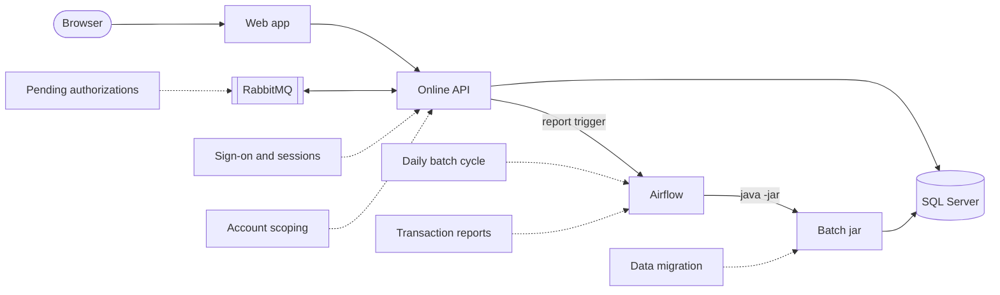

# Features

Active contributors: factory-aj-pahl

This section follows each business capability of the modern CardDemo from the browser or the scheduler down to the database and back. A feature page names every process and module a capability touches and links to the module and application pages for code detail.

## How to read these pages

Every page here uses the same vocabulary as [Architecture](../overview/architecture.md): screens are CICS programs served as `/api/screens/<PROGRAM>` resources, bounded contexts are Maven modules under `modernization/backend/`, and batch work runs in the batch jar under Airflow. Decision IDs such as D-USER-ACCT or B-UOW come from `modernization/decisions/README.md` and the two ledgers; see [Fidelity ledger](../verification/fidelity-ledger.md).

## Feature catalog

| Feature | Summary | Applications | Backend modules | Data and queues |
|:--|:--|:--|:--|:--|
| [Sign-on and sessions](sign-on-and-sessions.md) | BCrypt sign-on, generic failure text, lockout, server session, CSRF, idle timeout, role-based menus, sign-off, audit log | [Web app](../applications/web-app.md), [Online API](../applications/online-api.md), [Bill-payment service](../applications/billpay-service.md) | [IAM](../modules/iam.md), [Common](../modules/common.md) | `app_user`, `audit_log` |
| [Account scoping](account-scoping.md) | Regular users see only accounts linked to them; out-of-scope keys look like missing keys | Online API, Batch jar (reports), Bill-payment service | IAM, account, card, transaction, billpay, reporting, authorization, inquiry | `user_account` |
| [Daily batch cycle](daily-batch-cycle.md) | BACKUP, POSTTRAN, monthly INTCALC, CREASTMT on business days; restart and restore | [Airflow](../applications/airflow.md), [Batch jar](../applications/batch-jar.md) | [Cycle](../modules/cycle.md), account, card, transaction | `card_transaction`, `account`, `tran_cat_balance`, `posting_reject`, `cycle_backup*`, Spring Batch tables, inbox/outbox files |
| [Transaction reports](transaction-reports.md) | CORPT00C request starts an Airflow run of TRANREPT; the file is downloaded in the browser | Web app, Online API, Airflow, Batch jar | [Reporting](../modules/reporting.md), cycle, IAM | `report_run`, `$CARDDEMO_OUTBOX/reports/<run id>/TRANREPT.txt` |
| [Pending authorizations](pending-authorizations.md) | Card authorization decisions over RabbitMQ or REST, list and detail screens, fraud marking, purge, IMS unload and load | Online API, Web app, Airflow, Batch jar | [Authorization](../modules/authorization.md), account, card | RabbitMQ `AWS.M2.CARDDEMO.PAUTH.REQUEST` / `.REPLY`, `CARD.DEMO.DLQ`; `pending_auth_summary`, `pending_auth_detail`, `auth_fraud_report`, `auth_error_log` |
| [Data migration](data-migration.md) | Flyway schema, sample-data load with overpunch decoding, USRSEC users, IMS and Db2 seeds, export round trip | Batch jar, ops scripts | [Schema and migration](../modules/schema-and-migration.md) | Every table; `app/data/ASCII`, `app/data/EBCDIC` |

Capabilities without a page of their own (account view and update, card list/view/update, transaction list/view/add, bill payment, user maintenance, transaction-type maintenance, MQ inquiry, data export and import) are single-context features; their module pages describe them: [Account](../modules/account.md), [Card](../modules/card.md), [Transaction](../modules/transaction.md), [Bill payment](../modules/billpay.md), [Reference data](../modules/refdata.md), [Inquiry](../modules/inquiry.md), [Data exchange](../modules/dataexchange.md).

## Screens by role

Sign-on sends a regular user (type `U`) to the main menu COMEN01C and an admin (type `A`) to the admin menu COADM01C (`modernization/backend/iam/src/main/java/com/carddemo/iam/web/SignonController.java`). The option lists are the COBOL tables COMEN02Y and COADM02Y, held in `modernization/backend/iam/src/main/java/com/carddemo/iam/internal/MenuCatalog.java`. Admins keep the COBOL admin menu only (DF-10), although their API scope is unrestricted.

### Regular user: main menu (COMEN01C, transaction CM00)

| Option | Screen | Program | Web component | Related page |
|:--|:--|:--|:--|:--|
| 01 | Account View | COACTVWC | `modernization/web/src/screens/AccountView.tsx` | [Account](../modules/account.md) |
| 02 | Account Update | COACTUPC | `modernization/web/src/screens/AccountUpdate.tsx` | [Account](../modules/account.md) |
| 03 | Credit Card List | COCRDLIC | `modernization/web/src/screens/CardList.tsx` | [Card](../modules/card.md) |
| 04 | Credit Card View | COCRDSLC | `modernization/web/src/screens/CardView.tsx` | [Card](../modules/card.md) |
| 05 | Credit Card Update | COCRDUPC | `modernization/web/src/screens/CardUpdate.tsx` | [Card](../modules/card.md) |
| 06 | Transaction List | COTRN00C | `modernization/web/src/screens/TransactionList.tsx` | [Transaction](../modules/transaction.md) |
| 07 | Transaction View | COTRN01C | `modernization/web/src/screens/TransactionView.tsx` | [Transaction](../modules/transaction.md) |
| 08 | Transaction Add | COTRN02C | `modernization/web/src/screens/TransactionAdd.tsx` | [Transaction](../modules/transaction.md) |
| 09 | Transaction Reports | CORPT00C | `modernization/web/src/screens/TransactionReports.tsx` | [Transaction reports](transaction-reports.md) |
| 10 | Bill Payment | COBIL00C | `modernization/web/src/screens/BillPayment.tsx` | [Bill payment](../modules/billpay.md) |
| 11 | Pending Authorization View | COPAUS0C | `modernization/web/src/screens/PendingAuthList.tsx` | [Pending authorizations](pending-authorizations.md) |

COPAUS1C (authorization detail, `modernization/web/src/screens/PendingAuthDetail.tsx`) is reached from COPAUS0C, not from the menu. Every option in this table is in the user's [account scope](account-scoping.md).

### Admin: admin menu (COADM01C, transaction CA00)

| Option | Screen | Program | Web component | Related page |
|:--|:--|:--|:--|:--|
| 01 | User List (Security) | COUSR00C | `modernization/web/src/screens/UserList.tsx` | [IAM](../modules/iam.md) |
| 02 | User Add (Security) | COUSR01C | `modernization/web/src/screens/UserAdd.tsx` | [IAM](../modules/iam.md) |
| 03 | User Update (Security) | COUSR02C | `modernization/web/src/screens/UserUpdate.tsx` | [IAM](../modules/iam.md) |
| 04 | User Delete (Security) | COUSR03C | `modernization/web/src/screens/UserDelete.tsx` | [IAM](../modules/iam.md) |
| 05 | Transaction Type List/Update (Db2) | COTRTLIC | `modernization/web/src/screens/TranTypeList.tsx` | [Reference data](../modules/refdata.md) |
| 06 | Transaction Type Maintenance (Db2) | COTRTUPC | `modernization/web/src/screens/TranTypeMaint.tsx` | [Reference data](../modules/refdata.md) |

These screens, and the admin menu itself, are listed in `SecurityConfig.ADMIN_SCREENS` (`modernization/backend/iam/src/main/java/com/carddemo/iam/security/SecurityConfig.java`). A regular user who calls one gets HTTP 403 and is sent to the main menu; see [Sign-on and sessions](sign-on-and-sessions.md).

An option can be switched off with the property `carddemo.features.disabled-programs`; the menu then answers with the COBOL "not installed" message instead of navigating (`MenuCatalog.installed`).

## Related pages

- [API](../api/index.md) for the HTTP and queue interfaces the features use
- [Security](../security.md) for the trust boundaries behind sign-on and scoping
- [Verification](../verification/index.md) for how each feature is proven against the COBOL
