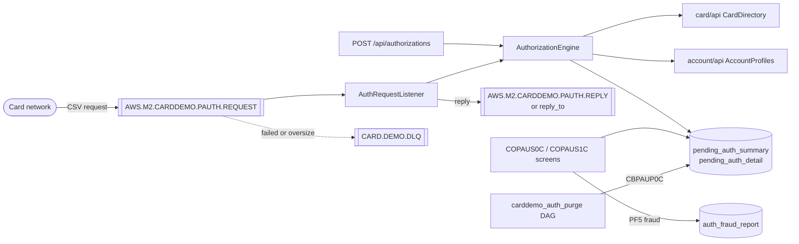
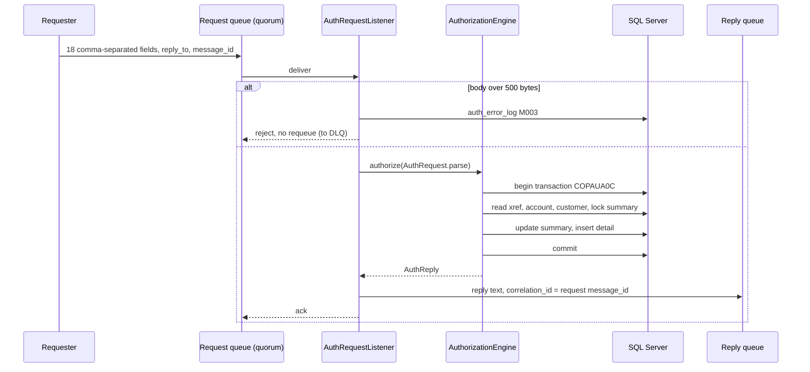

# Pending authorizations

Active contributors: factory-aj-pahl

Card authorization requests arrive on a RabbitMQ queue (or through `POST /api/authorizations`), are decided and recorded as pending authorizations in SQL Server, and are answered on a reply queue. Users browse them on the COPAUS0C list and COPAUS1C detail screens and can mark one as fraud; a daily Airflow DAG purges expired ones. This is the optional IMS, Db2, and MQ module of the mainframe (`app/app-authorization-ims-db2-mq`) rebuilt as the [Authorization](../modules/authorization.md) context.

## Overview

The IMS database DBPAUTP0 (root segment PAUTSUM0, child PAUTDTL1) becomes two tables, and the Db2 fraud table AUTHFRDS becomes a third, all in `modernization/backend/schema/src/main/resources/db/migration/V60__authorization.sql`:

| Table | Replaces | Key |
|:--|:--|:--|
| `pending_auth_summary` | PAUTSUM0 root, one per account | `account_id` |
| `pending_auth_detail` | PAUTDTL1 child | identity `auth_id`; unique `(account_id, auth_ts DESC, auth_id DESC)` is the "IMS key order" |
| `auth_fraud_report` | Db2 `CARDDEMO.AUTHFRDS` | `(card_num, auth_ts, auth_id)` (Q-COPAUS2C-03) |
| `auth_error_log` | CCPAUERY error records | identity; `event_key` holds the masked card number |

The inverted-time IMS key is replaced by the insert timestamp `auth_ts` plus the identity, so two authorizations in the same millisecond keep a stable order (`modernization/architecture.md`, section 3).

## Request and reply over RabbitMQ

`modernization/backend/authorization/src/main/java/com/carddemo/authorization/messaging/AuthRequestListener.java` is a long-lived consumer of the request queue (Q-COPAUA0C-15). Its rules:

- **Parsing.** The body is read as ISO-8859-1, one character per byte, and split on commas into the 18 fields of `AuthRequest` (`modernization/backend/authorization/src/main/java/com/carddemo/authorization/internal/AuthRequest.java`) as the COBOL `UNSTRING` does. Each field is cut to its COBOL length and only trailing space padding is removed, so control characters and high bytes are kept and echoed.
- **Order of effects.** Decide and commit, then publish the reply, then acknowledge (Q-COPAUA0C-06). The COBOL replied before updating the database.
- **Reply.** It goes to the request's `reply_to`, or the fixed reply queue when absent. `correlation_id` is the request `message_id` (or its `correlation_id`), type `reply`, non-persistent, with a 5-second expiration. The body is the CCPAURLY text from `AuthReply.text()`: card number, transaction ID, auth ID code (the request time), response code, reason code, and the edited approved amount, each fixed-width and comma-terminated.
- **Reply failure.** If the reply queue does not exist or the publish fails, error M004 is logged and the request is still acknowledged, because the authorization is already committed.

### Queues and dead letters

`modernization/backend/authorization/src/main/java/com/carddemo/authorization/messaging/AuthMessagingConfig.java` declares the queues named in `AuthQueues.java` (the names in the module README, BR-COPAUA0C-01) when the broker connection opens:

| Queue | Settings |
|:--|:--|
| `AWS.M2.CARDDEMO.PAUTH.REQUEST` | Durable quorum queue, delivery limit 3, dead-letters to `CARD.DEMO.DLQ` |
| `AWS.M2.CARDDEMO.PAUTH.REPLY` | Durable, max length 10,000, `reject-publish` overflow |
| `CARD.DEMO.DLQ` | Durable |

A request over the 500-byte COBOL buffer (logged as M003, the MQGET failure) and a request whose database transaction fails (`AuthorizationFailure`) are rejected without requeue and go to the dead-letter queue at once. Any other exception is redelivered until the delivery limit of 3, then dead-lettered. The property `carddemo.mq.queue-suffix` appends a suffix to all three names so test runs get private queues on a shared broker. The other queue pairs (account and date inquiry) are described in [Message queues](../api/message-queues.md).

### The REST equivalent

`POST /api/authorizations` (`modernization/backend/authorization/src/main/java/com/carddemo/authorization/web/AuthorizationController.java`) takes the same 18 fields as JSON and returns `cardNum`, `transactionId`, `authIdCode`, `respCode`, `reasonCode`, and a decimal `approvedAmount` (D-MQ). A critical error returns 503 with the error location and message. Because callers act for the card network, the endpoint requires an ADMIN session (`@PreAuthorize("hasRole('ADMIN')")`). See [REST endpoints](../api/rest-endpoints.md).

## The decision

`modernization/backend/authorization/src/main/java/com/carddemo/authorization/internal/AuthorizationEngine.java` handles one request in its own transaction named `COPAUA0C` (Q-COPAUA0C-18). It reads the cross-reference through `card/api` `CardDirectory` and the account limits and customer through `account/api` `AccountProfiles`, so the module's own SQL touches only its own tables. It never updates the account.

A request is declined (response code `05`) when the card is not in the cross-reference, the account is missing, the amount is blank, not numeric, or not positive (Q-COPAUA0C-12), or the amount is above the available credit. Otherwise it is approved with response `00` and reason `0000`. The reason code of a decline is chosen in this order:

| Condition (declined requests only) | Reason code |
|:--|:--|
| Card, account, or customer record missing | `3100` (invalid card) |
| Amount above available credit | `4100` (insufficient funds) |
| Any other decline (an invalid amount) | `9000` |

A missing customer record alone does not decline a request; it only changes the reason code of a request declined for another cause.

Available credit is the summary's credit limit minus credit balance, or the account's limit minus current balance when the account has no summary yet. Decline reasons the COBOL can never reach (card not active, account closed, fraud, and others in the COPAUS1C table) are not invented (DF-5). Missing card, account, or customer records are logged as warnings A001 to A003 in `auth_error_log`.

When the card is known and the amount is valid, the engine records the result: an approval adds to the credit balance, approved count, and approved amount and sets the cash balance to 0 (BR-COPAUA0C-14, Q-COPAUA0C-17); a decline adds to the declined count and amount. A new detail row gets match status `P` (approved) or `D` (declined). A database error rolls back the transaction, writes a critical error record (I001 to I004, C001 to C003), and produces no reply (Q-COPAUA0C-07).

## The screens

| Screen | Controller | Web component |
|:--|:--|:--|
| COPAUS0C View Authorizations (CPVS), main menu option 11 | `modernization/backend/authorization/src/main/java/com/carddemo/authorization/web/PendingAuthListController.java` | `modernization/web/src/screens/PendingAuthList.tsx` |
| COPAUS1C View Authorization Details (CPVD) | `modernization/backend/authorization/src/main/java/com/carddemo/authorization/web/PendingAuthDetailController.java` | `modernization/web/src/screens/PendingAuthDetail.tsx` |

- **List.** The user types an account ID; the screen shows the customer, limits, and summary counts, and the account's pending authorizations five per page, newest first (`PF7` and `PF8` page). `S` on a row opens the detail. A regular user sees only linked accounts; any other account is answered as not found in the cross-reference, the same text as a missing account (see [Account scoping](account-scoping.md)).
- **Detail.** Every field of the selected authorization, with the card number masked and the reason code shown with its description. `PF8` moves to the next older authorization; at the end it shows `Already at the last Authorization...`. `PF3` returns to the list.
- **State.** The account in view and the selected authorization (COMMAREA fields CDEMO-ACCT-ID and CDEMO-CPVS-PAU-SELECTED in the COBOL) are kept in the server session (`modernization/backend/authorization/src/main/java/com/carddemo/authorization/web/AuthScreens.java`).

### Marking fraud (COPAUS2C)

`PF5` on the detail screen calls `PendingAuthDetails.toggleFraud` (`modernization/backend/authorization/src/main/java/com/carddemo/authorization/internal/PendingAuthDetails.java`). In one transaction it flips the detail's fraud flag (`F` becomes `R` for removed, anything else becomes `F`), records the report through `FraudReports` (`modernization/backend/authorization/src/main/java/com/carddemo/authorization/internal/FraudReports.java`), which inserts a full row into `auth_fraud_report` or, if the row exists, updates only the flag and report date, and then updates the detail. Both writes commit or neither does (BR-COPAUS1C-06). The screen then re-reads and shows the stored flag and date, also after a failure (Q-COPAUS1C-01). Error messages show the SQL Server error number in the Db2 `+9(06)` form plus the SQLSTATE.

## Purge (CBPAUP0C)

`modernization/airflow/dags/carddemo_auth_purge.py` runs daily (`@daily`, `catchup=False`), outside the base cycle (Q-CA7-04). It builds the CBPAUP0C SYSIN card `EE,CCCCC,DDDDD,F` from its params and runs `CBPAUP0C sysin=...`:

| Param | Default | Meaning |
|:--|:--|:--|
| `expiry_days` | 5 | Age in whole days at which a detail is purged; 0 purges every detail; a non-numeric value becomes `XX`, which the program replaces with 5 |
| `checkpoint_frequency` | 5 | Summaries per commit |
| `display_frequency` | 10 | Commits between `CHKP SUCCESS` lines |
| `debug` | false | DEBUG logging for `PurgeJob` |

The default of 5 days instead of the JCL's `00` is decision D-PURGE. `modernization/backend/authorization/src/main/java/com/carddemo/authorization/internal/PurgeJob.java` walks every summary in account order and its details newest first, deletes expired details, reduces the summary's counts and amounts by what it deleted (D-PURGE) but leaves the credit and cash balances alone (DF-13), and deletes a summary only when its approved count is 0 or less and no detail remains. It commits once per checkpoint interval; on an error the open interval rolls back, earlier intervals stay, and the job ends with program return code 16, which fails the task. A rerun is the restart (Q-CBPAUP0C-07).

## IMS unload and load

The IMS utility programs run as batch jar commands with no DAG (`modernization/backend/batch/src/main/java/com/carddemo/batch/BatchCommandLine.java`):

| Command | Mainframe job | What it does |
|:--|:--|:--|
| `PAUDBUNL rootFile=... childFile=...` | UNLDPADB | Writes summaries (100-byte records) and details (206 bytes: 6-byte packed parent key plus 200-byte segment) |
| `DBUNLDGS rootFile=... childFile=...` | UNLDGSAM | Same files through the GSAM variant |
| `PAUDBLOD rootFile=... childFile=...` | LOADPADB | Inserts the roots, then the children under their parents; duplicates, orphans, and invalid keys are counted and skipped |

`modernization/backend/authorization/src/main/java/com/carddemo/authorization/internal/UnloadJob.java` reads both tables in one SERIALIZABLE read-only transaction so the files are a consistent snapshot, and deletes both files after a failure. `LoadJob.java` (same directory) loads each file in one transaction. These files keep full card numbers as a data-interchange contract and are written owner-only (D-PII-FILES). The original IMS HD unload file in the sample data is loaded by a different path, the migration loader; see [Data migration](data-migration.md).

## Integration points

- [Account](../modules/account.md) and [Card](../modules/card.md) through their `api` packages.
- [Account scoping](account-scoping.md) on both screens, not on the queue.
- The screens are listed on the main menu built by [IAM](../modules/iam.md).

## Key source files

| File | Purpose |
|:--|:--|
| `modernization/backend/authorization/src/main/java/com/carddemo/authorization/messaging/AuthRequestListener.java` | Queue consumer, reply, dead-lettering |
| `modernization/backend/authorization/src/main/java/com/carddemo/authorization/messaging/AuthMessagingConfig.java` | Queue declarations |
| `modernization/backend/authorization/src/main/java/com/carddemo/authorization/internal/AuthorizationEngine.java` | Decision and recording |
| `modernization/backend/authorization/src/main/java/com/carddemo/authorization/internal/PendingAuthRepository.java` | Summary and detail SQL |
| `modernization/backend/authorization/src/main/java/com/carddemo/authorization/internal/PendingAuthDetails.java` | Detail reads and fraud toggle |
| `modernization/backend/authorization/src/main/java/com/carddemo/authorization/internal/PurgeJob.java` | CBPAUP0C |
| `modernization/airflow/dags/carddemo_auth_purge.py` | Purge DAG |

The module has 25 main source files and 10 test files under `modernization/backend/authorization/src/test/java/com/carddemo/authorization/`, including `AuthorizationMessagingTest.java`, `AuthorizationFailureTest.java`, `PendingAuthListTest.java`, `PendingAuthDetailTest.java`, `FraudReportsTest.java`, `AuthPurgeJobTest.java`, and `AuthUnloadLoadTest.java`. Browser coverage is `modernization/e2e/tests/authorizations.spec.ts`.
