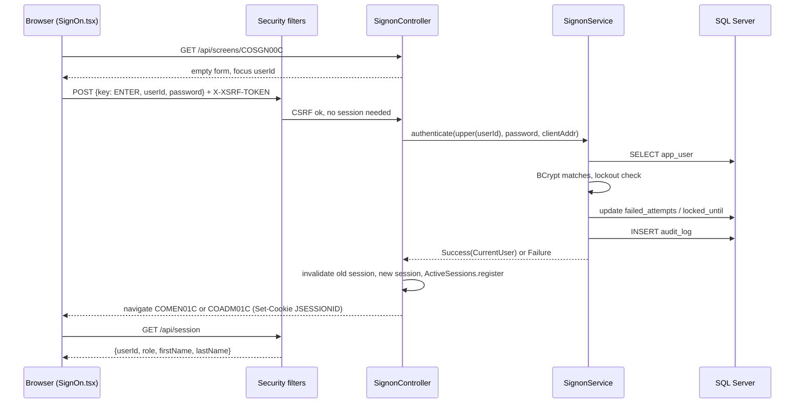

# Sign-on and sessions

Active contributors: factory-aj-pahl

A user signs on through the COSGN00C screen, gets a server-side session tied to a `JSESSIONID` cookie, and lands on the main menu or the admin menu by role. The modern system keeps the COBOL screen flow and messages but adds BCrypt hashes, one generic failure message, lockout after repeated failures, CSRF protection, a 15-minute idle timeout, and an audit log (D-AUTH, D-FIX-SEC, D-SEC-EXTRAS in `modernization/decisions/README.md`).

## Purpose

The original COSGN00C compared plaintext passwords from the USRSEC file, told the user whether the ID or the password was wrong, and kept the user and role in the COMMAREA, which a client could alter. The rebuild fixes those defects (ledger rows Q-COSGN00C-01, -02, -04, -05 in `modernization/decisions/ledger-online.md`) and replaces the COMMAREA with a server session (convention C-SESSION).

## How it works

### Sign-on screen turn

`modernization/backend/iam/src/main/java/com/carddemo/iam/web/SignonController.java` handles one turn:

- `PF3` invalidates any session and answers `navigate: "EXIT"`; the web app shows `/signed-off` with the COBOL farewell text (`modernization/web/src/useScreen.ts`, `modernization/web/src/screens/SignedOff.tsx`).
- Any key other than `ENTER` or `PF3` gets the shared invalid-key message.
- The user ID is cut to 8 characters as the BMS field would, then upper-cased (user IDs are case-insensitive, passwords case-sensitive, Q-COSGN00C-02).
- Blank ID or password get the COBOL prompts `Please enter User ID ...` and `Please enter Password ...`.
- A database error shows `Unable to verify the User ...`.
- Success starts the session and navigates to `COADM01C` for an admin, `COMEN01C` otherwise.
- Every failure, whatever the cause, shows `Invalid User ID or Password. Try again ...` with the cursor on the password field (Q-COSGN00C-04).

### Authentication and lockout

`modernization/backend/iam/src/main/java/com/carddemo/iam/internal/SignonService.java` does the check in one transaction:

| Situation | Behavior |
|:--|:--|
| Unknown user ID | BCrypt is run against a dummy hash so the response time matches a known ID; audit `SIGNON_FAILURE` |
| ID locked (`locked_until` in the future) | Refused even with the right password, lockout not extended; audit `SIGNON_FAILURE` with field `locked` |
| Wrong password | `failed_attempts` incremented; at the threshold `locked_until` = now + lockout duration and audits `SIGNON_FAILURE` plus `SIGNON_LOCKOUT` |
| Lockout expired | The counter starts again at 0 |
| Right password | Counter and lock cleared; audit `SIGNON_SUCCESS` |

The threshold, durations, and BCrypt cost are `carddemo.security.*` properties with defaults in `modernization/backend/iam/src/main/java/com/carddemo/iam/security/SecurityProperties.java`: BCrypt cost 12, idle timeout 15 minutes, lockout threshold 5, lockout duration 15 minutes. The counter and lock live in `app_user.failed_attempts` and `app_user.locked_until` (`modernization/backend/schema/src/main/resources/db/migration/V1__core_schema.sql`). Because the message is the same for every failure, a lockout is never disclosed to the caller.

### Session, cookies, and CSRF

`modernization/backend/iam/src/main/java/com/carddemo/iam/security/SecurityConfig.java` builds the filter chain:

- **Session.** The `CurrentUser` record (`modernization/backend/common/src/main/java/com/carddemo/common/security/CurrentUser.java`) is stored in the HTTP session through `HttpSessionSecurityContextRepository`. `SignonController.startSession` invalidates any earlier session first, and session fixation protection creates a new one.
- **Cookie.** `modernization/backend/app/src/main/resources/application.properties` sets `server.servlet.session.timeout=15m`, `cookie.http-only=true`, and `cookie.same-site=strict`. The bill-payment service uses the same three settings in `modernization/backend/billpay-service/src/main/resources/application.properties`.
- **CSRF.** `CookieCsrfTokenRepository.withHttpOnlyFalse()` puts the token in an `XSRF-TOKEN` cookie. `CsrfCookieFilter` loads the token on every request so the cookie is always issued. The web app reads the cookie and sends it as the `X-XSRF-TOKEN` header on each POST (`modernization/web/src/api.ts`).
- **Idle timeout.** `IdleTimeoutFilter` (`modernization/backend/iam/src/main/java/com/carddemo/iam/security/IdleTimeoutFilter.java`) stores the last request time in the session using the application clock. A request more than the idle timeout after the previous one invalidates the session and continues unauthenticated, so protected endpoints answer 401. Using the application clock lets tests move time forward.
- **401 and 403.** No session gives 401; `api.ts` turns that into `Unauthorized`, and `useScreen.ts` sends the user to a clean `/screens/COSGN00C`. A USER calling an admin screen gets 403 with a JSON `ScreenResponse` that navigates to `COMEN01C` with the COBOL text `No access - Admin Only option... ` (C-ROLE). `api.ts` treats that 403 body as a normal screen response.
- **Public paths.** Only `/api/screens/COSGN00C`, `/api/session`, `/actuator/health`, and the OpenAPI pages are open; every other `/api/**` path needs a session, and anything else is denied.

### Active sessions

`modernization/backend/iam/src/main/java/com/carddemo/iam/security/ActiveSessions.java` keeps a per-instance map from user ID to live sessions. User update (`modernization/backend/iam/src/main/java/com/carddemo/iam/web/UserUpdateController.java`) and user delete (`modernization/backend/iam/src/main/java/com/carddemo/iam/web/UserDeleteController.java`) call `endAll` so a user whose type or password changed, or who was deleted, is signed off at once (Q-COUSR02C-04, Q-COUSR03C-07). The registry is in memory, so with several API instances each one only ends its own sessions.

### Who is signed on

`GET /api/session` (`modernization/backend/iam/src/main/java/com/carddemo/iam/web/SessionController.java`) returns `userId`, `role`, `firstName`, and `lastName`, or 401. The web app calls it on every route change through `useSessionTracker` in `modernization/web/src/session.ts` and puts the result in a React context for the header.

### Menus and role checks

The two menus share `modernization/web/src/screens/Menu.tsx`. On the server, `MainMenuController` and `AdminMenuController` (`modernization/backend/iam/src/main/java/com/carddemo/iam/web/`) normalize the typed option as COBOL does (right-justified, leading spaces as zeros), reject numbers out of range, check the option's user type, and check whether the program is installed. `PF3` on either menu invalidates the session and returns to COSGN00C. The full option lists are on the [Features](index.md) page.

The role check is enforced twice: by URL in `SecurityConfig.ADMIN_SCREENS` (admin menu, user screens, transaction-type screens) and by the menu's own option check. `POST /api/authorizations` is admin-only through `@PreAuthorize`.

### Audit log

`modernization/backend/iam/src/main/java/com/carddemo/iam/internal/JdbcAuditLog.java` implements `AuditLog` from the common module and writes one `audit_log` row per event: time, actor, action, target, changed field names, and client address (C-AUDIT in `modernization/decisions/ledger-online.md`).

| Action | Written by |
|:--|:--|
| `SIGNON_SUCCESS`, `SIGNON_FAILURE`, `SIGNON_LOCKOUT` | `modernization/backend/iam/src/main/java/com/carddemo/iam/internal/SignonService.java` |
| `USER_ADD`, `USER_UPDATE`, `USER_DELETE` | `modernization/backend/iam/src/main/java/com/carddemo/iam/internal/UserMaintenance.java` |
| `ACCOUNT_UPDATE` | `modernization/backend/account/src/main/java/com/carddemo/account/web/AccountUpdater.java` |
| `CARD_UPDATE` (target is the masked card number) | `modernization/backend/card/src/main/java/com/carddemo/card/internal/CardUpdateService.java` |

Audit rows never hold passwords or full card numbers, and no screen shows them.

## Integration points

- Every other screen relies on `CurrentUser.require()` from this session, including [Account scoping](account-scoping.md).
- The batch jar has no session. The report job receives the requester's user ID as a parameter and looks up the role itself; see [Transaction reports](transaction-reports.md).
- The standalone [Bill-payment service](../applications/billpay-service.md) reuses the IAM module for its own sign-on and sessions.

## Entry points for modification

| Change | Where |
|:--|:--|
| Lockout threshold, timeouts, BCrypt cost | `carddemo.security.*` properties, defaults in `SecurityProperties.java` |
| A new admin-only screen | Add its paths to `SecurityConfig.ADMIN_SCREENS` and an option to `MenuCatalog.ADMIN` |
| A new audited event | Call `AuditLog.record` from the owning service inside its transaction |
| Session handling in the browser | `modernization/web/src/api.ts`, `modernization/web/src/useScreen.ts`, `modernization/web/src/session.ts` |

## Key source files

| File | Purpose |
|:--|:--|
| `modernization/backend/iam/src/main/java/com/carddemo/iam/web/SignonController.java` | COSGN00C screen turns, session start |
| `modernization/backend/iam/src/main/java/com/carddemo/iam/internal/SignonService.java` | BCrypt check, lockout, audit |
| `modernization/backend/iam/src/main/java/com/carddemo/iam/security/SecurityConfig.java` | Filter chain, CSRF, admin paths, 401/403 handling |
| `modernization/backend/iam/src/main/java/com/carddemo/iam/security/IdleTimeoutFilter.java` | 15-minute idle expiry |
| `modernization/backend/iam/src/main/java/com/carddemo/iam/security/ActiveSessions.java` | Ends sessions after user changes |
| `modernization/backend/iam/src/main/java/com/carddemo/iam/internal/MenuCatalog.java` | Main and admin menu options |
| `modernization/backend/iam/src/main/java/com/carddemo/iam/web/SessionController.java` | `GET /api/session` |
| `modernization/web/src/screens/SignOn.tsx`, `modernization/web/src/screens/Menu.tsx` | Sign-on and menu screens |
| `modernization/web/src/api.ts`, `modernization/web/src/session.ts` | XSRF header, 401/403 handling, session tracking |

## Tests

- `modernization/backend/iam/src/test/java/com/carddemo/iam/SignonRulesTest.java`, `SignonAndMenusTest.java`, `MenuRulesTest.java`, `DisabledOptionsTest.java` (same directory) for screen rules
- `modernization/backend/app/src/test/java/com/carddemo/app/SecurityExtrasTest.java` for lockout, idle timeout, and audit
- `modernization/backend/app/src/test/java/com/carddemo/app/SecurityMatrixTest.java` for the role and path matrix
- `modernization/e2e/tests/headers.spec.ts` in the browser, which checks the sign-on and menu headers (transaction IDs CC00, CM00, CA00)

Sign on locally with `ADMIN001` or `USER0001` and the demo password in the root `README.md`. See [Security](../security.md) for the wider security model and [Testing](../how-to-contribute/testing.md) for running these suites.
