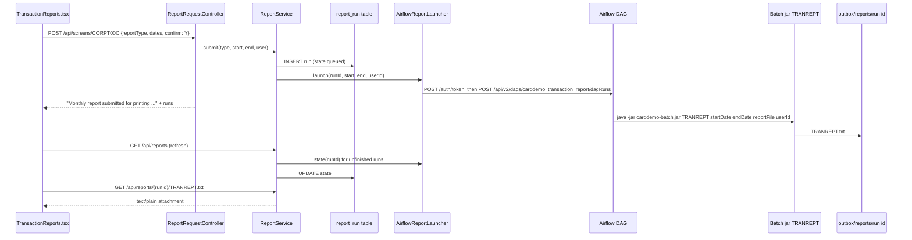

# Transaction reports

Active contributors: factory-aj-pahl

A user requests a transaction report on the CORPT00C screen, the API starts an Airflow run of the `carddemo_transaction_report` DAG, the DAG runs the batch jar's TRANREPT job (the CBTRN03C report), and the user downloads the finished file from the same screen. On the mainframe, CORPT00C wrote JCL to the internal reader; the rebuild replaces that with the Airflow REST API (`modernization/architecture.md`, section 2).

## Overview

## The request screen

`modernization/backend/reporting/src/main/java/com/carddemo/reporting/web/ReportRequestController.java` serves `/api/screens/CORPT00C` (transaction CR00, main menu option 9). The three COBOL marker fields become one `reportType` choice (Q-CORPT00C-04):

| Type | Date range |
|:--|:--|
| Monthly | First to last day of the current month (application clock) |
| Yearly | January 1 to December 31 of the current year |
| Custom | Start and end month, day, year typed by the user |

Custom dates follow the COBOL checks in order: each part required (`Start Date - Month can NOT be empty...` and so on), digits padded with leading zeros (BR-CORPT00C-04), month at most 12, day at most 31, then a calendar check where dates before 1582-10-15 are invalid (DF-8). A start after the end is accepted on the screen as in the COBOL (Q-CORPT00C-03); the batch job then refuses the range. A blank confirmation asks `Please confirm to print the <Type> report...`, `N` clears the form, and `Y` submits. A launch failure shows the COBOL text `Unable to Write TDQ (JOBS)...`.

`PF3` returns to the main menu. The screen response also carries the user's recent runs (`RunView` in `modernization/backend/reporting/src/main/java/com/carddemo/reporting/web/RunView.java`), and `modernization/web/src/screens/TransactionReports.tsx` shows them in a table with a download link once the file exists. The table can be refreshed with `GET /api/reports` without a screen turn.

## Recording and launching a run

`ReportService.submit` (`modernization/backend/reporting/src/main/java/com/carddemo/reporting/internal/ReportService.java`):

1. Builds a run ID `CR00_<user>_<yyyyMMddTHHmmssSSS>_<4 hex digits>`.
2. Inserts a `report_run` row with state `queued` (`modernization/backend/schema/src/main/resources/db/migration/V40__report_run.sql`). The row is written before the launch because it is the access check for the download.
3. Calls the launcher. If the launch fails, the row is deleted and the screen shows the launch-failure message, so a run is launched at most once (Q-CORPT00C-09).

`AirflowReportLauncher` (`modernization/backend/reporting/src/main/java/com/carddemo/reporting/internal/AirflowReportLauncher.java`) gets a JWT from Airflow's `POST /auth/token`, caches it, and repeats a call once with a new token after a 401. It posts the DAG run with the chosen `dag_run_id`, `logical_date: null` (Airflow 3.0 requires the key), and conf `start_date`, `end_date`, `user_id`. Base URL, user name, and password come from `carddemo.airflow.*` in `modernization/backend/app/src/main/resources/application.properties`, which read `AIRFLOW_BASE_URL`, `AIRFLOW_USERNAME`, and `AIRFLOW_PASSWORD`. Connect and read timeouts default to 5 seconds.

Run states are refreshed lazily. When the screen or `/api/reports` lists runs, each unfinished run's state is read from `GET /api/v2/dags/carddemo_transaction_report/dagRuns/{runId}` and written back with `state_checked_at`. `success` and `failed` are final.

## The DAG and the job

`modernization/airflow/dags/carddemo_transaction_report.py` has no schedule and one task, `TRANREPT`:

- The output directory is `report_dir(run_id)` = `$CARDDEMO_OUTBOX/reports/<dag_run_id>`; a run ID containing `/` or equal to `.` or `..` is refused.
- It runs `TRANREPT startDate=... endDate=... reportFile=<dir>/TRANREPT.txt [userId=...]`. If the job fails and the directory is empty, the directory is removed.
- After success, `prune_reports` keeps the reports of the last 10 runs by file time and deletes older run directories (DF-3, Q-ENT-16).

In the batch jar, `BatchCommandLine.tranrept` (`modernization/backend/batch/src/main/java/com/carddemo/batch/BatchCommandLine.java`) refuses a missing, invalid, or reversed range with `INVALID OR MISSING REPORT DATE RANGE` and exit 12 (Q-CBTRN03C-06, -07). The job step `STEP10R` in `modernization/backend/batch/src/main/java/com/carddemo/batch/cycle/CycleJobsConfig.java` resolves the account filter, and `TransactionReportService` in the reporting module (`modernization/backend/reporting/src/main/java/com/carddemo/reporting/internal/TransactionReportService.java`) writes the 133-column report with the COBOL page breaks and totals, with the reference-patch fixes RP-CBTRN03C-1 to -3 (out-of-range rows not selected, last amount not added twice, last card total printed) and card numbers masked. The file is written to a `.part` file first and then moved into place.

### Filtering for regular users (D-REPORT)

The requester's user ID travels from the session into the DAG conf and the job parameter `userId`. `STEP10R` looks up the role through `UserRoles`:

| Requester | Accounts in the report |
|:--|:--|
| Regular user | `AccountScope.linkedAccounts(userId)` |
| Admin | All |
| No user ID (manual trigger) | All |
| Unknown user ID | None |

See [Account scoping](account-scoping.md) for the scope rules.

## Download

`modernization/backend/reporting/src/main/java/com/carddemo/reporting/web/ReportRunController.java`:

| Endpoint | Returns |
|:--|:--|
| `GET /api/reports` | The 10 most recent runs visible to the user, newest first |
| `GET /api/reports/{runId}` | One run with its current state, or 404 |
| `GET /api/reports/{runId}/TRANREPT.txt` | The file as `text/plain` with `Content-Disposition: attachment; filename=<runId>-TRANREPT.txt`, or 404 until the file exists |

A regular user sees only their own runs; an admin sees every run. A run ID the user may not see is a 404. The API reads the file from `carddemo.reports.outbox` (default `$CARDDEMO_OUTBOX` or `~/.carddemo/outbox`), which must be the same directory the Airflow worker writes to. A run pruned by DF-3 keeps its `report_run` row but no longer has a download link.

## Testing and verification

- **API tests:** `modernization/backend/reporting/src/test/java/com/carddemo/reporting/ReportRequestScreenTest.java` and `ReportRunApiTest.java` (same directory), with a fake launcher.
- **Job tests:** `modernization/backend/batch/src/test/java/com/carddemo/batch/TranreptJobTest.java` and `ReportRequestJobTest.java` (same directory).
- **Browser tests:** `modernization/e2e/tests/reports.spec.ts`. In e2e runs, `modernization/e2e/playwright.config.ts` starts `modernization/e2e/scripts/airflow-stub.mjs` and points `AIRFLOW_BASE_URL` at it. The stub issues a token, accepts `carddemo_transaction_report` runs, writes a small `TRANREPT.txt` into the outbox, and reports each run as succeeded, so the tests need no real Airflow.
- **End-to-end report check:** `modernization/verification/schedule/verify_report.py` (`make -C modernization verify-report`) runs against the real stack. For `ADMIN001` and `USER0001` it requests a Custom report in the browser, waits for the real DAG run, downloads the file, and compares it byte for byte with GnuCOBOL CBTRN03C run on the stack's own tables exported in legacy layouts. For the regular user the reference input is filtered to the cards of the linked accounts. If the sample daily file has not been posted, it first triggers `carddemo_daily_cycle` for business date 2022-06-10. See [Cycle, data, and report checks](../verification/cycle-data-and-report.md).

## Entry points for modification

| Change | Where |
|:--|:--|
| Screen validation or messages | `ReportRequestController.java` |
| Run list size or file name | `ReportService.LISTED`, `ReportService.REPORT_FILE` |
| Retention | `REPORTS_KEPT` in `modernization/airflow/dags/carddemo_batch.py` |
| Report layout | `TransactionReportService.java` |
| A scheduler other than Airflow | Implement `ReportLauncher` (`modernization/backend/reporting/src/main/java/com/carddemo/reporting/internal/ReportLauncher.java`) |

## Key source files

| File | Purpose |
|:--|:--|
| `modernization/web/src/screens/TransactionReports.tsx` | Request form, run table, download link |
| `modernization/backend/reporting/src/main/java/com/carddemo/reporting/web/ReportRequestController.java` | CORPT00C screen turns |
| `modernization/backend/reporting/src/main/java/com/carddemo/reporting/web/ReportRunController.java` | Run list, state, download |
| `modernization/backend/reporting/src/main/java/com/carddemo/reporting/internal/ReportService.java` | Record, launch, refresh, find the file |
| `modernization/backend/reporting/src/main/java/com/carddemo/reporting/internal/AirflowReportLauncher.java` | Airflow 3 REST client |
| `modernization/airflow/dags/carddemo_transaction_report.py` | The DAG |
| `modernization/backend/reporting/src/main/java/com/carddemo/reporting/internal/TransactionReportService.java` | CBTRN03C report writer |

Related: [Reporting](../modules/reporting.md), [Airflow](../applications/airflow.md), [REST endpoints](../api/rest-endpoints.md), [End-to-end suite](../verification/e2e-suite.md).
