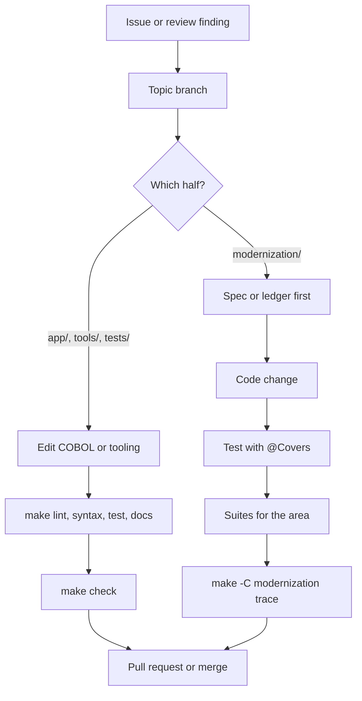
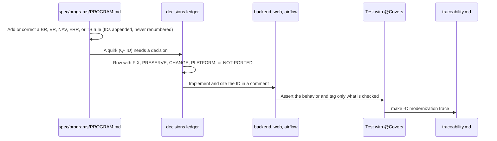

# Development workflow

This page walks through one change from branch to merge, separately for the COBOL half (root tooling) and the modernized stack. The two halves have different checks: the COBOL half is guarded by `make check` and CI, the modernization by local suites and the traceability report.

## Overview



## Branch strategy

The git history of the `modernization` branch shows two phases:

- **Build waves**: topic branches named for a slice of work (`w1-data`, `w2-batch`, `w3-iam-card`, `w4-acct-tran`, `w5-trantype-inquiry`) merged into `modernization` ("Merge branch 'w1-data' into modernization"). Later stages were merged with a short description in the subject ("Merge stage6: run-from-scratch scripts, smoke, standalone bill payment, report check").
- **Review rounds**: one branch per batch of review findings (`spec-fixes`, `spec-fixes-2` to `spec-fixes-6`, `test-fixes-late`, `exp-fixes-late`, `dr-fixes`, `sched-fixes`) merged into an `integrate` branch ("Merge branch 'spec-fixes-6' into integrate"). `integrate`, `integrate-next`, and `modernization` all point at the same commit (467e0f0) today, so `integrate` was brought into `modernization` without extra merge commits.

All merges are real merge commits (no squash), so `git log --first-parent` on `modernization` reads as a list of merged topics. Upstream work on `main` used GitHub pull requests from forks ("Merge pull request #12 from ...").

## Commit messages

From `git log --format=%s -40`:

- Imperative subject in sentence case, no trailing period, no type prefix: "Refuse BACKUP once a date is posted; restore the latest backup", "Tighten tests flagged by the test-quality delta review".
- Common verbs: Correct, Tighten, Test, Fix, Regenerate, Apply, Describe.
- Spec, ledger, and review IDs appear in the subject when the change is about them: "Correct the batch half of Q-ENT-32 and clarify Q-COPAUS0C-14", "Fix late exploratory findings X-1 and X-2".
- The body explains what changed and why in plain prose, often naming the IDs whose text changed and saying when dispositions were not touched ("Text only; dispositions and targets unchanged").
- Commits written with Droid end with the trailer `Co-authored-by: factory-droid[bot] <138933559+factory-droid[bot]@users.noreply.github.com>`. All of the last 60 commits carry it.

## COBOL and root tooling

### Steps

The skill `.factory/skills/carddemo-cobol-change/SKILL.md` is the step list for edits under `app/`:

1. **Orient.** Find the program in `docs/INVENTORY.md` (module, copybooks, calls, complexity) and its flow in `docs/architecture.md`; record layouts and keys are in `docs/data-model.md`. For CICS programs, read the COMMAREA in `app/cpy/COCOM01Y.cpy` and the map copybook in `app/cpy-bms` first.
2. **Edit safely.** Code in columns 8-72, comments with `*` in column 7, no tabs, nothing past column 80, existing line endings kept. A copybook change touches every program that copies it: list them with `rg -l "COPY <NAME>" app`.
3. **Verify** in this order:

   ```sh
   make lint          # new static-analysis findings only
   make syntax        # GnuCOBOL syntax check of batch programs without CICS/SQL/DLI
   make test          # unit + integration, including batch job behaviour
   make docs          # if programs or copybooks were added, removed, or changed
   make docs-check
   ```

   For CBACT02C, CBACT03C, CBCUS01C, and CBTRN02C, also run `make run-batch PROGRAM=<name>` and inspect `.batch-runs/<name>/`. A behavior change gets a test in `tests/integration/test_batch_jobs.py`.
4. **Hand off.** Explain any `make baseline` in the pull request and fill in the template, including what needs a mainframe.

CICS, Db2, IMS, and MQ programs cannot be compiled or run locally; rely on `make lint`, review the `EXEC` blocks by hand, and say so in the pull request.

### Pre-commit hooks

`make setup` installs the hooks in `.pre-commit-config.yaml`. On each commit they run:

| Hook | What it does |
|:--|:--|
| `check-added-large-files` (1024 KB), `check-merge-conflict`, `check-yaml`, `check-toml` | Generic hygiene |
| `end-of-file-fixer`, `trailing-whitespace` | Skips `app/`, `samples/`, `diagrams/`, `scripts/`, where columns and line endings matter |
| `ruff-check`, `ruff-format` | Python lint and format |
| `gitleaks` | Secret scan of the staged change |
| `carddemo-lint` | `python3 -m tools.carddemo lint` (new findings only) |
| `carddemo-docs` | `inventory --check` and `check-docs`: `docs/INVENTORY.md` and `AGENTS.md` are current |

Run them all on demand with `.venv/bin/pre-commit run --all-files`. The hooks apply to every commit, including ones that touch only `modernization/`.

### Before the pull request

Run `make check`. It is exactly what CI runs, in the same order (`.github/workflows/ci.yml`).

## Modernization

### How a behavior change flows

Every behavior of the modern code traces to an ID in the spec or the ledger. A change goes through them in this order:



1. **Spec.** If the COBOL was described wrongly, correct `modernization/spec/programs/<PROGRAM>.md` (or `modernization/spec/jobs.md`, `entities.md`, `components.md`). Run `make -C modernization verify-spec`.
2. **Ledger.** If the target should differ from the COBOL, the quirk needs a row in `modernization/decisions/ledger-online.md` or `ledger-batch-data.md` with a category and a decision; a CHANGE cites the user decision (D- ID) behind it. Run `make -C modernization verify-ledger`.
3. **Code.** Change the module that owns the program (see [Modules](../modules/index.md)) and cite the rule ID in a comment where the reason is not obvious.
4. **Test.** Add or update a test whose assertions check the rule, tagged `@Covers({"BR-..."})` in Java, or with the IDs at the start of the test title (Playwright) or docstring (Airflow). Expected values come from the spec or a GnuCOBOL reference run, not from current Java output.
5. **Traceability.** Run the backend, e2e, and Airflow suites, then `make -C modernization trace` (with `BATCH=<results.json>` from `verify-batch` when batch rules are involved). Commit the regenerated `modernization/verification/traceability.md`.

Text-only spec corrections that do not change behavior still go through `verify-spec` and a trace run, because `trace.py` derives the owed set from the bold IDs in the spec.

### Which targets to run

| Area changed | Run |
|:--|:--|
| A backend context module (`modernization/backend/<module>`) | `make -C modernization test-backend` (all modules, since the `app` module's `ModuleBoundariesTest` and `SecurityMatrixTest` cover everything) |
| `modernization/backend/billpay-service` or the `billpay`/`iam` modules it packages | `make -C modernization test-billpay` |
| `modernization/web` or `modernization/e2e` | `make -C modernization test-web`, then `test-e2e` with the stack down |
| `modernization/airflow/dags` | `make -C modernization test-airflow`; `verify-cycle` for cycle logic |
| A batch job in `modernization/backend/batch` or `cycle`/`dataexchange`/`authorization` batch code | `make -C modernization verify-batch OUT=/abs/dir` (optionally `ONLY=<PROGRAM>`) |
| Loader or exporter (`migration` module) | `make -C modernization verify-data OUT=/abs/dir` |
| Report screen or TRANREPT | `make -C modernization verify-report` with the stack up |
| Parity harness itself | `make -C modernization verify-harness` |
| Spec or ledger | `verify-spec`, `verify-ledger`, then `trace` |

The verification targets need the secrets exported first: `set -a; . ~/.carddemo/secrets.env; set +a` (`modernization/Makefile`).

### Database isolation

The backend tests use `CARDDEMO_TEST_DB` and the e2e suite `CARDDEMO_E2E_DB`, both defaulting to `carddemo_test` (`modernization/backend/test-support/src/main/resources/config/application.properties`, `modernization/e2e/playwright.config.ts`). Every Spring test context runs Flyway clean and migrate on that database (`modernization/backend/test-support/src/main/java/com/carddemo/test/TestDatabaseConfig.java`). Never point either variable at `carddemo` while the stack is running. To run two builds in parallel (for example in two worktrees), give each its own database name and, for e2e, its own `CARDDEMO_API_PORT` and `CARDDEMO_WEB_PORT`.

### Heavy runs

Some targets take minutes and have preconditions:

- `test-e2e` builds the web app and starts its own API, web server, and Airflow stand-in on 8081 and 5173, so stop the stack (`make -C modernization down`) or move the ports.
- `verify-batch`, `verify-data`, and `verify-cycle` rebuild the backend jars first (they depend on the `backend` target) and need GnuCOBOL for the reference side.
- `verify-cycle` runs `airflow dags test carddemo_daily_cycle` from the Airflow venv against a scratch `CARDDEMO_DB` (set `CARDDEMO_DB` to a throwaway name), and compares the end state with the GnuCOBOL chain (`modernization/verification/cycle/verify_cycle.py`).
- `verify-report` needs the stack up and may first post the sample daily file for 2022-06-10 through Airflow.

Pass `OUT=/abs/dir` to keep the outputs for inspection; otherwise they go to a temporary directory.

## Related pages

- [How to contribute](index.md) for the definition of done
- [Testing](testing.md)
- [Migration context](../background/migration-context.md)
- [Specification](../verification/specification.md)
