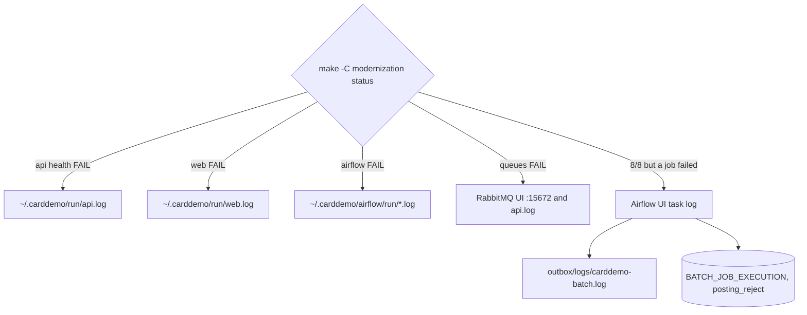

# How to monitor

The modern stack runs on one machine, and monitoring it means reading log files, calling health endpoints, running the stack check, and looking at a few database tables and the Airflow and RabbitMQ web UIs. No metrics, tracing, or alerting is configured: only the actuator `health` endpoint is exposed, and there is no Prometheus endpoint, no OpenTelemetry, no log shipping, and nothing pages anyone when something fails.

## Quick check

```sh
make -C modernization status
```

This runs `modernization/ops/check_stack.py` with the stack environment and prints one `OK` or `FAIL` line per check, then `stack check: N/8 passed` (exit 1 on any failure). The eight checks cover API health, the web app and its proxy, Airflow health, the four owed DAGs, the report DAG being unpaused, DAG import errors, and the eight RabbitMQ queues; [Deployment](deployment.md) lists them. Run it first whenever something looks wrong.

## Where to look



## Logs

| Log | Path | Written by |
|:--|:--|:--|
| Online API | `~/.carddemo/run/api.log` | stdout and stderr of the API jar (`modernization/ops/up.sh`) |
| Web app | `~/.carddemo/run/web.log` | `vite preview` |
| Bill-payment service | `~/.carddemo/run/billpay.log` | `modernization/ops/billpay.sh` |
| Airflow services | `~/.carddemo/airflow/run/api-server.log`, `scheduler.log`, `dag-processor.log`, `db-migrate.log`, `reserialize.log` | `modernization/airflow/start.sh` |
| Airflow task logs | `~/.carddemo/airflow/logs/` (Airflow's `base_log_folder` under `AIRFLOW_HOME`), also shown in the Airflow UI per task | Airflow |
| Batch jar application log | `carddemo-batch.log` in `CARDDEMO_LOG_DIR`: `~/.carddemo/outbox/logs/` for Airflow runs, `~/.carddemo/run/` for `db-reset` and `load` | `logging.file.name` in `modernization/backend/batch/src/main/resources/application.properties`; Spring rotates it into dated `.gz` files |
| Batch job SYSOUT | Standard output of the jar, which the Airflow task logs line by line as `SYSOUT ...` (stderr as `STDERR ...`) | `JobLog` and `modernization/airflow/dags/carddemo_batch.py` |

The batch jar keeps two streams apart on purpose. `modernization/backend/common/src/main/java/com/carddemo/common/batch/JobLog.java` writes the COBOL DISPLAY lines (the SYSOUT a JCL job would produce) verbatim to standard output, and nothing else goes there: `logging.threshold.console=OFF` sends application logging to the file only. So to read what the job "displayed", open the Airflow task log; to read stack traces and Spring messages, open `carddemo-batch.log`. There is no job log table; SYSOUT lives only in the Airflow task log (or your terminal, when you run the jar by hand). The Airflow task's final line states the exit code meaning, for example `POSTTRAN abend (exit 99)`.

Card numbers and other PII do not appear in these logs by design (B-MASK); see [Security](security.md).

## Health endpoints

| Endpoint | Expected |
|:--|:--|
| `http://127.0.0.1:8081/actuator/health` | `{"status":"UP"}`, aggregated from Spring Boot's auto-configured indicators (the database and RabbitMQ among them). Public |
| `http://127.0.0.1:5173/actuator/health` | The same through the web app's proxy |
| `http://127.0.0.1:8091/actuator/health` | Bill-payment service, when started |
| `http://127.0.0.1:8080/api/v2/monitor/health` | Airflow: `metadatabase` and `scheduler` with `status: healthy` |

Liveness and readiness groups are enabled on the API (`management.endpoint.health.probes.enabled=true`), but the security chain permits only the exact path `/actuator/health`, so `/actuator/health/liveness` and `/readiness` are refused for anonymous callers. Only `health` is exposed; there is no `/actuator/metrics` or `/actuator/prometheus`.

## Airflow: DAG runs

- UI: `http://127.0.0.1:8080`, user `carddemo`; the password is generated into `~/.carddemo/airflow/simple_auth_manager_passwords.json.generated` on first start.
- REST: get a token with `POST /auth/token`, then for example `GET /api/v2/dags/carddemo_daily_cycle/dagRuns` with `Authorization: Bearer <token>`. `check_stack.py` shows the pattern in `airflow_token()`.
- What to watch: failed `carddemo_daily_cycle` tasks (exit 8 refused, 12 bad date, 99 abend fail the task without retry), the paused state of the daily cycle (paused unless `CARDDEMO_CYCLE_SCHEDULE=on`), and import errors. Recovery after a failed POSTTRAN is in [Daily batch cycle](features/daily-batch-cycle.md).

## RabbitMQ

The management UI is at `http://127.0.0.1:15672` (bound to loopback). Under the `carddemo` vhost, watch:

- `CARD.DEMO.DLQ` depth: nothing consumes it, so any message there is a request that failed three deliveries or was rejected at once (oversized authorization, failed commit). See [Message queues](api/message-queues.md).
- `CARD.DEMO.ERROR` depth: inquiry error records (read failures, full or missing reply queues, rate-limit hits).
- Fixed reply queue depth: the reply queues are capped at 10,000 messages and reject new publishes when full.
- Consumers on the three request queues: zero consumers means the API is down or disconnected.

The application user `carddemo` lacks the management tag (comment in `modernization/ops/check_stack.py`), so the UI needs a broker account with that tag. Without one, `check_stack.py` still tells you which queues exist; its passive declare also receives each message count, but the script prints only presence.

## Database tables worth querying

| Table | Migration | What it tells you |
|:--|:--|:--|
| `BATCH_JOB_EXECUTION`, `BATCH_STEP_EXECUTION` | `modernization/backend/schema/src/main/resources/db/migration/V2__spring_batch.sql` | Every batch job run with status, exit code, start and end time; step read, write, and commit counts |
| `posting_reject` | `V1__core_schema.sql` | POSTTRAN rejects (the DALYREJS content) |
| `cycle_backup`, `statement_run`, `interest_account` | `V20__batch_cycle.sql` | Backups taken and restored, statement runs, which accounts got interest for which month |
| `report_run` | `V40__report_run.sql` | Each CORPT00C report request: type, date range, user, `state` as last seen from Airflow, `state_checked_at` |
| `audit_log` | `V1__core_schema.sql` | Sign-on successes, failures, lockouts (with client address), and user, account, and card changes (C-AUDIT) |
| `app_user.failed_attempts`, `locked_until` | `V1__core_schema.sql` | Which user IDs are locked out and until when |
| `auth_error_log` | `V60__authorization.sql` | Authorization engine and queue errors (CCPAUERY records such as M003, M004) |

All migrations are under `modernization/backend/schema/src/main/resources/db/migration/`. Connect with `sqlcmd` from `/opt/mssql-tools18/bin` as `carddemo_app`, taking the password from your environment rather than typing it on the command line. Column-level detail is in [Data models](reference/data-models.md).

## What is not monitored

- No metrics or dashboards for request rates, latencies, JVM memory, or queue throughput.
- No distributed tracing or correlation IDs across the API, Airflow, and the batch jar.
- No alerting: a failed nightly cycle is visible only in the Airflow UI and the tables above.
- No log aggregation or retention policy; the API, web, and billpay logs are overwritten on each start (`>` redirection in the ops scripts).

## Related pages

- [Debugging](how-to-contribute/debugging.md) for common failures and fixes
- [Deployment](deployment.md) for what runs where
- [Airflow](applications/airflow.md) and [Batch jar](applications/batch-jar.md) for exit codes and DAGs
