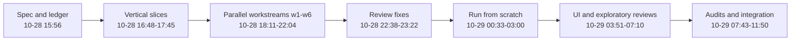

# Lore

CardDemo started in 2022 as an AWS sample mainframe application and changed slowly for three years. In late October 2026 it gained local tooling and then, in about two days, a full rebuild on a modern stack. This page lists the eras with dates taken from `git log` on the `modernization` branch (commit 467e0f0) and on `origin/main`.

## Overview

| Era | Dates | Commits | What changed |
|:--|:--|--:|:--|
| 1. Initial release | 2022-08-22 to 2022-09-01 | 3 | Repository created, Release 1.0 with the base COBOL application |
| 2. Early fixes and contributions | 2022-09-06 to 2023-02-10 | 22 | Typo and compile fixes, catalog listing, runtime samples, first outside contributions |
| 3. Runtime samples | 2024-09-17 to 2024-12-09 | 3 | UniKix runtime samples |
| 4. Optional modules and schedulers | 2025-08-03 to 2025-10-16 | 4 | IMS/Db2/MQ, Db2, and VSAM-MQ modules; CA7 and Control-M files; data export and import |
| 5. Agent-ready tooling | 2026-10-27 | 1 | Python lint, inventory, GnuCOBOL runner, tests, CI |
| 6. Modernization | 2026-10-28 to 2026-10-29 | 138 | Spec, fidelity ledger, Java/React/Airflow rebuild, verification, review rounds |

Times in era 6 are UTC as recorded in the commits. Era 6 is described in more depth in [Migration context](background/migration-context.md), and the size of each era is charted in [By the numbers](by-the-numbers.md).

## Era 1: initial release (August to September 2022)

- 2022-08-22: the repository is created by an automation account with a README, license, and notice (commit 6c04f7b, 5 files).
- 2022-09-01: "Release 1.0" (commit 8c797e2) adds 143 files and 34,159 lines. It already contains the core of today's `app/` tree: 26 COBOL programs in `app/cbl` (sign-on `COSGN00C`, the menus, account, card, transaction, bill payment, report, and user screens, and the batch programs `CBTRN01C` to `CBTRN03C` and `CBACT01C` to `CBACT04C`), 17 BMS maps, 27 copybooks, 28 JCL jobs, the CICS resource definitions in `app/csd`, and the ASCII sample data.

The name and purpose come from the root `README.md`: a credit card management application built to test and demonstrate AWS and partner tools for mainframe migration and modernization.

## Era 2: early fixes and contributions (September 2022 to February 2023)

- 2022-09-06: the first pull request (#1) from an outside contributor fixes typos in `README.md`.
- 2022-09-08: issue #2 fixes a typo in `app/jcl/DUSRSECJ.jcl`.
- 2022-10-04: a catalog listing lands in `app/catlg/LISTCAT.txt`.
- 2022-10-12: a fix to `app/cbl/COACTUPC.cbl` and sample compile jobs are added.
- 2022-10-13: a compile issue in `app/cbl/CBTRN01C.cbl` is fixed.
- 2022-10-22: an outside contributor renames the ACCTDATA file to its correct name.
- 2022-11-27 and 2022-12-02: the AWS Mainframe Modernization (M2) runtime archive and its configuration are added under `samples/`.
- 2023-01-09: pull request #16 adds a COBOL-to-COBOL call.
- 2023-02-10: the README gains copybook names. Upstream activity then stops for about 19 months.

These commits came from upstream AWS contributors and a few outside contributors. Most were small, which suggests the application was considered complete as a sample and was mainly being corrected.

## Era 3: runtime samples (September to December 2024)

- 2024-09-17 and 2024-09-25: UniKix runtime components are added as a sample under `samples/`, then their compile scripts are adjusted.
- 2024-12-09: a further file upload.

## Era 4: optional modules and schedulers (August to October 2025)

- 2025-08-03: "Add optional modules and enhanced functionality" (commit fb78417) is the largest upstream change: 190 files, 24,487 lines added and 6,944 deleted. It creates the three optional modules under `app/app-authorization-ims-db2-mq`, `app/app-transaction-type-db2`, and `app/app-vsam-mq`, adds `app/cbl/COBSWAIT.cbl` and the first CA7 schedule (`app/scheduler/CardDemo.ca7`), and adds the `scripts/` helpers for working with a real mainframe.
- 2025-09-15: an updated CA7 schedule.
- 2025-10-10: a Control-M schedule (`app/scheduler/CardDemo.controlm`).
- 2025-10-16: data export and import (commit 59cc6c2): `app/cbl/CBEXPORT.cbl`, `app/cbl/CBIMPORT.cbl`, their JCL and copybook, and EBCDIC data. This is the last upstream commit and the point where the `modernization` branch leaves `origin/main`.

## Era 5: agent-ready tooling (27 October 2026)

At 19:41 UTC on 2026-10-27, commit a3e87a4 adds `tools/carddemo/` (a standard-library Python linter for COBOL and JCL with rules CD001 to CD070, a baseline, inventory generation, a GnuCOBOL syntax check, and local batch runs), the `tests/` pytest suites with a 90 percent coverage gate, `AGENTS.md`, the root `Makefile`, the docs under `docs/`, and CI workflows under `.github/workflows/`. It also fixes real defects in the mainframe source: the `RECORD KEY` of `app/cbl/CBEXPORT.cbl` and `app/cbl/CBIMPORT.cbl` pointed at WORKING-STORAGE, `app/jcl/CBEXPORT.jcl` had a wrong key offset, and tab characters were removed from `app/cpy/CUSTREC.cpy`, `app/cpy/CSLKPCDY.cpy`, and `app/app-transaction-type-db2/cbl/COTRTLIC.cbl`. The tooling is covered in [Local tooling](mainframe/local-tooling.md).

## Era 6: modernization (28 to 29 October 2026)

The phases below are read from commit subjects and merge branch names. They overlap, because several workstreams ran in parallel branches.

1. **Specification and ledger** (2026-10-28 15:56, commit 825b06c): 53 files and 18,772 lines add `modernization/spec/` (one file per COBOL program plus `modernization/spec/components.md`, `modernization/spec/entities.md`, and `modernization/spec/jobs.md`), `modernization/architecture.md`, and the fidelity ledger in `modernization/decisions/`. The architecture document records its status as "approved (2026-10-28)" on line 3 of `modernization/architecture.md`.
2. **Vertical slices** (16:48 to 17:45): a backend slice with the POSTTRAN parity harness, a React slice (sign-on, menus, bill payment) with Playwright tests, the Airflow daily-cycle DAG and a RabbitMQ date inquiry, the spec and traceability checkers, data round-trip verification, and the user maintenance and transaction screens.
3. **Parallel workstreams** (18:11 to 22:04): branches named `w1-data`, `w2-batch`, `w3-iam-card`, `w4-acct-tran`, `w5-trantype-inquiry`, and `merge-w6` add the card, account, report, transaction-type, and pending-authorization screens; INTCALC, CREASTMT, TRANVERIFY, and TRANREPT jobs; data exchange jobs; the authorization engine over RabbitMQ and REST; and the security matrix tests. Two commits in this window correct the batch and online specs after a fidelity review (d5182ea at 19:12 and 5e461d4 at 19:31).
4. **Review fixes** (22:38 to 23:22): a spec delta review, a test-quality review (merge `fix-tqr`, which tightened tests that claimed more spec IDs than they proved), and a dataset-coverage review (merge `fix-dcr`).
5. **Run from scratch** (2026-10-29 00:33 to 03:00): stack scripts under `modernization/ops/`, a smoke test, standalone bill-payment tests, the report check, closing the remaining traceability gaps, the first generated traceability matrix, and the accessibility suite over every BMS map.
6. **UI and exploratory reviews** (03:51 to 07:10): fixes for review findings labelled UIR-1 to UIR-20 (and follow-up rounds) and EXP-1 to EXP-4, then traceability regeneration.
7. **Audits and integration** (07:43 to 11:50): spec audits labelled E2 to E6 and resolution re-checks, merged into an `integrate` branch together with scheduling fixes (the daily cycle gets a schedule and catches up a missed month's interest) and backup fixes (BACKUP is refused once a date is posted). The last commit, 467e0f0 at 11:50, regenerates the traceability matrix.

From the spec commit to the final commit took just under 20 hours. The density of review-and-fix commits in the second half suggests the process put more time into checking the rebuild than into writing it, though the commit history alone cannot show how long each step really took.

## Longest-standing features

- The base online and batch programs. All 26 programs from Release 1.0 are still in `app/cbl`, and 119 of the 142 `app/` files in Release 1.0 have not been touched by any later commit.
- Of the 30,343 lines in `app/cbl`, `app/cpy`, `app/bms`, and `app/jcl` today, `git blame` dates 21,073 (about 69 percent) to 2022, 8,209 to 2025, and 1,061 to 2026. The 2026 lines come from the tab and key fixes in commit a3e87a4.
- Sign-on through transaction `CC00` and program `COSGN00C` (defined in `app/csd/CARDDEMO.CSD`, line 378) dates from Release 1.0 and survives in the rebuild as the `/api/screens/COSGN00C` screen. See [Sign-on and sessions](features/sign-on-and-sessions.md).

## Replaced and retired in the rebuild

The COBOL sources are not deleted; `app/` is unchanged by the rebuild except for the tooling fixes. These are things the modern stack replaces or drops, as recorded in the decision ledger:

| Original | Rebuild | Source |
|:--|:--|:--|
| JCL jobs run by CA7 and Control-M | Airflow DAGs calling the batch jar; "The CA7 and Control-M definitions are not ported" | B-CYCLE in `modernization/decisions/ledger-batch-data.md`, line 24 |
| CLOSEFIL, OPENFIL, WAITSTEP, TRANBKP, COMBTRAN, TRANIDX steps | No target step: online stays up (D-BATCH-WINDOW), interest rows go straight into the transaction table, and a database backup runs before POSTTRAN | B-CYCLE; `modernization/airflow/dags/carddemo_daily_cycle.py`, lines 30-31 |
| Plain-text passwords in USRSEC | BCrypt hashes (cost 12) | Q-COSGN00C-01 in `modernization/decisions/ledger-online.md`, line 33 |
| Separate "User not found" and "Wrong Password" messages | One generic message, so user IDs cannot be enumerated | Q-COSGN00C-04, line 36 of the same file |
| IBM MQ request and reply queues | RabbitMQ with the same queue names, plus REST equivalents | [Message queues](api/message-queues.md) |
| VSAM, Db2, and IMS data stores | One SQL Server database managed by Flyway | [Data migration](features/data-migration.md) |
| CICS screens on a 3270 terminal | React screens over a per-program screen API | [Screen API](api/screen-api.md) |

One inconsistency is worth knowing about: the context table in `modernization/architecture.md` (line 79) still lists a Spring Batch job named `combtran`, while the ledger and the daily-cycle DAG say there is no COMBTRAN step. The DAG matches the ledger, so the table entry is probably left over from an earlier draft.

## Growth trajectory

Upstream, the repository grew in two large steps (Release 1.0 in 2022 and the optional modules in 2025) with small fixes between them. Across its whole history upstream added 71,126 lines. The `modernization` branch then added 83,561 lines in 139 commits over three days, so roughly half of today's tracked lines date from October 2026 (`modernization/` alone holds 76,941 lines). For the counts behind this, see [By the numbers](by-the-numbers.md).
