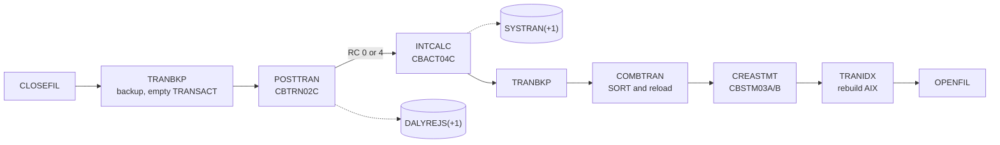

# Batch and JCL

Active contributors: Arunkumar Selvam, Sanjay Rao, Abhijit Kshirsagar

CardDemo's batch side is a set of COBOL batch programs in `app/cbl` (names `CB*C`) run by the JCL in `app/jcl`, with two procedures in `app/proc`, one control card in `app/ctl`, and CA7 and Control-M schedules in `app/scheduler`. The daily cycle posts transactions, charges interest, and writes statements against the same VSAM files the online programs use.

## Purpose

Batch work covers four things: defining and loading the VSAM files from sample data, the recurring business cycle (posting, interest, statements, reports), listing and housekeeping utilities, and demonstrations of mainframe infrastructure (FTP, internal reader, PDF conversion). The modernization specification classifies every job into these four classes in `modernization/spec/jobs.md` (classes a to d).

## Directory layout

```
app/
├── cbl/CB*.cbl, COBSWAIT.cbl, CSUTLDTC.cbl   batch programs and subprograms
├── jcl/            38 base jobs (.jcl / .JCL)
├── proc/REPROC.prc     IDCAMS REPRO procedure (load or unload a VSAM file)
├── proc/TRANREPT.prc   report procedure used by the TRANREPT job
├── ctl/REPROCT.ctl     control card: REPRO INFILE(FILEIN) OUTFILE(FILEOUT)
├── asm/MVSWAIT.asm     timed wait called by COBSWAIT
└── scheduler/
    ├── CardDemo.ca7        CA7 job listings with trigger chains (570 lines)
    └── CardDemo.controlm   Control-M XML DEFTABLE (92 lines)
```

Module jobs (CBPAUP0J, the IMS load and unload jobs, CREADB21, MNTTRDB2, TRANEXTR) live in the module directories; see [Optional modules](optional-modules.md).

## Batch programs

| Program | Job | What it does | Lines | Modern module |
|:--|:--|:--|--:|:--|
| CBTRN02C | POSTTRAN | Validates each daily transaction (card in the cross-reference, account exists, within credit limit, before expiry), writes valid ones to TRANSACT, updates account and category balances, writes rejects to DALYREJS; RC 4 when any are rejected | 732 | [Cycle](../modules/cycle.md) |
| CBTRN01C | none | Read-only check of each daily transaction's card and account; no JCL or schedule runs it (`modernization/spec/programs/CBTRN01C.md`) | 495 | [Cycle](../modules/cycle.md) (`TRANVERIFY` command) |
| CBACT04C | INTCALC | Computes interest per category balance from the disclosure group rates, updates accounts, writes interest transactions to the SYSTRAN GDG | 653 | [Cycle](../modules/cycle.md) |
| CBSTM03A | CREASTMT | Writes account statements in text and HTML | 925 | [Cycle](../modules/cycle.md) |
| CBSTM03B | (called) | File I/O subroutine for CBSTM03A | 231 | [Cycle](../modules/cycle.md) |
| CBTRN03C | TRANREPT | Transaction detail report for a date range, submitted from the CR00 screen | 650 | [Reporting](../modules/reporting.md) |
| CBACT01C | READACCT | Lists the account file and writes three demo output formats; calls the COBDATFT assembler routine | 431 | [Data exchange](../modules/dataexchange.md) |
| CBACT02C | READCARD | Lists the card file | 179 | [Data exchange](../modules/dataexchange.md) |
| CBACT03C | READXREF | Lists the card cross-reference file | 179 | [Data exchange](../modules/dataexchange.md) |
| CBCUS01C | READCUST | Lists the customer file | 179 | [Data exchange](../modules/dataexchange.md) |
| CBEXPORT | CBEXPORT | Exports customers, accounts, cross-references, transactions, and cards into one multi-record file | 586 | [Data exchange](../modules/dataexchange.md) |
| CBIMPORT | CBIMPORT | Splits the export file back into normalized sequential files | 491 | [Data exchange](../modules/dataexchange.md) |
| COBSWAIT | WAITSTEP | Waits for a fixed time by calling MVSWAIT | 42 | `WAITSTEP` command in the [Batch jar](../applications/batch-jar.md); not scheduled |

Line counts and calls are from `docs/INVENTORY.md`. Every CB program calls `CEE3ABD` to abend after an unexpected file status; the runbook describes this as ABEND U999.

## JCL jobs by purpose

Grouped by the classes in `modernization/spec/jobs.md` section 1.

| Class | Jobs in `app/jcl` | Notes |
|:--|:--|:--|
| (a) Setup and data definition | ACCTFILE, CARDFILE, CUSTFILE, XREFFILE, TRANFILE, DUSRSECJ, TCATBALF, DISCGRP, TRANTYPE, TRANCATG, DEFCUST, DEFGDGB, DEFGDGD, DALYREJS, REPTFILE, ESDSRRDS, CBEXPORT, CBIMPORT | Mostly IDCAMS DELETE, DEFINE CLUSTER, and REPRO from the `.PS` sample datasets. CARDFILE, CUSTFILE, and TRANFILE also close and reopen their CICS files with SDSF. DEFCUST is obsolete; ESDSRRDS is a demo |
| (b) Recurring business batch | TRANBKP, POSTTRAN, INTCALC, COMBTRAN, CREASTMT, TRANREPT | The daily cycle plus the on-demand report |
| (c) Utility, listing, operations | TRANIDX, PRTCATBL, READACCT, READCARD, READCUST, READXREF, CLOSEFIL, OPENFIL, WAITSTEP | CLOSEFIL and OPENFIL issue `CEMT SET FILE` commands to the CICS region through SDSF |
| (d) Infrastructure | CBADMCDJ, INTRDRJ1, INTRDRJ2, TXT2PDF1, FTPJCL | CICS resource definition (DFHCSDUP), internal reader demo, text to PDF, FTP put |

`app/proc/REPROC.prc` runs IDCAMS with SYSIN from `&CNTLLIB(REPROCT)`, which is `app/ctl/REPROCT.ctl`. TRANBKP, PRTCATBL, and TRANREPT use it.

## How the daily cycle runs

The runbook order (`docs/runbooks/batch-operations.md`) is the authoritative sequence according to `modernization/spec/jobs.md` section 2:



| # | Job | Expected RC |
|--:|:--|:--|
| 1 | CLOSEFIL | 0 |
| 2 | TRANBKP | 0 |
| 3 | POSTTRAN | 0, or 4 when any transaction is rejected |
| 4 | INTCALC | 0 |
| 5 | TRANBKP | 0 |
| 6 | COMBTRAN | 0 |
| 7 | CREASTMT | 0 |
| 8 | TRANIDX | 0 |
| 9 | OPENFIL | 0 |

Anything above RC 4 or an abend stops the cycle. With the sample data, POSTTRAN processes 300 transactions and rejects 43, all reason 102 (over limit), when compiled with the cobc default sign handling that `make run-batch PROGRAM=CBTRN02C` uses ([Local tooling](local-tooling.md)). Compiled with `-fsign=EBCDIC`, which decodes the overpunched signs as the mainframe would, it rejects 38 (Q-CBTRN02C-08). Reject reason codes 100 to 103, the GDG-based rollback, and failure symptoms are in the runbook.

Two behaviors in this chain surprise most readers, both documented in `modernization/spec/jobs.md` section 2:

- CBTRN02C opens TRANSACT for OUTPUT (`app/cbl/CBTRN02C.cbl:256`), which only works on an empty KSDS, so TRANBKP must empty TRANSACT first. After COMBTRAN, TRANSACT holds only this cycle's postings and interest; older transactions survive only in the five TRANSACT.BKUP generations.
- CBACT04C resets the cycle credit and debit totals that POSTTRAN's over-limit check uses, and its formula divides an annual rate by 1200 (a monthly charge). Running INTCALC daily (runbook) or monthly (Control-M) gives different results.

## Schedulers

The two schedule files disagree with each other and with the runbook. `modernization/spec/jobs.md` section 9 records the details as quirks Q-CA7-01 to Q-CA7-05 and Q-CONTROLM-01 to Q-CONTROLM-07.

- **CA7** (`app/scheduler/CardDemo.ca7`): job listings whose trigger edges form three chains. Chain A is CLOSEFIL, CBPAUP0J, POSTTRAN, WAITSTEP, OPENFIL. It has no TRANBKP, INTCALC, COMBTRAN, or TRANIDX, and it pulls the optional IMS module job CBPAUP0J into the base cycle. Chain B reloads reference files and runs the listings; chain C runs CREASTMT, TXT2PDF1, and PRTCATBL.
- **Control-M** (`app/scheduler/CardDemo.controlm`): folders DAILY-TransactionBackup (CLOSEFIL, TRANBKP, WAITSTEP, OPENFIL with no posting), two WEEKLY folders (MNTTRDB2, TRANEXTR, DISCGRP refresh), and MONTHLY-InterestCalculation (CLOSEFIL, INTCALC, COMBTRAN, WAITSTEP, OPENFIL).
- **Scripts**: `scripts/run_full_batch.sh`, `scripts/run_posting.sh`, and `scripts/run_interest_calc.sh` submit jobs over FTP without waiting for return codes; sleeps are the only ordering.

The modern daily DAG follows the runbook order instead of either scheduler (`modernization/architecture.md` section 5). See [Daily batch cycle](../features/daily-batch-cycle.md) and [Airflow](../applications/airflow.md).

## Jobs with no target equivalent

`modernization/architecture.md` section 5 says that "CLOSEFIL/OPENFIL, TRANIDX, FTP, and internal-reader jobs have no target equivalent", and the "Modern equivalent" column of `modernization/spec/jobs.md` section 1 gives the reason per job:

| Job | Why it is not needed |
|:--|:--|
| CLOSEFIL, OPENFIL | Database concurrency replaces exclusive file access |
| TRANIDX | SQL Server maintains indexes automatically |
| TRANBKP, COMBTRAN | Replaced by the BACKUP snapshot step; interest inserts directly into the transaction table |
| WAITSTEP | Airflow task dependencies replace fixed waits (the jar still has a `WAITSTEP` command) |
| INTRDRJ1, INTRDRJ2 | Internal reader submission becomes a DAG trigger or task dependency |
| FTPJCL | The spec suggests a managed file transfer task; the architecture lists FTP as having no target equivalent |
| DEFGDGB, DEFGDGD, REPTFILE, DEFCUST, ESDSRRDS | Retired; snapshot and run tables replace GDGs |

The listing jobs (READACCT, READCARD, READCUST, READXREF) and PRTCATBL are not scheduled, but they exist as commands of the batch jar (`modernization/backend/batch/src/main/java/com/carddemo/batch/BatchCommandLine.java`).

The file definition and load jobs (class a) become Flyway migrations and the sample-data loader; see [Data migration](../features/data-migration.md).

## Entry points for modification

- Change job steps in `app/jcl/<JOB>.jcl`; keep 80-column records and no tabs (rules CD001 and CD002).
- For a batch program that the local runner supports (CBACT02C, CBACT03C, CBCUS01C, CBTRN02C), run it and add an assertion in `tests/integration/test_batch_jobs.py`.
- Byte-for-byte parity of the modern jobs with these programs is checked by the harness in [Batch parity](../verification/batch-parity.md).

## Key source files

| File | Purpose |
|:--|:--|
| `app/jcl/POSTTRAN.jcl` | Posting job (CBTRN02C) |
| `app/jcl/INTCALC.jcl` | Interest job (CBACT04C) |
| `app/jcl/CREASTMT.JCL` | Statement job (sort, CBSTM03A) |
| `app/jcl/TRANBKP.jcl`, `app/jcl/COMBTRAN.jcl` | Backup and combine around posting |
| `app/jcl/TRANREPT.jcl`, `app/proc/TRANREPT.prc` | Transaction report |
| `app/jcl/DEFGDGB.jcl` | GDG bases (five generations of TRANSACT.BKUP) |
| `app/scheduler/CardDemo.ca7`, `app/scheduler/CardDemo.controlm` | Schedules |
| `docs/runbooks/batch-operations.md` | Operating order, return codes, recovery |
| `modernization/spec/jobs.md` | Per-job specification, scheduler analysis, dataset catalogue |

## Related pages

- [Mainframe application](index.md)
- [Data stores](data-stores.md)
- [Batch jar](../applications/batch-jar.md)
- [Batch parity](../verification/batch-parity.md)
- [Glossary](../overview/glossary.md)
