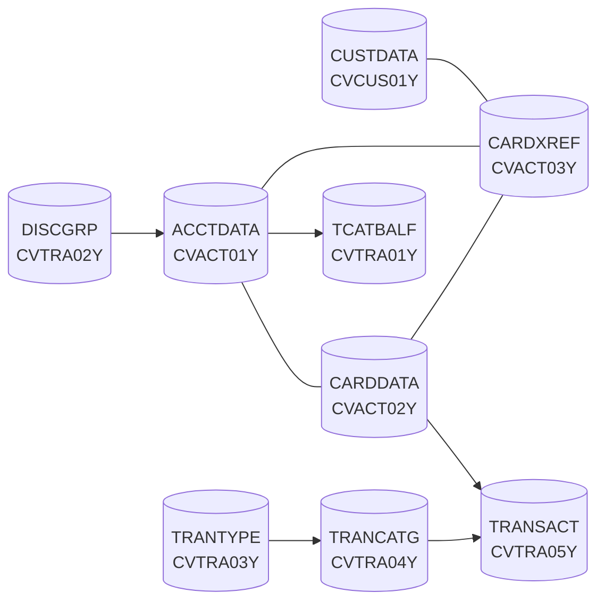

# Data stores

Active contributors: Arunkumar Selvam, Abhijit Kshirsagar, Sanjay Rao

All base CardDemo data lives in VSAM files whose record layouts are COBOL copybooks in `app/cpy`. Sample data for every file ships twice: readable ASCII text in `app/data/ASCII` and upload-ready EBCDIC binaries in `app/data/EBCDIC`. The IDCAMS catalog listing in `app/catlg/LISTCAT.txt` shows what the datasets look like on a real system.

## Purpose

The copybooks are contracts. The VSAM definitions in `app/jcl`, the sample files, the README dataset table, and the modern SQL schema all depend on their record lengths, and `tests/integration/test_data_layouts.py` checks the lengths against the sample files and the README. If you change a record copybook, update the data and the README table in the same change, as `AGENTS.md` requires.

## Directory layout

```
app/
├── cpy/CV*.cpy, CSUSR01Y.cpy, CUSTREC.cpy, COSTM01.CPY   record layouts
├── data/
│   ├── ASCII/     9 text files, one record per line (used by the local batch runner)
│   └── EBCDIC/    13 fixed-length binary datasets named AWS.M2.CARDDEMO.*.PS
├── catlg/LISTCAT.txt   IDCAMS LISTCAT LEVEL(AWS.M2.CARDDEMO) ALL output (3,956 lines)
└── jcl/<FILE>.jcl      DEFINE CLUSTER / DEFINE ALTERNATEINDEX and REPRO load per file
```

## VSAM files

From `docs/data-model.md`; keys come from the IDCAMS definitions in the job with the same name as the file (for example `app/jcl/CARDFILE.jcl`). Dataset names are under the high-level qualifier `AWS.M2.CARDDEMO`.

| Dataset | CICS file | Copybook | Record | Key (offset, length) | Alternate index |
|:--|:--|:--|--:|:--|:--|
| ACCTDATA.VSAM.KSDS | ACCTDAT | `app/cpy/CVACT01Y.cpy` | 300 | ACCT-ID (0, 11) | |
| CARDDATA.VSAM.KSDS | CARDDAT | `app/cpy/CVACT02Y.cpy` | 150 | CARD-NUM (0, 16) | CARDAIX on CARD-ACCT-ID (16, 11) |
| CUSTDATA.VSAM.KSDS | CUSTDAT | `app/cpy/CVCUS01Y.cpy` | 500 | CUST-ID (0, 9) | |
| CARDXREF.VSAM.KSDS | CCXREF | `app/cpy/CVACT03Y.cpy` | 50 | XREF-CARD-NUM (0, 16) | CXACAIX on XREF-ACCT-ID (25, 11) |
| TRANSACT.VSAM.KSDS | TRANSACT | `app/cpy/CVTRA05Y.cpy` | 350 | TRAN-ID (0, 16) | on TRAN-PROC-TS (304, 26), rebuilt by TRANIDX |
| USRSEC.VSAM.KSDS | USRSEC | `app/cpy/CSUSR01Y.cpy` | 80 | SEC-USR-ID (0, 8) | |
| TCATBALF.VSAM.KSDS | | `app/cpy/CVTRA01Y.cpy` | 50 | account, type, category (0, 17) | |
| DISCGRP.VSAM.KSDS | | `app/cpy/CVTRA02Y.cpy` | 50 | group, type, category (0, 16) | |
| TRANTYPE.VSAM.KSDS | | `app/cpy/CVTRA03Y.cpy` | 60 | TRAN-TYPE (0, 2) | |
| TRANCATG.VSAM.KSDS | | `app/cpy/CVTRA04Y.cpy` | 60 | type, category (0, 6) | |
| DALYTRAN.PS | | `app/cpy/CVTRA06Y.cpy` | 350 | sequential input to POSTTRAN | |

Only the first six have CICS file definitions in `app/csd/CARDDEMO.CSD`; the other files are batch-only. The CICS definitions use `RECOVERY(NONE)` (`modernization/spec/jobs.md`, conventions section).



The card cross-reference is the hub: transactions carry only a card number, and batch programs use the cross-reference to find the account and customer (`docs/data-model.md`). The entity diagram source is `diagrams/CARDDEMO-DataModel.drawio`.

## Record copybooks

Record lengths are computed from the PICTURE and USAGE clauses by `tools/carddemo/copybook.py` and published in `docs/INVENTORY.md`.

| Copybook | 01-level record | Bytes | Used for |
|:--|:--|--:|:--|
| `app/cpy/CVACT01Y.cpy` | ACCOUNT-RECORD | 300 | Account master |
| `app/cpy/CVACT02Y.cpy` | CARD-RECORD | 150 | Card master |
| `app/cpy/CVACT03Y.cpy` | CARD-XREF-RECORD | 50 | Card, account, customer cross-reference |
| `app/cpy/CVCUS01Y.cpy` | CUSTOMER-RECORD | 500 | Customer master |
| `app/cpy/CUSTREC.cpy` | CUSTOMER-RECORD | 500 | Second customer layout, used only by CBSTM03A |
| `app/cpy/CVTRA01Y.cpy` | TRAN-CAT-BAL-RECORD | 50 | Category balance per account |
| `app/cpy/CVTRA02Y.cpy` | DIS-GROUP-RECORD | 50 | Disclosure group (interest rate) |
| `app/cpy/CVTRA03Y.cpy` | TRAN-TYPE-RECORD | 60 | Transaction type |
| `app/cpy/CVTRA04Y.cpy` | TRAN-CAT-RECORD | 60 | Transaction category |
| `app/cpy/CVTRA05Y.cpy` | TRAN-RECORD | 350 | Posted transaction |
| `app/cpy/CVTRA06Y.cpy` | DALYTRAN-RECORD | 350 | Daily transaction input |
| `app/cpy/CVTRA07Y.cpy` | REPORT-NAME-HEADER and others | 114-115 | CBTRN03C report lines |
| `app/cpy/COSTM01.CPY` | TRNX-RECORD | 350 | Sorted transaction layout read by CBSTM03A |
| `app/cpy/CVEXPORT.cpy` | EXPORT-RECORD | 500 | Multi-record export file (CBEXPORT, CBIMPORT) |
| `app/cpy/CSUSR01Y.cpy` | SEC-USER-DATA | 80 | User security (ID, name, password, user type) |
| `app/cpy/CVCRD01Y.cpy` | CC-WORK-AREAS | 213 | Working storage for card and account screens, not a file |
| `app/cpy/UNUSED1Y.cpy` | UNUSED-DATA | 80 | Not copied by any program (the one CD031 finding in the lint baseline) |

The user security file stores passwords in plain text in the original design; the modern schema stores BCrypt hashes instead (see [Security](../security.md)).

## Sample data

The sample data is synthetic. Do not copy card numbers, SSNs, or names from these files into documentation or logs; `docs/data-handling.md` sets the rules.

| ASCII file (`app/data/ASCII`) | Lines | EBCDIC dataset (`app/data/EBCDIC`) | Bytes | Records | Copybook |
|:--|--:|:--|--:|--:|:--|
| `acctdata.txt` | 50 | AWS.M2.CARDDEMO.ACCTDATA.PS | 15,000 | 50 | CVACT01Y |
| (none) | | AWS.M2.CARDDEMO.ACCDATA.PS | 15,000 | 50 | CVACT01Y |
| `carddata.txt` | 50 | AWS.M2.CARDDEMO.CARDDATA.PS | 7,500 | 50 | CVACT02Y |
| `cardxref.txt` | 50 | AWS.M2.CARDDEMO.CARDXREF.PS | 2,500 | 50 | CVACT03Y |
| `custdata.txt` | 50 | AWS.M2.CARDDEMO.CUSTDATA.PS | 25,000 | 50 | CVCUS01Y |
| `dailytran.txt` | 300 | AWS.M2.CARDDEMO.DALYTRAN.PS | 105,000 | 300 | CVTRA06Y |
| (none) | | AWS.M2.CARDDEMO.DALYTRAN.PS.INIT | 350 | 1 | CVTRA06Y |
| `discgrp.txt` | 51 | AWS.M2.CARDDEMO.DISCGRP.PS | 2,550 | 51 | CVTRA02Y |
| `tcatbal.txt` | 50 | AWS.M2.CARDDEMO.TCATBALF.PS | 2,500 | 50 | CVTRA01Y |
| `trancatg.txt` | 18 | AWS.M2.CARDDEMO.TRANCATG.PS | 1,080 | 18 | CVTRA04Y |
| `trantype.txt` | 7 | AWS.M2.CARDDEMO.TRANTYPE.PS | 420 | 7 | CVTRA03Y |
| (none) | | AWS.M2.CARDDEMO.USRSEC.PS | 800 | 10 | CSUSR01Y |
| (none) | | AWS.M2.CARDDEMO.EXPORT.DATA.PS | 250,000 | 500 | CVEXPORT |

Line counts are from `wc -l`; EBCDIC record counts are file size divided by record length. The dataset-to-copybook mapping is the `EBCDIC_LAYOUTS` table in `tests/integration/test_data_layouts.py`, which asserts that every EBCDIC file is a whole number of records. ACCDATA.PS is a second copy of the account data under an older name (a 2022 upstream commit renamed the file to ACCTDATA). TRANFILE loads TRANSACT from DALYTRAN.PS.INIT.

How the two encodings are used:

- **EBCDIC** files are uploaded as-is (binary) to a mainframe and loaded by the jobs in `app/jcl` (ACCTFILE, CARDFILE, and so on). The modern sample-data loader also reads these (see [Data migration](../features/data-migration.md)).
- **ASCII** files are what `tools/carddemo/batch.py` reads. It pads each line to the copybook length (trailing FILLER is trimmed in the text files) and loads KSDS files into GnuCOBOL indexed files with the same primary key. See [Local tooling](local-tooling.md).

## Catalog listing

`app/catlg/LISTCAT.txt` is IDCAMS output from `LISTCAT LEVEL(AWS.M2.CARDDEMO) ALL`, dated 09/01/22. It lists 160 non-VSAM datasets, 10 VSAM clusters, 3 alternate indexes, 3 paths, and 7 GDG bases (counted from entry headers). It is reference material only; nothing reads it. The full dataset catalogue, including GDGs and which job creates each dataset, is section 10 of `modernization/spec/jobs.md`.

## Integration points

- Online programs access files through their CICS names (ACCTDAT, CARDAIX, and so on); see [Online programs](online-programs.md).
- Batch jobs refer to files by DD name (ACCTFILE, XREFFILE, TCATBALF, DALYTRAN); see [Batch and JCL](batch-and-jcl.md).
- In the modern application each file becomes a SQL Server table; the column-by-column mapping is in [Data models](../reference/data-models.md), and the entity specification is `modernization/spec/entities.md`.

## Key source files

| File | Purpose |
|:--|:--|
| `docs/data-model.md` | File, key, and relationship reference |
| `app/cpy/CVACT01Y.cpy` | Account record |
| `app/cpy/CVTRA05Y.cpy` | Transaction record |
| `app/jcl/ACCTFILE.jcl` | Example define-and-load job |
| `tests/integration/test_data_layouts.py` | Record length checks for samples, EBCDIC files, and README |
| `tools/carddemo/batch.py` | ASCII-to-fixed-record conversion and KSDS loading |
| `app/catlg/LISTCAT.txt` | Catalog listing |

## Related pages

- [Mainframe application](index.md)
- [Optional modules](optional-modules.md) for the Db2 tables and IMS segments
- [Schema and migration](../modules/schema-and-migration.md)
- [Glossary](../overview/glossary.md)
