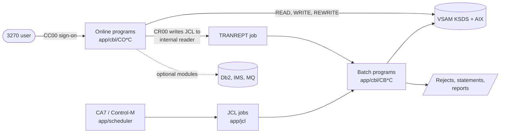

# Mainframe application

Active contributors: Arunkumar Selvam, Sanjay Rao, Abhijit Kshirsagar

The original AWS CardDemo application lives under `app/`: a CICS online credit card system and a JCL batch cycle written in COBOL, sharing VSAM files, with three optional modules that add Db2, IMS DB, and MQ. Nothing under `app/` runs in this repository without a mainframe, except the batch programs that the local GnuCOBOL tooling can compile (see [Local tooling](local-tooling.md)).

## Purpose

CardDemo exists to exercise mainframe migration and modernization tools. The root `README.md` describes it as an application that "intentionally incorporates various coding styles and patterns", so inconsistent naming, duplicated code, and dead paragraphs are part of the sample, not accidents to clean up. On the `modernization` branch the same sources are the specification input for the rebuilt application under `modernization/` (see [Specification](../verification/specification.md)).

## Directory layout

```
app/
├── cbl/                31 programs: CO*C online (CICS), CB*C batch, plus COBSWAIT and CSUTLDTC
├── cpy/                30 copybooks: record layouts (CV*Y, CSUSR01Y), COMMAREA, menus, messages
├── bms/                17 BMS mapsets for the base screens
├── cpy-bms/            17 symbolic map copybooks generated from the mapsets
├── jcl/                38 jobs: file definition and load, the batch cycle, listings, utilities
├── proc/               REPROC (IDCAMS REPRO) and TRANREPT procedures
├── ctl/                REPROCT control card used by REPROC
├── csd/                CARDDEMO.CSD: CICS files, mapsets, programs, transactions
├── asm/, maclib/       MVSWAIT (timed wait) and COBDATFT (date format) assembler and macros
├── catlg/              LISTCAT.txt: IDCAMS catalog listing of the AWS.M2.CARDDEMO datasets
├── data/ASCII/         9 readable sample files used by the local batch runner
├── data/EBCDIC/        13 binary sample datasets to upload to a mainframe
├── scheduler/          CardDemo.ca7 and CardDemo.controlm schedule definitions
├── app-authorization-ims-db2-mq/   optional: pending authorizations (IMS, Db2, MQ)
├── app-transaction-type-db2/       optional: transaction type maintenance (Db2)
└── app-vsam-mq/                    optional: account and date inquiry over MQ
```

Counts come from listing each directory. `app/cpy-bms/` also holds a `.gitkeep`, so it has 18 files and 17 copybooks.

## By the numbers

| Item | Base (`app/`) | Optional modules | Total |
|:--|--:|--:|--:|
| COBOL programs | 31 | 13 (8 authorization, 3 transaction type, 2 VSAM-MQ) | 44 |
| COBOL lines (programs only) | 20,656 | 9,525 | 30,181 |
| Copybooks (`cpy`, plus Db2 `dcl` in modules) | 30 | 11 cpy + 3 dcl | 44 |
| BMS mapsets | 17 | 4 | 21 |
| JCL jobs | 38 | 5 + 3 | 46 |
| CICS transactions defined | 19 in `app/csd/CARDDEMO.CSD` | 7 | 26 |

The program and line totals match the 30,181-line count in `modernization/spec/components.md`. The largest program is `app/cbl/COACTUPC.cbl` at 4,237 lines, which also has the most complex paragraph in the code base (cyclomatic complexity 248, per `docs/INVENTORY.md`).

## How it is used



- **A user** signs on with transaction CC00 (`app/cbl/COSGN00C.cbl`). Regular users (for example `USER0001`) land on the main menu CM00; administrators (for example `ADMIN001`) land on the admin menu CA00. Both demo users sign on with the demo password in the root `README.md`. From the menus they view and update accounts and cards, list and add transactions, pay a bill, request a transaction report, and (admins) maintain users. See [Online programs](online-programs.md).
- **The nightly batch** closes the CICS files, backs up and posts the day's transactions (POSTTRAN, `app/cbl/CBTRN02C.cbl`), calculates interest (INTCALC), combines and reloads transactions, writes statements (CREASTMT), rebuilds the alternate index, and reopens the files. The order is in `docs/runbooks/batch-operations.md`. See [Batch and JCL](batch-and-jcl.md).
- **Data** is in VSAM files whose layouts are the copybooks in `app/cpy`. See [Data stores](data-stores.md).

## Base application and optional modules

The base application (`app/cbl`, `app/cpy`, `app/bms`, `app/jcl`, and the rest) runs on CICS, VSAM, and JCL alone. The three `app/app-*` directories are self-contained add-ons with their own `cbl`, `cpy`, `bms`, `jcl`, `csd`, and Db2 or IMS definitions. A module may COPY base copybooks, but base code must never COPY from a module and modules must not COPY from each other; lint rule CD040 in `tools/carddemo/rules.py` enforces this. The base menus still name module programs as data: option 11 of the main menu (`app/cpy/COMEN02Y.cpy`) is `COPAUS0C`, and options 5 and 6 of the admin menu (`app/cpy/COADM02Y.cpy`) are `COTRTLIC` and `COTRTUPC`. `app/cbl/COMEN01C.cbl` checks with `EXEC CICS INQUIRE` whether `COPAUS0C` is installed and shows "is not installed" if it is not. See [Optional modules](optional-modules.md).

## Other mainframe material outside `app/`

| Path | Contents |
|:--|:--|
| `samples/jcl` | Compile and utility JCL: `BATCMP.jcl` (batch COBOL), `CICCMP.jcl` (CICS COBOL), `CICDBCMP.jcl` (CICS with Db2), `IMSMQCMP.jcl` (IMS and MQ), `BMSCMP.jcl` (BMS maps), plus `LISTCAT.jcl`, `RACFCMDS.jcl`, `REPRTEST.jcl`, `SORTTEST.jcl` |
| `samples/proc` | Build procedures `BUILDBAT.prc`, `BUILDONL.prc`, `BUILDBMS.prc`, `BLDCIDB2.prc` used by the compile JCL |
| `samples/m2` | Prebuilt runtime archives for AWS Mainframe Modernization: `samples/m2/mf/CardDemo_runtime.zip` (Micro Focus) and `samples/m2/unikix/UniKix_CardDemo_runtime_v1.zip` |
| `diagrams` | Screenshots and flows used by the README (`Signon-Screen.png`, `Main-Menu.png`, `Admin-Menu.png`, `Application-Flow-User.png`, `Application-Flow-Admin.png`), the authorization module images (`auth_*.png`, `ims_model.png`, `db2_model.png`), and the entity model source `CARDDEMO-DataModel.drawio` |
| `scripts` | Shell helpers that upload, compile, and submit on a real mainframe through an FTP tunnel (see [Local tooling](local-tooling.md)) |
| `docs` | `docs/architecture.md`, `docs/data-model.md`, the generated `docs/INVENTORY.md`, `docs/static-analysis.md`, `docs/data-handling.md`, `docs/runbooks/batch-operations.md` |

## Where the modern equivalents live

Every program under `app/` has a counterpart (or a documented "not ported" decision) on the `modernization` branch. Online programs become screen endpoints in the Spring Boot bounded-context modules, batch programs become Spring Batch jobs in the batch jar orchestrated by Airflow, and VSAM files become SQL Server tables.

| Mainframe area | Modern home |
|:--|:--|
| Online programs (CICS + BMS) | Backend modules, see [Modules](../modules/index.md), served by the [Online API](../applications/online-api.md) and the [Web app](../applications/web-app.md) |
| Batch programs and JCL | [Batch jar](../applications/batch-jar.md) and [Airflow](../applications/airflow.md) DAGs |
| VSAM files | SQL tables, see [Data models](../reference/data-models.md) |
| Optional modules | [Authorization](../modules/authorization.md), [Reference data](../modules/refdata.md), [Inquiry](../modules/inquiry.md) |

The full list of runnable processes is in [Applications](../applications/index.md). Terms such as COMMAREA, XCTL, KSDS, and GDG are defined in the [Glossary](../overview/glossary.md).

## Key source files

| File | Purpose |
|:--|:--|
| `README.md` | Upstream installation guide, application inventory, batch job order |
| `app/csd/CARDDEMO.CSD` | CICS definitions of the base files, mapsets, programs, and transactions |
| `app/cpy/COCOM01Y.cpy` | COMMAREA passed between every online program |
| `app/jcl/POSTTRAN.jcl` | The core posting job |
| `docs/architecture.md` | Online and batch flows |
| `docs/INVENTORY.md` | Generated list of every program and copybook with complexity and copybook usage |
| `modernization/spec/programs` | One specification file per program (44 files) |

## Related pages

- [Online programs](online-programs.md)
- [Batch and JCL](batch-and-jcl.md)
- [Data stores](data-stores.md)
- [Optional modules](optional-modules.md)
- [Local tooling](local-tooling.md)
- [Architecture](../overview/architecture.md)
