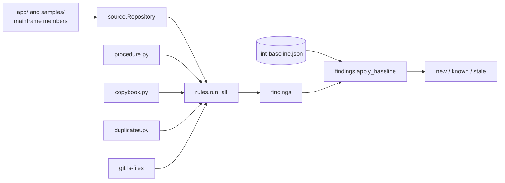

# Local tooling

Active contributors: factory-aj-pahl, Arunkumar Selvam

The Python package `tools/carddemo` lets you lint, document, syntax-check, and run the CardDemo COBOL without a mainframe. The root `Makefile` wraps it, pytest suites in `tests/` cover it, and CI runs it on every push. The older shell scripts in `scripts/` do the opposite job: they push sources and jobs to a real mainframe over an FTP tunnel.

## Purpose

The mainframe sources are the product, and most changes to them cannot be compiled or run here. The tooling catches the problems that can be caught locally: broken fixed-format columns, wrong member names, unresolved or cross-module COPY statements, PII in DISPLAY statements, growing complexity, and behavior changes in the batch programs that GnuCOBOL can run. It uses only the Python 3.10+ standard library (root `README.md`); development tools (ruff, mypy, pytest) are pinned in `requirements-dev.txt`. factory-aj-pahl wrote `tools/` and `tests/` (`git log -- tools tests`). Arunkumar Selvam is the upstream author of `scripts/` (`git log origin/main -- scripts`).

## Directory layout

```
tools/carddemo/
├── __main__.py         CLI: lint, complexity, inventory, syntax, run-batch, check-docs (153 lines)
├── source.py           fixed-format source model, Repository, module_of (223)
├── rules.py            the CDxxx lint rules (266)
├── findings.py         Finding, baseline load/apply/write (75)
├── lint-baseline.json  51 accepted findings
├── copybook.py         record length calculation from PIC and USAGE (129)
├── procedure.py        paragraph control-flow graph, complexity, reachability (194)
├── duplicates.py       copy-paste detection (80)
├── inventory.py        generates docs/INVENTORY.md (94)
├── batch.py            GnuCOBOL syntax check and batch runner (242)
└── agentsmd.py         checks AGENTS.md references (44)
tests/
├── conftest.py         cobol() helper, make_repo fixture, cobc skip logic
├── unit/               6 files, 30 tests, synthetic snippets only
└── integration/        3 files, 15 tests, against the real app/ tree
scripts/                FTP-tunnel helpers for a real mainframe
```

The package has 1,501 lines of Python; the tests have 631 lines (about 0.42 test lines per code line). `pyproject.toml` sets a 90 percent coverage gate (`fail_under = 90`) and mypy strict mode.

## Commands

| Make target | Runs | Notes |
|:--|:--|:--|
| `make setup` | `python3 -m venv .venv`, pip install `requirements-dev.txt`, `pre-commit install` | |
| `make setup-cobol` | `sudo apt-get install gnucobol` | Needed for syntax, run-batch, and `cobc` tests |
| `make lint` | `python3 -m tools.carddemo lint` | Fails only on findings not in the baseline |
| `make lint-all` | `lint --all` | Also prints baselined findings |
| `make baseline` | `lint --update-baseline` | Rewrites `tools/carddemo/lint-baseline.json` |
| `make complexity` | `complexity --top 25` | Paragraph ranking |
| `make lint-python`, `make format` | ruff check and format on `tools` and `tests` | |
| `make typecheck` | mypy | |
| `make syntax` | `syntax --require-cobc` | Fails if cobc is missing |
| `make test`, `make test-unit` | pytest `-n auto` (all, or `tests/unit` only) | |
| `make coverage` | pytest with coverage, writes `reports/coverage.xml` and `reports/junit.xml` | |
| `make docs` | `inventory` | Regenerates `docs/INVENTORY.md` |
| `make docs-check` | `inventory --check` then `check-docs` | `make check-docs` is an alias |
| `make run-batch PROGRAM=CBTRN02C` | `run-batch <PROGRAM> --workdir .batch-runs/<PROGRAM>` | Default program CBTRN02C |
| `make check` | lint-python, typecheck, lint, syntax, docs-check, coverage | Same list CI runs |
| `make clean` | removes `.batch-runs`, `reports`, coverage and tool caches | |

CI (`.github/workflows/ci.yml`) installs GnuCOBOL and the dev requirements, then runs `make lint-python typecheck lint syntax docs-check coverage` one at a time, writing a timing table to the job summary, and runs gitleaks in a second job. The pre-commit hooks (`.pre-commit-config.yaml`) run ruff, gitleaks, `lint`, and `inventory --check` plus `check-docs`; the whitespace fixers skip `app`, `samples`, `diagrams`, and `scripts` because COBOL columns and line endings matter. More on CI and hooks in [Tooling](../how-to-contribute/tooling.md).

## How the lint works



`source.Repository` collects every file under `app/` and `samples/` with a mainframe suffix (`.cbl`, `.cpy`, `.bms`, `.jcl`, `.prc`, `.ctl`, `.ddl`, `.dcl`, `.psb`, `.dbd`, `.csd`, and others; `MAINFRAME_SUFFIXES` in `tools/carddemo/source.py`). Programs are `.cbl` files under `app/`; copybooks are `.cpy` and `.dcl`. `SourceLine.code` is columns 8-72, the only part the compiler reads. Rules CD022 and CD060 also scan every file git would commit (tracked plus untracked, not ignored).

### Rules

From `tools/carddemo/rules.py`; thresholds are the module constants. `docs/static-analysis.md` gives the rationale for each.

| Rule | Function | Checks |
|:--|:--|:--|
| CD001 | `check_record_format` | Tab character in a mainframe member |
| CD002 | `check_record_format` | Record wider than 80 columns (`MAX_RECORD_COLUMNS`) |
| CD010 | `check_naming` | File stem is not a valid member name: 1-8 characters from `A-Z0-9#$@`, starting with a letter or national character |
| CD011 | `check_naming` | `PROGRAM-ID` differs from the member name |
| CD020 | `check_procedures` | Paragraph cyclomatic complexity above 25 (one plus each IF, WHEN except WHEN OTHER, UNTIL, AND, OR) |
| CD021 | `check_size` | Source file longer than 5,000 lines |
| CD022 | `check_size` | Any committed file larger than 1 MiB |
| CD030 | `check_procedures` | Paragraph unreachable through PERFORM, THRU ranges, GO TO, CICS HANDLE labels, or fall-through |
| CD031 | `check_copybooks` | Copybook not copied by any file |
| CD032 | `check_copybooks` | COPY or `EXEC SQL INCLUDE` that resolves to no repository copybook (system prefixes DFH, CMQ, SQLCA, SQLDA, CEEIGZ are exempt) |
| CD040 | `check_copybooks` | COPY that reaches into an optional module other than the file's own (see [Optional modules](optional-modules.md)) |
| CD050 | `check_duplicates` | At least 30 consecutive normalized code lines repeated elsewhere |
| CD060 | `check_debt_markers` | TODO, FIXME, or HACK without `(#123)` or `(ABC-12)` |
| CD070 | `check_pii_display` | DISPLAY of a field whose name matches SSN, CARD-NUM, CARD-NO, CVV, PASSWORD, PWD, PASSWD, GOVT-ISSUED, DOB-, or FICO, or of a group or record that contains one |

`AGENTS.md` describes CD001 as fixed format and CD002 as tabs. The code and `docs/static-analysis.md` use CD001 for tabs and CD002 for width.

### Baseline

`tools/carddemo/findings.py` fingerprints a finding by rule, path, and a stable key (paragraph name, copybook name, duplicate block, or a 12-character SHA-1 of the line), not by line number. `apply_baseline` splits findings into new, known, and stale; for metric rules (CD020, CD021, CD050) it also reports a known finding as new if its value grew past the recorded one. The current `tools/carddemo/lint-baseline.json` holds 51 entries: 17 CD050, 16 CD020, 10 CD070 (listing programs that DISPLAY whole card, cross-reference, and customer records), 6 CD030 (`*-EXIT` paragraphs in the authorization module), 1 CD010 (`app/app-transaction-type-db2/ddl/XTRNTYCAT.ddl`, nine characters), and 1 CD031 (`app/cpy/UNUSED1Y.cpy`). Use `make baseline` only to accept a finding on purpose, and explain why in the pull request (`AGENTS.md`).

### Supporting analyzers

| Module | What it does |
|:--|:--|
| `tools/carddemo/copybook.py` | Parses 01-level records into item trees (OCCURS, REDEFINES, inherited USAGE) and computes byte lengths: COMP-3 is `ceil((digits+1)/2)`, binary is 2, 4, or 8 bytes by digit count. Used by CD070, the inventory, and `tests/integration/test_data_layouts.py` |
| `tools/carddemo/procedure.py` | Builds a paragraph graph from PERFORM, PERFORM THRU, GO TO, CICS HANDLE labels, and fall-through, following COPY up to five levels deep; computes complexity and the unreachable set |
| `tools/carddemo/duplicates.py` | Hashes 30-line windows of normalized code (columns 8-72, upper case, whitespace collapsed) across `.cbl` and `.cpy` files, skipping `cpy-bms`, ignores windows that occur more than 8 times, and merges overlapping matches into blocks |
| `tools/carddemo/inventory.py` | Renders `docs/INVENTORY.md`: per program the module, kind (online if it contains `EXEC CICS`), CICS/Db2/IMS/MQ use, lines, paragraphs, maximum complexity, calls, copybooks; per copybook its record lengths and users. `inventory --check` fails when the file differs from a fresh render |
| `tools/carddemo/agentsmd.py` | `check-docs`: every `make <target>` in `AGENTS.md` must exist in the Makefile, every `python3 -m tools.carddemo <sub>` must be a real subcommand, and every code span that starts with `app/`, `docs/`, `tools/`, `tests/`, `scripts/`, `samples/`, `diagrams/`, `.github/`, `.factory/`, or `.devcontainer/` must exist |

## The GnuCOBOL runner

`tools/carddemo/batch.py` compiles only batch programs without `EXEC CICS`, `EXEC SQL`, or `EXEC DLI` (`syntax_candidates`), using `cobc -std=ibm` with include paths for the program's module and base (`cpy`, `cpy-bms`, `dcl`). `syntax` runs `cobc -fsyntax-only` on each of them.

`run-batch` supports four jobs (`JOBS`): CBACT02C (READCARD), CBACT03C (READXREF), CBCUS01C (READCUST), and CBTRN02C (POSTTRAN). For each run it:

1. Compiles the program into `<workdir>/.build/<PROGRAM>`.
2. Converts each input from `app/data/ASCII` to fixed-length records, padding trimmed trailing FILLER (`fixed_records`).
3. Loads KSDS inputs (ACCTFILE, CARDFILE, XREFFILE, CUSTFILE, TCATBALF) into GnuCOBOL indexed files through a generated loader program `KSDSLOAD`, with the key length from `DATASETS`; DALYTRAN stays sequential.
4. Runs the program with `DD_<name>` environment variables pointing at the files, and for POSTTRAN deletes old TRANFILE and DALYREJS outputs first.
5. Prints the output and the return code. The CLI exits 0 for RC 0 or 4.

`make run-batch` uses `.batch-runs/<PROGRAM>/` as the work directory; without `--workdir` the CLI uses a new temporary directory. A good POSTTRAN run ends with RC=4, 300 transactions processed, and 43 rejected with reason `0102 OVERLIMIT TRANSACTION` (`AGENTS.md`). Each DALYREJS record is 430 bytes: the 350-byte transaction plus an 80-byte trailer (`tests/integration/test_batch_jobs.py`).

The modernization branch reuses this approach at larger scale in its differential harness; see [Batch parity](../verification/batch-parity.md).

## Tests

| File | Tests | Covers |
|:--|--:|:--|
| `tests/unit/test_rules.py` | 9 | Each rule on small snippets |
| `tests/unit/test_procedure.py` | 7 | Complexity, reachability, THRU, sections, copybook paragraphs |
| `tests/unit/test_copybook.py` | 5 | PICTURE digits, item lengths, OCCURS and REDEFINES |
| `tests/unit/test_findings.py` | 4 | Baseline new/known/stale, metric growth, round trip |
| `tests/unit/test_duplicates.py` | 3 | Duplicate detection |
| `tests/unit/test_agentsmd.py` | 2 | Missing targets, subcommands, paths |
| `tests/integration/test_batch_jobs.py` | 5 | Syntax check, listings in key order, posting results, repeatability (all `@pytest.mark.cobc`) |
| `tests/integration/test_data_layouts.py` | 5 | EBCDIC files, ASCII samples, and README table agree with copybooks |
| `tests/integration/test_repository_checks.py` | 5 | No new lint findings, inventory current, AGENTS.md valid, CLI smoke |

Counts are `def test_` functions; parametrized tests expand further at run time. Unit tests build their own repository in `tmp_path` with the `make_repo` fixture and the `cobol()` helper from `tests/conftest.py`, which puts code in column 8. `cobc` tests are skipped when GnuCOBOL is missing unless `CARDDEMO_REQUIRE_COBC=1`, which CI sets. See [Testing](../how-to-contribute/testing.md).

## Agent skill

`.factory/skills/carddemo-cobol-change/SKILL.md` is the step-by-step workflow for COBOL changes: orient with `docs/INVENTORY.md` and the COMMAREA, edit within fixed-format rules, then run `make lint`, `make syntax`, `make test`, `make docs`, and `make docs-check`, run `make run-batch` for supported programs, and state in the pull request which checks need a mainframe. Conventions are summarized in [Patterns and conventions](../how-to-contribute/patterns-and-conventions.md).

## Real-mainframe scripts

The scripts in `scripts/` expect an FTP tunnel on `localhost:2121` (each checks for it with `ps` and prints "FTP Tunnel to Ensono not running" otherwise) and use `tnftp`. `.env.example` documents the related settings. These scripts are not used by CI or by the modernization.

| Script | What it does |
|:--|:--|
| `scripts/upld_module.sh <path> <type>` | Pads each record to 80 columns with `scripts/pad.awk`, then FTPs the file into `'AWS.M2.CARDDEMO.<type>(<member>)'` |
| `scripts/remote_compile.sh` | Runs `make -f Makefile`, fills the member name into `scripts/compile_batch.jcl.template` (IGYCRCTL compile and link), and submits it with `quote site filetype=JES` (only for `.cbl`) |
| `scripts/remote_submit.sh` | Submits a `.jcl` file to JES over FTP |
| `scripts/remote_refresh.sh` | Submits CLOSEFIL and the file reload jobs |
| `scripts/run_full_batch.sh`, `scripts/run_posting.sh`, `scripts/run_interest_calc.sh` | Submit the batch sequences listed in [Batch and JCL](batch-and-jcl.md), with sleeps instead of return-code checks |
| `scripts/local_compile.sh` | One `cobc --std=ibm-strict` command against a `sample/cobol/SIZING.cbl` path that does not exist in this repository |
| `scripts/git-addSrcVersionInfo.sh` | Inserts or updates the version comment line in the sources (the `Ver: CardDemo_v...` trailers) |
| `scripts/markers/` | 45 empty files named after members (programs, copybooks, jobs). Nothing in the repository references them; they look like timestamp markers for a make-based upload, but that Makefile is not in the repository |

## Entry points for modification

- New lint rule: add a function to `RULES` in `tools/carddemo/rules.py`, document it in `docs/static-analysis.md`, and add a unit test in `tests/unit/test_rules.py`.
- New runnable batch program: add a `BatchJob` to `JOBS` and any new `Dataset` to `DATASETS` in `tools/carddemo/batch.py`, then add a `@pytest.mark.cobc` test in `tests/integration/test_batch_jobs.py`.
- New CLI subcommand or make target: if it is named in `AGENTS.md`, `check-docs` will verify it exists.

## Key source files

| File | Purpose |
|:--|:--|
| `tools/carddemo/__main__.py` | CLI and subcommand wiring |
| `tools/carddemo/rules.py` | Lint rules |
| `tools/carddemo/findings.py` | Baseline logic |
| `tools/carddemo/batch.py` | GnuCOBOL runner |
| `tools/carddemo/source.py` | Fixed-format source model and module detection |
| `Makefile` | Developer entry points |
| `pyproject.toml` | pytest, coverage, ruff, and mypy configuration |
| `.github/workflows/ci.yml` | CI pipeline |

## Related pages

- [Mainframe application](index.md)
- [Tooling](../how-to-contribute/tooling.md)
- [Getting started](../overview/getting-started.md)
- [Glossary](../overview/glossary.md)
