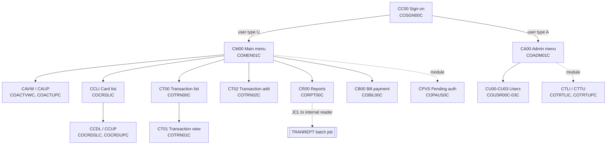

# Online programs

Active contributors: Sanjay Rao, Arunkumar Selvam, Abhijit Kshirsagar

The online half of CardDemo is a set of pseudo-conversational CICS COBOL programs in `app/cbl` (names `CO*C`), each driving one BMS screen. They share state through one COMMAREA, move between screens with `EXEC CICS XCTL`, and read and write VSAM files directly.

## Purpose

The online programs let a regular user manage accounts, cards, transactions, bill payments, and report requests, and let an administrator maintain users (and, with the Db2 module, transaction types). In the modernized application each of these programs is a screen endpoint `/api/screens/<PROGRAM>` in a backend module; see [Screen API](../api/screen-api.md).

## Directory layout

```
app/
├── cbl/CO*C.cbl        17 CICS programs (COBSWAIT also starts with CO but is batch; CSUTLDTC is a called date subprogram)
├── bms/*.bms           17 BMS mapsets, one per screen
├── cpy-bms/*.CPY       17 symbolic map copybooks (input and output map fields)
├── cpy/COCOM01Y.cpy    CARDDEMO-COMMAREA
├── cpy/COMEN02Y.cpy    main menu option table
├── cpy/COADM02Y.cpy    admin menu option table
├── cpy/COTTL01Y.cpy, CSMSG01Y.cpy, CSDAT01Y.cpy   screen titles, common messages, date/time work areas
└── csd/CARDDEMO.CSD    CICS resource definitions (FILE, MAPSET, PROGRAM, TRANSACTION)
```

A map is named after its program without the trailing `C`: program `app/cbl/COSGN00C.cbl` uses mapset `app/bms/COSGN00.bms` and copybook `app/cpy-bms/COSGN00.CPY`.

## Key abstractions

| Abstraction | Where | What it does |
|:--|:--|:--|
| COMMAREA | `app/cpy/COCOM01Y.cpy` | 160-byte `CARDDEMO-COMMAREA`: from/to transaction ID and program, signed-on user ID, user type (`A` admin, `U` user), program context (0 first entry, 1 re-entry), customer ID and name, account ID and status, card number, last map and mapset |
| Main menu table | `app/cpy/COMEN02Y.cpy` | 11 options, each with number, name, target program, and user type. The file's header comment says "Admin Menu Options", but it is the main menu table used by `app/cbl/COMEN01C.cbl` |
| Admin menu table | `app/cpy/COADM02Y.cpy` | 6 options; options 5 and 6 were "added for Db2 release" and point to the transaction type module |
| Symbolic maps | `app/cpy-bms/*.CPY` | Generated `...I` (input) and `...O` (output) structures for each mapset |
| Common copybooks | `app/cpy/COTTL01Y.cpy`, `app/cpy/CSMSG01Y.cpy`, `app/cpy/CSDAT01Y.cpy` | Copied by every online program (21 including module programs, per `docs/INVENTORY.md`) |
| User security record | `app/cpy/CSUSR01Y.cpy` | 80-byte `SEC-USER-DATA` read from the USRSEC file at sign-on and in user maintenance |

### Menu options

Main menu (`app/cpy/COMEN02Y.cpy`, used by COMEN01C, transaction CM00):

| # | Option | Program |
|--:|:--|:--|
| 1 | Account View | COACTVWC |
| 2 | Account Update | COACTUPC |
| 3 | Credit Card List | COCRDLIC |
| 4 | Credit Card View | COCRDSLC |
| 5 | Credit Card Update | COCRDUPC |
| 6 | Transaction List | COTRN00C |
| 7 | Transaction View | COTRN01C |
| 8 | Transaction Add | COTRN02C |
| 9 | Transaction Reports | CORPT00C |
| 10 | Bill Payment | COBIL00C |
| 11 | Pending Authorization View | COPAUS0C (optional module) |

All 11 options carry user type `U`. Option 8 has a commented-out label "Transaction Add (Admin Only)". COMEN01C blocks options marked `A` for regular users (`app/cbl/COMEN01C.cbl:137`), runs `EXEC CICS INQUIRE` before transferring to COPAUS0C and reports that it "is not installed" when the module is absent (`app/cbl/COMEN01C.cbl:147-166`), and shows "is coming soon" for any program whose name starts with `DUMMY`.

Admin menu (`app/cpy/COADM02Y.cpy`, used by COADM01C, transaction CA00): 1 User List, 2 User Add, 3 User Update, 4 User Delete (COUSR00C to COUSR03C), 5 Transaction Type List/Update (Db2) (COTRTLIC), 6 Transaction Type Maintenance (Db2) (COTRTUPC).

## How it works

Every program follows the pseudo-conversational pattern described in `docs/architecture.md`: on first entry (`CDEMO-PGM-ENTER`) it sends its map; when the user presses Enter or a PF key, CICS starts the transaction again, the program receives the map, validates input, reads or updates VSAM, and either redisplays the map with a message or transfers with `XCTL`. It ends each turn with `EXEC CICS RETURN TRANSID(...) COMMAREA(...)`. PF3 generally returns to the program in `CDEMO-FROM-PROGRAM` or to the menu.



COSGN00C reads the user from USRSEC and transfers to COADM01C or COMEN01C depending on the user type (`app/cbl/COSGN00C.cbl:231-236`). CORPT00C does not produce the report online: its `SUBMIT-JOB-TO-INTRDR` paragraph writes the TRANREPT JCL to a transient data queue for the internal reader (`app/cbl/CORPT00C.cbl:462-515`), and CBTRN03C prints the report in batch. COTRN02C and CORPT00C call `app/cbl/CSUTLDTC.cbl`, which validates dates through the Language Environment `CEEDAYS` service.

### Data access by screen

From `docs/architecture.md` (CICS file names as defined in `app/csd/CARDDEMO.CSD`):

| Programs | VSAM files |
|:--|:--|
| COSGN00C, COUSR00C-COUSR03C, COADM01C | USRSEC |
| COACTVWC, COACTUPC | ACCTDAT, CUSTDAT, CARDDAT, CARDAIX, CXACAIX |
| COCRDLIC, COCRDSLC, COCRDUPC | CARDDAT, CARDAIX |
| COTRN00C, COTRN01C, CORPT00C | TRANSACT |
| COTRN02C | TRANSACT, ACCTDAT, CCXREF, CXACAIX |
| COBIL00C | TRANSACT, ACCTDAT, CXACAIX |

## Program, transaction, map, and modern module

Transaction IDs are from `app/csd/CARDDEMO.CSD` and the module CSD files; maps follow the naming rule above. Line counts are from `docs/INVENTORY.md`.

| Program | Transaction | Map | Function | Lines | Modern module |
|:--|:--|:--|:--|--:|:--|
| COSGN00C | CC00 | COSGN00 | Sign-on | 261 | [IAM](../modules/iam.md) |
| COMEN01C | CM00 | COMEN01 | Main menu | 309 | [IAM](../modules/iam.md) |
| COADM01C | CA00 | COADM01 | Admin menu | 289 | [IAM](../modules/iam.md) |
| COUSR00C | CU00 | COUSR00 | List users | 696 | [IAM](../modules/iam.md) |
| COUSR01C | CU01 | COUSR01 | Add user | 300 | [IAM](../modules/iam.md) |
| COUSR02C | CU02 | COUSR02 | Update user | 415 | [IAM](../modules/iam.md) |
| COUSR03C | CU03 | COUSR03 | Delete user | 360 | [IAM](../modules/iam.md) |
| COACTVWC | CAVW | COACTVW | Account view | 942 | [Account](../modules/account.md) |
| COACTUPC | CAUP | COACTUP | Account update | 4,237 | [Account](../modules/account.md) |
| COCRDLIC | CCLI | COCRDLI | Credit card list | 1,460 | [Card](../modules/card.md) |
| COCRDSLC | CCDL | COCRDSL | Credit card view | 888 | [Card](../modules/card.md) |
| COCRDUPC | CCUP | COCRDUP | Credit card update | 1,561 | [Card](../modules/card.md) |
| COTRN00C | CT00 | COTRN00 | Transaction list | 700 | [Transaction](../modules/transaction.md) |
| COTRN01C | CT01 | COTRN01 | Transaction view | 331 | [Transaction](../modules/transaction.md) |
| COTRN02C | CT02 | COTRN02 | Transaction add | 784 | [Transaction](../modules/transaction.md) |
| CORPT00C | CR00 | CORPT00 | Transaction reports | 650 | [Reporting](../modules/reporting.md) |
| COBIL00C | CB00 | COBIL00 | Bill payment | 573 | [Bill payment](../modules/billpay.md) |
| CSUTLDTC | none (called) | none | Date validation subprogram | 158 | [Transaction](../modules/transaction.md) |
| COPAUS0C | CPVS | COPAU00 | Pending authorization summary (module) | 1,033 | [Authorization](../modules/authorization.md) |
| COPAUS1C | CPVD | COPAU01 | Pending authorization detail (module) | 605 | [Authorization](../modules/authorization.md) |
| COPAUS2C | none (linked from COPAUS1C) | none | Fraud marking in Db2 (module) | 245 | [Authorization](../modules/authorization.md) |
| COPAUA0C | CP00 | none (MQ triggered) | Authorization request processor (module) | 1,027 | [Authorization](../modules/authorization.md) |
| COTRTLIC | CTLI | COTRTLI | Transaction type list/update/delete (module) | 2,099 | [Reference data](../modules/refdata.md) |
| COTRTUPC | CTTU | COTRTUP | Transaction type add/edit (module) | 1,703 | [Reference data](../modules/refdata.md) |
| CODATE01 | CDRD | none (MQ) | System date inquiry (module) | 525 | [Inquiry](../modules/inquiry.md) |
| COACCT01 | CDRA | none (MQ) | Account inquiry (module) | 621 | [Inquiry](../modules/inquiry.md) |

`app/csd/CARDDEMO.CSD` also defines transaction CDV1 for a program COCRDSEC, which has no source file in the repository.

## Integration points

- **Batch**: CR00 submits TRANREPT; the batch cycle needs the CICS files closed (CLOSEFIL) and reopened (OPENFIL). See [Batch and JCL](batch-and-jcl.md).
- **Data**: every online program reads the VSAM files in [Data stores](data-stores.md).
- **Optional modules**: reached through menu options 11 (main) and 5-6 (admin), or through MQ triggers. See [Optional modules](optional-modules.md).

## Entry points for modification

- Screen logic: the program in `app/cbl`; screen layout: the mapset in `app/bms` and its generated copybook in `app/cpy-bms`.
- New menu options: add an entry to `app/cpy/COMEN02Y.cpy` or `app/cpy/COADM02Y.cpy` and raise the option count (the `OCCURS` sizes are 12 and 9).
- Before changing screen logic, read the COMMAREA and the map copybook, as `.factory/skills/carddemo-cobol-change/SKILL.md` instructs. CICS programs cannot be compiled locally; `make lint` is the only local check (see [Local tooling](local-tooling.md)).

## Key source files

| File | Purpose |
|:--|:--|
| `app/cbl/COSGN00C.cbl` | Sign-on and routing by user type |
| `app/cbl/COMEN01C.cbl` | Main menu dispatch, installed-program check |
| `app/cbl/COACTUPC.cbl` | Largest and most complex program (account and customer update) |
| `app/cbl/CORPT00C.cbl` | Report request that submits batch JCL |
| `app/cpy/COCOM01Y.cpy` | COMMAREA |
| `app/cpy/COMEN02Y.cpy`, `app/cpy/COADM02Y.cpy` | Menu tables |
| `app/csd/CARDDEMO.CSD` | Transaction, program, mapset, and file definitions |
| `diagrams/Application-Flow-User.png`, `diagrams/Application-Flow-Admin.png` | Upstream flow diagrams |

## Related pages

- [Mainframe application](index.md)
- [Sign-on and sessions](../features/sign-on-and-sessions.md)
- [Web app](../applications/web-app.md)
- [Specification](../verification/specification.md)
- [Glossary](../overview/glossary.md)
