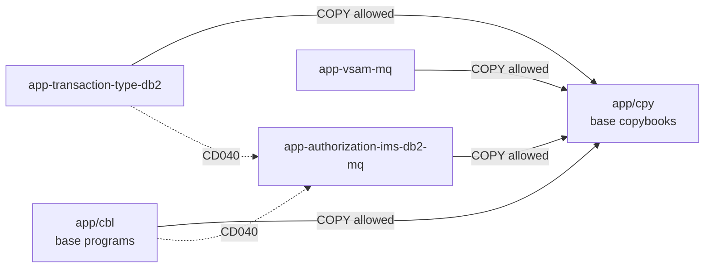

# Optional modules

Active contributors: Arunkumar Selvam

Three self-contained add-ons under `app/` extend the base CardDemo application with Db2, IMS DB, and MQ: pending credit card authorizations (`app/app-authorization-ims-db2-mq`), transaction type maintenance in Db2 (`app/app-transaction-type-db2`), and account and date inquiry over MQ (`app/app-vsam-mq`). Each can be installed or left out without breaking the base application.

## Purpose

The base application uses only CICS, VSAM, and JCL. The modules exist to give migration tools harder material: hierarchical IMS databases, embedded SQL with cursors, two-phase commit across IMS and Db2, and MQ trigger and request-reply patterns. Each module has its own README with installation steps. All three were added upstream in one commit, "Add optional modules and enhanced functionality" (2025-08-03, per `git log origin/main`).

## Directory layout

```
app/app-authorization-ims-db2-mq/
├── cbl/      COPAUA0C, COPAUS0C, COPAUS1C, COPAUS2C, CBPAUP0C, PAUDBUNL, PAUDBLOD, DBUNLDGS
├── cpy/      CIPAUSMY, CIPAUDTY (IMS segments), CCPAURQY, CCPAURLY, CCPAUERY (MQ messages, error log),
│             IMSFUNCS, PAUTBPCB, PADFLPCB, PASFLPCB (DL/I function codes and PCB masks)
├── bms/, cpy-bms/   COPAU00 (summary), COPAU01 (detail)
├── ims/      DBDs DBPAUTP0, DBPAUTX0, PADFLDBD, PASFLDBD; PSBs PSBPAUTB, PSBPAUTL, PAUTBUNL, DLIGSAMP
├── ddl/      AUTHFRDS.ddl, XAUTHFRD.ddl (Db2 fraud table and index)
├── dcl/      AUTHFRDS.dcl (DCLGEN host variables)
├── jcl/      CBPAUP0J, DBPAUTP0, UNLDPADB, LOADPADB, UNLDGSAM
├── csd/      CRDDEMO2.csd
└── data/EBCDIC/AWS.M2.CARDDEMO.IMSDATA.DBPAUTP0.dat   IMS unload sample
app/app-transaction-type-db2/
├── cbl/      COTRTLIC, COTRTUPC (CICS + Db2), COBTUPDT (batch Db2)
├── cpy/      CSDB2RPY, CSDB2RWY (Db2 error handling work areas)
├── bms/, cpy-bms/   COTRTLI (list), COTRTUP (add/edit)
├── ddl/      TRNTYPE, TRNTYCAT, XTRNTYPE, XTRNTYCAT
├── dcl/      DCLTRTYP, DCLTRCAT
├── ctl/      DB2CREAT, DB2FREE, DB2LTCAT, DB2LTTYP, DB2TEP41, DB2TIAD1, REPROCT
├── jcl/      CREADB21, MNTTRDB2, TRANEXTR
└── csd/      CRDDEMOD.csd
app/app-vsam-mq/
├── cbl/      CODATE01, COACCT01
└── csd/      CRDDEMOM.csd
```

| Module | Programs | COBOL lines | Copybooks | Maps | Jobs |
|:--|--:|--:|--:|--:|--:|
| `app/app-authorization-ims-db2-mq` | 8 | 4,352 | 9 cpy + 1 dcl | 2 | 5 |
| `app/app-transaction-type-db2` | 3 | 4,040 | 2 cpy + 2 dcl | 2 | 3 |
| `app/app-vsam-mq` | 2 | 1,146 | 0 | 0 | 0 |

Line counts are the sums of the per-program counts in `docs/INVENTORY.md` (9,538 in total; `wc -l` over the same files gives 9,525 because the inventory splits on newlines and so counts one extra line per file).

## Pending authorizations (IMS, Db2, MQ)

What it demonstrates: an MQ-triggered CICS program, an IMS HIDAM database accessed from CICS and from batch BMP and DLI programs, Db2 inserts from CICS, and IMS/Db2 two-phase commit (`app/app-authorization-ims-db2-mq/README.md`).

| Program | Transaction or job | Role |
|:--|:--|:--|
| COPAUA0C | CP00 (MQ trigger) | Reads a comma-separated authorization request from MQ, looks up the card, account, and customer through the VSAM cross-reference, approves or declines, writes the pending authorization to IMS, replies on MQ |
| COPAUS0C | CPVS, main menu option 11 | Pending authorization summary for an account (IMS and VSAM) |
| COPAUS1C | CPVD | Authorization detail; PF5 marks it as fraud |
| COPAUS2C | linked from COPAUS1C | Inserts the fraud record into Db2 table AUTHFRDS |
| CBPAUP0C | CBPAUP0J | Batch purge of expired authorizations, adjusting available credit |
| PAUDBUNL, PAUDBLOD, DBUNLDGS | UNLDPADB, LOADPADB, UNLDGSAM | Unload the IMS database to flat files, reload it, or unload to GSAM files |

The IMS database DBPAUTP0 has a root segment PAUTSUM0 (authorization summary, copybook `app/app-authorization-ims-db2-mq/cpy/CIPAUSMY.cpy`) and a child PAUTDTL1 (detail, `app/app-authorization-ims-db2-mq/cpy/CIPAUDTY.cpy`), indexed by DBPAUTX0. The README names the queues `AWS.M2.CARDDEMO.PAUTH.REQUEST` and `AWS.M2.CARDDEMO.PAUTH.REPLY`.

Modern counterpart: [Authorization](../modules/authorization.md), with the end-to-end flow in [Pending authorizations](../features/pending-authorizations.md).

## Transaction type maintenance (Db2)

What it demonstrates: static embedded SQL in CICS, forward and backward cursor paging, delete with a `DELETE RESTRICT` foreign key, and SQLCA error handling (`app/app-transaction-type-db2/README.md`).

| Program | Transaction or job | Role |
|:--|:--|:--|
| COTRTLIC | CTLI, admin menu option 5 | List, update, and delete transaction types with cursor paging |
| COTRTUPC | CTTU, admin menu option 6 | Add or edit a transaction type |
| COBTUPDT | MNTTRDB2 | Batch add, update, and delete from an input file |

Tables `CARDDEMO.TRANSACTION_TYPE` and `CARDDEMO.TRANSACTION_TYPE_CATEGORY` are defined in `app/app-transaction-type-db2/ddl`. CREADB21 creates and loads them; TRANEXTR extracts them with DSNTIAUL to the TRANTYPE and TRANCATG sequential files the base batch reads, so Db2 is the master copy and VSAM a copy. The Control-M schedule runs MNTTRDB2 and TRANEXTR weekly (`app/scheduler/CardDemo.controlm`).

Modern counterpart: [Reference data](../modules/refdata.md). The modern application keeps one SQL Server table as the single source, so TRANEXTR has no equivalent (`modernization/spec/jobs.md`, JOB-TRANEXTR).

## Account and date inquiry (VSAM, MQ)

What it demonstrates: the MQ request-reply pattern from CICS over VSAM data.

| Program | Transaction | Role |
|:--|:--|:--|
| CODATE01 | CDRD | Replies with the system date |
| COACCT01 | CDRA | Reads an account from VSAM (copybook CVACT01Y) and replies with the 300-byte record |

Both programs take the input queue name from the MQ trigger message (`MQTM-QNAME`, `app/app-vsam-mq/cbl/CODATE01.cbl:146`) and hard-code their reply and error queues: `CARD.DEMO.REPLY.DATE`, `CARD.DEMO.REPLY.ACCT`, and `CARD.DEMO.ERROR`. The module README instead shows queues named `CARDDEMO.REQUEST.QUEUE` and `CARDDEMO.RESPONSE.QUEUE`; the code is the reliable source.

Modern counterpart: [Inquiry](../modules/inquiry.md), with queue details in [Message queues](../api/message-queues.md).

## The COPY boundary rule (CD040)

`AGENTS.md` states the rule: a module program may COPY base copybooks from `app/cpy`, base programs must never COPY from a module, and modules must not COPY from each other. `check_copybooks` in `tools/carddemo/rules.py` enforces it. For every COPY or `EXEC SQL INCLUDE`, it looks up the copybook by name and reports CD040 if no copy of it lives in the including file's own module or in base. The module of a file is the `app/app-*` directory it sits in, or `base` (`module_of` in `tools/carddemo/source.py`). Copybook resolution follows the same order as the build: own module first, then base (`Repository.resolve_copybook`). The lint baseline in `tools/carddemo/lint-baseline.json` has no CD040 entries.

The rule covers COPY statements only. The base menus still name module programs as data (`app/cpy/COMEN02Y.cpy` option 11, `app/cpy/COADM02Y.cpy` options 5 and 6), and the CA7 posting chain runs the module job CBPAUP0J before POSTTRAN, which the specification records as a schedule-level break of the separation (Q-CA7-04 in `modernization/spec/jobs.md`).



## Entry points for modification

- None of the module programs can be compiled locally: they need the CICS, Db2, IMS, or MQ precompilers, so `tools/carddemo/batch.py` excludes them from the syntax check. `make lint` is the only local check; mainframe testing is needed (`.factory/skills/carddemo-cobol-change/SKILL.md`).
- Compile JCL for these programs is in `samples/jcl` (`CICDBCMP.jcl` for CICS with Db2, `IMSMQCMP.jcl` for IMS and MQ).
- Copybooks a module needs belong in the module's own `cpy` directory unless they are base record layouts.

## Key source files

| File | Purpose |
|:--|:--|
| `app/app-authorization-ims-db2-mq/README.md` | Module install guide, message formats, IMS and Db2 structure |
| `app/app-authorization-ims-db2-mq/cbl/COPAUA0C.cbl` | MQ-triggered authorization engine |
| `app/app-authorization-ims-db2-mq/ims/DBPAUTP0.dbd` | IMS HIDAM database definition |
| `app/app-transaction-type-db2/README.md` | Db2 module guide |
| `app/app-transaction-type-db2/cbl/COTRTLIC.cbl` | Cursor paging list (most complex module program, complexity 69) |
| `app/app-vsam-mq/cbl/COACCT01.cbl` | MQ account inquiry |
| `tools/carddemo/rules.py` | CD040 implementation (`check_copybooks`) |

## Related pages

- [Mainframe application](index.md)
- [Online programs](online-programs.md)
- [Batch and JCL](batch-and-jcl.md)
- [Modules](../modules/index.md)
