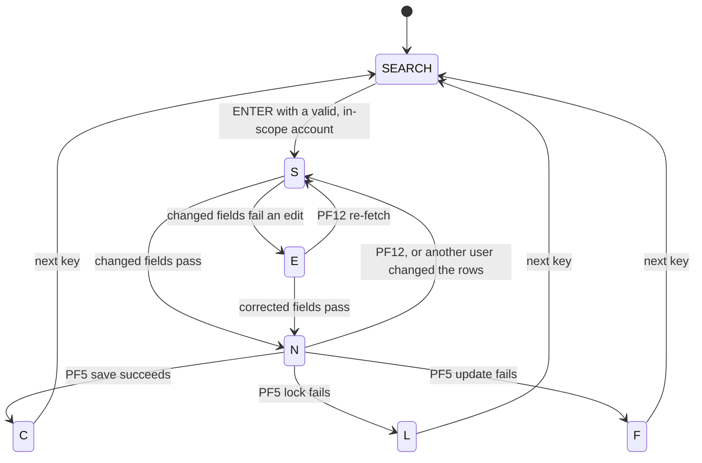
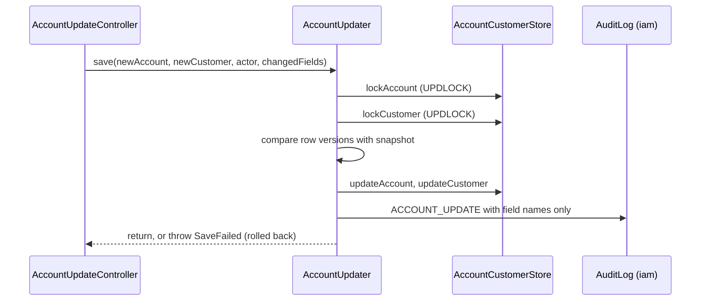

# Account

Active contributors: factory-aj-pahl

The `account` Maven module is bounded context BC-2, Account and Customer. It ports the account view screen COACTVWC and the account update screen COACTUPC, and it owns the `account` and `customer` tables. Its `api` package publishes narrow read and update interfaces that the bill payment, cycle, inquiry, and authorization contexts use instead of touching the tables directly.

## Purpose

| COBOL program | Transaction | Controller | Spec |
|:--|:--|:--|:--|
| COACTVWC view account | CAVW | `modernization/backend/account/src/main/java/com/carddemo/account/web/AccountViewController.java` | `modernization/spec/programs/COACTVWC.md` |
| COACTUPC update account | CAUP | `modernization/backend/account/src/main/java/com/carddemo/account/web/AccountUpdateController.java` | `modernization/spec/programs/COACTUPC.md` |

COACTUPC is the largest online program in the specification (922 lines and 81 distinct BR/VR/NAV/ERR rule IDs in its spec file, against 478 lines and 27 IDs for COACTVWC). Most of the module's code is its edit logic.

## Directory layout

```
modernization/backend/account/src/main/java/com/carddemo/account/
  api/        AccountBalances, AccountInquiry, AccountPostings, AccountProfiles,
              CycleAccounts (interfaces); AccountLimits, CustomerContact,
              InterestAccount, PostingAccount, StatementAccount, StatementCustomer (records)
  internal/   AccountCustomerStore, AccountRecord, CustomerRecord, Numval, UsLookups,
              JdbcAccountBalances, JdbcAccountInquiry, JdbcAccountPostings,
              JdbcAccountProfiles, JdbcCycleAccounts
  web/        AccountViewController, AccountUpdateController, AccountUpdater,
              AccountLookup, UpdateEdits, UpdateForm, Amounts, LookupMessages
modernization/backend/account/src/test/java/com/carddemo/account/
  5 test classes and a base class
```

| Measure | Main | Test |
|:--|:--|:--|
| Java files | 29 | 6 |
| Lines | 1,845 | 1,407 |
| Test methods | | 60 |

The ratio of test lines to main lines is about 0.76. `modernization/backend/account/pom.xml` depends on `common`, on `card` (for the `CardDirectory` cross-reference lookup), and on `iam` as the "Runtime provider of AccountScope and AuditLog; code uses only the common interfaces".

## Key abstractions

| Type | File | Role |
|:--|:--|:--|
| `AccountViewController` | `modernization/backend/account/src/main/java/com/carddemo/account/web/AccountViewController.java` | Read-only COACTVWC (BR-COACTVWC-04). SSN is shown as `***-**-` plus last 4 and the government ID keeps only its last 4 characters (Q-COACTVWC-09). |
| `AccountLookup` | `modernization/backend/account/src/main/java/com/carddemo/account/web/AccountLookup.java` | The lookup chain shared by both screens: card cross-reference by account (the lowest card, DF-6), then account master, then customer. Each step has a not-found and an error outcome with the verbatim message. An out-of-scope account is answered like a missing cross-reference (C-SCOPE). |
| `AccountUpdateController` | `modernization/backend/account/src/main/java/com/carddemo/account/web/AccountUpdateController.java` | The COACTUPC conversation. Its state (`Mode`: `SEARCH`, `S`, `E`, `N`, `C`, `L`, `F`, after ACUP-CHANGE-ACTION, BR-COACTUPC-01), the fetched snapshot, and the validated save image are kept in a `Conversation` object in the session (C-SESSION). |
| `UpdateEdits` | `modernization/backend/account/src/main/java/com/carddemo/account/web/UpdateEdits.java` | Change detection, field edits, and the save image under D-VALIDATE-CHANGED. 26 logical field groups; a multi-part field (date, SSN, phone) counts as one. Only changed groups are edited, in COBOL order; the first failing message is kept (VR-COACTUPC-34) while every failing field is flagged. |
| `UpdateForm` | `modernization/backend/account/src/main/java/com/carddemo/account/web/UpdateForm.java` | Field names and BMS lengths of the CACTUPA map, the protected fields, and conversion between records and screen values. |
| `AccountUpdater` | `modernization/backend/account/src/main/java/com/carddemo/account/web/AccountUpdater.java` | The save as one `@Transactional` unit (Q-COACTUPC-03): lock account, lock customer, compare both `ROWVERSION` values with the snapshot, update both by column name, write the `ACCOUNT_UPDATE` audit record. Any failure throws `SaveFailed` with an outcome and rolls everything back. |
| `AccountCustomerStore` | `modernization/backend/account/src/main/java/com/carddemo/account/internal/AccountCustomerStore.java` | Reads, `UPDLOCK, ROWLOCK` reads with a `SET LOCK_TIMEOUT` prefix (`carddemo.account.lock-timeout-ms`, default 5000), and column-by-name updates. The account update leaves `addr_zip` as stored (Q-COACTUPC-01). |
| `Numval` | `modernization/backend/account/src/main/java/com/carddemo/account/internal/Numval.java` | TEST-NUMVAL-C / NUMVAL-C for amount fields: leading or trailing sign, `CR`/`DB`, `$`, grouping commas. Rejects more than 10 integer digits or 2 decimals (Q-COACTUPC-15). |
| `UsLookups` | `modernization/backend/account/src/main/java/com/carddemo/account/internal/UsLookups.java` | The CSLKPCDY lookup tables from `app/cpy/CSLKPCDY.cpy`: North American area codes, US state codes, and state plus ZIP-prefix pairs (Q-COACTUPC-08, -09). |

`AccountUpdater` sits in `web` rather than `internal` on purpose. Its Javadoc explains that the batch jar scans `account.internal` without the IAM audit log, so a class that needs `AuditLog` cannot live there.

## How it works

The update screen is a small state machine:



1. **Fetch.** The account number must be 11 digits and non-zero (C-KEYLEN). `AccountLookup.find` reads the cross-reference, account, and customer. The fetched records and the shown values become the snapshot (state `S`).
2. **Edit.** Protected fields are reset to the shown values. `UpdateEdits.changed` compares each group with the snapshot: trimmed, case-sensitive, blank equals spaces equals LOW-VALUES (Q-COACTUPC-05, -06). A masked SSN or government ID sent back unchanged counts as unchanged (Q-COACTUPC-28). With no change the screen says `No change detected with respect to values fetched.`
3. **Validate.** `UpdateEdits.validate` runs VR-COACTUPC-07 to -33 for the changed groups only. Typed SSN parts and the government ID are echoed masked (C-MASK). Failures go to state `E`; success builds the new account and customer records and moves to `N` (`Changes validated.Press F5 to save`).
4. **Save.** PF5 calls `AccountUpdater.save` with the image validated at state `N`, so values typed on the F5 turn are ignored (Q-COACTUPC-18). A row-version mismatch re-fetches the current values and shows `Record changed by some one else. Please review` (Q-COACTUPC-04). Lock failures go to `L`, update failures to `F`, success to `C` (`Changes committed to database`).



## Published API and its consumers

The `api` package holds only interfaces and records (enforced by `modernization/backend/app/src/test/java/com/carddemo/app/ModuleBoundariesTest.java`). Each interface is implemented by a package-private `Jdbc*` class in `internal`.

| Interface or record | File | Consumers (main code) |
|:--|:--|:--|
| `AccountBalances` | `modernization/backend/account/src/main/java/com/carddemo/account/api/AccountBalances.java` | `modernization/backend/billpay/src/main/java/com/carddemo/billpay/internal/BillPaymentService.java` (plain read, locked read, balance update) |
| `AccountPostings`, `PostingAccount` | `modernization/backend/account/src/main/java/com/carddemo/account/api/AccountPostings.java` | `modernization/backend/cycle/src/main/java/com/carddemo/cycle/internal/PostingService.java` (CBTRN02C lock and posting, BR-CBTRN02C-07) |
| `CycleAccounts`, `InterestAccount`, `StatementAccount`, `StatementCustomer` | `modernization/backend/account/src/main/java/com/carddemo/account/api/CycleAccounts.java` | `InterestService`, `TransactionVerifier`, and `StatementService` in `modernization/backend/cycle/src/main/java/com/carddemo/cycle/internal/` (CBACT04C, CBTRN01C, CBSTM03A) |
| `AccountInquiry` | `modernization/backend/account/src/main/java/com/carddemo/account/api/AccountInquiry.java` | `modernization/backend/inquiry/src/main/java/com/carddemo/inquiry/internal/AccountInquiryService.java` and `modernization/backend/inquiry/src/main/java/com/carddemo/inquiry/web/AccountInquiryController.java` |
| `AccountProfiles`, `AccountLimits`, `CustomerContact` | `modernization/backend/account/src/main/java/com/carddemo/account/api/AccountProfiles.java` | `modernization/backend/authorization/src/main/java/com/carddemo/authorization/internal/AuthorizationEngine.java` and `modernization/backend/authorization/src/main/java/com/carddemo/authorization/web/PendingAuthListController.java` |

See [Bill payment](billpay.md), [Cycle](cycle.md), [Inquiry](inquiry.md), and [Authorization](authorization.md).

## Integration points

- `card.api.CardDirectory` gives the lowest card of an account and its cross-reference record (see [Card](card.md)).
- `AccountScope` and `AuditLog` come from [IAM](iam.md) through the interfaces in [Common](common.md).
- The web screens are `modernization/web/src/screens/AccountView.tsx` and `modernization/web/src/screens/AccountUpdate.tsx`, served through the [Screen API](../api/screen-api.md).

## Tests

| Test class | Methods | Focus |
|:--|:--|:--|
| `modernization/backend/account/src/test/java/com/carddemo/account/AccountUpdateScreenTest.java` | 31 | COACTUPC screen turns: key checks, changed-field edits, confirm, save |
| `modernization/backend/account/src/test/java/com/carddemo/account/AccountViewScreenTest.java` | 15 | COACTVWC screen turns and masking |
| `modernization/backend/account/src/test/java/com/carddemo/account/AccountUpdateTurnTest.java` | 8 | State transitions one turn at a time, blank input, column saves, abends |
| `modernization/backend/account/src/test/java/com/carddemo/account/AccountFailureTest.java` | 5 | File errors, account and customer lock failures, atomicity (lock timeout set to 300 ms) |
| `modernization/backend/account/src/test/java/com/carddemo/account/web/AccountUpdateStateTest.java` | 1 | An unexpected conversation state fails the turn (ERR-COACTUPC-12) |

`modernization/backend/account/src/test/java/com/carddemo/account/AccountScreenTestBase.java` loads the base sample data and gives each test a fresh screen client.

## Notable ledger decisions

`modernization/decisions/ledger-online.md` has 41 Q- rows for the two programs: 21 FIX and 1 CHANGE.

- **Q-COACTUPC-07** (CHANGE, D-VALIDATE-CHANGED): the COBOL validates every field on every change, so most sample accounts, which carry legacy values such as FICO 274 or unlisted area codes, could never be saved. The target validates only fields the user changed.
- **Q-COACTUPC-03** (FIX): account and customer rewrites were not atomic; now both are in one transaction and roll back together.
- **Q-COACTUPC-01** (FIX): the COBOL rewrite layout wrote the group ID into the ZIP bytes; the target updates by column name and leaves the ZIP as stored.
- **Q-COACTVWC-09** and **Q-COACTUPC-28** (FIX): full SSN and government ID were shown to any user; now they are masked and every saved change is audited.

## Entry points for modification

- A new edit rule goes into `UpdateEdits.validate` in the COBOL order, with the verbatim message, and must keep the "first message wins, every failing field flagged" behavior.
- A new field needs a `Group` in `UpdateEdits`, an entry in `UpdateForm.LENGTHS`, the column in `AccountCustomerStore`, and a matching change in `modernization/web/src/screens/AccountUpdate.tsx`.
- If another context needs account data, add a method or a new interface to `api` and implement it in `internal`. Do not import `internal` from another module.

## Key source files

| File | Purpose |
|:--|:--|
| `modernization/backend/account/src/main/java/com/carddemo/account/web/AccountUpdateController.java` | COACTUPC conversation and state machine |
| `modernization/backend/account/src/main/java/com/carddemo/account/web/UpdateEdits.java` | Change detection and field edits |
| `modernization/backend/account/src/main/java/com/carddemo/account/web/AccountUpdater.java` | Atomic, version-checked save with audit |
| `modernization/backend/account/src/main/java/com/carddemo/account/internal/AccountCustomerStore.java` | Account and customer SQL |
| `modernization/backend/account/src/main/java/com/carddemo/account/web/AccountLookup.java` | Cross-reference, account, customer lookup chain |
| `modernization/backend/account/src/main/java/com/carddemo/account/api/CycleAccounts.java` | Batch cycle account access |

## Related pages

- [Modules](index.md)
- [Account scoping](../features/account-scoping.md)
- [Online API](../applications/online-api.md)
- [Data models](../reference/data-models.md)
- [Fidelity ledger](../verification/fidelity-ledger.md)
