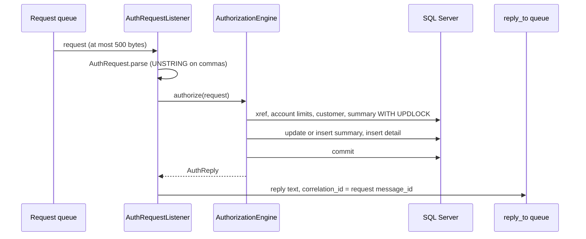

# Authorization

Active contributors: factory-aj-pahl

The `authorization` module (`modernization/backend/authorization`) is bounded context BC-10, the rebuild of the optional IMS, Db2, and MQ module in `app/app-authorization-ims-db2-mq`. It holds the authorization decision engine behind a RabbitMQ consumer and a REST endpoint, the two pending-authorization screens with the fraud toggle, and four batch jobs (purge, IMS unload, load, and GSAM unload). This page is the code map; the end-to-end story is in [Pending authorizations](../features/pending-authorizations.md).

## Purpose

| COBOL program | What it did | Java |
|:--|:--|:--|
| COPAUA0C | MQ-triggered: read a comma-delimited request, decide, update the IMS summary, insert a detail, reply | `AuthRequestListener`, `AuthorizationEngine`, `AuthorizationController` |
| COPAUS0C | Screen CPVS: account header and pending authorizations, five per page | `PendingAuthListController`, `PendingAuthBrowser` |
| COPAUS1C | Screen CPVD: one authorization; PF8 next older, PF5 fraud toggle | `PendingAuthDetailController`, `PendingAuthDetails` |
| COPAUS2C | Called by COPAUS1C: insert or update the Db2 fraud row | `FraudReports` |
| CBPAUP0C | Batch purge of expired details | `PurgeJob` |
| PAUDBUNL | IMS unload to two sequential files | `UnloadJob` (`Program.PAUDBUNL`) |
| DBUNLDGS | IMS unload to GSAM files | `UnloadJob` (`Program.DBUNLDGS`) |
| PAUDBLOD | Load the unload files back into IMS | `LoadJob` |

## Directory layout

```
modernization/backend/authorization/
  pom.xml                 BC-10; depends on common, account, card, migration, spring-boot-starter-amqp
  src/main/java/com/carddemo/authorization/
    api/          AuthorizationJobs, AuthorizationJobResult
    internal/     AuthorizationEngine, AuthRequest, AuthReply, AuthErrorLog,
                  PendingAuthRepository, PendingAuthBrowser, PendingAuthDetails, FraudReports,
                  PurgeJob, UnloadJob, LoadJob, AuthBatchFiles, AuthorizationJobService, LegacyDisplay
    messaging/    AuthMessagingConfig, AuthQueues, AuthRequestListener, ReplyQueueCheck
    web/          AuthorizationController, PendingAuthListController, PendingAuthDetailController,
                  AuthScreens, AuthFormat
  src/test/java/com/carddemo/authorization/
    AuthorizationMessagingTest, AuthorizationFailureTest, PendingAuthListTest, PendingAuthDetailTest,
    PendingAuthScreenFailureTest, AuthPurgeJobTest, AuthUnloadLoadTest, FraudReportsTest,
    AuthFixtures, AuthScreenTestSupport
```

Size: 25 main files (2,754 lines) and 10 test files (3,118 lines), a test-to-code ratio of about 1.1. It is the largest context by main code. `modernization/backend/batch/src/test/java/com/carddemo/batch/AuthorizationCommandLineTest.java` covers the batch commands.

The tables come from `modernization/backend/schema/src/main/resources/db/migration/V60__authorization.sql`: `pending_auth_summary` (the IMS root PAUTSUM0), `pending_auth_detail` (the child PAUTDTL1, with a unique index on account, `auth_ts DESC`, `auth_id DESC` for newest-first browsing), `auth_fraud_report` (Db2 `CARDDEMO.AUTHFRDS`), and `auth_error_log` (the CSSL error records).

## Key abstractions

| Type | File | Role |
|:--|:--|:--|
| `AuthRequest` | `modernization/backend/authorization/src/main/java/com/carddemo/authorization/internal/AuthRequest.java` | The 18 request fields, parsed like COBOL `UNSTRING ... DELIMITED BY ','`; `amount()` reads like `FUNCTION NUMVAL` |
| `AuthReply` | `modernization/backend/authorization/src/main/java/com/carddemo/authorization/internal/AuthReply.java` | The reply record; `text()` builds the 63-character comma-separated reply with a trailing comma |
| `AuthorizationEngine` | `modernization/backend/authorization/src/main/java/com/carddemo/authorization/internal/AuthorizationEngine.java` | COPAUA0C 5000-PROCESS-AUTH: lookups, decision, summary and detail write, all in one transaction |
| `AuthErrorLog` | `modernization/backend/authorization/src/main/java/com/carddemo/authorization/internal/AuthErrorLog.java` | CCPAUERY error records, committed in their own transaction so they survive a rollback |
| `AuthRequestListener` | `modernization/backend/authorization/src/main/java/com/carddemo/authorization/messaging/AuthRequestListener.java` | Long-lived RabbitMQ consumer of the request queue |
| `AuthQueues`, `AuthMessagingConfig` | `modernization/backend/authorization/src/main/java/com/carddemo/authorization/messaging/` | Queue names and declarations (quorum request queue, delivery limit 3, dead-letter, bounded reply queue) |
| `ReplyQueueCheck` | `modernization/backend/authorization/src/main/java/com/carddemo/authorization/messaging/ReplyQueueCheck.java` | Passive declare to tell whether a `reply_to` queue exists |
| `PendingAuthRepository` | `modernization/backend/authorization/src/main/java/com/carddemo/authorization/internal/PendingAuthRepository.java` | JDBC access to summary and detail; `UPDLOCK, HOLDLOCK` reads stand in for IMS "get hold" calls |
| `PendingAuthBrowser` | `modernization/backend/authorization/src/main/java/com/carddemo/authorization/internal/PendingAuthBrowser.java` | COPAUS0C reads: summary and one page of details in a read-only transaction named `COPAUS0C` |
| `PendingAuthDetails` | `modernization/backend/authorization/src/main/java/com/carddemo/authorization/internal/PendingAuthDetails.java` | COPAUS1C reads and the PF5 fraud toggle |
| `FraudReports` | `modernization/backend/authorization/src/main/java/com/carddemo/authorization/internal/FraudReports.java` | COPAUS2C: insert the fraud row, or update flag and date when it exists; Db2-style SQLCODE text on failure |
| `PurgeJob` | `modernization/backend/authorization/src/main/java/com/carddemo/authorization/internal/PurgeJob.java` | CBPAUP0C with its SYSIN card `EE,CCCCC,DDDDD,F` |
| `UnloadJob`, `LoadJob` | `modernization/backend/authorization/src/main/java/com/carddemo/authorization/internal/` | PAUDBUNL/DBUNLDGS and PAUDBLOD over 100-byte root and 206-byte child files |
| `AuthorizationJobs` | `modernization/backend/authorization/src/main/java/com/carddemo/authorization/api/AuthorizationJobs.java` | Published batch interface used by the batch jar; returns RC 0 or 16 |
| `LegacyDisplay` | `modernization/backend/authorization/src/main/java/com/carddemo/authorization/internal/LegacyDisplay.java` | DISPLAY renderings shared by the batch jobs (`+00000022` counters, YYMMDD, YYDDD) |
| `AuthScreens`, `AuthFormat` | `modernization/backend/authorization/src/main/java/com/carddemo/authorization/web/` | Session-held COMMAREA fields (account in context, selected authorization) and screen amount formatting |

## How it works

### Authorization requests



1. `AuthRequestListener.onRequest` rejects a body over 500 bytes (the COBOL `W01-GET-BUFFER`): it logs M003 and throws `AmqpRejectAndDontRequeueException`, so the request is dead-lettered at once (ERR-COPAUA0C-02, Q-COPAUA0C-16).
2. The body is decoded as ISO-8859-1, one character per byte, so control characters and bytes above 0x7E stay in their fields and are echoed in the reply. `AuthRequest.parse` splits on commas into 18 fields; text after the 18th field is ignored and missing fields are blank, as an `UNSTRING` with no `ON OVERFLOW` clause leaves them. Each field is cut to its copybook length and its trailing spaces removed.
3. `AuthorizationEngine.authorize` opens a `REQUIRES_NEW` transaction named `COPAUA0C`. It looks up the cross-reference through `CardDirectory`, the account limits and customer through `AccountProfiles`, and locks the summary row.
4. The decision: an unknown card, a missing account, or an amount that is not a positive number is declined. Otherwise available credit is the summary's credit limit minus credit balance, or the account's limit minus current balance when there is no summary; a larger amount is declined for insufficient funds. Reason codes are `0000` approved, `3100` invalid card, `4100` insufficient funds, `9000` other.
5. For a known card with a valid amount, the summary is updated or inserted and a detail is inserted. The detail key is the insert timestamp plus a generated ID, so two requests in the same second never collide (Q-COPAUA0C-11).
6. The engine commits, and only then does the listener publish the reply (Q-COPAUA0C-06). A commit failure throws `AuthorizationFailure`, nothing is sent, and the request is dead-lettered. A reply that cannot be published is logged as M004; the request is still acknowledged because the authorization is already committed.

`AuthorizationController` (`POST /api/authorizations`) calls the same engine with JSON in and out. It requires an ADMIN session (`@PreAuthorize("hasRole('ADMIN')")`) and answers 503 with the error-log location and message on a critical failure. Queue formats and dead-letter behavior are in [Message queues](../api/message-queues.md); the REST contract is in [REST endpoints](../api/rest-endpoints.md).

### Screens

`PendingAuthListController` serves `/api/screens/COPAUS0C`. It reads the account through the card cross-reference and `AccountProfiles`, shows the summary counts and amounts, and lists details newest first, `PAGE_SIZE = 5` per page. The account ID must be 11 digits (`PendingAuthListTest.an_account_id_must_be_eleven_digits`, Q-COPAUS0C-14). Paging has no page limit, fixing the COMMAREA overflow after 20 pages (Q-COPAUS0C-02). A regular user sees linked accounts only, and any other account gets the cross-reference not-found message (C-SCOPE, see [Account scoping](../features/account-scoping.md)).

`PendingAuthDetailController` serves `/api/screens/COPAUS1C`. It shows every field of the selected authorization with the card number masked, maps reason codes through the decline-reason table, moves to the next older authorization on PF8, and on PF5 marks or removes fraud. The PF5 path runs `FraudReports.record` and the detail's flag update in one transaction, so a failed detail update also rolls back the fraud row (`PendingAuthScreenFailureTest.a_failed_detail_update_rolls_back_the_fraud_row_too`).

The selected account and authorization live in the HTTP session (`AuthScreens`), replacing the COMMAREA fields `CDEMO-ACCT-ID` and `CDEMO-CPVS-PAU-SELECTED`.

### Batch jobs

The batch jar calls `AuthorizationJobs` for `CBPAUP0C [sysin=...]`, `PAUDBUNL`, `PAUDBLOD`, and `DBUNLDGS` (`rootFile=` and `childFile=`), in `modernization/backend/batch/src/main/java/com/carddemo/batch/BatchCommandLine.java`. The Airflow DAG `modernization/airflow/dags/carddemo_auth_purge.py` builds the purge SYSIN card from its parameters and runs it daily, outside the base cycle (Q-CA7-04).

- **Purge (`PurgeJob`).** Walks summaries in account order and details newest first, deletes details whose age in real days is at least the expiry (Q-CBPAUP0C-03), saves the kept summary with the approved or declined count and amount of each deleted detail taken out (D-PURGE), and deletes a summary only when its approved count is 0 or less and no detail remains (Q-ENT-42). Credit and cash balances are not changed (DF-13). One transaction covers each checkpoint interval; an error rolls back the open interval and ends with RC 16.
- **Unload (`UnloadJob`).** Writes every summary as a 100-byte record and every detail as a 6-byte packed parent key plus the 200-byte segment, read in one serializable read-only transaction so the files are a consistent snapshot (Q-PAUDBUNL-09). DBUNLDGS writes the parent key too (Q-DBUNLDGS-01). A failed run deletes both files.
- **Load (`LoadJob`).** Inserts roots, then children under their parents; existing segments are reported and skipped (Q-PAUDBLOD-05), orphans get `ROOT GU CALL FAIL:`, and each file is one transaction so a failure loads nothing from that file (Q-PAUDBLOD-04).
- **Files.** `AuthBatchFiles` creates the unload files with permissions `rw-------`, because they hold full card numbers (D-PII-FILES).

## Integration points

- **Card and account contexts.** Only through `com.carddemo.card.api.CardDirectory` and `CardXref`, and `com.carddemo.account.api.AccountProfiles`, `AccountLimits`, and `CustomerContact`.
- **Migration module.** `PendingAuthSegments` (the `Summary` and `Detail` records and segment lengths) and `PendingAuthTables` (row mappers and inserts), shared with the IMS seed loader. See [Schema and migration](schema-and-migration.md).
- **Common.** `Masking.card` for event keys and the detail screen, `Pic`, `JobLog`, `ScreenResponse`, `AccountScope`, `CurrentUser` ([Common](common.md)).
- **IAM.** `AccountScope` is resolved per call through `ObjectProvider` in the screen controllers; `iam` is a test-scope dependency only ([IAM](iam.md)).
- **RabbitMQ.** `spring-boot-starter-amqp`; queue name suffix from `carddemo.mq.queue-suffix` so tests get private queues.

## Specification and tests

| Program | Spec file | Main tests |
|:--|:--|:--|
| COPAUA0C | `modernization/spec/programs/COPAUA0C.md` | `AuthorizationMessagingTest`, `AuthorizationFailureTest` |
| COPAUS0C | `modernization/spec/programs/COPAUS0C.md` | `PendingAuthListTest`, `PendingAuthScreenFailureTest` |
| COPAUS1C | `modernization/spec/programs/COPAUS1C.md` | `PendingAuthDetailTest`, `PendingAuthScreenFailureTest` |
| COPAUS2C | `modernization/spec/programs/COPAUS2C.md` | `PendingAuthDetailTest`, `FraudReportsTest` |
| CBPAUP0C | `modernization/spec/programs/CBPAUP0C.md` | `AuthPurgeJobTest` |
| PAUDBUNL | `modernization/spec/programs/PAUDBUNL.md` | `AuthUnloadLoadTest` |
| PAUDBLOD | `modernization/spec/programs/PAUDBLOD.md` | `AuthUnloadLoadTest` |
| DBUNLDGS | `modernization/spec/programs/DBUNLDGS.md` | `AuthUnloadLoadTest` |

Tests worth reading first, under `modernization/backend/authorization/src/test/java/com/carddemo/authorization/`:

- `AuthorizationMessagingTest.reply_failure_is_logged_after_the_commit_and_the_request_is_consumed` (Q-COPAUA0C-06)
- `AuthorizationMessagingTest.control_characters_and_bytes_above_ascii_are_taken_as_received_and_answered` (BR-COPAUA0C-03)
- `AuthorizationMessagingTest.an_oversized_request_is_logged_and_dead_lettered_and_the_next_request_is_answered`
- `AuthorizationFailureTest.commit_failure_sends_no_approval_and_dead_letters_the_request`
- `AuthPurgeJobTest.kept_summary_is_saved_with_the_purged_approvals_taken_out_but_balances_unchanged` (Q-CBPAUP0C-01)
- `AuthUnloadLoadTest.every_child_carries_its_own_parent_key_not_only_the_first_of_each_root` (Q-PAUDBUNL-12)

## Notable decisions

| ID | Decision | Where |
|:--|:--|:--|
| Q-COPAUA0C-06 | Commit first, then publish the reply, then acknowledge; a failed commit sends no approval and dead-letters the request | `modernization/decisions/ledger-batch-data.md`; `AuthorizationEngine`, `AuthRequestListener` |
| DF-5 / Q-COPAUA0C-05 | Available credit keeps the COBOL formula and is not reconciled with the account balance; unreachable decline reasons are not invented | `modernization/decisions/README.md` |
| D-PURGE | Purge expiry is a DAG parameter defaulting to 5 days (not the JCL's `00`), and the purge adjusts summary counts and amounts | `modernization/decisions/README.md`; `PurgeJob`, `carddemo_auth_purge.py` |
| DF-13 | The purge never changes the summary's credit and cash balances | `modernization/decisions/README.md` |
| D-PII-FILES | Unload files keep full card numbers as the load contract and are written mode 600 | `modernization/decisions/README.md`; `AuthBatchFiles` |

## Entry points for modification

- Decision logic: `AuthorizationEngine.decideAndRecord`. Any change to the reply text belongs in `AuthReply.text`, and both the queue and REST paths pick it up.
- Request parsing: `AuthRequest.parse` and `AuthRequest.LENGTHS`; keep the UNSTRING behavior unless a ledger row says otherwise.
- Queue names or limits: `AuthQueues` and `AuthMessagingConfig`.
- Screens: the two controllers in `web/`; read-side transactions are in `PendingAuthBrowser` and `PendingAuthDetails`.

## Key source files

| File | Purpose |
|:--|:--|
| `modernization/backend/authorization/src/main/java/com/carddemo/authorization/internal/AuthorizationEngine.java` | Decision and recording |
| `modernization/backend/authorization/src/main/java/com/carddemo/authorization/internal/AuthRequest.java` | Request parsing |
| `modernization/backend/authorization/src/main/java/com/carddemo/authorization/messaging/AuthRequestListener.java` | Queue consumer |
| `modernization/backend/authorization/src/main/java/com/carddemo/authorization/web/PendingAuthListController.java` | COPAUS0C screen |
| `modernization/backend/authorization/src/main/java/com/carddemo/authorization/web/PendingAuthDetailController.java` | COPAUS1C screen |
| `modernization/backend/authorization/src/main/java/com/carddemo/authorization/internal/PurgeJob.java` | CBPAUP0C |
| `modernization/backend/authorization/src/main/java/com/carddemo/authorization/internal/UnloadJob.java` | PAUDBUNL and DBUNLDGS |
| `modernization/backend/authorization/src/main/java/com/carddemo/authorization/internal/LoadJob.java` | PAUDBLOD |
| `modernization/backend/schema/src/main/resources/db/migration/V60__authorization.sql` | Authorization tables |
