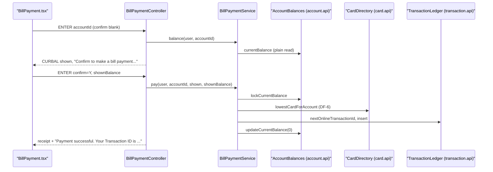

# Bill payment

Active contributors: factory-aj-pahl

The `billpay` Maven module is bounded context BC-5. It ports COBIL00C (transaction CB00), the screen that pays the full current balance of one account. It is the smallest context in the backend: one service and one controller.

## Purpose

A user enters an account ID, sees the current balance, and confirms with `Y`. The payment writes one transaction row and sets the account balance to zero. The modern version keeps the COBOL messages and flow, and adds four fixes from the fidelity ledger:

- The payment is atomic.
- The transaction ID comes from a locked counter.
- The amount paid must equal the balance the user saw.
- Balances that do not fit the transaction amount field are refused.

The same module also runs inside the standalone [Bill-payment service](../applications/billpay-service.md), which shows that one context can be deployed on its own ("selective conversion").

## Directory layout

```
modernization/backend/billpay/
  pom.xml
  src/main/java/com/carddemo/billpay/
    internal/BillPaymentService.java
    web/BillPaymentController.java
  src/test/java/com/carddemo/billpay/
    BillPaymentAtomicityTest.java
    BillPaymentLookupTest.java
    BillPaymentScreenTest.java
```

Size: 2 main files (336 lines) and 3 test files (743 lines), with 27 test methods. The test code is about 2.2 times the size of the main code. The module has no `api` package; nothing else depends on it.

## Key abstractions

| Type | Path | Role |
|:--|:--|:--|
| `BillPaymentController` | `modernization/backend/billpay/src/main/java/com/carddemo/billpay/web/BillPaymentController.java` | `/api/screens/COBIL00C`: ENTER shows or pays, PF3 back to the menu, PF4 clears |
| `BillPaymentController.Fields` | same file | Screen fields `accountId`, `currentBalance`, `confirm`, plus an optional `receipt` |
| `BillPaymentController.Receipt` | same file | D-RECEIPT panel: transaction ID, account, amount paid, new balance |
| `BillPaymentController.Request` | same file | Carries `shownBalance`, the balance the screen displayed before the key was pressed |
| `BillPaymentService` | `modernization/backend/billpay/src/main/java/com/carddemo/billpay/internal/BillPaymentService.java` | `balance` (display turn) and `pay` (confirmed payment) |
| `BillPaymentService.Outcome` | same file | Sealed result: `Paid`, `NotFound`, `NothingToPay`, `BalanceChanged`, `TooLarge` |
| `BillPaymentService.PaymentFailed` | same file | A data-access step failed; its message is the COBOL error text for that step |

## How it works



### Display turn

`BillPaymentController.enter` checks the input in COBOL order:

1. A blank account ID gives `Acct ID can NOT be empty...`.
2. Confirm `N` clears the form.
3. Any confirm value other than `Y`, `N`, or blank gives `Invalid value. Valid values are (Y/N)...`.
4. The account ID must be exactly 11 digits (C-KEYLEN, Q-COBIL00C-04); otherwise the screen shows `Account ID NOT found...`.

With a blank confirm, `BillPaymentService.balance` does a plain read with no lock (Q-COBIL00C-13). An out-of-scope account looks the same as a missing one (C-SCOPE). A zero or negative balance shows `You have nothing to pay...`. Otherwise the screen shows the balance, formatted with `Pic.signedZeros(balance, 10)`, and asks for confirmation.

### Confirmed payment

`BillPaymentService.pay` is one `@Transactional` method (Q-COBIL00C-02). In order, it:

1. Checks scope, then locks the account row through `AccountBalances.lockCurrentBalance`.
2. Returns `NothingToPay` when the balance is zero or negative.
3. Returns `BalanceChanged` when the screen showed a balance and the locked balance differs from it (Q-COBIL00C-08). The controller then shows the current balance with confirm cleared, so the user must confirm again. If `Y` is typed on the first ENTER, before any balance was shown, the payment proceeds at once (BR-COBIL00C-08).
4. Returns `TooLarge` when the balance exceeds `999999999.99`, the largest TRAN-AMT (Q-COBIL00C-07). The message is the new text `Balance too large for online payment...`.
5. Picks the account's lowest card number (DF-6, Q-COBIL00C-11).
6. Takes the next ID from `TransactionLedger.nextOnlineTransactionId`, the same row-locked counter that transaction add uses (Q-COBIL00C-01). See [Transaction](transaction.md).
7. Inserts a row with type `02`, category `2`, source `POS TERM`, description `BILL PAYMENT - ONLINE`, a positive amount (Q-COBIL00C-05, preserved), and a CICS-style timestamp truncated to whole seconds.
8. Sets the balance to zero with `updateCurrentBalance`.

If any step throws `PaymentFailed`, Spring rolls back the whole transaction, so the balance and the transaction table stay unchanged. The controller shows that step's COBOL message, such as `Unable to lookup XREF AIX file...` or `Unable to Update Account...`.

On success the response carries the D-RECEIPT panel. Its amounts are plain decimals with two places. The message is `Payment successful.  Your Transaction ID is <id>.` in green.

## Integration points

- `account.api`: `AccountBalances` for read, lock, and update of the current balance. See [Account](account.md).
- `card.api`: `CardDirectory.lowestCardForAccount`. See [Card](card.md).
- `transaction.api`: `TransactionLedger` and `NewTransaction`.
- `common`: `AccountScope`, `CurrentUser`, `LegacyTimestamps`, `Pic`, and the screen envelope.
- Web screen: `modernization/web/src/screens/BillPayment.tsx`.
- Standalone service: `modernization/backend/billpay-service/src/main/java/com/carddemo/billpayservice/BillPayServiceApplication.java` scans `com.carddemo.billpay` together with the account, card, and transaction `api` and `internal` packages. Its integration tests are `modernization/backend/billpay-service/src/test/java/com/carddemo/billpayservice/it/StandaloneBillPaymentIT.java` and `modernization/backend/billpay-service/src/test/java/com/carddemo/billpayservice/it/StandaloneSecurityMatrixIT.java`.

## Tests

| Test | What it covers |
|:--|:--|
| `modernization/backend/billpay/src/test/java/com/carddemo/billpay/BillPaymentScreenTest.java` | Screen flow: `show_balance_then_confirm_pays_the_full_balance`, `confirm_on_first_enter_pays_at_once`, `nothing_to_pay_for_zero_or_negative_balance`, key-length and confirm rules |
| `modernization/backend/billpay/src/test/java/com/carddemo/billpay/BillPaymentAtomicityTest.java` | Rollback and concurrency: `failed_balance_update_also_removes_the_inserted_payment`, `concurrent_payments_get_distinct_ids_and_all_commit`, `concurrent_payments_of_the_same_account_pay_once` |
| `modernization/backend/billpay/src/test/java/com/carddemo/billpay/BillPaymentLookupTest.java` | Read failures: `an_account_read_failure_shows_unable_to_lookup_account`, `a_missing_or_unreadable_card_cross_reference_stops_the_payment` |

## Specification and ledger

The spec file is `modernization/spec/programs/COBIL00C.md`. The ledger rows are in `modernization/decisions/ledger-online.md`, and D-RECEIPT is defined in `modernization/decisions/README.md`.

| ID | Decision | Effect |
|:--|:--|:--|
| Q-COBIL00C-02 | FIX | Lock, card lookup, ID, insert, and balance update form one database transaction |
| Q-COBIL00C-08 | FIX | The confirming turn must match the balance that was shown; otherwise nothing is written and the user is asked to confirm again |
| Q-COBIL00C-07 | FIX | Balances above 999,999,999.99 are refused with a NEW message instead of being truncated |
| Q-COBIL00C-11 | FIX (DF-6) | Accounts with several cards use the lowest card number |
| D-RECEIPT | user decision | A receipt panel appears after success, in addition to the COBOL message |

See [Fidelity ledger](../verification/fidelity-ledger.md).

## Entry points for modification

- Payment rules belong in `BillPaymentService.pay`. Keep every write inside the one transaction, and add a `PaymentFailed` message for each new data-access step.
- New screen states need a new `Outcome` record and a matching `case` in `BillPaymentController.confirmPayment`. The `switch` over the sealed interface fails to compile until you add it.
- A change here also changes the standalone service. Run its integration tests as well (see [Testing](../how-to-contribute/testing.md)).

## Related pages

- [Modules](index.md)
- [Screen API](../api/screen-api.md)
- [Account scoping](../features/account-scoping.md)
