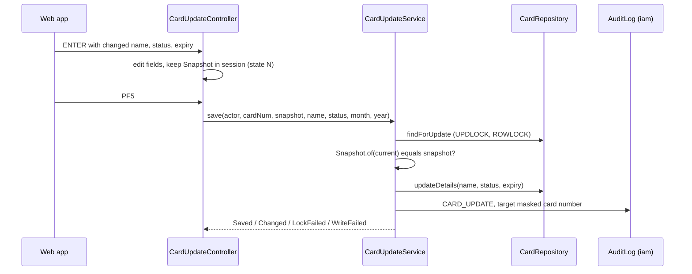

# Card

Active contributors: factory-aj-pahl

The `card` Maven module is bounded context BC-3, Card. It ports the card list COCRDLIC, the card view COCRDSLC, and the card update COCRDUPC, and it owns the `card` and `card_xref` tables. Its published `CardDirectory` interface is the most widely used cross-context API in the backend: six other contexts look up an account's cards or a card's account through it.

## Purpose

| COBOL program | Transaction | Controller | Spec |
|:--|:--|:--|:--|
| COCRDLIC card list | CCLI | `modernization/backend/card/src/main/java/com/carddemo/card/web/CardListController.java` | `modernization/spec/programs/COCRDLIC.md` |
| COCRDSLC card view | CCDL | `modernization/backend/card/src/main/java/com/carddemo/card/web/CardViewController.java` | `modernization/spec/programs/COCRDSLC.md` |
| COCRDUPC card update | CCUP | `modernization/backend/card/src/main/java/com/carddemo/card/web/CardUpdateController.java` | `modernization/spec/programs/COCRDUPC.md` |

The list shows 7 cards per page in card-number order with optional account and card filters; `S` on a row opens the view and `U` opens the update. The view is read-only and is reached either from the list (keys trusted and protected) or from main menu option 4 (keys typed). The update lets the user change the embossed name, the active status, and the expiry month and year, then confirm with F5.

## Directory layout

```
modernization/backend/card/src/main/java/com/carddemo/card/
  api/        CardDirectory, CardXrefListing (interfaces); CardXref (record)
  internal/   CardRepository, CardUpdateService, CardLookup, CardForms,
              JdbcCardDirectory, JdbcCardXrefListing
  web/        CardListController, CardViewController, CardUpdateController, CardScreens
modernization/backend/card/src/test/java/com/carddemo/card/
  5 test classes and a support class
```

| Measure | Main | Test |
|:--|:--|:--|
| Java files | 13 | 6 |
| Lines | 1,320 | 1,592 |
| Test methods | | 78 |

Test lines exceed main lines by about 20 percent. `modernization/backend/card/pom.xml` depends on `common` at compile time and on `iam` only with `test` scope, which is why card resolves its IAM-provided collaborators lazily (below).

## Key abstractions

| Type | File | Role |
|:--|:--|:--|
| `CardRepository` | `modernization/backend/card/src/main/java/com/carddemo/card/internal/CardRepository.java` | SQL over `card`. `forward` and `backward` are keyset browses with `TOP (n)` over the binary-collated primary key, with optional account, card, and scope filters (`account_id IN (...)`) instead of a sequential scan (Q-COCRDLIC-05). `findForUpdate` reads `WITH (UPDLOCK, ROWLOCK)`. `updateDetails` writes only name, status, and expiry. |
| `CardUpdateService` | `modernization/backend/card/src/main/java/com/carddemo/card/internal/CardUpdateService.java` | COCRDUPC 9200-WRITE-PROCESSING as one transaction with a 10-second timeout: lock, compare with the fetched `Snapshot`, rewrite, audit. Returns `Saved`, `Changed`, `LockFailed`, or `WriteFailed`. |
| `CardLookup` | `modernization/backend/card/src/main/java/com/carddemo/card/internal/CardLookup.java` | Card read for view and update: the card must belong to the entered account (Q-COCRDSLC-01, Q-COCRDUPC-02) and the account must be in scope (C-SCOPE), or it is answered as not found. |
| `CardForms` | `modernization/backend/card/src/main/java/com/carddemo/card/internal/CardForms.java` | Shared key-field edits and messages of the view and update screens. |
| `CardScreens` | `modernization/backend/card/src/main/java/com/carddemo/card/web/CardScreens.java` | Server-side hand-off of the selected row from the list to view or update. The list resolves the row on the server, so the full card number never reaches the browser (Q-COCRDLIC-16). |
| `CardDirectory` | `modernization/backend/card/src/main/java/com/carddemo/card/api/CardDirectory.java` | Published: `lowestCardForAccount` (DF-6: the card an account-level operation is attributed to), `findXref`, `cardsOfAccounts`. Implemented by `modernization/backend/card/src/main/java/com/carddemo/card/internal/JdbcCardDirectory.java` over `card_xref`. |
| `CardXref` | `modernization/backend/card/src/main/java/com/carddemo/card/api/CardXref.java` | Published record of one cross-reference row (CVACT03Y): card number, customer, account. |
| `CardXrefListing` | `modernization/backend/card/src/main/java/com/carddemo/card/api/CardXrefListing.java` | Published sequential browse of the cross-reference in card-number order. |

### Optional collaborators through `ObjectProvider`

`AccountScope` and `AuditLog` are implemented in [IAM](iam.md), but card does not depend on IAM at compile time, and several modules that depend on card (account, transaction, cycle, and others) build Spring contexts without those beans. `CardListController`, `CardLookup`, and `CardUpdateService` therefore take `ObjectProvider<AccountScope>` or `ObjectProvider<AuditLog>` and call `getObject()` only when a screen turn needs them. The comments in those classes give this reason. The pattern is described in [Patterns and conventions](../how-to-contribute/patterns-and-conventions.md).

## How it works

### Paging the list

`CardListController` keeps a `ListState` in the session: page number, first and last card number of the page, whether a next page exists, the filters that produced the page, and the rows. For a USER the filter carries the linked accounts from `AccountScope.linkedAccounts`; for an ADMIN it carries none (Q-COCRDLIC-01).

- **Forward (ENTER, PF8).** `CardRepository.forward` reads `PAGE_SIZE + 1` rows. The extra row only decides the next-page flag, so PF8 never shows an empty page (Q-COCRDLIC-04).
- **Backward (PF7).** `CardRepository.backward` reads 7 rows below the first key in descending order. If it reaches the first matching card early, page 1 is shown from the start (Q-COCRDLIC-07).
- **Filters.** A new or changed filter starts at page 1 with the first matching card (Q-COCRDLIC-03). An account or card filter outside the user's scope gives `NO RECORDS FOUND FOR THIS SEARCH CONDITION.`.
- **Selection errors.** More than one selection or an invalid code redisplays the same page with the typed codes kept and the bad rows in error style (Q-COCRDLIC-02).

Card numbers on the list are masked with `Masking.card` from [Common](common.md).

### Updating a card



This is a read-compare-rewrite rather than a row-version check: the service locks the row, rebuilds a `Snapshot` (CVV, upper-cased name, expiry year, month, day, status) from what is stored now, and compares it with the snapshot taken at fetch time. A difference returns `Changed` and the screen shows `Record changed by some one else. Please review`. The CVV and account ID are never written (Q-COCRDUPC-01, -02, -03). The new expiry keeps the fetched day, clamped to the last day of the new month (DF-7, Q-COCRDUPC-06). The audit record lists only the names of changed columns and uses the masked card number as target (Q-COCRDUPC-17).

## Published API consumers

| API | Consumers (main code) |
|:--|:--|
| `CardDirectory` | account: `modernization/backend/account/src/main/java/com/carddemo/account/web/AccountLookup.java`; billpay: `modernization/backend/billpay/src/main/java/com/carddemo/billpay/internal/BillPaymentService.java`; transaction: `modernization/backend/transaction/src/main/java/com/carddemo/transaction/web/TransactionAddController.java`, `modernization/backend/transaction/src/main/java/com/carddemo/transaction/web/TransactionReader.java`; cycle: `PostingService`, `TransactionVerifier`, `InterestService` in `modernization/backend/cycle/src/main/java/com/carddemo/cycle/internal/`; authorization: `modernization/backend/authorization/src/main/java/com/carddemo/authorization/internal/AuthorizationEngine.java`, `modernization/backend/authorization/src/main/java/com/carddemo/authorization/web/PendingAuthListController.java`; reporting: `modernization/backend/reporting/src/main/java/com/carddemo/reporting/internal/TransactionReportService.java` |
| `CardXref` | `AccountLookup` (account), `TransactionAddController` (transaction), `PostingService`, `TransactionVerifier`, and `StatementService` (cycle), `AuthorizationEngine` and `PendingAuthListController` (authorization), `TransactionReportService` (reporting) |
| `CardXrefListing` | `modernization/backend/cycle/src/main/java/com/carddemo/cycle/internal/StatementService.java` (implemented by `modernization/backend/card/src/main/java/com/carddemo/card/internal/JdbcCardXrefListing.java`) |

See [Account](account.md), [Transaction](transaction.md), [Bill payment](billpay.md), [Cycle](cycle.md), [Authorization](authorization.md), and [Reporting](reporting.md).

## Tests

| Test class | Methods | Focus |
|:--|:--|:--|
| `modernization/backend/card/src/test/java/com/carddemo/card/CardListTest.java` | 26 | Paging, filters, selection, masking against the 50 sample cards |
| `modernization/backend/card/src/test/java/com/carddemo/card/CardUpdateTest.java` | 29 | Fetch, edits, confirmation, save, concurrency |
| `modernization/backend/card/src/test/java/com/carddemo/card/CardViewTest.java` | 14 | View from the list and from the menu |
| `modernization/backend/card/src/test/java/com/carddemo/card/CardScreenFailureTest.java` | 8 | Failed browses and reads, unexpected errors |
| `modernization/backend/card/src/test/java/com/carddemo/card/web/CardUpdateStateTest.java` | 1 | An unexpected change action fails the turn (ERR-COCRDUPC-06) |

`modernization/backend/card/src/test/java/com/carddemo/card/CardScreenTestSupport.java` loads the base sample data and signs on an admin client.

## Notable ledger decisions

`modernization/decisions/ledger-online.md` has 50 Q- rows for the three programs: 19 FIX and 2 CHANGE.

- **Q-COCRDLIC-01** (CHANGE, D-USER-ACCT): the COBOL header promised account scoping but every user saw every card; now a USER sees only cards of linked accounts.
- **Q-COCRDUPC-17** (CHANGE, D-USER-ACCT, D-SEC-EXTRAS): any user could change any card with no audit; now updates are scoped and audited.
- **Q-COCRDUPC-01** (FIX): every COBOL save overwrote the CVV with a value derived from spaces; the target never writes the CVV.
- **Q-COCRDLIC-16** and **Q-COCRDSLC-11** (FIX): full card numbers were shown; now they are masked and selection is resolved on the server.

## Entry points for modification

- To change paging, edit `CardListController.forward` and `backward` together; both depend on `ListState.firstKey` and `lastKey`.
- To make another card column editable, add it to `CardRepository.updateDetails`, `CardUpdateService.Snapshot`, and the audit field list, and update `modernization/web/src/screens/CardUpdate.tsx`.
- A new cross-context card lookup belongs in `CardDirectory`, implemented in `JdbcCardDirectory`.

## Key source files

| File | Purpose |
|:--|:--|
| `modernization/backend/card/src/main/java/com/carddemo/card/web/CardListController.java` | COCRDLIC paging, filters, selection |
| `modernization/backend/card/src/main/java/com/carddemo/card/web/CardUpdateController.java` | COCRDUPC state machine and edits |
| `modernization/backend/card/src/main/java/com/carddemo/card/internal/CardUpdateService.java` | Locked read-compare-rewrite with audit |
| `modernization/backend/card/src/main/java/com/carddemo/card/internal/CardRepository.java` | Card SQL and keyset browse |
| `modernization/backend/card/src/main/java/com/carddemo/card/api/CardDirectory.java` | Published card and cross-reference lookups |

## Related pages

- [Modules](index.md)
- [Account scoping](../features/account-scoping.md)
- [Screen API](../api/screen-api.md)
- [Online API](../applications/online-api.md)
- [Data models](../reference/data-models.md)
- [Fidelity ledger](../verification/fidelity-ledger.md)
