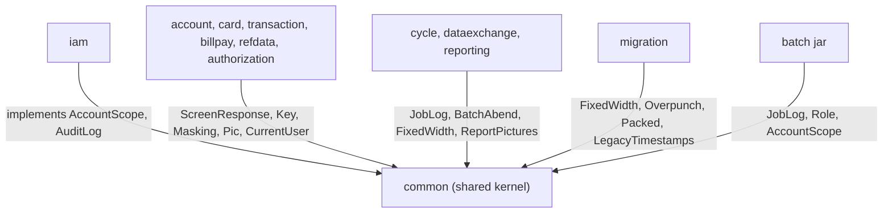

# Common

Active contributors: factory-aj-pahl

The `common` Maven module is the shared kernel of the modernized backend. It holds the screen envelope, the codecs for legacy record formats, COBOL picture formatting, masking, the signed-on user and role, the account-scope and audit interfaces, and the batch SYSOUT helpers. It holds no business rules and depends on no bounded context, so every other module can use it without creating a cycle.

## Purpose

Every bounded context in `modernization/backend/` needs the same small set of building blocks: a way to answer a screen turn, a way to read and write fixed-width COBOL fields, a way to print amounts the way a COBOL picture does, and a way to ask "who is signed on and what may they see". `common` provides these as plain classes, records, enums, and interfaces. It decides nothing about accounts, cards, or transactions.

Two rules keep it that way:

- `modernization/backend/app/src/test/java/com/carddemo/app/ModuleBoundariesTest.java` has a test `shared_kernel_depends_on_no_context` that fails the build if any class under `com.carddemo.common..` depends on a class in `iam`, `card`, `account`, `transaction`, `billpay`, `refdata`, `reporting`, `cycle`, `dataexchange`, `authorization`, or `inquiry`.
- Cross-context services that need an implementation (account scope, audit log) are only declared here as interfaces. The implementations live in the IAM module (`modernization/backend/iam/src/main/java/com/carddemo/iam/internal/JdbcAccountScope.java`, `modernization/backend/iam/src/main/java/com/carddemo/iam/internal/JdbcAuditLog.java`). See [IAM](iam.md).

The module description in `modernization/backend/common/pom.xml` lists its scope: "screen envelope, messages, date validation (CSUTLDTC/CSUTLDPY), codecs, masking, session principal, audit and scope interfaces". Its dependencies are Spring Boot web, security, JDBC, validation, the SQL Server driver, and springdoc.

## Directory layout

```
modernization/backend/common/src/main/java/com/carddemo/common/
  audit/     AuditLog
  batch/     JobLog, BatchAbend, UnlabeledAbend
  codec/     FixedWidth, Overpunch, Packed, LegacyTimestamps
  date/      CalendarDates
  format/    Pic, ReportPictures
  mask/      Masking
  msg/       CommonMessages
  screen/    ScreenResponse, Key, MessageColor
  security/  AccountScope, CurrentUser, Role
  time/      TimeConfig
```

The module has 20 Java files (812 lines) and no `src/test` directory. Its classes are tested through the modules that use them: for example `modernization/backend/transaction/src/test/java/com/carddemo/transaction/CalendarDatesTest.java` tests `CalendarDates`, and the codecs and report pictures are checked byte for byte by the batch parity harness (see [Batch parity](../verification/batch-parity.md)).

## Key abstractions

| Package | Type | File | What it does |
|:--|:--|:--|:--|
| screen | `ScreenResponse<F>` | `modernization/backend/common/src/main/java/com/carddemo/common/screen/ScreenResponse.java` | The C-RENDER envelope of one screen turn: `fields`, `message`, `messageColor`, `focus`, `navigate`. Null members are left out of the JSON. Fluent helpers `show`, `navigate`, `error`, `withMessage`, `withFocus`, `withFields`. |
| screen | `Key` | `modernization/backend/common/src/main/java/com/carddemo/common/screen/Key.java` | Attention identifier of a turn: `ENTER`, `CLEAR`, `PA1`-`PA3`, `PF1`-`PF24`. `folded()` maps PF13-PF24 to PF1-PF12 (the CSSTRPFY copybook behavior). |
| screen | `MessageColor` | `modernization/backend/common/src/main/java/com/carddemo/common/screen/MessageColor.java` | `RED`, `GREEN`, `NEUTRAL`. Red is the BMS default for ERRMSG. |
| msg | `CommonMessages` | `modernization/backend/common/src/main/java/com/carddemo/common/msg/CommonMessages.java` | Verbatim texts of CSMSG01Y and COTTL01Y, trailing spaces included (thank-you, invalid key, admin-only, the two title lines). |
| codec | `FixedWidth` | `modernization/backend/common/src/main/java/com/carddemo/common/codec/FixedWidth.java` | Read and write `X(n)`, `9(n)`, and signed zoned fields at zero-based copybook offsets. Pads short ASCII lines; treats LOW-VALUES as empty (DF-07). |
| codec | `Overpunch` | `modernization/backend/common/src/main/java/com/carddemo/common/codec/Overpunch.java` | Signed zoned decimal with the sign overpunched in the last byte (`{A-I}` positive, `}J-R` negative, DF-03). Encoding truncates like a COBOL MOVE. |
| codec | `Packed` | `modernization/backend/common/src/main/java/com/carddemo/common/codec/Packed.java` | COMP-3 packed decimal: decode, validate, encode with `C`/`D` sign nibbles. Used by the IMS segment codecs. |
| codec | `LegacyTimestamps` | `modernization/backend/common/src/main/java/com/carddemo/common/codec/LegacyTimestamps.java` | Parses the 26-character timestamp texts the COBOL writers produce (Db2 style `YYYY-MM-DD-HH.MM.SS.hh0000` and the space style of the feed and COBIL00C) and renders them back (Q-ENT-08, Q-ENT-41). |
| date | `CalendarDates` | `modernization/backend/common/src/main/java/com/carddemo/common/date/CalendarDates.java` | CSUTLDTC (CEEDAYS) as a library: `VALID`, `OUT_OF_RANGE` (before 1582-10-15), or `INVALID` for pictures `YYYY-MM-DD` and `YYYYMMDD` (Q-CSUTLDTC-02). `isValid` treats out-of-range as invalid (DF-8). |
| format | `Pic` | `modernization/backend/common/src/main/java/com/carddemo/common/format/Pic.java` | Screen renderings such as `+9(n).99` with leading zeros and the 11-digit account ID. |
| format | `ReportPictures` | `modernization/backend/common/src/main/java/com/carddemo/common/format/ReportPictures.java` | Edited pictures for batch reports and statements (`-ZZZ,ZZZ,ZZZ.ZZ`, `Z(9).99-`, `9(9).99-`, GnuCOBOL DISPLAY of signed zoned items). Throws `PictureOverflow` instead of dropping high-order digits (Q-CBTRN03C-10, Q-CBSTM03A-09). |
| mask | `Masking` | `modernization/backend/common/src/main/java/com/carddemo/common/mask/Masking.java` | C-MASK and B-MASK: card number as asterisks plus last 4, SSN as `***-**-` plus last 4, `keepLast`, `all`. |
| security | `CurrentUser` | `modernization/backend/common/src/main/java/com/carddemo/common/security/CurrentUser.java` | The signed-on user in the server-side session (C-SESSION): user ID, role, names. `current()` and `require()` read it from the Spring Security context. |
| security | `Role` | `modernization/backend/common/src/main/java/com/carddemo/common/security/Role.java` | `ADMIN` and `USER`, mapped from user types `A` and `U`; any other type is rejected (Q-COSGN00C-07). |
| security | `AccountScope` | `modernization/backend/common/src/main/java/com/carddemo/common/security/AccountScope.java` | C-SCOPE interface (D-USER-ACCT): `canAccess(user, accountId)` and `linkedAccounts(userId)`. Out-of-scope keys must be answered like missing keys. |
| audit | `AuditLog` | `modernization/backend/common/src/main/java/com/carddemo/common/audit/AuditLog.java` | C-AUDIT interface: `record(actor, action, target, changedFields, clientAddr)`. The Javadoc forbids passing passwords, full card numbers, CVVs, SSNs, or government IDs. |
| batch | `JobLog` | `modernization/backend/common/src/main/java/com/carddemo/common/batch/JobLog.java` | Batch SYSOUT: COBOL DISPLAY lines written verbatim to standard output, with a capture mode for tests. |
| batch | `BatchAbend` | `modernization/backend/common/src/main/java/com/carddemo/common/batch/BatchAbend.java` | A COBOL abend path (B-ABEND): the job stops, the unit of work rolls back, and the error text plus a `FILE STATUS IS: NNNN00xx` line are displayed before `ABENDING PROGRAM`. |
| batch | `UnlabeledAbend` | `modernization/backend/common/src/main/java/com/carddemo/common/batch/UnlabeledAbend.java` | A B-ABEND with no COBOL DISPLAY text: SYSOUT shows only `ABENDING PROGRAM`; the reason goes to the error stream. |
| time | `TimeConfig` | `modernization/backend/common/src/main/java/com/carddemo/common/time/TimeConfig.java` | The `Clock` bean every rule uses for "now". Tests replace it to pin dates, lockout windows, and idle time. |

## How it works

`common` is a leaf. Contexts import its types; IAM implements its two service interfaces; the runnable applications pick up `TimeConfig` and `JobLog` through component scanning.



Files that import each type outside `common` (main and test code together):

| Type | Users |
|:--|:--|
| `ScreenResponse`, `Key` | Every online context: iam (8 files), refdata (4), card (3), transaction (3), account (2), authorization (2), billpay, reporting |
| `CommonMessages` | iam (15 files), transaction (7), and most other online contexts |
| `JobLog` | batch (10 files), dataexchange (8), authorization (5), cycle (5), refdata (2), reporting (1) |
| `FixedWidth` | cycle (6 files), dataexchange (4), batch, migration, reporting, test-support, transaction |
| `Masking` | card (5 files), account (3), authorization (3), transaction (3), reporting (1) |
| `AccountScope` | account, authorization, batch, billpay, card, iam, inquiry, transaction |

## Integration points

- The screen envelope is the contract of the [Screen API](../api/screen-api.md). The web app reads `fields`, `message`, `messageColor`, `focus`, and `navigate` from every response.
- `CurrentUser` is put into the session by `modernization/backend/iam/src/main/java/com/carddemo/iam/web/SignonController.java` and read by every controller through `CurrentUser.require()`. See [Sign-on and sessions](../features/sign-on-and-sessions.md).
- `AccountScope` is the single check behind [Account scoping](../features/account-scoping.md).
- `JobLog` and `BatchAbend` define what batch SYSOUT looks like, which the [Batch jar](../applications/batch-jar.md) maps to exit code 99 on abend.
- `FixedWidth`, `Overpunch`, and `Packed` are used by the loader and exporter in [Schema and migration](schema-and-migration.md).

## Entry points for modification

- A new screen message shared by several programs belongs in `CommonMessages` only if it is verbatim COBOL text from a shared copybook. Program-specific messages stay in the controller.
- A new edited picture for a report goes into `ReportPictures`, with an overflow check, and needs a parity dataset that exercises it.
- Do not add a class here that names an account, card, or transaction rule. Put it in the owning context and publish an interface through that context's `api` package instead (see [Modules](index.md)).
- If you change `Masking`, check every caller: screens (C-MASK) and batch SYSOUT (B-MASK) both depend on the exact output length.

## Key source files

| File | Purpose |
|:--|:--|
| `modernization/backend/common/pom.xml` | Module definition and dependencies |
| `modernization/backend/common/src/main/java/com/carddemo/common/screen/ScreenResponse.java` | Screen turn envelope (C-RENDER) |
| `modernization/backend/common/src/main/java/com/carddemo/common/codec/Overpunch.java` | Zoned decimal sign handling |
| `modernization/backend/common/src/main/java/com/carddemo/common/format/ReportPictures.java` | Report and statement number formats |
| `modernization/backend/common/src/main/java/com/carddemo/common/security/AccountScope.java` | Account scope interface (C-SCOPE) |
| `modernization/backend/common/src/main/java/com/carddemo/common/batch/BatchAbend.java` | Batch abend with COBOL SYSOUT lines |
| `modernization/backend/app/src/test/java/com/carddemo/app/ModuleBoundariesTest.java` | Enforces that `common` depends on no context |

## Related pages

- [Modules](index.md)
- [IAM](iam.md), which implements `AccountScope` and `AuditLog`
- [Patterns and conventions](../how-to-contribute/patterns-and-conventions.md)
- [Fidelity ledger](../verification/fidelity-ledger.md) for the C-, B-, and DF- rule IDs cited above
