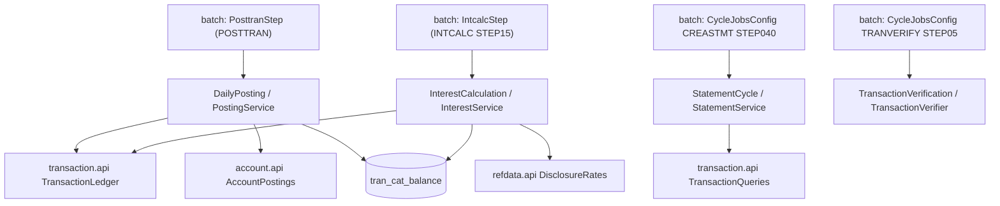

# Cycle

Active contributors: factory-aj-pahl

The `cycle` Maven module is bounded context BC-7. It holds the business logic of the nightly batch cycle: posting daily transactions (CBTRN02C), monthly interest (CBACT04C), statements (CBSTM03A with its I/O subroutine CBSTM03B), and the on-request daily-file check (CBTRN01C). The module has no screens and no Spring Batch code. The batch jar wraps its published interfaces in jobs and steps.

## Purpose

Each COBOL program became one service that processes one unit of work at a time:

- **Posting** (POSTTRAN, CBTRN02C) handles one daily record per database transaction.
- **Interest** (INTCALC, CBACT04C) handles one account per database transaction.
- **Statements** (CREASTMT, CBSTM03A/B) handle a whole run in one transaction.
- **Verification** (TRANVERIFY, CBTRN01C) reads only; it writes nothing.

The per-record commit follows decision B-UOW. Restart and job-instance rules (B-CYCLE) live in the batch jar. The end-to-end schedule (BACKUP, POSTTRAN, INTCALC on the first business date of a month, CREASTMT) is described in [Daily batch cycle](../features/daily-batch-cycle.md).

## Directory layout

```
modernization/backend/cycle/
  pom.xml
  src/main/java/com/carddemo/cycle/
    api/        DailyPosting, InterestCalculation, PostingOutcome, StatementCycle,
                TransactionVerification
    internal/   PostingService, PostingRejects, CategoryBalances, DailyRecord,
                InterestService, StatementService, TransactionVerifier
  src/test/java/com/carddemo/cycle/
    PostingServiceTest.java
    internal/TransactionVerifierCloseTest.java
```

Size: 12 main files (1,086 lines) and 2 test files (279 lines), with 13 test methods. The ratio inside the module is low (about 0.26) because most cycle tests run the real jobs from the batch jar. Those tests are in `modernization/backend/batch/src/test/java/com/carddemo/batch/`:

| Batch test | Test methods |
|:--|:--|
| `PosttranJobTest.java` | 6 |
| `IntcalcJobTest.java` | 10 |
| `StatementJobTest.java` | 9 |
| `TranverifyJobTest.java` | 4 |
| `CycleFailuresTest.java` | 24 |
| `CycleBackupTest.java` | 7 |

## Key abstractions

| Type | Path | Role |
|:--|:--|:--|
| `DailyPosting` | `modernization/backend/cycle/src/main/java/com/carddemo/cycle/api/DailyPosting.java` | `post(dailyRecord, runId, businessDate)` inside the caller's transaction; `rejectRecords(runId)` |
| `PostingOutcome` | `modernization/backend/cycle/src/main/java/com/carddemo/cycle/api/PostingOutcome.java` | Reason code and text; `POSTED` is reason 0 |
| `InterestCalculation` | `modernization/backend/cycle/src/main/java/com/carddemo/cycle/api/InterestCalculation.java` | `lastSuffix`, `nextAccount`, `chargeAccount`; static `idPrefix` and `interestMonth` |
| `StatementCycle` | `modernization/backend/cycle/src/main/java/com/carddemo/cycle/api/StatementCycle.java` | `createStatements(businessDate, statementFile, htmlFile)` |
| `TransactionVerification` | `modernization/backend/cycle/src/main/java/com/carddemo/cycle/api/TransactionVerification.java` | `verify(dailyFile)`, SYSOUT only |
| `PostingService` | `modernization/backend/cycle/src/main/java/com/carddemo/cycle/internal/PostingService.java` | CBTRN02C validation, posting, and reject paths |
| `DailyRecord` | `modernization/backend/cycle/src/main/java/com/carddemo/cycle/internal/DailyRecord.java` | Parses the 350-byte DALYTRAN record (CVTRA06Y) with EBCDIC overpunch signs (Q-CBTRN02C-08) |
| `CategoryBalances` | `modernization/backend/cycle/src/main/java/com/carddemo/cycle/internal/CategoryBalances.java` | The `tran_cat_balance` table (TCATBALF): lock, insert, add |
| `PostingRejects` | `modernization/backend/cycle/src/main/java/com/carddemo/cycle/internal/PostingRejects.java` | The `posting_reject` table; rebuilds the 430-byte DALYREJS records |
| `InterestService` | `modernization/backend/cycle/src/main/java/com/carddemo/cycle/internal/InterestService.java` | CBACT04C for one account |
| `StatementService` | `modernization/backend/cycle/src/main/java/com/carddemo/cycle/internal/StatementService.java` | CBSTM03A/B: text (80 wide) and HTML (100 wide) statements per cross-reference card |
| `TransactionVerifier` | `modernization/backend/cycle/src/main/java/com/carddemo/cycle/internal/TransactionVerifier.java` | CBTRN01C as a read-only check |

## How it works



### Posting (CBTRN02C)

`PostingService.post` requires the caller's transaction (`Propagation.MANDATORY`). The transaction is opened by `modernization/backend/batch/src/main/java/com/carddemo/batch/posting/PosttranStep.java`, which also writes SYSOUT, writes the DALYREJS file, and saves restart counts with every commit (Q-CBTRN02C-07). For each record, `post`:

1. Parses the record with `DailyRecord.parse`.
2. Looks up the card in the cross-reference. If it is missing, the record is rejected with reason 100 `INVALID CARD NUMBER FOUND`.
3. Locks the account with `AccountPostings.lockForPosting`. If it is missing, the reason is 101 `ACCOUNT RECORD NOT FOUND`.
4. Runs the limit test: cycle credit minus cycle debit plus the amount, at full precision (Q-CBTRN02C-11), must not exceed the credit limit. Otherwise the reason is 102 `OVERLIMIT TRANSACTION`.
5. Runs the expiry test as a text comparison of the account expiry date with the first 10 characters of the origination timestamp. A failure gives reason 103, which overwrites 102 when both fail (Q-CBTRN02C-03, preserved).
6. For a valid record, runs `postValid` inside a nested transaction (savepoint). It updates or creates the category balance, applies the amount to the account, and inserts the transaction with a Db2-style processing timestamp. If the account update fails, the savepoint undoes the category balance and the record is rejected with reason 109 (Q-CBTRN02C-04).
7. Writes rejects to `posting_reject`. A duplicate transaction ID or another write failure throws `BatchAbend` with the COBOL message, which the batch jar maps to exit code 99 (B-ABEND).

The ledger records the expected sample result as 300 processed and 38 rejected, all `0102 OVERLIMIT TRANSACTION`, with RC 4 (Q-CBTRN02C-08 in `modernization/decisions/ledger-batch-data.md`). The ledger calls the 43 rejects quoted in the root `AGENTS.md` and the runbook an ASCII-decoding artifact: the ASCII sample uses EBCDIC sign overpunch, and the loader and parity harness decode it that way.

### Interest (CBACT04C)

`modernization/backend/batch/src/main/java/com/carddemo/batch/cycle/IntcalcStep.java` is a chunk step with commit interval 1. For each account it calls `nextAccount`, which finds the next account that has category balances and no `interest_account` row for the month, and then `chargeAccount`. So a rerun after an abend skips the accounts that were already committed. For each account, `chargeAccount`:

- Reads the category balances in type and category order and displays each record.
- Gets the rate from `DisclosureRates.interestRate`, falling back to the `DEFAULT` group with the COBOL message pair.
- Computes monthly interest as `balance * rate / 1200`, truncated to 2 decimals. High-order digits beyond the picture are dropped as the COBOL does (`fit`, BR-CBACT04C-04).
- Writes each interest row with ID `YYYYMMDD00` plus a 6-digit counter (`InterestCalculation.idPrefix`), type `01`, category `5`, and the account's lowest card number (DF-6). A suffix above 999999 abends instead of wrapping.
- Updates every account, including the last one (Q-CBACT04C-01), and inserts the month marker into `interest_account`.

`BatchCommandLine` (`modernization/backend/batch/src/main/java/com/carddemo/batch/BatchCommandLine.java`) uses `InterestCalculation.interestMonth` as the job-instance key. A second completed run in the same month is refused with `INTEREST ALREADY CALCULATED FOR YYYY-MM` and exit code 8 (Q-CBACT04C-08). `INTSTATUS` reads the same job instances.

### Statements (CBSTM03A/B)

`StatementService.createStatements` runs in one transaction. It inserts a `statement_run` row and marks every transaction not covered by an earlier run with `TransactionQueries.coverUncovered` (D-HISTORY, Q-CREASTMT-04). It then writes one text and one HTML statement per cross-reference card, in card order, to `.part` files that are moved into place at the end. The COBOL table limits are gone (Q-CBSTM03A-04), names and cities keep all their words (Q-CBSTM03A-07), and HTML values are escaped (Q-CBSTM03A-10). The CBSTM03B file-access subroutine has no class of its own; reads go through `TransactionQueries`, `CardXrefListing`, and `CycleAccounts` (Q-CBSTM03B-04).

### Verification (CBTRN01C)

`TransactionVerifier.verify` reads the daily file and echoes each record with the card number masked. It looks up the cross-reference and the account, and prints the COBOL success or failure lines. It is an on-request job, not part of the scheduled cycle (Q-CBTRN01C-06).

## Integration points

- Depends on `account.api` (`AccountPostings`, `PostingAccount`, `CycleAccounts`, `InterestAccount`, `StatementAccount`, `StatementCustomer`), `card.api` (`CardDirectory`, `CardXref`, `CardXrefListing`), `transaction.api` (`TransactionLedger`, `TransactionQueries`, `NewTransaction`, `TransactionRecord`), and `refdata.api` (`DisclosureRates`).
- Consumers of `cycle.api`, all in the batch jar: `modernization/backend/batch/src/main/java/com/carddemo/batch/posting/PosttranStep.java`, `modernization/backend/batch/src/main/java/com/carddemo/batch/cycle/IntcalcStep.java`, `modernization/backend/batch/src/main/java/com/carddemo/batch/cycle/CycleJobsConfig.java`, and `modernization/backend/batch/src/main/java/com/carddemo/batch/BatchCommandLine.java`. See [Batch jar](../applications/batch-jar.md).
- Tables: `tran_cat_balance` and `posting_reject` (`modernization/backend/schema/src/main/resources/db/migration/V1__core_schema.sql`); `interest_account` and `statement_run` (`modernization/backend/schema/src/main/resources/db/migration/V20__batch_cycle.sql`). See [Data models](../reference/data-models.md).
- Parity: `modernization/verification/parity/datasets.md` lists owed datasets for CBTRN01C, CBTRN02C, CBACT04C, and CBSTM03A, and `modernization/verification/cycle/verify_cycle.py` checks the chain run through Airflow. See [Batch parity](../verification/batch-parity.md).

## Tests

| Test | What it covers |
|:--|:--|
| `modernization/backend/cycle/src/test/java/com/carddemo/cycle/PostingServiceTest.java` | Reject reasons 100-103, `expiry_check_overrides_the_limit_check_and_compares_dates_as_text`, `limit_sum_keeps_digits_above_nine_integer_places` |
| `modernization/backend/cycle/src/test/java/com/carddemo/cycle/internal/TransactionVerifierCloseTest.java` | Close failure keeps the COBOL text (Q-CBTRN01C-02) |
| `modernization/backend/batch/src/test/java/com/carddemo/batch/IntcalcJobTest.java` | `posted_sample_charges_every_account_including_the_last`, `a_second_run_in_the_same_month_is_refused_and_the_next_month_runs`, rerun after abend |
| `modernization/backend/batch/src/test/java/com/carddemo/batch/StatementJobTest.java` | `each_run_covers_only_transactions_no_earlier_run_covered`, HTML escaping, more than ten transactions per card |
| `modernization/backend/batch/src/test/java/com/carddemo/batch/CycleFailuresTest.java` | Abend paths for POSTTRAN, INTCALC, CREASTMT, TRANVERIFY, and TRANREPT, for example `posttran_abends_on_a_failed_lookup_instead_of_posting_to_the_previous_account` |

## Specification and ledger

The spec files are `modernization/spec/programs/CBTRN01C.md`, `modernization/spec/programs/CBTRN02C.md`, `modernization/spec/programs/CBACT04C.md`, `modernization/spec/programs/CBSTM03A.md`, and `modernization/spec/programs/CBSTM03B.md`. The ledger rows are in `modernization/decisions/ledger-batch-data.md`.

| ID | Decision | Effect |
|:--|:--|:--|
| Q-CBTRN02C-07 | FIX | One database transaction per daily record (B-UOW); a restart continues with the first uncommitted record |
| Q-CBTRN02C-01 | CHANGE (D-HISTORY) | Posted rows are appended to the persistent transaction table instead of a file opened OUTPUT |
| Q-CBACT04C-01 | FIX | The last account receives its interest and its cycle totals are reset |
| Q-CBACT04C-08 | FIX (D-INTEREST) | At most one completed INTCALC per calendar month; a second run is refused with exit code 8 |
| Q-CREASTMT-04 | CHANGE (D-HISTORY) | Each statement run covers only transactions that no earlier run covered |

See [Fidelity ledger](../verification/fidelity-ledger.md).

## Entry points for modification

- Posting rules: `PostingService.validateAccount` and `postValid`. Keep the reject code order, because 103 overriding 102 is a preserved quirk.
- Interest formula and ID scheme: `InterestService.chargeAccount`, `InterestCalculation.idPrefix`.
- Statement layout: the `Writer` class inside `StatementService`. Statement output is compared byte for byte with the patched COBOL, so rerun the parity harness after any change.
- Job wiring (steps, restart, exit codes) is not here. It lives in `modernization/backend/batch`.

## Related pages

- [Modules](index.md)
- [Transaction](transaction.md), [Account](account.md), [Reference data](refdata.md)
- [Airflow](../applications/airflow.md)
