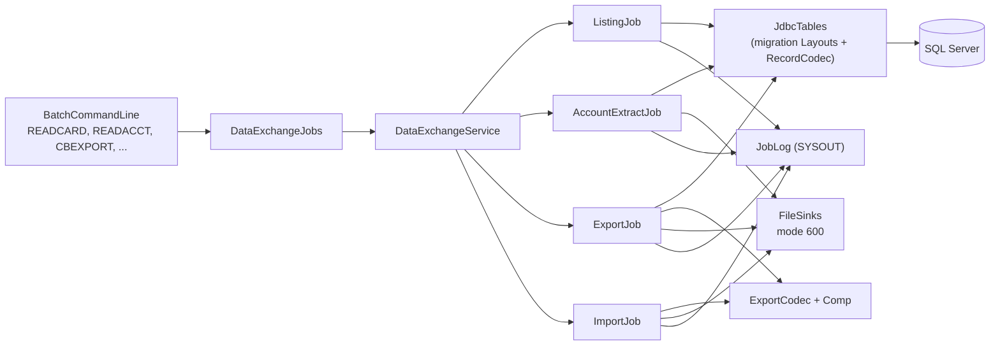

# Data exchange

Active contributors: factory-aj-pahl

The `dataexchange` module (`modernization/backend/dataexchange`) is bounded context BC-9. It restates six COBOL batch utilities: the branch export and import pair CBEXPORT and CBIMPORT, the account extract CBACT01C, and the listing programs CBACT02C (cards), CBACT03C (cross-reference), and CBCUS01C (customers). It has no screens; every job is a command of the [Batch jar](../applications/batch-jar.md).

## Purpose

The COBOL utilities read the VSAM masters sequentially and either print each record to SYSOUT or write fixed-length files. The Java jobs read the same masters from SQL Server, turn every row back into its legacy record bytes, and then do what the COBOL did, so their SYSOUT and output files can be compared with a GnuCOBOL run. The ledger fixes the security and correctness defects of the originals: listings are masked (B-MASK), outputs that must carry full card numbers and SSNs are owner-only files (D-PII-FILES), and stale-field bugs are corrected.

The seventh BC-9 program in the spec, COBSWAIT, has no class here. It is the `WAITSTEP wait=NNNNNNNN` command in `modernization/backend/batch/src/main/java/com/carddemo/batch/BatchCommandLine.java`.

## Directory layout

```
modernization/backend/dataexchange/
  pom.xml                        BC-9; depends on common, migration, account, card, transaction
  src/main/java/com/carddemo/dataexchange/
    api/        DataExchangeJobs, JobResult, AccountExtractFiles, ImportFiles
    internal/   DataExchangeService, ExportJob, ImportJob, ExportCodec, Comp,
                ListingJob, AccountExtractJob, FileStatuses, FileStatusException,
                RecordSource, RecordSink, Sinks, FileSinks, Tables, JdbcTables
  src/test/java/com/carddemo/dataexchange/internal/
    ExportImportJobTest, AccountExtractJobTest, ListingJobTest, FileStatusesTest, Fixtures
```

Size: 19 main files (1,240 lines) and 5 test files (1,138 lines), a test-to-code ratio of about 0.9. `modernization/backend/batch/src/test/java/com/carddemo/batch/DataExchangeCommandLineTest.java` tests the same jobs through the command line.

## Key abstractions

| Type | File | Role |
|:--|:--|:--|
| `DataExchangeJobs` | `modernization/backend/dataexchange/src/main/java/com/carddemo/dataexchange/api/DataExchangeJobs.java` | Published interface: `listCards`, `listXrefs`, `listCustomers`, `extractAccounts`, `exportAll`, `importAll` |
| `JobResult` | `modernization/backend/dataexchange/src/main/java/com/carddemo/dataexchange/api/JobResult.java` | Completed or abended (B-ABEND); the batch jar maps an abend to exit code 99 |
| `AccountExtractFiles`, `ImportFiles` | `modernization/backend/dataexchange/src/main/java/com/carddemo/dataexchange/api/` | Output paths, one per COBOL DD (OUTFILE, ARRYFILE, VBRCFILE; CUSTOUT, ACCTOUT, XREFOUT, TRNXOUT, CARDOUT, ERROUT) |
| `DataExchangeService` | `modernization/backend/dataexchange/src/main/java/com/carddemo/dataexchange/internal/DataExchangeService.java` | The `@Service` that implements `DataExchangeJobs` over JDBC with mode-600 file sinks |
| `ExportJob` | `modernization/backend/dataexchange/src/main/java/com/carddemo/dataexchange/internal/ExportJob.java` | CBEXPORT: five masters into one file of 500-byte records |
| `ImportJob` | `modernization/backend/dataexchange/src/main/java/com/carddemo/dataexchange/internal/ImportJob.java` | CBIMPORT: splits an export file back into the five legacy record files and an error file |
| `ExportCodec` | `modernization/backend/dataexchange/src/main/java/com/carddemo/dataexchange/internal/ExportCodec.java` | The CVEXPORT record layout and its conversion from and to each master record |
| `Comp` | `modernization/backend/dataexchange/src/main/java/com/carddemo/dataexchange/internal/Comp.java` | COBOL binary (COMP) and packed (COMP-3) fields, big-endian as on z/OS |
| `ListingJob` | `modernization/backend/dataexchange/src/main/java/com/carddemo/dataexchange/internal/ListingJob.java` | CBACT02C, CBACT03C, CBCUS01C: one masked DISPLAY line per record |
| `AccountExtractJob` | `modernization/backend/dataexchange/src/main/java/com/carddemo/dataexchange/internal/AccountExtractJob.java` | CBACT01C: field-by-field account listing and three demonstration extract files |
| `FileStatuses`, `FileStatusException` | `modernization/backend/dataexchange/src/main/java/com/carddemo/dataexchange/internal/` | Map Java and JDBC failures to the two-character COBOL file status, and render the `FILE STATUS IS:` line |
| `RecordSource`, `RecordSink`, `Sinks`, `FileSinks` | `modernization/backend/dataexchange/src/main/java/com/carddemo/dataexchange/internal/` | Sequential input and output in COBOL terms; `FileSinks` creates every file with permissions `rw-------` |
| `Tables`, `JdbcTables` | `modernization/backend/dataexchange/src/main/java/com/carddemo/dataexchange/internal/` | Open a table as its legacy KSDS: rows re-encoded through the migration layouts and sorted by record bytes |

## How it works



### Reading the masters as KSDS files

`JdbcTables` runs `SELECT * FROM <table>` for the layout and passes each row through `com.carddemo.migration.RecordCodec.encode`, so a row comes back as exactly the record the loader read from `app/data/ASCII`. It sorts the records by their bytes, not by the database collation, because the key is the record prefix for every base layout and byte order is the GnuCOBOL KSDS order. A failing query becomes `FileStatusException` with status `35` (bad SQL, the table is missing) or `93` (database unavailable).

### File status emulation

COBOL programs report I/O failures by two-character status. `FileStatuses` maps target failures to the closest status: `35` missing input file or table, `37` an output that cannot be created, `34` disk full on write, `30` any other I/O error, `93` database not reachable. `statusLine` reproduces the listing programs' 9910-DISPLAY-IO-STATUS paragraph: for a non-numeric status or one starting with `9`, the second byte is shown as the 3-digit binary value of its EBCDIC code, so `93` prints as `FILE STATUS IS: NNNN9243` (ERR-CBACT02C-04). `modernization/backend/dataexchange/src/test/java/com/carddemo/dataexchange/internal/FileStatusesTest.java` checks the mapping.

### Listings (CBACT02C, CBACT03C, CBCUS01C)

`ListingJob` has one `Spec` per program with its messages and a mask function. Each record is displayed once, which fixes the duplicate display of Q-CBACT03C-01 and Q-CBCUS01C-01. Masks follow the byte positions of the reference patches so the parity harness compares like with like:

| Program | Masked bytes | Reference patch |
|:--|:--|:--|
| CBACT02C | card number bytes 1-12, CVV bytes 28-30 | RP-CBACT02C-1 |
| CBACT03C | card number bytes 1-12 | RP-CBACT03C-2 |
| CBCUS01C | SSN bytes 280-284, government ID, date of birth, EFT account | RP-CBCUS01C-2 |

Names, addresses, and phone numbers stay in the customer listing; the ledger row Q-CBCUS01C-02 in `modernization/decisions/ledger-batch-data.md` explains why.

### Export and import (CBEXPORT, CBIMPORT)

`ExportJob` reads customers, accounts, cross-references, transactions, and cards in that order and writes one 500-byte CVEXPORT record per row. `ExportCodec.header` fills the first 40 bytes: record type (`C`, `A`, `X`, `T`, `D`), a 26-byte timestamp, a 4-byte binary sequence number that runs across all sections, branch `0001`, and region `NORTH`. The data area mixes encodings as the copybook does: text and zoned fields are copied, while IDs and amounts are re-encoded as COMP or COMP-3 through `Comp` (Q-ENT-19, Q-CBEXPORT-04). No record content goes to SYSOUT; only section counts and totals are displayed.

`ImportJob` reads the export file whole, sorts the 500-byte records by their unsigned sequence number (the export KSDS key order), and dispatches each by type to `ExportCodec.toCustomer`, `toAccount`, `toXref`, `toTransaction`, or `toCard`. Fixes from the ledger:

- FILLER bytes are written as spaces (Q-CBIMPORT-03).
- An unknown record type goes to the 132-byte error file with the full 9-digit sequence (Q-CBIMPORT-04, RP-CBIMPORT-2).
- A numeric field that cannot be decoded goes to the error file as `INVALID NUMERIC DATA` and the import continues (Q-CBIMPORT-07).
- The card output exists even though the original JCL has no CARDOUT DD (Q-CBIMPORT-01).
- A trailing partial record is processed after every complete record and abends with status `04` (ERR-CBIMPORT-02).
- On an abend, every output already created is deleted, as `DISP=(NEW,CATLG,DELETE)` would.

`ExportImportJobTest.export_then_import_reproduces_every_source_record_byte_for_byte` is the round-trip check.

### Account extract (CBACT01C)

`AccountExtractJob` displays each account field by field, then writes three outputs: a 107-byte OUTFILE record, a 110-byte ARRYFILE record holding the balance and the COBOL's demonstration constants, and two variable-length VBRCFILE records with a 4-byte record descriptor word (`AccountExtractJob.variable`). A zero cycle debit is still written as the constant 2525.00 (DF-11), while a non-zero one is now the account's own value instead of the previous record's (Q-CBACT01C-01). The reissue date becomes `YYYYMMDD` plus two spaces (Q-CBACT01C-02), and an invalid reissue date abends instead of writing garbage (Q-CBACT01C-08), because COBDATFT is replaced by a strict date parse.

## Integration points

- **Batch jar.** `BatchCommandLine` maps `READCARD`, `READXREF`, `READCUST`, `READACCT`, `CBEXPORT`, and `CBIMPORT` to `DataExchangeJobs` methods; the file paths are `key=value` arguments (`outFile`, `arryFile`, `vbrcFile`, `exportFile`, `custOut`, `acctOut`, ...). See [Batch jar](../applications/batch-jar.md).
- **Migration module.** `com.carddemo.migration.Layouts` and `RecordCodec` define the record layouts; the loader and these jobs share them. See [Schema and migration](schema-and-migration.md) and [Data migration](../features/data-migration.md).
- **Common.** `JobLog` (SYSOUT), `FixedWidth`, and `Overpunch` from [Common](common.md).
- **Parity harness.** The listing and export outputs are compared with GnuCOBOL runs; see [Batch parity](../verification/batch-parity.md).

The `pom.xml` also declares `account`, `card`, and `transaction`, but the jobs read tables directly through the migration layouts rather than through those contexts' `api` interfaces.

## Specification and tests

| Program | Spec file | Java | Tests |
|:--|:--|:--|:--|
| CBEXPORT | `modernization/spec/programs/CBEXPORT.md` | `ExportJob`, `ExportCodec` | `ExportImportJobTest` |
| CBIMPORT | `modernization/spec/programs/CBIMPORT.md` | `ImportJob`, `ExportCodec` | `ExportImportJobTest` |
| CBACT01C | `modernization/spec/programs/CBACT01C.md` | `AccountExtractJob` | `AccountExtractJobTest` |
| CBACT02C | `modernization/spec/programs/CBACT02C.md` | `ListingJob.CARDS` | `ListingJobTest` |
| CBACT03C | `modernization/spec/programs/CBACT03C.md` | `ListingJob.XREFS` | `ListingJobTest` |
| CBCUS01C | `modernization/spec/programs/CBCUS01C.md` | `ListingJob.CUSTOMERS` | `ListingJobTest` |

Tests worth reading first, all under `modernization/backend/dataexchange/src/test/java/com/carddemo/dataexchange/internal/`:

- `ExportImportJobTest.export_file_is_owner_only_and_nothing_sensitive_reaches_sysout` (`@Covers` Q-CBEXPORT-01, Q-ENT-33, B-MASK)
- `ExportImportJobTest.rerun_replaces_the_outputs_and_every_output_is_owner_only` (D-PII-FILES)
- `ExportImportJobTest.account_record_mixes_zoned_packed_and_binary_fields` (TS-CBEXPORT-03)
- `ListingJobTest.customer_listing_shows_each_customer_once_with_ssn_id_dob_and_eft_masked`
- `AccountExtractJobTest.invalid_reissue_date_abends_instead_of_writing_garbage`

## Notable decisions

| ID | Decision | Where |
|:--|:--|:--|
| D-PII-FILES | Export, import, and unload files keep full card numbers, CVVs, and SSNs as a data-interchange contract, written mode 600; screens and job logs stay masked | `modernization/decisions/README.md`; `FileSinks` |
| B-MASK | No job writes a full card number, CVV, SSN, government ID, date of birth, or EFT account to SYSOUT or a log | `modernization/decisions/ledger-batch-data.md`; `ListingJob` |
| DF-11 | The account extract's fixed 2525.00 cycle-debit constant is preserved as a business choice | `modernization/decisions/README.md`; `AccountExtractJob.DEFAULT_DEBIT` |
| Q-ENT-19 | CVEXPORT keeps its mixed zoned, binary, and packed byte layout, encoded field by field, never by whole-record code-page conversion | `modernization/decisions/ledger-batch-data.md`; `ExportCodec` |

## Entry points for modification

- A new listing program: add a `Spec` constant to `ListingJob`, a method to `DataExchangeJobs`, and a `case` in `BatchCommandLine`.
- A layout change: change the layout in the migration module first; `JdbcTables` and the export codec offsets depend on it. Update `ExportCodec` offsets and the round-trip test together.
- A new failure mode: map it in `FileStatuses` so the displayed status stays one the COBOL could have shown.

## Key source files

| File | Purpose |
|:--|:--|
| `modernization/backend/dataexchange/src/main/java/com/carddemo/dataexchange/api/DataExchangeJobs.java` | Published job interface |
| `modernization/backend/dataexchange/src/main/java/com/carddemo/dataexchange/internal/DataExchangeService.java` | Wires jobs to tables, sinks, job log, and clock |
| `modernization/backend/dataexchange/src/main/java/com/carddemo/dataexchange/internal/ExportCodec.java` | 500-byte CVEXPORT record codec |
| `modernization/backend/dataexchange/src/main/java/com/carddemo/dataexchange/internal/Comp.java` | COMP and COMP-3 field encoding |
| `modernization/backend/dataexchange/src/main/java/com/carddemo/dataexchange/internal/ImportJob.java` | CBIMPORT |
| `modernization/backend/dataexchange/src/main/java/com/carddemo/dataexchange/internal/FileStatuses.java` | COBOL file status mapping |
| `modernization/backend/dataexchange/src/main/java/com/carddemo/dataexchange/internal/FileSinks.java` | Owner-only output files |
| `modernization/backend/batch/src/main/java/com/carddemo/batch/BatchCommandLine.java` | Command names and arguments |
