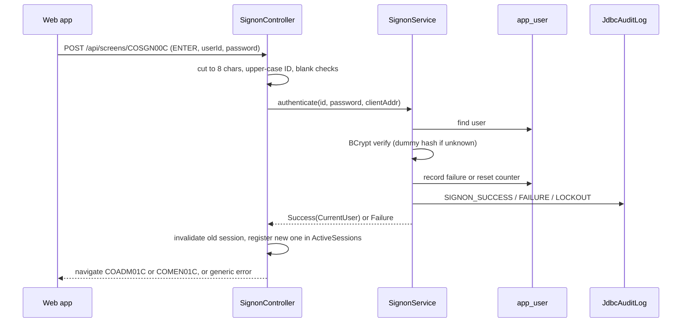

# IAM

Active contributors: factory-aj-pahl

The `iam` Maven module is bounded context BC-1, IAM and navigation. It ports the sign-on screen, the main and admin menus, and the four user maintenance screens, and it owns the Spring Security setup of the online API: server-side sessions, roles, CSRF, idle timeout, lockout, and the audit log. It also provides the implementations of the `AccountScope` and `AuditLog` interfaces that other contexts use.

## Purpose

| COBOL program | Transaction | Controller | Spec |
|:--|:--|:--|:--|
| COSGN00C sign-on | CC00 | `modernization/backend/iam/src/main/java/com/carddemo/iam/web/SignonController.java` | `modernization/spec/programs/COSGN00C.md` |
| COMEN01C main menu | CM00 | `modernization/backend/iam/src/main/java/com/carddemo/iam/web/MainMenuController.java` | `modernization/spec/programs/COMEN01C.md` |
| COADM01C admin menu | CA00 | `modernization/backend/iam/src/main/java/com/carddemo/iam/web/AdminMenuController.java` | `modernization/spec/programs/COADM01C.md` |
| COUSR00C user list | CU00 | `modernization/backend/iam/src/main/java/com/carddemo/iam/web/UserListController.java` | `modernization/spec/programs/COUSR00C.md` |
| COUSR01C add user | CU01 | `modernization/backend/iam/src/main/java/com/carddemo/iam/web/UserAddController.java` | `modernization/spec/programs/COUSR01C.md` |
| COUSR02C update user | CU02 | `modernization/backend/iam/src/main/java/com/carddemo/iam/web/UserUpdateController.java` | `modernization/spec/programs/COUSR02C.md` |
| COUSR03C delete user | CU03 | `modernization/backend/iam/src/main/java/com/carddemo/iam/web/UserDeleteController.java` | `modernization/spec/programs/COUSR03C.md` |

Transaction IDs are taken from the controller Javadoc. `modernization/backend/iam/src/main/java/com/carddemo/iam/web/SessionController.java` adds `GET /api/session`, which returns the signed-on user and role or 401. The web app uses it in place of reading the user fields of the COMMAREA.

The COBOL sign-on compared plain-text passwords and the admin programs never checked the user type. Most of what this module adds beyond the screens comes from security fixes in the fidelity ledger (D-AUTH, D-FIX-SEC, D-SEC-EXTRAS). See [Security](../security.md) and [Sign-on and sessions](../features/sign-on-and-sessions.md).

## Directory layout

```
modernization/backend/iam/src/main/java/com/carddemo/iam/
  api/        UserRoles
  internal/   SignonService, UserMaintenance, MenuCatalog,
              UserRepository, UserAdminRepository, UserRecord, UserForms,
              JdbcAccountScope, JdbcAuditLog, JdbcUserRoles
  security/   SecurityConfig, SecurityProperties, CsrfCookieFilter,
              IdleTimeoutFilter, ActiveSessions
  web/        SignonController, SessionController, MainMenuController,
              AdminMenuController, UserListController, UserAddController,
              UserUpdateController, UserDeleteController, UserScreens
modernization/backend/iam/src/test/java/com/carddemo/iam/
  10 test classes
```

| Measure | Main | Test |
|:--|:--|:--|
| Java files | 25 | 10 |
| Lines | 1,986 | 1,954 |
| Test methods | | 119 |

The test-to-code ratio by lines is about 1:1. The module depends only on `common` at compile time and on `test-support` for tests (`modernization/backend/iam/pom.xml`).

## Key abstractions

| Type | File | Role |
|:--|:--|:--|
| `SecurityConfig` | `modernization/backend/iam/src/main/java/com/carddemo/iam/security/SecurityConfig.java` | The single `SecurityFilterChain`. Sign-on, `/api/session`, health, and OpenAPI are public; `ADMIN_SCREENS` (COADM01C, COUSR00C-03C, COTRTLIC, COTRTUPC) need role ADMIN; every other `/api/**` path needs a session; anything else is denied. Session fixation creates a new session. CSRF uses a readable `XSRF-TOKEN` cookie. A missing session answers 401; a USER on an admin endpoint gets 403 with a screen envelope that navigates to COMEN01C with `CommonMessages.ADMIN_ONLY` (C-ROLE). HTTP Basic, form login, and logout are disabled. |
| `SecurityProperties` | `modernization/backend/iam/src/main/java/com/carddemo/iam/security/SecurityProperties.java` | `carddemo.security.*`: BCrypt cost (default 12), idle timeout (15 minutes), lockout threshold (5), lockout duration (15 minutes). |
| `CsrfCookieFilter` | `modernization/backend/iam/src/main/java/com/carddemo/iam/security/CsrfCookieFilter.java` | Loads the deferred CSRF token on every request so the SPA always receives the cookie. |
| `IdleTimeoutFilter` | `modernization/backend/iam/src/main/java/com/carddemo/iam/security/IdleTimeoutFilter.java` | Stores the last access time in the session and invalidates the session when the gap exceeds the timeout, measured with the application `Clock` so tests can move time (Q-COSGN00C-05). |
| `ActiveSessions` | `modernization/backend/iam/src/main/java/com/carddemo/iam/security/ActiveSessions.java` | In-memory registry of sessions by user ID. User update ends the sessions of a user whose type or password changed (Q-COUSR02C-04); user delete ends the deleted user's sessions (Q-COUSR03C-07). The registry is per API instance. |
| `SignonService` | `modernization/backend/iam/src/main/java/com/carddemo/iam/internal/SignonService.java` | Authentication: BCrypt verify (Q-COSGN00C-01), a dummy-hash verify for unknown IDs so timing does not reveal existence (Q-COSGN00C-04), failure counting and lockout (Q-COSGN00C-05), and audit records `SIGNON_SUCCESS`, `SIGNON_FAILURE`, `SIGNON_LOCKOUT`. Returns a sealed `Success` or `Failure`. |
| `MenuCatalog` | `modernization/backend/iam/src/main/java/com/carddemo/iam/internal/MenuCatalog.java` | The COMEN02Y (11 options) and COADM02Y (6 options) tables as code, each option tagged with the user type it needs (Q-COMEN01C-01). `carddemo.features.disabled-programs` turns options off as "not installed" (Q-COMEN01C-05). |
| `UserMaintenance` | `modernization/backend/iam/src/main/java/com/carddemo/iam/internal/UserMaintenance.java` | Writes of the user screens: BCrypt hashing (Q-COUSR01C-01), version-checked update (Q-COUSR02C-05), account-link checks and replacement (A-3), and audit records `USER_ADD`, `USER_UPDATE`, `USER_DELETE` with field names only. |
| `UserAdminRepository` | `modernization/backend/iam/src/main/java/com/carddemo/iam/internal/UserAdminRepository.java` | Keyset browse of `app_user` in user-ID order, reads with links, `UPDLOCK` read for update, inserts, updates, link replacement, and deletes. Computes the user version fingerprint (below). |
| `UserForms` | `modernization/backend/iam/src/main/java/com/carddemo/iam/internal/UserForms.java` | Field cutting to BMS lengths, upper-casing of IDs and types, the link-field parser (11-digit accounts, C-KEYLEN), and the verbatim and **NEW** messages of the user screens. |
| `JdbcAccountScope` | `modernization/backend/iam/src/main/java/com/carddemo/iam/internal/JdbcAccountScope.java` | Implements `AccountScope` from [Common](common.md) over `user_account`: ADMIN sees everything, USER sees linked accounts (D-USER-ACCT). |
| `JdbcAuditLog` | `modernization/backend/iam/src/main/java/com/carddemo/iam/internal/JdbcAuditLog.java` | Implements `AuditLog`: one `audit_log` row per event, with field names joined by commas (C-AUDIT). |
| `UserRoles` / `JdbcUserRoles` | `modernization/backend/iam/src/main/java/com/carddemo/iam/api/UserRoles.java`, `modernization/backend/iam/src/main/java/com/carddemo/iam/internal/JdbcUserRoles.java` | The published API: the role of a stored user, for jobs acting on a user's behalf (D-REPORT). Its only consumer is the TRANREPT job in `modernization/backend/batch/src/main/java/com/carddemo/batch/cycle/CycleJobsConfig.java`. |
| `UserScreens` | `modernization/backend/iam/src/main/java/com/carddemo/iam/web/UserScreens.java` | Server-side hand-off of the selected user from the list to update or delete, so the selection is never taken from client fields (Q-COUSR00C-14). |

### The user version fingerprint

COUSR02C must detect that another admin changed the user between fetch and save (Q-COUSR02C-05). The `app_user` table has a `ROWVERSION`, but sign-on bookkeeping (failed attempts, lockout time) rewrites the row without changing anything the update screen shows. `UserAdminRepository` therefore computes the version as a SHA-256 hash of first name, last name, user type, password hash, and the set of linked accounts. `UserMaintenance.update` reads the row with `UPDLOCK, ROWLOCK`, compares the fingerprint with the one held in the session, and returns `CHANGED` on a mismatch; the controller then shows `Record changed by some one else. Please review`.

## How it works

### Sign-on



`SignonService.authenticate` checks a lock first: while `locked_until` is in the future every attempt fails, even with the right password, and the lock is not extended. After the lock expires the counter starts again at zero. The fifth consecutive failure sets `locked_until` to now plus the lockout duration. All failure cases show the same message, `Invalid User ID or Password. Try again ...` (`SignonController.INVALID_CREDENTIALS`).

### Menus

Both menu controllers right-justify the two-character option and turn leading spaces into zeros (`MainMenuController.normalize`, BR-COMEN01C-04). An admin-only option is refused to a USER with the admin-only message. An option whose program is in `carddemo.features.disabled-programs` answers "not installed". The standalone [Bill-payment service](../applications/billpay-service.md) uses this to switch off every program it does not carry (`modernization/backend/billpay-service/src/main/resources/application.properties`). PF3 on either menu invalidates the session and goes back to sign-on.

### User maintenance

The list (COUSR00C) shows 10 users per page and pages with keyset queries (`from`, `after`, `before`) over the binary-collated user ID, so the order matches the VSAM key. A selection is resolved on the server and handed to COUSR02C or COUSR03C through `UserScreens`. Update holds the fetched ID and version in the session (Q-COUSR02C-02); the password is never returned (Q-COUSR02C-03), and an admin cannot change their own user type (Q-COUSR02C-04). Delete refuses to delete the signed-on admin's own ID (Q-COUSR03C-02).

## Integration points

- Every other context depends on IAM at runtime for `AccountScope` and `AuditLog`, but codes only against the interfaces in `common`. For example, `modernization/backend/account/pom.xml` adds IAM as the "Runtime provider of AccountScope and AuditLog".
- The batch jar imports `JdbcAccountScope` and `JdbcUserRoles` directly (`modernization/backend/batch/src/main/java/com/carddemo/batch/BatchApplication.java`).
- `UserAdminRepository.missingAccounts` reads only key existence from the `account` table. Its Javadoc explains why: a Maven dependency on the account context would form a cycle, since account tests use IAM for sign-on and scoping.
- The web screens are `modernization/web/src/screens/SignOn.tsx`, `modernization/web/src/screens/Menu.tsx`, `modernization/web/src/screens/UserList.tsx`, `modernization/web/src/screens/UserAdd.tsx`, `modernization/web/src/screens/UserUpdate.tsx`, and `modernization/web/src/screens/UserDelete.tsx`. See [Web app](../applications/web-app.md).

## Tests

| Test class | Methods | Focus |
|:--|:--|:--|
| `modernization/backend/iam/src/test/java/com/carddemo/iam/SignonAndMenusTest.java` | 21 | Sign-on screen turns and menu navigation end to end |
| `modernization/backend/iam/src/test/java/com/carddemo/iam/SignonRulesTest.java` | 9 | Upper-cased ID lookup, hash verification, generic message, fresh session |
| `modernization/backend/iam/src/test/java/com/carddemo/iam/MenuRulesTest.java` | 7 | Dispatch, admin-only refusal, blank input |
| `modernization/backend/iam/src/test/java/com/carddemo/iam/DisabledOptionsTest.java` | 3 | "Not installed" options on both menus |
| `modernization/backend/iam/src/test/java/com/carddemo/iam/UserListTest.java` | 19 | Paging boundaries and selection |
| `modernization/backend/iam/src/test/java/com/carddemo/iam/UserAddTest.java` | 16 | Field order of edits, links, duplicates |
| `modernization/backend/iam/src/test/java/com/carddemo/iam/UserUpdateTest.java` | 24 | Fetch without password, version conflicts, session ending |
| `modernization/backend/iam/src/test/java/com/carddemo/iam/UserDeleteTest.java` | 15 | Delete with audit and session ending, own-ID refusal |
| `modernization/backend/iam/src/test/java/com/carddemo/iam/UserScreenFailureTest.java` | 5 | Data-access failures (the COBOL "other RESP" branches) |

The cross-module security matrix tests for roles and CSRF live in the `app` module; see [Online API](../applications/online-api.md).

## Notable ledger decisions

The rows are in `modernization/decisions/ledger-online.md`. Across the seven programs the ledger has 68 Q- rows; 34 are FIX and none is CHANGE.

- **Q-COSGN00C-01** (FIX): passwords are stored only as BCrypt hashes (cost 12); the loader hashes the USRSEC values.
- **Q-COSGN00C-04** and **Q-COSGN00C-05** (FIX, D-SEC-EXTRAS): one generic failure message, a dummy-hash check for unknown IDs, lockout after 5 failures for 15 minutes, 15-minute idle timeout, and audit records with the client address.
- **Q-COADM01C-01** (FIX): the admin menu and user programs never checked the user type in COBOL; now they require ADMIN (C-ROLE).
- **Q-COUSR02C-05** (FIX): the fetch no longer takes an exclusive lock, and the save is version-checked.

## Entry points for modification

- To add a menu option, add an `Option` to `MenuCatalog.MAIN` or `MenuCatalog.ADMIN`. If it is admin-only, also add its path to `SecurityConfig.ADMIN_SCREENS`.
- To change lockout or timeout values, set `carddemo.security.*` properties rather than editing `SecurityProperties` defaults (see [Configuration](../reference/configuration.md)).
- `ActiveSessions` is in memory. Running more than one API instance would need a shared session store before user changes can end sessions on every instance.

## Key source files

| File | Purpose |
|:--|:--|
| `modernization/backend/iam/src/main/java/com/carddemo/iam/security/SecurityConfig.java` | Security filter chain, roles, CSRF, 401/403 handling |
| `modernization/backend/iam/src/main/java/com/carddemo/iam/internal/SignonService.java` | Authentication, lockout, sign-on audit |
| `modernization/backend/iam/src/main/java/com/carddemo/iam/web/SignonController.java` | COSGN00C screen and session start |
| `modernization/backend/iam/src/main/java/com/carddemo/iam/internal/MenuCatalog.java` | Menu option tables and feature flags |
| `modernization/backend/iam/src/main/java/com/carddemo/iam/internal/UserAdminRepository.java` | User browse, version fingerprint, writes |
| `modernization/backend/iam/src/main/java/com/carddemo/iam/internal/JdbcAccountScope.java` | Account scope for every context |

## Related pages

- [Sign-on and sessions](../features/sign-on-and-sessions.md)
- [Security](../security.md)
- [Account scoping](../features/account-scoping.md)
- [Screen API](../api/screen-api.md)
- [Modules](index.md), [Common](common.md), [Account](account.md), [Card](card.md)
- [Fidelity ledger](../verification/fidelity-ledger.md)
