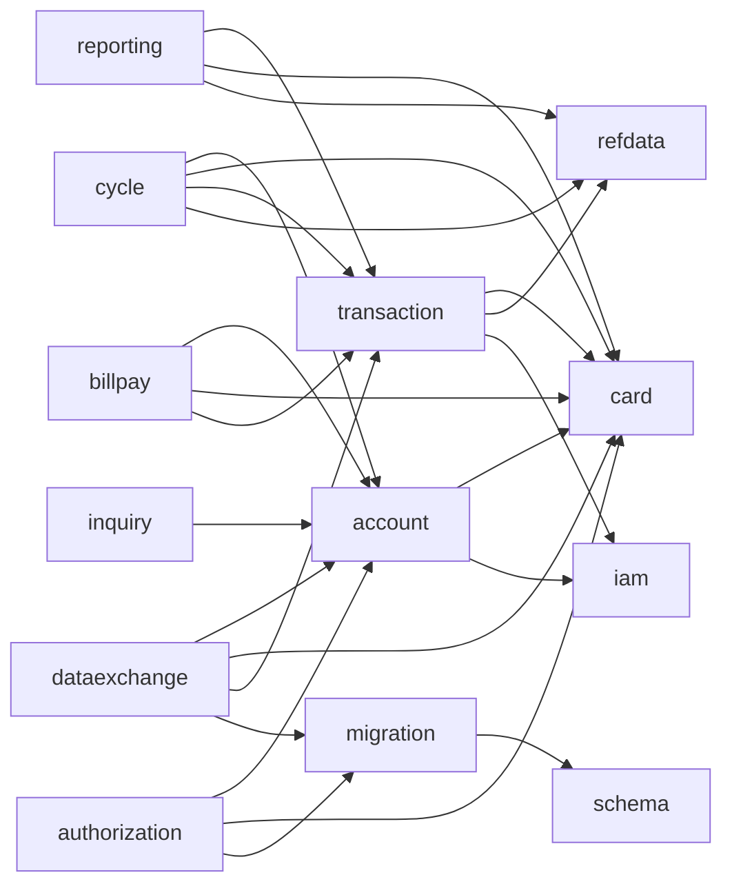

# Modules

Active contributors: factory-aj-pahl

The modern backend is one Maven reactor, `modernization/backend/pom.xml`, with 18 modules: 11 bounded contexts that restate groups of COBOL programs, 4 shared modules, and 3 runnable assemblies. This page lists every module, explains the package rule that keeps contexts apart, shows the dependency graph taken from the module `pom.xml` files, and summarizes what each context needs from the others according to `modernization/spec/components.md`.

## Overview

| Kind | Modules | Role |
|:--|:--|:--|
| Context | iam, account, card, transaction, billpay, reporting, cycle, refdata, dataexchange, authorization, inquiry | One bounded context (BC-1 to BC-11) each, with `web`, `internal`, and `api` packages |
| Shared | common, schema, migration, test-support | Shared kernel, Flyway SQL, sample-data codec and loader, test fixtures |
| Runnable | app, batch, billpay-service | Spring Boot applications that assemble contexts into a process |

The parent POM uses `spring-boot-starter-parent` 3.5.16, Java 21, springdoc 2.8.17, and ArchUnit 1.4.1 (`modernization/backend/pom.xml`). It also sets `forceCreation` on `maven-jar-plugin` so the executable jars never keep a stale module jar.

## Module table

File counts are for `src/main` (all files) and `src/test` (Java files) at commit 467e0f0. Lines are Java lines.

| Module | Kind | COBOL programs | Main files (lines) | Test files (lines) | Page |
|:--|:--|:--|--:|--:|:--|
| common | shared | none (shared kernel) | 20 (812) | 0 | [Common](common.md) |
| schema | shared | IDCAMS DEFINE jobs | 6 SQL | 0 | [Schema and migration](schema-and-migration.md) |
| migration | shared | none | 9 (1,028) | 0 | [Schema and migration](schema-and-migration.md) |
| test-support | shared | none | 8 (283) | 0 | [Schema and migration](schema-and-migration.md) |
| iam | context BC-1 | COSGN00C, COMEN01C, COADM01C, COUSR00C-03C | 25 (1,986) | 10 (1,954) | [IAM](iam.md) |
| account | context BC-2 | COACTVWC, COACTUPC | 29 (1,845) | 6 (1,407) | [Account](account.md) |
| card | context BC-3 | COCRDLIC, COCRDSLC, COCRDUPC | 13 (1,320) | 6 (1,592) | [Card](card.md) |
| transaction | context BC-4 | COTRN00C-02C, CSUTLDTC | 13 (1,097) | 8 (1,396) | [Transaction](transaction.md) |
| billpay | context BC-5 | COBIL00C | 2 (336) | 3 (743) | [Bill payment](billpay.md) |
| reporting | context BC-6 | CORPT00C, CBTRN03C | 10 (877) | 4 (737) | [Reporting](reporting.md) |
| cycle | context BC-7 | CBTRN01C, CBTRN02C, CBACT04C, CBSTM03A, CBSTM03B | 12 (1,086) | 2 (279) | [Cycle](cycle.md) |
| refdata | context BC-8 | COTRTLIC, COTRTUPC, COBTUPDT | 23 (2,200) | 7 (2,132) | [Reference data](refdata.md) |
| dataexchange | context BC-9 | CBEXPORT, CBIMPORT, CBACT01C, CBACT02C, CBACT03C, CBCUS01C | 19 (1,240) | 5 (1,138) | [Data exchange](dataexchange.md) |
| authorization | context BC-10 | COPAUA0C, COPAUS0C, COPAUS1C, COPAUS2C, CBPAUP0C, PAUDBUNL, PAUDBLOD, DBUNLDGS | 25 (2,754) | 10 (3,118) | [Authorization](authorization.md) |
| inquiry | context BC-11 | COACCT01, CODATE01 | 11 (687) | 3 (990) | [Inquiry](inquiry.md) |
| app | runnable | none | 2 (13) | 6 (1,195) | [Online API](../applications/online-api.md) |
| batch | runnable | none (hosts COBSWAIT as `WAITSTEP`) | 10 (1,297) | 16 (2,187) | [Batch jar](../applications/batch-jar.md) |
| billpay-service | runnable | none | 2 (24) | 5 (652) | [Bill-payment service](../applications/billpay-service.md) |

Across the 11 contexts there are 182 main Java files (15,428 lines) and 64 test files (15,486 lines), so the context test code is about the same size as the code it tests. The shared modules have no tests of their own; they are exercised through the context, app, and batch suites. The cycle module is the outlier with 279 test lines, because its job tests (`PosttranJobTest`, `IntcalcJobTest`, `StatementJobTest`) live in `modernization/backend/batch/src/test/java/com/carddemo/batch/`, and its byte-for-byte checks run in the GnuCOBOL parity harness ([Batch parity](../verification/batch-parity.md)).

## Package rule and boundary test

Each context has the package root `com.carddemo.<module>` and up to three packages:

| Package | Holds | Who may import it |
|:--|:--|:--|
| `web` | `@RestController` classes and their request and field records | Only its own context |
| `internal` | Services, JDBC repositories, job classes | Only its own context |
| `api` | Interfaces and records published to other contexts | Any context |

`authorization` adds a fourth package, `messaging`, for its RabbitMQ consumer. Two contexts, `billpay` and `inquiry`, have no `api` package because no other module calls them.

`modernization/backend/app/src/test/java/com/carddemo/app/ModuleBoundariesTest.java` imports every production class under `com.carddemo` and checks three rules, all tagged `@Covers({"ARCH-BOUNDARIES"})`:

1. `contexts_use_each_other_only_through_api_packages`: a class in one of the 11 contexts may depend on another context only through `com.carddemo.<other>.api`.
2. `shared_kernel_depends_on_no_context`: nothing in `com.carddemo.common` depends on a context.
3. `published_api_packages_hold_only_interfaces_and_records`: `api` packages contain only interfaces and records.

The test lists the 11 contexts by name. The runnable modules are not in the list, so `modernization/backend/batch/src/main/java/com/carddemo/batch/BatchApplication.java` may and does import `com.carddemo.iam.internal.JdbcAccountScope` to wire the batch process. See [Patterns and conventions](../how-to-contribute/patterns-and-conventions.md) for how to add a cross-context interface.

## Dependency graph

Compile-scope `<dependency>` entries between CardDemo modules, read from each `modernization/backend/<module>/pom.xml`. Every context also depends on `common`, and every context has `test-support` at test scope; those edges are left out to keep the graph readable.

Points worth knowing:

- `card`, `iam`, and `refdata` depend only on `common`. They are the leaves, which matches the spec's conversion order (reference data and identity first).
- `account` and `transaction` declare `iam` at compile scope, but no class under their `src/main` imports `com.carddemo.iam`. `card`, `refdata`, `billpay`, `authorization`, and `inquiry` take `iam` at test scope only, to have a real security configuration in their screen tests.
- `dataexchange` and `authorization` depend on `migration` for its record layouts (`Layouts`, `RecordCodec`, `PendingAuthSegments`, `PendingAuthTables`), so the jobs read and write the same bytes the loader does.
- `common` depends on Spring Web, Security, JDBC, Validation, the SQL Server driver, and springdoc. `schema` depends only on Flyway.

The runnable modules assemble contexts as follows:

| Runnable | CardDemo modules on its classpath (compile scope) |
|:--|:--|
| app | common, schema, all 11 contexts, plus actuator and Flyway |
| batch | common, schema, migration, cycle, reporting, refdata, dataexchange, authorization, iam, account, card, transaction (no billpay or inquiry) |
| billpay-service | common, schema, iam, billpay |

`billpay-service` running with only IAM and bill payment is the proof that the boundaries hold; see [Bill-payment service](../applications/billpay-service.md).

## Bounded contexts in the specification

`modernization/spec/components.md` section 3 assigns each of the 44 COBOL programs to one context, and section 5(e) records what a context needs from the others if it is converted alone. Condensed:

| ID | Context | Reads from | Writes into others' data | Provides to others |
|:--|:--|:--|:--|:--|
| BC-1 | IAM and Navigation | none | none | Sign-on identity and routing for every online program |
| BC-2 | Account and Customer | BC-3 (xref by account) | none | Account to BC-5, BC-7, BC-9, BC-10, BC-11; customer to BC-7, BC-9, BC-10 |
| BC-3 | Card | BC-2 (account ID on screen, not validated) | none | Card to BC-9; card cross-reference to almost every context |
| BC-4 | Transaction | BC-3 (xref by card and account) | none | Transaction list and detail |
| BC-5 | Bill Payment | BC-2, BC-3 | Account balance, new transaction | none |
| BC-6 | Reporting | BC-4/BC-7 transactions, BC-3, BC-8 | Backup GDG side effect (dropped in the target) | Report output |
| BC-7 | Batch Posting and Cycle | BC-3, BC-2, BC-8 (disclosure groups) | Account balances and cycle totals, transactions | Posted transactions, statements |
| BC-8 | Reference Data | none | none | Type and category names to BC-6, disclosure groups to BC-7 |
| BC-9 | Data Exchange and Utilities | Every base master | Import files only | Branch export file |
| BC-10 | Authorizations | BC-3 (xref by card), BC-2 (limits, customer) | none in base data | Pending authorizations, fraud flags |
| BC-11 | MQ Inquiry | BC-2 (account) | none | Account and date replies |

The spec's summary: the card cross-reference (BC-3) and the account (BC-2) are the hubs, read by seven and six contexts; the transaction table is written by three contexts (BC-4, BC-5, BC-7) and is the main contention point. The recommended conversion order is shared kernel, BC-8, BC-1, BC-3, BC-2, BC-4 with BC-5, BC-7, BC-6, BC-10, BC-11, BC-9 (`modernization/spec/components.md` section 8). In the target all contexts run against one SQL Server database, so the "data bridges" the spec describes become `api` interfaces such as `modernization/backend/card/src/main/java/com/carddemo/card/api/CardDirectory.java` and `modernization/backend/account/src/main/java/com/carddemo/account/api/AccountProfiles.java`.

## Module pages

- Shared: [Common](common.md), [Schema and migration](schema-and-migration.md)
- Online contexts: [IAM](iam.md), [Account](account.md), [Card](card.md), [Transaction](transaction.md), [Bill payment](billpay.md)
- Batch and reporting: [Reporting](reporting.md), [Cycle](cycle.md), [Reference data](refdata.md), [Data exchange](dataexchange.md)
- Optional-module contexts: [Authorization](authorization.md), [Inquiry](inquiry.md)
- Runnables: [Online API](../applications/online-api.md), [Batch jar](../applications/batch-jar.md), [Bill-payment service](../applications/billpay-service.md)

## Key source files

| File | Purpose |
|:--|:--|
| `modernization/backend/pom.xml` | Reactor: module list, Spring Boot parent, plugin settings |
| `modernization/backend/app/src/test/java/com/carddemo/app/ModuleBoundariesTest.java` | ArchUnit rules for the package boundaries |
| `modernization/spec/components.md` | Contexts, CRUD matrix, cross-context dependencies, conversion order |
| `modernization/architecture.md` | Target architecture; section 3 describes the module layout |
