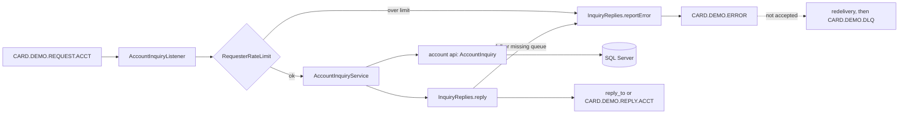

# Inquiry

Active contributors: factory-aj-pahl

The `inquiry` module (`modernization/backend/inquiry`) is bounded context BC-11, the rebuild of the optional VSAM-MQ module in `app/app-vsam-mq`. It answers two MQ request/reply services, account inquiry (COACCT01) and system date inquiry (CODATE01), as RabbitMQ listeners that keep the COBOL queue names and 1000-byte text replies, and it adds REST equivalents that return JSON to a signed-on user.

## Purpose

| COBOL program | Transaction | What it did | Java |
|:--|:--|:--|:--|
| COACCT01 | CDRA | Read a request (`INQA` + 11-digit account ID), read ACCTDAT, reply with labelled account fields | `AccountInquiryListener`, `AccountInquiryService`, `AccountInquiryController` |
| CODATE01 | CDRD | Reply with the system date and time to any request | `DateInquiryListener`, `DateInquiry`, `DateInquiryController` |

The COBOL services had no authentication and no throttling (Q-COACCT01-15, Q-CODATE01-14). The rebuild relies on broker authentication and queue permissions, adds a per-requester rate limit and bounded reply queues, and makes the REST endpoints require a session with account scoping.

## Directory layout

```
modernization/backend/inquiry/
  pom.xml               BC-11; depends on common, account, spring-boot-starter-amqp
  src/main/java/com/carddemo/inquiry/
    internal/   AccountInquiryListener, AccountInquiryService, DateInquiryListener, DateInquiry,
                InquiryQueues, InquiryMessagingConfig, InquiryReplies, ErrorRecord, RequesterRateLimit
    web/        AccountInquiryController, DateInquiryController
  src/test/java/com/carddemo/inquiry/
    AccountInquiryMessagingTest, DateInquiryMessagingTest, internal/DateInquiryTest
```

Size: 11 main files (687 lines) and 3 test files (990 lines), a test-to-code ratio of about 1.4. There is no `api` package; no other module calls this context.

## Key abstractions

| Type | File | Role |
|:--|:--|:--|
| `AccountInquiryService` | `modernization/backend/inquiry/src/main/java/com/carddemo/inquiry/internal/AccountInquiryService.java` | Validates the request, reads the account through `AccountInquiry`, and builds the outcome: `Found`, `NotFound`, `Invalid`, or the `ReadFailed` exception |
| `DateInquiry` | `modernization/backend/inquiry/src/main/java/com/carddemo/inquiry/internal/DateInquiry.java` | `SYSTEM DATE : MM-dd-yyyySYSTEM TIME : HH:mm:ss` padded to 1000 bytes for the queue; `OffsetDateTime` for REST |
| `AccountInquiryListener`, `DateInquiryListener` | `modernization/backend/inquiry/src/main/java/com/carddemo/inquiry/internal/` | `@RabbitListener` consumers of the two request queues |
| `InquiryQueues` | `modernization/backend/inquiry/src/main/java/com/carddemo/inquiry/internal/InquiryQueues.java` | Queue names, with an optional suffix from `carddemo.mq.queue-suffix` |
| `InquiryMessagingConfig` | `modernization/backend/inquiry/src/main/java/com/carddemo/inquiry/internal/InquiryMessagingConfig.java` | Declares quorum request queues (delivery limit 3, dead-letter to `CARD.DEMO.DLQ`), reply queues capped at 10,000 messages with `reject-publish`, the error queue, and the DLQ |
| `InquiryReplies` | `modernization/backend/inquiry/src/main/java/com/carddemo/inquiry/internal/InquiryReplies.java` | Publishes replies and error records with publisher confirms, detecting a full or missing reply queue like a failed MQPUT |
| `ErrorRecord` | `modernization/backend/inquiry/src/main/java/com/carddemo/inquiry/internal/ErrorRecord.java` | The MQ-ERR-DISPLAY layout (paragraph, message, condition code, reason code, queue name) plus a storage error code field |
| `RequesterRateLimit` | `modernization/backend/inquiry/src/main/java/com/carddemo/inquiry/internal/RequesterRateLimit.java` | Fixed-window limit per requester (`user_id` + `app_id`), default 100 requests per second |
| `AccountInquiryController`, `DateInquiryController` | `modernization/backend/inquiry/src/main/java/com/carddemo/inquiry/web/` | `GET /api/inquiry/account/{id}` and `GET /api/inquiry/date` |

Queue names (`InquiryQueues`):

| Constant | Queue |
|:--|:--|
| `DATE_REQUEST` / `DATE_REPLY` | `CARD.DEMO.REQUEST.DATE` / `CARD.DEMO.REPLY.DATE` |
| `ACCOUNT_REQUEST` / `ACCOUNT_REPLY` | `CARD.DEMO.REQUEST.ACCT` / `CARD.DEMO.REPLY.ACCT` |
| `ERROR` | `CARD.DEMO.ERROR` |
| `DEAD_LETTER` | `CARD.DEMO.DLQ` |

The reply and error queue names are from the COBOL. The request queue names come from CICS trigger definitions that are not in the repository, so the Java names them after the reply queues (Javadoc of `InquiryQueues`).

## How it works



### Account inquiry on the queue

1. The listener computes the reply queue: the request's `reply_to`, or `CARD.DEMO.REPLY.ACCT` when absent (Q-COACCT01-02). The reply's `correlation_id` is the request's `message_id` (Q-COACCT01-03).
2. A requester over its rate limit gets an `ErrorRecord` with the message `REQUEST RATE EXCEEDED` (new text with no COBOL counterpart) on both the error queue and its reply queue.
3. `AccountInquiryService.answer(byte[])` reads bytes 1-4 as the function and bytes 5-15 as the account ID. A request shorter than 15 bytes or longer than 1000, a function other than `INQA`, or a key that is not 11 digits greater than zero is `Invalid`.
4. A found account becomes the labelled WS-ACCT-RESPONSE text (`ACCOUNT ID : ...BALANCE : ...`), amounts as signed zoned `S9(10)V99` with overpunch (Q-COACCT01-05), padded to 1000 bytes. A missing one is `INVALID REQUEST PARAMETERS ACCT ID : <key>`.
5. A database failure is `ReadFailed`: the listener sends `ERROR WHILE READING ACCTF` (the 28-character COBOL literal cut to 25) with the database error code to the error queue and an error reply to the requester, and the request is consumed (Q-COACCT01-07).
6. If the error queue itself refuses the record, `InquiryReplies.reportError` throws, the request is redelivered, and after three deliveries it lands on `CARD.DEMO.DLQ` (ERR-COACCT01-08).

The date listener follows the same steps without reading the request body: any request, empty or not, oversized or not, gets one date reply (Q-CODATE01-02, Q-CODATE01-07). The time is read when the request is processed, not when it was queued (Q-CODATE01-15).

### REST endpoints

| Endpoint | Success | Errors |
|:--|:--|:--|
| `GET /api/inquiry/account/{id}` | 200, `AccountReply` JSON with decimal amounts (two places) and ISO dates | 400 invalid ID, 404 missing or out of scope, 503 account store unreadable; body `{"message": ...}` |
| `GET /api/inquiry/date` | 200, `{"timestamp": "..."}` as ISO 8601 local time with UTC offset (Q-CODATE01-03) | none specific |

Both need a session: `modernization/backend/iam/src/main/java/com/carddemo/iam/security/SecurityConfig.java` requires authentication for `/api/**`.

The account ID follows the C-KEYLEN rule (`modernization/decisions/ledger-online.md`, from D-ACCTID and DF-9): it must be exactly 11 digits and not all zeros, and it is never left-padded. `AccountInquiryService.answer(CurrentUser, String)` builds the key the queue would see for `INQA` followed by the ID, space-padding a short ID and cutting a long one to 11 characters, so the 400 body is the same invalid-request text the queue would return (`AccountInquiryMessagingTest.rest_invalid_request_text_is_the_queue_reply_for_the_same_id`). An account outside the user's linked accounts is answered 404 exactly like a missing one (C-SCOPE, see [Account scoping](../features/account-scoping.md)). `modernization/architecture.md` section 3 states the same contract.

## Integration points

- **Account context.** Only `com.carddemo.account.api.AccountInquiry` and its `AccountSnapshot` record ([Account](account.md)).
- **Common.** `Overpunch` for zoned amounts, `AccountScope` and `CurrentUser` for REST ([Common](common.md)).
- **RabbitMQ.** Vhost and connection settings come from the application configuration; queue formats, DLQ, and reply rules for all CardDemo queues are in [Message queues](../api/message-queues.md). REST contracts are in [REST endpoints](../api/rest-endpoints.md).
- **IAM.** Test scope only, for a real security configuration in the REST tests.

## Specification and tests

| Program | Spec file | Tests |
|:--|:--|:--|
| COACCT01 | `modernization/spec/programs/COACCT01.md` | `modernization/backend/inquiry/src/test/java/com/carddemo/inquiry/AccountInquiryMessagingTest.java` |
| CODATE01 | `modernization/spec/programs/CODATE01.md` | `modernization/backend/inquiry/src/test/java/com/carddemo/inquiry/DateInquiryMessagingTest.java`, `modernization/backend/inquiry/src/test/java/com/carddemo/inquiry/internal/DateInquiryTest.java` |

The two messaging tests run against a real broker with suffixed private queues. Tests worth reading first:

- `AccountInquiryMessagingTest.account_request_gets_the_legacy_text_on_its_reply_to_queue_and_rest_returns_the_same_data_as_json`
- `AccountInquiryMessagingTest.rest_needs_a_session_and_answers_other_users_accounts_as_not_found` (Q-COACCT01-15, C-ROLE, C-SCOPE, D-USER-ACCT)
- `AccountInquiryMessagingTest.read_error_sends_an_error_reply_and_an_error_record_and_consumes_the_request`
- `AccountInquiryMessagingTest.a_request_that_fails_three_deliveries_is_dead_lettered_and_the_next_request_is_answered`
- `DateInquiryMessagingTest.full_reply_queue_is_reported_on_the_error_queue_and_the_request_is_consumed`
- `DateInquiryMessagingTest.a_requester_over_its_rate_limit_gets_an_error_reply` (Q-CODATE01-14)

## Notable decisions

| ID | Decision | Where |
|:--|:--|:--|
| D-MQ | MQ request/reply becomes RabbitMQ request/reply queues plus REST endpoints | `modernization/decisions/README.md` |
| Q-COACCT01-01 | The code, not the module README, is the contract: function `INQA`, labelled text reply, reply queue `CARD.DEMO.REPLY.ACCT`, error queue `CARD.DEMO.ERROR` | `modernization/decisions/ledger-batch-data.md` |
| Q-COACCT01-15 | Broker requesters authenticate and need queue permission; REST needs a session with C-ROLE and C-SCOPE | `modernization/decisions/ledger-batch-data.md` |
| Q-CODATE01-14 | Per-requester rate limit and bounded reply queues on top of broker authentication | `modernization/decisions/ledger-batch-data.md`; `RequesterRateLimit`, `InquiryMessagingConfig` |
| Q-CODATE01-03 | The queue keeps the legacy US-format local text; REST returns ISO 8601 with offset | `modernization/decisions/ledger-batch-data.md`; `DateInquiry` |

## Entry points for modification

- Reply layout: `AccountInquiryService.accountResponse` and `legacyReply`; the REST error body reuses `legacyReply`, so both change together.
- Validation: `AccountInquiryService.answer` (queue) and `answer(CurrentUser, String)` (REST).
- Limits: `carddemo.mq.rate-limit.requests` and `carddemo.mq.rate-limit.window` properties; queue bounds in `InquiryMessagingConfig`.

## Key source files

| File | Purpose |
|:--|:--|
| `modernization/backend/inquiry/src/main/java/com/carddemo/inquiry/internal/AccountInquiryService.java` | COACCT01 logic and reply text |
| `modernization/backend/inquiry/src/main/java/com/carddemo/inquiry/internal/AccountInquiryListener.java` | Account request consumer |
| `modernization/backend/inquiry/src/main/java/com/carddemo/inquiry/internal/DateInquiryListener.java` | Date request consumer |
| `modernization/backend/inquiry/src/main/java/com/carddemo/inquiry/internal/InquiryReplies.java` | Confirmed publishing and error reporting |
| `modernization/backend/inquiry/src/main/java/com/carddemo/inquiry/internal/InquiryMessagingConfig.java` | Queue declarations |
| `modernization/backend/inquiry/src/main/java/com/carddemo/inquiry/internal/RequesterRateLimit.java` | Rate limit |
| `modernization/backend/inquiry/src/main/java/com/carddemo/inquiry/web/AccountInquiryController.java` | REST account inquiry |
| `modernization/backend/inquiry/src/main/java/com/carddemo/inquiry/web/DateInquiryController.java` | REST date inquiry |
