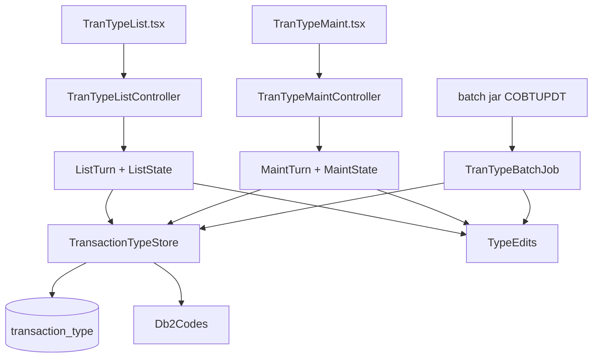

# Reference data

Active contributors: factory-aj-pahl

The `refdata` Maven module is bounded context BC-8. It ports the optional transaction-type Db2 module (`app/app-transaction-type-db2`): the list screen COTRTLIC (transaction CTLI), the single-type maintenance screen COTRTUPC (CTTU), and the batch updater COBTUPDT (JOB-MNTTRDB2). It also publishes read-only lookups of transaction types, categories, and disclosure-group rates to the rest of the backend.

## Purpose

The reference tables `transaction_type`, `transaction_category`, and `disclosure_group` are read by transaction add, the report, and the interest calculation. Only the transaction-type programs change them. Those programs were written against Db2, and their screens branch on SQLCODE values (-532, -803, -911) and show Db2 error texts. The target database is SQL Server, so the module includes a small SQLCODE emulation layer that lets those branches and messages survive.

Both screens are ADMIN only. The rule is enforced in `modernization/backend/iam/src/main/java/com/carddemo/iam/security/SecurityConfig.java`, which lists `/api/screens/COTRTLIC` and `/api/screens/COTRTUPC` among the admin paths (Q-COTRTLIC-05, Q-COTRTUPC-10).

## Directory layout

```
modernization/backend/refdata/
  pom.xml
  src/main/java/com/carddemo/refdata/
    api/        BatchUpdateResult, DisclosureRates, TranTypeBatchUpdate,
                TransactionCodeNames, TransactionCodes
    internal/   TransactionTypeStore, TypeEdits, TypeFilter, TypeRow,
                Db2Codes, Db2Error, Db2Failure, CursorFailure,
                TranTypeBatchJob, JdbcTransactionCodes, JdbcCycleReferenceData
    web/        TranTypeListController, ListState, ListTurn,
                TranTypeMaintController, MaintState, MaintTurn, TranTypeNavigation
  src/test/java/com/carddemo/refdata/
    TranTypeListScreenTest, TranTypeListFaultsTest, TranTypeMaintScreenTest,
    TranTypeMaintFaultsTest, TranTypeBatchUpdateTest, TranTypeScreens,
    web/TranTypeMaintAbendTest
```

Size: 23 main files (2,200 lines) and 7 test files (2,132 lines), with 95 test methods, the most of the five modules on these pages. The test code is about the same size as the main code. The two turn classes are the largest files: `ListTurn.java` (709 lines) and `MaintTurn.java` (420 lines).

## Key abstractions

| Type | Path | Role |
|:--|:--|:--|
| `TranTypeListController` | `modernization/backend/refdata/src/main/java/com/carddemo/refdata/web/TranTypeListController.java` | `/api/screens/COTRTLIC`: ENTER, PF2 add, PF3 exit, PF7/PF8 paging, PF10 confirm |
| `ListTurn` / `ListState` | `modernization/backend/refdata/src/main/java/com/carddemo/refdata/web/ListTurn.java`, `modernization/backend/refdata/src/main/java/com/carddemo/refdata/web/ListState.java` | One list turn (edits, cursor reads, changes, send) and the session-held conversation state |
| `TranTypeMaintController` | `modernization/backend/refdata/src/main/java/com/carddemo/refdata/web/TranTypeMaintController.java` | `/api/screens/COTRTUPC`: ENTER, PF3 exit, PF4 delete, PF5 add or save, PF12 cancel |
| `MaintTurn` / `MaintState` | `modernization/backend/refdata/src/main/java/com/carddemo/refdata/web/MaintTurn.java`, `modernization/backend/refdata/src/main/java/com/carddemo/refdata/web/MaintState.java` | One maintenance turn and the TTUP-CHANGE-ACTION state machine |
| `TranTypeNavigation` | `modernization/backend/refdata/src/main/java/com/carddemo/refdata/web/TranTypeNavigation.java` | Session keys, and the caller that COTRTUPC returns to on PF3 |
| `TransactionTypeStore` | `modernization/backend/refdata/src/main/java/com/carddemo/refdata/internal/TransactionTypeStore.java` | All SQL against `transaction_type`: count, forward and backward cursors, find, versioned update and delete, batch insert/update/delete |
| `TypeEdits` | `modernization/backend/refdata/src/main/java/com/carddemo/refdata/internal/TypeEdits.java` | Type-code and description edits shared by both screens and COBTUPDT |
| `TypeFilter` / `TypeRow` | `modernization/backend/refdata/src/main/java/com/carddemo/refdata/internal/TypeFilter.java`, `modernization/backend/refdata/src/main/java/com/carddemo/refdata/internal/TypeRow.java` | List filters, and one row with its row version |
| `Db2Codes` | `modernization/backend/refdata/src/main/java/com/carddemo/refdata/internal/Db2Codes.java` | Maps SQL Server error numbers to Db2 SQLCODEs; `pic` formats a code as `----9` |
| `Db2Error` / `Db2Failure` / `CursorFailure` | `modernization/backend/refdata/src/main/java/com/carddemo/refdata/internal/Db2Error.java`, `modernization/backend/refdata/src/main/java/com/carddemo/refdata/internal/Db2Failure.java`, `modernization/backend/refdata/src/main/java/com/carddemo/refdata/internal/CursorFailure.java` | SQLCODE plus text; a failed single statement; a failed cursor read with its phase and the rows read so far |
| `TranTypeBatchJob` | `modernization/backend/refdata/src/main/java/com/carddemo/refdata/internal/TranTypeBatchJob.java` | COBTUPDT: applies an add/update/delete file in one transaction |
| `JdbcTransactionCodes` | `modernization/backend/refdata/src/main/java/com/carddemo/refdata/internal/JdbcTransactionCodes.java` | Implements `TransactionCodes` |
| `JdbcCycleReferenceData` | `modernization/backend/refdata/src/main/java/com/carddemo/refdata/internal/JdbcCycleReferenceData.java` | Implements `DisclosureRates` and `TransactionCodeNames` |

Published interfaces in `modernization/backend/refdata/src/main/java/com/carddemo/refdata/api/`:

| Interface | Methods | Consumer |
|:--|:--|:--|
| `TransactionCodes` | `typeExists`, `categoryExists` | `modernization/backend/transaction/src/main/java/com/carddemo/transaction/web/TransactionAddController.java` (Q-COTRN02C-09) |
| `TransactionCodeNames` | `typeDescription`, `categoryDescription` | `modernization/backend/reporting/src/main/java/com/carddemo/reporting/internal/TransactionReportService.java` |
| `DisclosureRates` | `interestRate(groupId, typeCd, catCd)` | `modernization/backend/cycle/src/main/java/com/carddemo/cycle/internal/InterestService.java` |
| `TranTypeBatchUpdate` | `apply(inputFile)` returning `BatchUpdateResult` | `modernization/backend/batch/src/main/java/com/carddemo/batch/BatchCommandLine.java` (`COBTUPDT` command) |

## How it works



### Conversation state

Each controller builds a fresh turn object (`ListTurn` or `MaintTurn`) per request and passes it the state from the HTTP session. That state replaces the COBOL program's own COMMAREA section. Keys for updates and deletes always come from the server copy, never from screen fields (Q-COTRTLIC-17, Q-COTRTUPC-21).

`ListState` holds:

- the filters as entered;
- the seven displayed rows, as `TypeRow` values with their row versions;
- the paging keys, page number, and next-page flag;
- the armed action (`D` or `U`, plus its row and type code). PF10 confirms only the action whose prompt was shown, on that row (Q-COTRTLIC-23).

`MaintState.Action` names each reachable TTUP-CHANGE-ACTION value, such as `SHOW` for `S`, `CONFIRM_DELETE` for `9`, and `DELETE_FAILED` for `6`. It also holds the old and new values and the row version read with them.

COTRTLIC's PF2 hands control to COTRTUPC and records `COTRTLIC` as the caller. COTRTUPC's PF3 then returns there, or to the admin menu `COADM01C` when there was no caller (Q-COTRTUPC-05). Any unexpected exception in a maintenance turn is caught by `TranTypeMaintController.guarded` and shown as the COBOL abend screen.

### Concurrency

`transaction_type` has a `ROWVERSION` column (`modernization/backend/schema/src/main/resources/db/migration/V1__core_schema.sql`). `TransactionTypeStore.update` and `delete` apply only while `CAST(row_version AS BIGINT)` still equals the version that was read. Otherwise they return `Change.CONFLICT`. The list then shows `Deadlock. Someone else updating ?` (Q-COTRTLIC-19), and the maintenance screen shows `Could not lock record for update` (Q-COTRTUPC-17).

### SQLCODE emulation

`Db2Codes.of(failure, op)` finds the `SQLException` in the cause chain and maps its SQL Server error number:

| SQL Server error | Db2 SQLCODE |
|:--|:--|
| 547 (foreign key) | -532 on delete, -530 otherwise |
| 2627, 2601 (duplicate key) | -803 |
| 1205, 1222 (deadlock, lock timeout) | -911 |
| 515 (null not allowed) | -407 |
| 8152, 2628 (string truncated) | -404 |
| 208 (invalid object), 207 (invalid column) | -204, -206 |
| SQLState `08...` (connection) | -904 |
| anything else | -901 |

The message text is the database's own message, without the binary length bytes that DSNTIAC used to add (Q-COTRTLIC-13, Q-COTRTUPC-03). A delete of a type that still has categories hits the category-to-type foreign key from `modernization/backend/schema/src/main/resources/db/migration/V50__transaction_category_type_fk.sql`, so the screen shows the -532 branch. SQL Server has no positive SQLCODEs, so `withWarnings` collects JDBC `SQLWarning`s from batch statements and logs them (Q-COBTUPDT-07).

The description filter is forced to a binary collation so that `LIKE` is case-sensitive as in Db2 (Q-COTRTLIC-09). A `[` is escaped because it is a pattern character only in SQL Server.

### Batch update (COBTUPDT)

`TranTypeBatchJob.apply` reads 53-byte records (action, two-digit type, description). It also accepts 80-byte card images and ignores columns 54-80 (Q-COBTUPDT-08). The action is `A`, `U`, or `D`, and `*` marks a comment line. Every record goes through the screen edits in `TypeEdits` (Q-COBTUPDT-05); a failing record is rejected with `ERROR: TYPE NOT VALID`.

The whole file runs in one `TransactionTemplate` (Q-COBTUPDT-03). Any `Db2Failure`, or a read error, stops the run and rolls everything back, and the job log shows `RUN STOPPED: ALL CHANGES ROLLED BACK, NOTHING APPLIED` (Q-COBTUPDT-04). Return codes come from `BatchUpdateResult.returnCode()`:

- 0 when nothing was rejected;
- 4 when at least one record was rejected;
- 12 when the run stopped.

The job ends with a summary of records read, added, updated, deleted, and rejected. The Airflow DAG `modernization/airflow/dags/carddemo_trantype_maintenance.py` runs it on demand (`schedule=None`) through `run_batch("COBTUPDT", "inputFile=...")`. See [Airflow](../applications/airflow.md).

## Integration points

- Depends only on `common` at compile time; `iam` is a test-scope dependency in `modernization/backend/refdata/pom.xml`.
- Web screens: `modernization/web/src/screens/TranTypeList.tsx` and `modernization/web/src/screens/TranTypeMaint.tsx`. End-to-end: `modernization/e2e/tests/trantype.spec.ts`.
- Seed data: transaction types and categories come from the base ASCII sample, not the Db2 seed (DF-1). See [Data migration](../features/data-migration.md).
- Table definitions: [Data models](../reference/data-models.md).

## Tests

| Test | What it covers |
|:--|:--|
| `modernization/backend/refdata/src/test/java/com/carddemo/refdata/TranTypeListScreenTest.java` | Paging, filters, in-line update and delete, for example `paging_forward_and_back_shows_boundary_messages_only_when_pressed_at_the_boundary` |
| `modernization/backend/refdata/src/test/java/com/carddemo/refdata/TranTypeListFaultsTest.java` | Database faults per cursor phase: `forward_fetch_failures_keep_the_rows_read_so_far`, `cursor_close_failures_are_reported` |
| `modernization/backend/refdata/src/test/java/com/carddemo/refdata/TranTypeMaintScreenTest.java` | COTRTUPC lookup, add, update, delete, cancel |
| `modernization/backend/refdata/src/test/java/com/carddemo/refdata/TranTypeMaintFaultsTest.java` | `a_lookup_error_shows_the_sql_message_and_offers_no_add`, `a_deadlock_on_save_reports_the_lock_failure` |
| `modernization/backend/refdata/src/test/java/com/carddemo/refdata/web/TranTypeMaintAbendTest.java` | `an_unexpected_state_abends_with_code_0001` |
| `modernization/backend/refdata/src/test/java/com/carddemo/refdata/TranTypeBatchUpdateTest.java` | COBTUPDT: `a_duplicate_add_stops_the_run_and_rolls_back_the_file`, rejected updates and deletes |
| `modernization/backend/batch/src/test/java/com/carddemo/batch/TranTypeCommandLineTest.java` | The `COBTUPDT` command in the batch jar |

## Specification and ledger

The spec files are `modernization/spec/programs/COTRTLIC.md`, `modernization/spec/programs/COTRTUPC.md`, and `modernization/spec/programs/COBTUPDT.md`. The ledger rows are in `modernization/decisions/ledger-batch-data.md`.

| ID | Decision | Effect |
|:--|:--|:--|
| Q-COTRTLIC-23 | FIX | PF10 performs only the prompted action on the prompted row |
| Q-COTRTLIC-19, Q-COTRTUPC-17 | FIX | Optimistic concurrency on the row version; an update never re-inserts a deleted row |
| Q-COBTUPDT-04 | FIX | Any negative SQLCODE stops the run, rolls back the whole file, and exits with 12 |
| Q-COBTUPDT-05 | FIX | The batch applies the same field edits as the screen |
| Q-COTRTLIC-13, Q-COTRTUPC-03 | FIX | Database error texts are shown cleanly, once each |

See [Fidelity ledger](../verification/fidelity-ledger.md).

## Entry points for modification

- New SQL against `transaction_type` goes in `TransactionTypeStore`. Wrap failures in `Db2Failure` or `CursorFailure` with `Db2Codes.of`, so the screens keep their SQLCODE branches.
- A new SQL Server error mapping goes in the `switch` in `Db2Codes.of`.
- Field rules shared by both screens and the batch belong in `TypeEdits`. Changing them changes all three programs.
- Screen behavior lives in `ListTurn` and `MaintTurn`. Their method comments name the COBOL paragraphs (for example `1210-EDIT-ARRAY`), which makes it easier to compare them with the spec.

## Related pages

- [Modules](index.md)
- [Transaction](transaction.md), [Cycle](cycle.md), [Reporting](reporting.md)
- [Optional modules](../mainframe/optional-modules.md)
- [Screen API](../api/screen-api.md)
