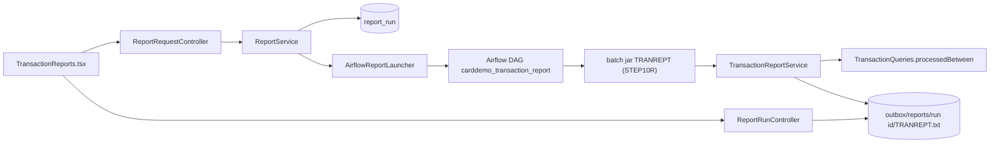

# Reporting

Active contributors: factory-aj-pahl

The `reporting` Maven module is bounded context BC-6. It ports CORPT00C (transaction CR00), the screen that requests a transaction report, and CBTRN03C, the batch program that writes it. The online part records and launches report runs through Airflow. The batch part, called by the TRANREPT job in the batch jar, writes the 133-byte report file.

## Purpose

On the mainframe, CORPT00C wrote JCL to an internal reader queue, and JOB-TRANREPT sorted a backup of the transaction file and ran CBTRN03C. In the modern stack:

1. The screen validates the request and starts one Airflow DAG run (`carddemo_transaction_report`) with the date range and the requester's user ID (Q-CORPT00C-07, -09).
2. The DAG runs `TRANREPT` in the batch jar, which calls this module's `TransactionReport` to write `TRANREPT.txt` into the outbox.
3. The screen and `/api/reports` list the user's runs with their state and a download link once the file exists.

A regular user's report covers only their linked accounts (D-REPORT). The full flow is described in [Transaction reports](../features/transaction-reports.md).

## Directory layout

```
modernization/backend/reporting/
  pom.xml
  src/main/java/com/carddemo/reporting/
    api/        TransactionReport
    internal/   AirflowReportLauncher, ReportLauncher, ReportRun, ReportRuns, ReportService,
                TransactionReportService
    web/        ReportRequestController, ReportRunController, RunView
  src/test/java/com/carddemo/reporting/
    ReportRequestScreenTest, ReportRunApiTest, ReportScreenTestBase,
    internal/AirflowReportLauncherTest
```

Size: 10 main files (877 lines) and 4 test files (737 lines), with 31 test methods. More report tests live in the batch jar: `modernization/backend/batch/src/test/java/com/carddemo/batch/TranreptJobTest.java` (8) and `modernization/backend/batch/src/test/java/com/carddemo/batch/ReportRequestJobTest.java` (2).

## Key abstractions

| Type | Path | Role |
|:--|:--|:--|
| `ReportRequestController` | `modernization/backend/reporting/src/main/java/com/carddemo/reporting/web/ReportRequestController.java` | `/api/screens/CORPT00C`: report type, date validation, confirmation, launch |
| `ReportRunController` | `modernization/backend/reporting/src/main/java/com/carddemo/reporting/web/ReportRunController.java` | `GET /api/reports`, `GET /api/reports/{runId}`, `GET /api/reports/{runId}/TRANREPT.txt` |
| `RunView` | `modernization/backend/reporting/src/main/java/com/carddemo/reporting/web/RunView.java` | One run as JSON; `downloadUrl` only once the file exists |
| `ReportService` | `modernization/backend/reporting/src/main/java/com/carddemo/reporting/internal/ReportService.java` | Records and launches runs, refreshes their state, finds the report file |
| `ReportLauncher` | `modernization/backend/reporting/src/main/java/com/carddemo/reporting/internal/ReportLauncher.java` | Interface: `launch(runId, Parameters)` and `state(runId)` |
| `AirflowReportLauncher` | `modernization/backend/reporting/src/main/java/com/carddemo/reporting/internal/AirflowReportLauncher.java` | Airflow 3 REST client: JWT from `/auth/token`, then `POST /api/v2/dags/carddemo_transaction_report/dagRuns` |
| `ReportRuns` / `ReportRun` | `modernization/backend/reporting/src/main/java/com/carddemo/reporting/internal/ReportRuns.java`, `modernization/backend/reporting/src/main/java/com/carddemo/reporting/internal/ReportRun.java` | The `report_run` table and its row record |
| `TransactionReport` | `modernization/backend/reporting/src/main/java/com/carddemo/reporting/api/TransactionReport.java` | Published batch interface: `write(start, end, accounts, reportFile)` |
| `TransactionReportService` | `modernization/backend/reporting/src/main/java/com/carddemo/reporting/internal/TransactionReportService.java` | CBTRN03C: headers, detail lines, card ("Account Total"), page, and grand totals |

## How it works



### Request screen

`ReportRequestController.enter` checks the report type first. The type is one enum value, Monthly, Yearly, or Custom (Q-CORPT00C-04); with none, the screen shows `Select a report type to print report...`.

- Monthly and Yearly use the current calendar month or year from the server clock (Q-CORPT00C-05).
- Custom checks the six date parts for blanks, pads digit-only parts with leading zeros, checks each part against its range, and then validates the full dates with `CalendarDates.isValid`.
  - A part with non-digit characters fails with that part's "Not a valid ..." message (Q-CORPT00C-01).
  - A two-digit year such as `22` is read as year 0022 and rejected by DF-8 (Q-CORPT00C-02).
  - A start date after the end date is accepted (Q-CORPT00C-03, preserved).

Confirm blank asks `Please confirm to print the <type> report...`. `N` clears the form. `Y` calls `ReportService.submit`, and the screen answers `<type> report submitted for printing ...` (Q-CORPT00C-10). Every response from this screen also lists the visible runs.

### Run records and launch

`ReportService.submit` builds a run ID of the form `CR00_<user>_<yyyyMMddTHHmmssSSS>_<4 hex>` and inserts a `queued` row into `report_run`. It then calls the launcher. If the launch throws, the row is deleted again, so a failed launch leaves nothing behind. The screen then shows the COBOL text `Unable to Write TDQ (JOBS)...`.

The `report_run` table comes from `modernization/backend/schema/src/main/resources/db/migration/V40__report_run.sql`. Its columns are `dag_run_id` (primary key), `report_type` (checked to Monthly, Yearly, or Custom), `start_date`, `end_date`, `user_id`, `requested_at`, `state`, and `state_checked_at`. It has two indexes, on `user_id, requested_at DESC` and on `requested_at DESC`.

`visibleRuns` returns the 10 newest runs (`ReportService.LISTED`): a USER's own runs, or every run for an ADMIN. For runs that are not yet `success` or `failed`, it asks Airflow for the current state and writes changes back to the table. `reportFile` looks for `<outbox>/reports/<runId>/TRANREPT.txt`. The outbox is `carddemo.reports.outbox`, falling back to `CARDDEMO_OUTBOX`, then `~/.carddemo/outbox`.

`AirflowReportLauncher` caches the JWT. On a 401 it fetches a new token once and repeats the call. It sends `logical_date: null` because Airflow 3.0 requires the key. Its settings are `carddemo.airflow.base-url` (default `http://127.0.0.1:8080`), `carddemo.airflow.username`, `carddemo.airflow.password`, and `carddemo.airflow.timeout-ms` (default 5000). The password has no default; see [Configuration](../reference/configuration.md).

### Report job (CBTRN03C)

The batch jar's TRANREPT job (`modernization/backend/batch/src/main/java/com/carddemo/batch/cycle/CycleJobsConfig.java`, step `STEP10R`) resolves the account filter before calling `TransactionReport.write`:

- No user ID, or an ADMIN: every account (`Optional.empty()`).
- A USER: `AccountScope.linkedAccounts(userId)` (D-REPORT).
- An unknown user ID: an empty set, so the report has no detail lines.

`TransactionReportService.write` then:

1. Writes to a `.part` file and moves it into place atomically at the end, so an abend leaves no report file.
2. Selects rows with `TransactionQueries.processedBetween`, which returns rows whose parsed processing timestamp is in range, ordered by card number and then transaction ID. Rows without a processing timestamp never appear (Q-CBTRN03C-11).
3. Skips rows whose card's cross-reference account is outside the filter.
4. Looks up type and category descriptions through `com.carddemo.refdata.api.TransactionCodeNames`. A missing one abends with the COBOL text, for example `INVALID TRANSACTION TYPE : `.
5. Follows the COBOL line counter for page breaks (20 lines, Q-CBTRN03C-04). Amounts are formatted with `ReportPictures.commaAmount`, and every line is padded to 133 characters.
6. Echoes each raw record to SYSOUT with bytes 263-274, the card number, masked (Q-CBTRN03C-08, B-MASK).

The reference patches RP-CBTRN03C-1 to -3 describe the fixed behavior, and the parity harness compares the output with the patched COBOL. See [Batch parity](../verification/batch-parity.md).

### Retention (DF-3)

The Java side does not delete report files. Retention lives in Airflow: `prune_reports` in `modernization/airflow/dags/carddemo_batch.py` keeps the report directories of the last 10 runs, by report file time, and deletes the rest. `modernization/airflow/dags/carddemo_transaction_report.py` calls it after each report. `report_run` rows are not pruned; a pruned run still appears in the list, but without a `downloadUrl`.

## Integration points

- `transaction.api` (`TransactionQueries`, `TransactionRecord`), `card.api` (`CardDirectory`, `CardXref`), and `refdata.api` (`TransactionCodeNames`).
- `common`: `JobLog`, `BatchAbend`, `UnlabeledAbend`, `FixedWidth`, `ReportPictures`, `Masking`, `CalendarDates`, and the screen envelope.
- Consumer of `reporting.api`: `modernization/backend/batch/src/main/java/com/carddemo/batch/cycle/CycleJobsConfig.java`. See [Batch jar](../applications/batch-jar.md) and [Airflow](../applications/airflow.md).
- Web: `modernization/web/src/screens/TransactionReports.tsx`. End-to-end: `modernization/e2e/tests/reports.spec.ts`. Byte-for-byte check of the browser report against CBTRN03C: `modernization/verification/schedule/verify_report.py` (see [Cycle, data, and report checks](../verification/cycle-data-and-report.md)).

## Tests

| Test | What it covers |
|:--|:--|
| `modernization/backend/reporting/src/test/java/com/carddemo/reporting/ReportRequestScreenTest.java` | Screen turns, for example `confirmed_monthly_launches_one_run_for_the_current_month_and_clears_the_form` and the leap-February month end |
| `modernization/backend/reporting/src/test/java/com/carddemo/reporting/ReportRunApiTest.java` | Download and visibility: `a_user_cannot_see_or_download_another_users_run_but_an_admin_can`, path tricks |
| `modernization/backend/reporting/src/test/java/com/carddemo/reporting/internal/AirflowReportLauncherTest.java` | Trigger body, token renewal, failed launches |
| `modernization/backend/batch/src/test/java/com/carddemo/batch/TranreptJobTest.java` | Report output: fixed end totals, out-of-range rows skipped, `a_user_request_covers_only_the_linked_accounts_and_an_admin_request_covers_all` |

`modernization/backend/reporting/src/test/java/com/carddemo/reporting/ReportScreenTestBase.java` replaces the launcher with a stub and points the outbox at a temporary directory.

## Specification and ledger

The spec files are `modernization/spec/programs/CORPT00C.md` and `modernization/spec/programs/CBTRN03C.md`. The ledger rows are in `modernization/decisions/ledger-online.md` (CORPT00C) and `modernization/decisions/ledger-batch-data.md` (CBTRN03C, TRANREPT).

| ID | Decision | Effect |
|:--|:--|:--|
| Q-CBTRN03C-01 | FIX | Out-of-range records are skipped instead of ending the report |
| Q-CBTRN03C-02, -03 | FIX | The last amount is no longer added twice, and the last card's total is printed |
| Q-CBTRN03C-06 | FIX | One date pair from the request drives selection and header; USER requests are filtered (D-REPORT) |
| Q-CORPT00C-07 | PLATFORM | The JCL submission becomes one job launch with start date, end date, and requester |
| Q-CORPT00C-02 | FIX (DF-8) | Two-digit years are rejected as dates before 1582-10-15 |

See [Fidelity ledger](../verification/fidelity-ledger.md).

## Entry points for modification

- Report layout changes go in `TransactionReportService.Run`. Check them against the parity harness before you change anything visible.
- To use a different scheduler, implement `ReportLauncher`. `ReportService` only depends on that interface.
- The number of listed runs (`ReportService.LISTED`) and the number of kept files (`REPORTS_KEPT` in `modernization/airflow/dags/carddemo_batch.py`) are separate settings. Change both together.

## Related pages

- [Modules](index.md)
- [Transaction](transaction.md), [Cycle](cycle.md)
- [REST endpoints](../api/rest-endpoints.md)
