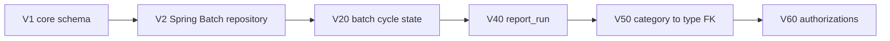
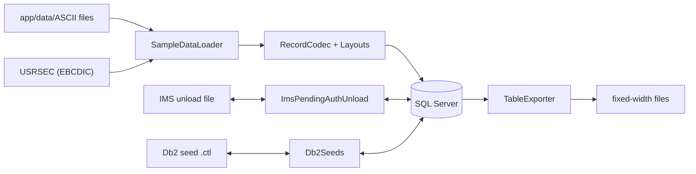

# Schema and migration

Active contributors: factory-aj-pahl

Three small Maven modules hold the data foundation of the modernized backend. `schema` owns the SQL Server schema as Flyway migrations, `migration` loads the legacy sample files into that schema and writes them back byte for byte, and `test-support` gives every other module's tests a clean migrated database, sample data, and a screen client.

## Purpose

On the mainframe, IDCAMS DEFINE jobs create the VSAM files and setup JCL loads them from flat files. In the target:

- `modernization/backend/schema` replaces the DEFINE jobs. Its `pom.xml` description reads "Flyway migrations for the SQL Server schema (replaces the IDCAMS DEFINE jobs)".
- `modernization/backend/migration` replaces the load jobs (ACCTFILE, CARDFILE, CUSTFILE, XREFFILE, TCATBALF, TRANTYPE, TRANCATG, DISCGRP, DUSRSECJ) and adds an exporter so a round trip can be compared with the original files.
- `modernization/backend/test-support` is a normal (non-test) jar that other modules add with `test` scope.

For the end-to-end load and round-trip flow see [Data migration](../features/data-migration.md). For the column-level description of every table see [Data models](../reference/data-models.md).

## Directory layout

```
modernization/backend/
  schema/src/main/resources/db/migration/
    V1__core_schema.sql
    V2__spring_batch.sql
    V20__batch_cycle.sql
    V40__report_run.sql
    V50__transaction_category_type_fk.sql
    V60__authorization.sql
  migration/src/main/java/com/carddemo/migration/
    SampleDataLoader, TableExporter, Layout, Layouts, RecordCodec,
    Db2Seeds, ImsPendingAuthUnload, PendingAuthSegments, PendingAuthTables
  test-support/src/main/java/com/carddemo/test/
    ScreenClient, SampleData, TestDatabaseConfig, TestApplication,
    Covers, DailyRecords, RepoPaths
  test-support/src/main/resources/config/application.properties
```

| Module | Main files | Main lines | Own tests |
|:--|:--|:--|:--|
| schema | 6 SQL files | 473 SQL lines | none |
| migration | 9 Java files | 1,028 | none |
| test-support | 7 Java files + 1 properties file | 283 | none |

None of the three has a `src/test` directory. The loader and exporter are exercised by the module tests that seed data through `SampleData`, by the batch jar commands `load`, `loaddb2`, and `export`, and by the round-trip check described in [Cycle, data, and report checks](../verification/cycle-data-and-report.md).

## Schema: Flyway migrations

The online API and the batch jar both point Flyway at `classpath:db/migration` (`modernization/backend/app/src/main/resources/application.properties` and `modernization/backend/batch/src/main/resources/application.properties`; the batch jar also sets `spring.flyway.clean-disabled=true`). The version numbers leave gaps so later migrations can be inserted per area.

| Migration | Tables and objects | Notes |
|:--|:--|:--|
| `modernization/backend/schema/src/main/resources/db/migration/V1__core_schema.sql` | `app_user`, `user_account`, `audit_log`, `customer`, `account`, `card`, `card_xref`, `card_transaction`, `id_counter` (seeded with `online_tran_id`), `tran_cat_balance`, `posting_reject`, `transaction_type`, `transaction_category`, `disclosure_group` | Base entities from `modernization/spec/entities.md`. Character keys use the `Latin1_General_BIN2` collation so browse order matches the byte order of the reference runs. `legacy_filler` columns keep non-blank FILLER bytes so an export reproduces the source. `card_transaction` keeps both the timestamp text (`*_ts_text`) and the parsed value (`*_ts`) (Q-ENT-08). Online-edited rows carry a `ROWVERSION`. |
| `modernization/backend/schema/src/main/resources/db/migration/V2__spring_batch.sql` | `BATCH_JOB_INSTANCE`, `BATCH_JOB_EXECUTION`, `BATCH_JOB_EXECUTION_PARAMS`, `BATCH_STEP_EXECUTION`, the two execution-context tables, and three sequences | The Spring Batch 5.2 job repository, copied from the spring-batch-core SQL Server script. It gives batch jobs their restart state (B-UOW, Q-CBTRN02C-07). |
| `modernization/backend/schema/src/main/resources/db/migration/V20__batch_cycle.sql` | `interest_account`, `statement_run`, `cycle_backup`, `cycle_backup_account`, `cycle_backup_transaction`, `cycle_backup_category`, `cycle_backup_interest` | INTCALC month tracking (Q-CBACT04C-08), CREASTMT statement runs (Q-CREASTMT-04, D-HISTORY), and the BACKUP/RESTORE snapshot tables (Q-TRANBKP-01, B-CYCLE). See [Daily batch cycle](../features/daily-batch-cycle.md). |
| `modernization/backend/schema/src/main/resources/db/migration/V40__report_run.sql` | `report_run` | One row per report DAG run started from CORPT00C; the row is also the access check for the download (Q-CORPT00C-07, -09, -10). See [Transaction reports](../features/transaction-reports.md). |
| `modernization/backend/schema/src/main/resources/db/migration/V50__transaction_category_type_fk.sql` | Foreign key `fk_transaction_category_type` | A category must belong to an existing type, and a type with categories cannot be deleted (the Db2 module's `ON DELETE RESTRICT`, ERR-COTRTLIC-13). |
| `modernization/backend/schema/src/main/resources/db/migration/V60__authorization.sql` | `pending_auth_summary`, `pending_auth_detail`, `auth_fraud_report`, `auth_error_log` | Replaces the IMS database DBPAUTP0, the Db2 table AUTHFRDS, and the COPAUA0C error log. Money is `DECIMAL(12,2)` (Q-ENT-26). `legacy_*` columns keep segment bytes that have no column so a migrated database unloads byte for byte. See [Pending authorizations](../features/pending-authorizations.md). |



## Migration: loader and exporter

The loader turns fixed-width legacy records into rows, column by column, using a declarative layout per file.

| Class | File | What it does |
|:--|:--|:--|
| `Layout` | `modernization/backend/migration/src/main/java/com/carddemo/migration/Layout.java` | A record layout: file name, table, record length, fields, and export order. Each field has a column, zero-based copybook offset, length, and kind (`TEXT`, `UNSIGNED`, `SIGNED`, `DATE`, `TIMESTAMP_TEXT`). Bytes outside any field are FILLER: ignored on load (Q-ENT-12), written as spaces on export. |
| `Layouts` | `modernization/backend/migration/src/main/java/com/carddemo/migration/Layouts.java` | The nine base layouts in load order: `trantype.txt`, `trancatg.txt`, `discgrp.txt`, `custdata.txt`, `acctdata.txt`, `carddata.txt`, `cardxref.txt`, `tcatbal.txt`, `transact.txt`. Reference data comes before masters. |
| `RecordCodec` | `modernization/backend/migration/src/main/java/com/carddemo/migration/RecordCodec.java` | Decodes a record into a column map and encodes a row back, using `FixedWidth`, `Overpunch`, and `LegacyTimestamps` from [Common](common.md). A `TIMESTAMP_TEXT` field fills both the text column and its parsed column. |
| `SampleDataLoader` | `modernization/backend/migration/src/main/java/com/carddemo/migration/SampleDataLoader.java` | `clear()` deletes the base tables children first and resets the online ID counter. `loadDirectory()` batch-inserts every layout whose file exists, then moves a group ID found in the ZIP slot to the group slot (Q-ENT-02, RP-DATA-1). `loadUsers()` reads the EBCDIC (code page 037) USRSEC file of 80-byte records, hashes each password with BCrypt (Q-COSGN00C-01), rejects user types other than `A`/`U` (Q-COSGN00C-07), and links accounts round-robin to the regular users (D-SEED). The BCrypt cost is 12 by default and lower in tests. |
| `TableExporter` | `modernization/backend/migration/src/main/java/com/carddemo/migration/TableExporter.java` | Writes each table back in its layout, one LF-terminated record per row, in key order. |
| `Db2Seeds` | `modernization/backend/migration/src/main/java/com/carddemo/migration/Db2Seeds.java` | Parses and writes the Db2 seed files `DB2LTTYP.ctl` and `DB2LTCAT.ctl` of the transaction-type module. They are SQL text (`INSERT ... SELECT ... UNION ALL`), not records. The writer reproduces the delivered files byte for byte, license header and column alignment included. |
| `ImsPendingAuthUnload` | `modernization/backend/migration/src/main/java/com/carddemo/migration/ImsPendingAuthUnload.java` | Reads and writes the DFSURGU0 IMS unload of DBPAUTP0: variable records with a 4-byte length prefix, a statistics header, one record per segment in hierarchic order, and a statistics trailer. A root whose key is not a valid account number is skipped with its children (Q-PAUDBUNL-02). |
| `PendingAuthSegments` | `modernization/backend/migration/src/main/java/com/carddemo/migration/PendingAuthSegments.java` | Byte layouts of the 100-byte summary root PAUTSUM0 and the 200-byte detail child PAUTDTL1 in code page 037, with `Packed` keys. Also used at runtime by the authorization module. |
| `PendingAuthTables` | `modernization/backend/migration/src/main/java/com/carddemo/migration/PendingAuthTables.java` | Row mappers and inserts for `pending_auth_summary` and `pending_auth_detail`, details newest first (Q-ENT-27). |



### Who calls the migration module

- `modernization/backend/batch/src/main/java/com/carddemo/batch/BatchCommandLine.java` runs the loader for the `load` command (sample files, USRSEC, IMS unload), `Db2Seeds` for `loaddb2`, and `TableExporter`, `Db2Seeds`, and `ImsPendingAuthUnload` for `export`. See [Batch jar](../applications/batch-jar.md).
- The authorization context uses `PendingAuthSegments` and `PendingAuthTables` in its repository, purge, unload, and load jobs (for example `modernization/backend/authorization/src/main/java/com/carddemo/authorization/internal/PendingAuthRepository.java`).
- The data exchange context uses `Layouts` and `RecordCodec` (`modernization/backend/dataexchange/src/main/java/com/carddemo/dataexchange/internal/ExportJob.java`, `modernization/backend/dataexchange/src/main/java/com/carddemo/dataexchange/internal/JdbcTables.java`).

## Test support

| Class | File | What it does |
|:--|:--|:--|
| `TestApplication` | `modernization/backend/test-support/src/main/java/com/carddemo/test/TestApplication.java` | `@SpringBootApplication(scanBasePackages = "com.carddemo")`: a module's tests start every component on their classpath (the module and its dependencies). |
| `TestDatabaseConfig` | `modernization/backend/test-support/src/main/java/com/carddemo/test/TestDatabaseConfig.java` | A Flyway strategy that runs `clean()` then `migrate()`, so every test application context starts from a freshly migrated database. |
| `SampleData` | `modernization/backend/test-support/src/main/java/com/carddemo/test/SampleData.java` | `clear()` and `load()`: the ASCII sample files, the 10 USRSEC users (BCrypt cost 4 for speed), and the round-robin account links. |
| `ScreenClient` | `modernization/backend/test-support/src/main/java/com/carddemo/test/ScreenClient.java` | Drives `/api/screens/<PROGRAM>` through MockMvc like the web app: one session, CSRF token attached, JSON in and out. Follows the new session after sign-on and a fresh one after sign-off. It holds a constant for the demo password documented in the root `README.md`. |
| `Covers` | `modernization/backend/test-support/src/main/java/com/carddemo/test/Covers.java` | Annotation listing the rule, scenario, and ledger IDs a test verifies (for example `BR-COBIL00C-03`). `modernization/verification/trace.py` joins these tags with JUnit results. See [Traceability](../verification/traceability.md). |
| `DailyRecords` | `modernization/backend/test-support/src/main/java/com/carddemo/test/DailyRecords.java` | Builds 350-byte DALYTRAN records from `app/data/ASCII/dailytran.txt`, with helpers to change the transaction ID, card, amount, timestamp, and type. |
| `RepoPaths` | `modernization/backend/test-support/src/main/java/com/carddemo/test/RepoPaths.java` | Finds the repository root (the directory holding `app/cbl` and `modernization`) and the sample data paths. |

`modernization/backend/test-support/src/main/resources/config/application.properties` points tests at the database named by `CARDDEMO_TEST_DB` (default `carddemo_test`), reads the database and RabbitMQ passwords from environment variables, enables Flyway clean, stops RabbitMQ listeners from starting, and sets the BCrypt cost to 4.

Usage across the backend (files that reference each class, test code): `Covers` is used in every module with tests (799 `@Covers` annotations in total), `ScreenClient` in 11 modules, `SampleData` in 13, and `TestDatabaseConfig` explicitly in the batch and billpay-service tests (other modules get it through `TestApplication`'s component scan).

## Entry points for modification

- **New table or column.** Add a new `V<n>__<name>.sql` file; never edit an applied migration. If the table mirrors a legacy file, add a `Layout` to `Layouts.BASE` and add the table to `SampleDataLoader.TABLES` in child-first order.
- **New legacy file format.** Write a codec next to `ImsPendingAuthUnload` or `Db2Seeds`, wire it into `BatchCommandLine`, and add it to the owed files of the data round trip.
- **New shared test helper.** Put it in `test-support` only if two or more modules need it; module-specific base classes stay in the module (for example `modernization/backend/card/src/test/java/com/carddemo/card/CardScreenTestSupport.java`).

## Key source files

| File | Purpose |
|:--|:--|
| `modernization/backend/schema/src/main/resources/db/migration/V1__core_schema.sql` | Base schema |
| `modernization/backend/migration/src/main/java/com/carddemo/migration/Layouts.java` | All base record layouts |
| `modernization/backend/migration/src/main/java/com/carddemo/migration/SampleDataLoader.java` | Sample data, users, links |
| `modernization/backend/migration/src/main/java/com/carddemo/migration/ImsPendingAuthUnload.java` | IMS unload format |
| `modernization/backend/test-support/src/main/java/com/carddemo/test/ScreenClient.java` | Screen-turn test client |
| `modernization/backend/test-support/src/main/java/com/carddemo/test/Covers.java` | Rule-ID tagging for traceability |

## Related pages

- [Data migration](../features/data-migration.md)
- [Data models](../reference/data-models.md)
- [Common](common.md)
- [Modules](index.md)
- [Testing](../how-to-contribute/testing.md)
