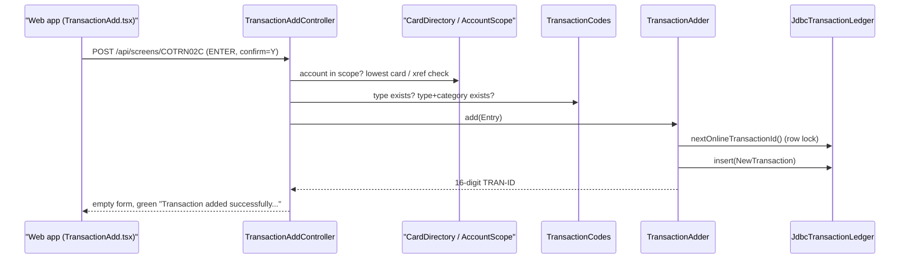

# Transaction

Active contributors: factory-aj-pahl

The `transaction` Maven module is bounded context BC-4. It ports the three CICS transaction screens (COTRN00C list, COTRN01C view, COTRN02C add) and owns the `card_transaction` table that every other writer and reader of transactions goes through.

## Purpose

The module has two jobs:

- Serve the screens `/api/screens/COTRN00C`, `/api/screens/COTRN01C`, and `/api/screens/COTRN02C` with the COBOL messages, field lengths, and paging rules, plus the security fixes from the fidelity ledger (masking, account scoping).
- Publish the transaction table through its `api` package: `TransactionLedger` for online writers (transaction add and bill payment, plus the batch posting and interest steps), and `TransactionQueries` for batch readers (TRANREPT and CREASTMT).

CSUTLDTC, the COBOL date-validation subroutine, has no class of its own here. It became `modernization/backend/common/src/main/java/com/carddemo/common/date/CalendarDates.java` in the shared kernel. The tests for it live in this module (`modernization/backend/transaction/src/test/java/com/carddemo/transaction/CalendarDatesTest.java`), because COTRN02C is its main caller. See [Common](common.md).

## Directory layout

```
modernization/backend/transaction/
  pom.xml
  src/main/java/com/carddemo/transaction/
    api/        NewTransaction, TransactionLedger, TransactionQueries, TransactionRecord
    internal/   JdbcTransactionLedger, JdbcTransactionQueries, TransactionAdder
    web/        TransactionListController, TransactionViewController, TransactionAddController,
                TransactionReader, Input, Selection
  src/test/java/com/carddemo/transaction/
    CalendarDatesTest, TimestampOrderingTest, TransactionAddScreenTest, TransactionFailureTest,
    TransactionListScreenTest, TransactionScreenTestBase, TransactionTurnRulesTest,
    TransactionViewScreenTest
```

Size: 13 main files (1,097 lines) and 8 test files (1,396 lines), with 73 `@Test`/`@ParameterizedTest` methods. The test code is about 1.3 times the size of the main code.

## Key abstractions

| Type | Path | Role |
|:--|:--|:--|
| `TransactionListController` | `modernization/backend/transaction/src/main/java/com/carddemo/transaction/web/TransactionListController.java` | COTRN00C (transaction CT00): 10 rows per page, keyset paging with PF7/PF8, `S` selection hands off to the view |
| `TransactionViewController` | `modernization/backend/transaction/src/main/java/com/carddemo/transaction/web/TransactionViewController.java` | COTRN01C (CT01): exact key lookup, masked card number, PF3 returns to the caller |
| `TransactionAddController` | `modernization/backend/transaction/src/main/java/com/carddemo/transaction/web/TransactionAddController.java` | COTRN02C (CT02): key validation, field validation in COBOL order, Y/N confirmation, PF5 copies the last transaction |
| `TransactionReader` | `modernization/backend/transaction/src/main/java/com/carddemo/transaction/web/TransactionReader.java` | Unlocked reads for the screens, filtered to the user's linked accounts |
| `TransactionAdder` | `modernization/backend/transaction/src/main/java/com/carddemo/transaction/internal/TransactionAdder.java` | Takes the next ID and inserts the row in one database transaction |
| `JdbcTransactionLedger` | `modernization/backend/transaction/src/main/java/com/carddemo/transaction/internal/JdbcTransactionLedger.java` | Row-locked ID counter and the insert |
| `JdbcTransactionQueries` | `modernization/backend/transaction/src/main/java/com/carddemo/transaction/internal/JdbcTransactionQueries.java` | Batch reads: date-range selection, statement coverage marks, highest ID by prefix |
| `TransactionLedger` | `modernization/backend/transaction/src/main/java/com/carddemo/transaction/api/TransactionLedger.java` | Published write interface |
| `TransactionQueries` | `modernization/backend/transaction/src/main/java/com/carddemo/transaction/api/TransactionQueries.java` | Published batch-read interface |
| `NewTransaction` | `modernization/backend/transaction/src/main/java/com/carddemo/transaction/api/NewTransaction.java` | One CVTRA05Y record to insert, with timestamp text and parsed value side by side (Q-ENT-08) |
| `TransactionRecord` | `modernization/backend/transaction/src/main/java/com/carddemo/transaction/api/TransactionRecord.java` | One stored row for batch readers; `legacy()` rebuilds the 350-byte TRAN-RECORD |

## How it works

### Screens

Each controller follows the screen API contract described in [Screen API](../api/screen-api.md): `GET` is the first entry and `POST` is one turn with an attention key. State that the COMMAREA used to carry between turns is kept in the HTTP session:

- The list keeps a `Position` record (first and last ID, page number, next-page flag, row keys) under `carddemo.transaction.list`.
- A row selected with `S` is stored as a `Selection` (`modernization/backend/transaction/src/main/java/com/carddemo/transaction/web/Selection.java`). The view consumes it on its first entry and remembers whether it came from the list or the menu, so PF3 goes back to the right place.
- The add screen holds the full card number behind the masked card field as a `HeldCard` under `carddemo.transaction.add.card` (Q-COTRN02C-15).

`TransactionReader` sits in the `web` package rather than `internal`. Its class comment explains why: the batch jar scans `transaction.internal`, and the reader depends on the IAM account scope, which the batch jar does not have. For a USER, `scopeOf` turns the linked accounts into a list of cards and every query adds `card_num IN (:cards)`. An ADMIN gets an unrestricted scope. See [Account scoping](../features/account-scoping.md).

List paging is keyset paging on `tran_id` (`>=`, `>`, or `<` the boundary key) with one look-ahead row to set the next-page flag. A backward page that reaches the start of the in-scope rows shows the first 10 rows as page 1 (Q-COTRN00C-11).

### Adding a transaction



Key validation (`keys` in `TransactionAddController`) applies these ledger fixes:

- If only the account is typed, the card is the account's lowest card number, from `CardDirectory.lowestCardForAccount` (DF-6, Q-COTRN02C-07). The card is shown masked.
- If both are typed, the card must belong to the account, or the screen shows `Card Number does not match the Account ID...` (Q-COTRN02C-06).
- Out-of-scope accounts and cards get the normal not-found messages (Q-COTRN02C-14).

Field validation (`validate`) checks the fields in COBOL order and reports only the first failure (Q-COTRN02C-11). It adds lookups against the type and category reference tables through `com.carddemo.refdata.api.TransactionCodes` (Q-COTRN02C-09). Dates go through `CalendarDates.isValid`, which rejects dates before 1582-10-15 (DF-8, Q-COTRN02C-12).

`TransactionAdder.add` runs in one `@Transactional` method. `JdbcTransactionLedger.nextOnlineTransactionId` requires an existing transaction (`Propagation.MANDATORY`). Inside one SQL batch it:

1. Updates the `online_tran_id` row of `id_counter` to take its exclusive lock.
2. Reads the highest all-numeric `tran_id`.
3. Sets the counter to the larger of the two plus one.

Every other online writer waits on that lock until the surrounding transaction commits, so concurrent adds and bill payments never get the same ID (Q-COTRN02C-01, Q-COBIL00C-01). IDs that are not all digits, such as INTCALC's date-prefixed IDs, are ignored. A failure maps to the COBOL texts `Unable to lookup Transaction...`, `Tran ID already exist...`, or `Unable to Add Transaction...`.

## Integration points

The module depends on `card.api` (`CardDirectory`, `CardXref`), `refdata.api` (`TransactionCodes`), and `common` (screen envelope, `Pic`, `Masking`, `AccountScope`, `CalendarDates`).

Consumers of the published API (found by import):

| Consumer | Uses |
|:--|:--|
| `modernization/backend/billpay/src/main/java/com/carddemo/billpay/internal/BillPaymentService.java` | `TransactionLedger`, `NewTransaction` for the payment row ([Bill payment](billpay.md)) |
| `modernization/backend/cycle/src/main/java/com/carddemo/cycle/internal/PostingService.java` | `TransactionLedger.insert` for posted daily records ([Cycle](cycle.md)) |
| `modernization/backend/cycle/src/main/java/com/carddemo/cycle/internal/InterestService.java` | `TransactionLedger`, `TransactionQueries.highestIdWithPrefix` for interest rows |
| `modernization/backend/cycle/src/main/java/com/carddemo/cycle/internal/StatementService.java` | `TransactionQueries.coverUncovered` and `coveredBy` (D-HISTORY) |
| `modernization/backend/cycle/src/main/java/com/carddemo/cycle/internal/DailyRecord.java` | `NewTransaction` |
| `modernization/backend/reporting/src/main/java/com/carddemo/reporting/internal/TransactionReportService.java` | `TransactionQueries.processedBetween`, `TransactionRecord` ([Reporting](reporting.md)) |
| `modernization/backend/billpay-service/src/main/java/com/carddemo/billpayservice/BillPayServiceApplication.java` | Scans `transaction.api` and `transaction.internal` ([Bill-payment service](../applications/billpay-service.md)) |

The web screens are `modernization/web/src/screens/TransactionList.tsx`, `modernization/web/src/screens/TransactionView.tsx`, and `modernization/web/src/screens/TransactionAdd.tsx`. The browser suite is `modernization/e2e/tests/transaction.spec.ts`. The table itself is defined in the schema module; see [Data models](../reference/data-models.md).

## Tests

| Test | What it covers |
|:--|:--|
| `modernization/backend/transaction/src/test/java/com/carddemo/transaction/TransactionListScreenTest.java` | Paging, search, selection, and boundary messages over the sample data |
| `modernization/backend/transaction/src/test/java/com/carddemo/transaction/TransactionViewScreenTest.java` | Lookup, masking, PF3 back to the caller |
| `modernization/backend/transaction/src/test/java/com/carddemo/transaction/TransactionAddScreenTest.java` | Key rules, for example `account_with_several_cards_uses_the_lowest` and `a_card_of_another_account_does_not_match` |
| `modernization/backend/transaction/src/test/java/com/carddemo/transaction/TransactionFailureTest.java` | Read and write failures, including `write_failures_roll_back` |
| `modernization/backend/transaction/src/test/java/com/carddemo/transaction/TransactionTurnRulesTest.java` | Empty-input turns, continuing conversations, and the lock-free view (`viewing_takes_no_lock_so_a_row_held_for_update_can_still_be_viewed`) |
| `modernization/backend/transaction/src/test/java/com/carddemo/transaction/TimestampOrderingTest.java` | Ordering by parsed timestamp (Q-ENT-08) |
| `modernization/backend/transaction/src/test/java/com/carddemo/transaction/CalendarDatesTest.java` | CSUTLDTC rules as a pure function (TS-CSUTLDTC-01 to -06, DF-8) |

Tests tag the rule IDs they cover with `@Covers` from test-support. See [Traceability](../verification/traceability.md).

## Specification and ledger

Spec files: `modernization/spec/programs/COTRN00C.md`, `modernization/spec/programs/COTRN01C.md`, `modernization/spec/programs/COTRN02C.md`, `modernization/spec/programs/CSUTLDTC.md`. Ledger rows are in `modernization/decisions/ledger-online.md`. These rows have the most effect on the code:

| ID | Decision | Effect |
|:--|:--|:--|
| Q-COTRN02C-01 | FIX | One locked counter shared by all online writers replaces "highest key + 1" with no lock |
| Q-COTRN02C-07 | FIX (DF-6) | An account with several cards uses the lowest card number instead of failing on DUPKEY |
| Q-COTRN00C-08, Q-COTRN01C-07 | CHANGE (D-USER-ACCT) | A USER sees only transactions of cards on linked accounts |
| Q-COTRN00C-10 | FIX | Keyset paging on exclusive bounds, so deleted boundary rows cause no skips or repeats |
| Q-COTRN02C-04 | FIX | PF5 copies the highest in-scope transaction and validates it, but never writes in the same keystroke |

See [Fidelity ledger](../verification/fidelity-ledger.md) for the decision values.

## Entry points for modification

- A new screen rule usually goes in `TransactionAddController.validate` or `keys`. Keep the COBOL order and the one-message-at-a-time behavior.
- A new batch read belongs in `TransactionQueries` and `JdbcTransactionQueries`, not in the consuming module. Module boundaries are enforced by `modernization/backend/app/src/test/java/com/carddemo/app/ModuleBoundariesTest.java`.
- Do not move `TransactionReader` into `internal`; the batch jar would then need the IAM account scope.

## Related pages

- [Modules](index.md)
- [Card](card.md), [Account](account.md), [Reference data](refdata.md)
- [Online API](../applications/online-api.md)
