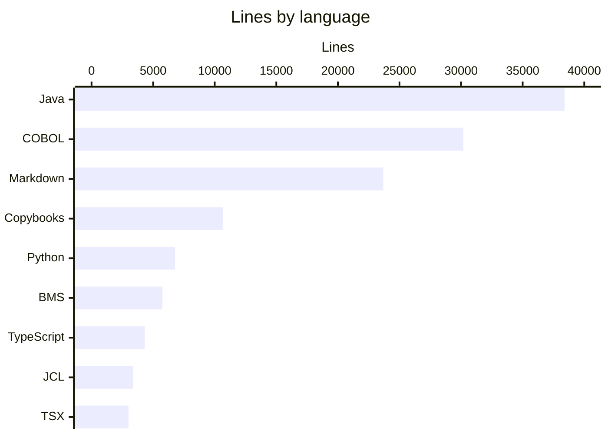
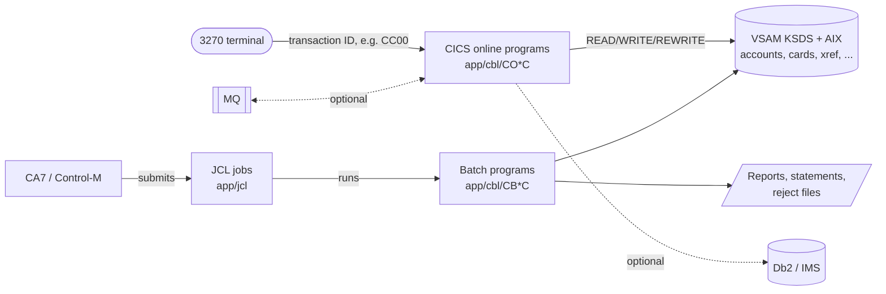
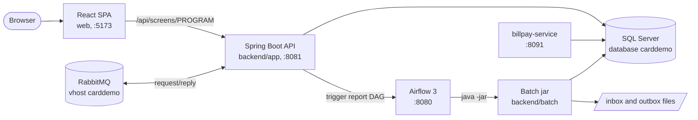
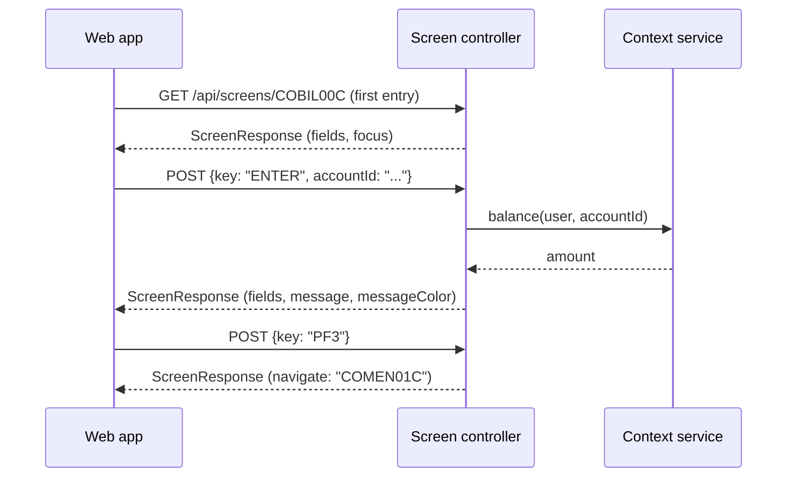
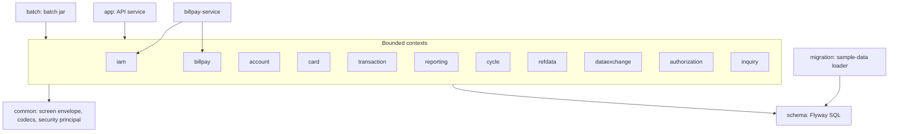
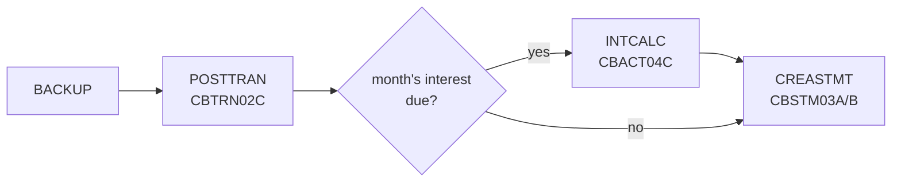

# Architecture

CardDemo exists twice in this repository: as the original mainframe application in `app/` and as a modern rebuild in `modernization/` that keeps the same screens, messages, data layouts, and batch outputs. This page describes both runtimes, how one maps onto the other, and how the modern code is organized. The authoritative design document is `modernization/architecture.md`; where it and a decision in `modernization/decisions/` disagree, the decision governs.

## Language breakdown

Line counts of tracked files at commit 467e0f0 (sample data and images excluded).

The Java and the COBOL are about the same size, which is expected: the backend is a near line-for-line behavioral restatement of 44 COBOL programs. Much of the Markdown is the specification (`modernization/spec/programs/*.md`) and the decision ledgers.

## The mainframe runtime

Online programs are pseudo-conversational CICS programs: each user turn starts the program, which reads the screen, acts, sends the BMS map, and returns, passing state in the COMMAREA (`app/cpy/COCOM01Y.cpy`). Navigation between screens is `XCTL`. Batch jobs run nightly under a scheduler and read and write the same VSAM files. Details are in [Mainframe application](../mainframe/index.md).

## The modern runtime

| Process | Source | Role |
|:--|:--|:--|
| Web app | `modernization/web` | One React route per CICS screen (`/screens/:program`), F-key bar, message line. See [Web app](../applications/web-app.md) |
| Online API | `modernization/backend/app` | Spring Boot service that assembles every bounded-context module. See [Online API](../applications/online-api.md) |
| Batch jar | `modernization/backend/batch` | Spring Batch command line for POSTTRAN, INTCALC, CREASTMT, TRANREPT, export/import, listings, IMS-module jobs, data load. See [Batch jar](../applications/batch-jar.md) |
| Airflow | `modernization/airflow` | DAGs that replace JCL and the CA7/Control-M schedules. See [Airflow](../applications/airflow.md) |
| Bill-payment service | `modernization/backend/billpay-service` | The same bill-payment code deployed alone. See [Bill-payment service](../applications/billpay-service.md) |

SQL Server and RabbitMQ run as systemd services on the same machine. Everything binds to 127.0.0.1 (`modernization/README.md`).

## Mapping the mainframe to the target

| Mainframe layer | Target |
|:--|:--|
| 21 BMS maps, CICS pseudo-conversational programs, PF keys, COMMAREA | React SPA, one route per screen; keyboard shortcuts keep F3/F5/F7/F8/F12 meaning; state in the URL and the server session |
| CICS program logic | Spring Boot REST controllers, one Maven module per bounded context |
| Batch COBOL programs | Spring Batch jobs in a separate jar, same fixed-width file outputs |
| JCL, CA7, Control-M | Airflow DAGs calling the jar; setup JCL becomes Flyway migrations and a data loader |
| VSAM KSDS and alternate indexes | SQL Server tables with primary keys, foreign keys, secondary indexes (`modernization/backend/schema/src/main/resources/db/migration/`) |
| Db2 tables, IMS HIDAM segments | SQL Server tables; IMS parent and child become `pending_auth_summary` and `pending_auth_detail` |
| MQ request/reply | RabbitMQ queues with the COBOL queue names, plus equivalent REST endpoints |
| RACF and plaintext USRSEC passwords | Spring Security, BCrypt hashes, server-side role checks |

## The screen API

The central design choice is that the server, not the browser, owns screen behavior. Each CICS program with a map is one resource, `/api/screens/<PROGRAM>`:

Every response is a `ScreenResponse` record (`modernization/backend/common/src/main/java/com/carddemo/common/screen/ScreenResponse.java`) with `fields`, `message`, `messageColor`, `focus`, and `navigate`. The controller decides what every key means, including the "invalid key" message, so the web app stays thin. `navigate` replaces `XCTL`. Message texts are copied verbatim from the COBOL. See [Screen API](../api/screen-api.md).

## Backend modules

`modernization/backend/pom.xml` lists 18 Maven modules. Eleven are bounded contexts, each with three packages:

- `web`: REST controllers (screen endpoints and plain REST endpoints)
- `internal`: services and JDBC repositories
- `api`: interfaces and records that other contexts may use

A context reaches another only through that context's `api` package, and `api` packages hold only interfaces and records. `modernization/backend/app/src/test/java/com/carddemo/app/ModuleBoundariesTest.java` enforces both rules with ArchUnit, and also checks that `common` depends on no context. This is what lets `billpay-service` run bill payment alone ("selective conversion"); `modernization/spec/components.md` lists what each context needs from the others. The [Modules](../modules/index.md) section has one page per module.

## Batch and scheduling

The Airflow DAG `carddemo_daily_cycle` (`modernization/airflow/dags/carddemo_daily_cycle.py`) runs the batch jar for each step through `modernization/airflow/dags/carddemo_batch.py`. Exit codes 0 and 4 succeed; anything else fails the task without retry. Each daily record commits with its effects, so a failed POSTTRAN restarts from its last committed record. The cycle is explained in [Daily batch cycle](../features/daily-batch-cycle.md).

## Data

The schema is derived from `modernization/spec/entities.md`: DECIMAL for signed zoned amounts, DATE and DATETIME2 for text dates and timestamps, CHAR for fixed codes, and a `rowversion` on rows edited online for optimistic concurrency. A loader (`modernization/backend/migration`) decodes the ASCII sample files, including overpunched signs, and a reverse exporter writes them back so the load can be checked byte for byte. See [Data models](../reference/data-models.md) and [Data migration](../features/data-migration.md).

## Verification

The modern code is accepted by evidence rather than review alone:

- Batch jobs are run against the original COBOL compiled with GnuCOBOL and compared record for record ([Batch parity](../verification/batch-parity.md)).
- The specification's test scenarios become JUnit and Playwright tests, and `modernization/verification/trace.py` maps every BR, VR, NAV, and ERR rule to a passing test or an approved exclusion ([Traceability](../verification/traceability.md)).
- A full Airflow cycle and the browser report download are compared with the GnuCOBOL chain ([Cycle, data, and report checks](../verification/cycle-data-and-report.md)).

## Related pages

- [Getting started](getting-started.md) for building and running both halves
- [Design decisions](../background/design-decisions.md) for why the architecture looks like this
- [Security](../security.md) for the trust boundaries
