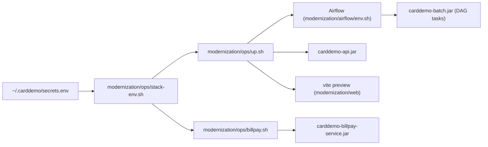

# Configuration

CardDemo's modern stack is configured through four Spring `application.properties` files, a small set of `carddemo.*` custom properties, and environment variables read by the ops scripts, Airflow, and the test suites. Passwords never appear in the repository: they come from the environment, normally loaded from `~/.carddemo/secrets.env` by `modernization/ops/stack-env.sh`. This page lists names and defaults only. Secret values are never shown.

## Overview

Configuration flows in three layers:

1. `modernization/ops/stack-env.sh` (sourced by every `modernization/ops/*.sh` script and by the `STACK_ENV` prefix in `modernization/Makefile`) sets ports, paths, and the database name, and reads the secrets file only when `CARDDEMO_DB_PASSWORD` is not already set.
2. `modernization/airflow/env.sh` sets the Airflow 3 settings and the batch inbox and outbox.
3. Each Spring Boot jar reads its `application.properties` and resolves `${VAR:default}` placeholders from the environment. Spring's relaxed binding also lets an environment variable such as `SERVER_PORT` override `server.port` even where the file has a fixed value.

See [Deployment](../deployment.md) for how the stack is started and [Security](../security.md) for how secrets are handled.

## Spring property files

### Online API

File: `modernization/backend/app/src/main/resources/application.properties`.

| Property | Value or default | Meaning |
|:--|:--|:--|
| `server.address` | `127.0.0.1` | Bind address; the API is never exposed beyond loopback |
| `server.port` | `8081` | HTTP port; `modernization/ops/up.sh` overrides it with `SERVER_PORT=$CARDDEMO_API_PORT` |
| `server.servlet.session.timeout` | `15m` | Servlet session timeout (the idle timeout itself is `carddemo.security.idle-timeout`) |
| `server.servlet.session.cookie.http-only` | `true` | Session cookie not readable by scripts |
| `server.servlet.session.cookie.same-site` | `strict` | Session cookie sent only on same-site requests |
| `spring.application.name` | `carddemo-api` | Application name |
| `spring.datasource.url` | `jdbc:sqlserver://127.0.0.1:1433;databaseName=${CARDDEMO_DB:carddemo};encrypt=true;trustServerCertificate=true` | SQL Server connection; database from `CARDDEMO_DB` |
| `spring.datasource.username` | `carddemo_app` | SQL login |
| `spring.datasource.password` | from environment (`CARDDEMO_DB_PASSWORD`) | SQL login password |
| `spring.flyway.locations` | `classpath:db/migration` | Migrations from the schema module |
| `management.endpoints.web.exposure.include` | `health` | Only `/actuator/health` is exposed |
| `management.endpoint.health.probes.enabled` | `true` | Liveness and readiness probe groups |
| `spring.rabbitmq.host` / `port` | `127.0.0.1` / `5672` | RabbitMQ broker |
| `spring.rabbitmq.username` | `carddemo` | RabbitMQ user |
| `spring.rabbitmq.virtual-host` | `carddemo` | RabbitMQ vhost |
| `spring.rabbitmq.password` | from environment (`RABBITMQ_PASSWORD`) | RabbitMQ password |
| `carddemo.airflow.base-url` | `${AIRFLOW_BASE_URL:http://127.0.0.1:8080}` | Airflow REST API for report runs |
| `carddemo.airflow.username` | `${AIRFLOW_USERNAME:admin}` | Airflow user (the stack scripts set `carddemo`) |
| `carddemo.airflow.password` | from environment (`AIRFLOW_PASSWORD`, empty default) | Airflow password, read by `modernization/ops/up.sh` from the generated password file |
| `carddemo.reports.outbox` | `${CARDDEMO_OUTBOX:${user.home}/.carddemo/outbox}` | Where TRANREPT output is read from (`<outbox>/reports/<run id>/`) |

### Batch jar

File: `modernization/backend/batch/src/main/resources/application.properties`.

| Property | Value or default | Meaning |
|:--|:--|:--|
| `spring.application.name` | `carddemo-batch` | Application name |
| `spring.main.web-application-type` | `none` | No web server |
| `spring.main.banner-mode` | `off` | Standard output carries only job SYSOUT |
| `spring.batch.job.enabled` | `false` | Jobs run only from the command line handler, not at startup |
| `spring.batch.jdbc.initialize-schema` | `never` | The Spring Batch tables come from Flyway `V2__spring_batch.sql` |
| `spring.datasource.url` / `username` | same as the API | SQL Server, database `CARDDEMO_DB` |
| `spring.datasource.password` | from environment (`CARDDEMO_DB_PASSWORD`) | SQL login password |
| `spring.flyway.locations` | `classpath:db/migration` | Migrations |
| `spring.flyway.clean-disabled` | `true` | Flyway clean can never drop the stack database |
| `spring.autoconfigure.exclude` | `UserDetailsServiceAutoConfiguration` | No generated in-memory user |
| `logging.threshold.console` | `OFF` | Application logs never reach standard output |
| `logging.file.name` | `${CARDDEMO_LOG_DIR:${java.io.tmpdir}}/carddemo-batch.log` | Application log file |

### Standalone bill-payment service

File: `modernization/backend/billpay-service/src/main/resources/application.properties`.

| Property | Value or default | Meaning |
|:--|:--|:--|
| `server.address` | `127.0.0.1` | Bind address |
| `server.port` | `${SERVER_PORT:8091}` | HTTP port; `modernization/ops/billpay.sh` passes `CARDDEMO_BILLPAY_PORT` |
| `server.servlet.session.*` | `15m`, `http-only=true`, `same-site=strict` | Same session settings as the API |
| `spring.application.name` | `carddemo-billpay-service` | Application name |
| `spring.datasource.*` | same as the API; password from environment | Shares the CardDemo database |
| `spring.flyway.locations` | `classpath:db/migration` | Migrations |
| `management.endpoints.web.exposure.include` | `health` | Health endpoint only |
| `carddemo.features.disabled-programs` | `COACTVWC,COACTUPC,COCRDLIC,COCRDSLC,COCRDUPC,COTRN00C,COTRN01C,COTRN02C,CORPT00C,COPAUS0C,COUSR00C,COUSR01C,COUSR02C,COUSR03C,COTRTLIC,COTRTUPC` | Menu options shown as not installed; only bill payment is deployed |

This service has no RabbitMQ settings and no AMQP dependency. See [Bill-payment service](../applications/billpay-service.md).

### Test overrides

File: `modernization/backend/test-support/src/main/resources/config/application.properties`. The test-support module is a test-scoped dependency, and a `config/application.properties` on the classpath overrides the module defaults.

| Property | Value or default | Meaning |
|:--|:--|:--|
| `spring.datasource.url` | `...databaseName=${CARDDEMO_TEST_DB:carddemo_test}...` | Scratch database so parallel builds do not share one |
| `spring.datasource.username` | `carddemo_app` | SQL login |
| `spring.datasource.password` | from environment (`CARDDEMO_DB_PASSWORD`) | SQL login password |
| `spring.flyway.clean-disabled` | `false` | Tests may clean and re-migrate their database |
| `spring.main.banner-mode` | `off` | Quiet test output |
| `logging.level.root` | `WARN` | Quiet test output |
| `spring.rabbitmq.*` | `127.0.0.1:5672`, user and vhost `carddemo`, password from environment (`RABBITMQ_PASSWORD`) | Broker for messaging tests |
| `spring.rabbitmq.listener.simple.auto-startup` / `direct.auto-startup` | `false` | Listeners start only in tests that need them |
| `carddemo.security.bcrypt-cost` | `4` | Fast password hashing in tests |

## Custom `carddemo.*` properties

| Property | Default | Bound in | Meaning |
|:--|:--|:--|:--|
| `carddemo.security.bcrypt-cost` | `12` | `modernization/backend/iam/src/main/java/com/carddemo/iam/security/SecurityProperties.java` (`@ConfigurationProperties("carddemo.security")`) | BCrypt cost for new password hashes |
| `carddemo.security.idle-timeout` | `15m` | same | Session expires after this long without a request |
| `carddemo.security.lockout-threshold` | `5` | same | Consecutive failed sign-ons that lock a user ID |
| `carddemo.security.lockout-duration` | `15m` | same | How long a locked ID is refused |
| `carddemo.features.disabled-programs` | empty | `modernization/backend/iam/src/main/java/com/carddemo/iam/internal/MenuCatalog.java` (`@Value`) | Programs whose menu options are reported as not installed |
| `carddemo.airflow.base-url` | `http://127.0.0.1:8080` | `modernization/backend/reporting/src/main/java/com/carddemo/reporting/internal/AirflowReportLauncher.java` | Airflow REST API base URL |
| `carddemo.airflow.username` | `admin` | same | Airflow user |
| `carddemo.airflow.password` | empty | same | Airflow password (from environment) |
| `carddemo.airflow.timeout-ms` | `5000` | same | HTTP timeout for Airflow calls |
| `carddemo.reports.outbox` | `${CARDDEMO_OUTBOX:${user.home}/.carddemo/outbox}` | `modernization/backend/reporting/src/main/java/com/carddemo/reporting/internal/ReportService.java` | Report output directory |
| `carddemo.mq.queue-suffix` | empty | `modernization/backend/authorization/src/main/java/com/carddemo/authorization/messaging/AuthQueues.java`, `modernization/backend/inquiry/src/main/java/com/carddemo/inquiry/internal/InquiryQueues.java` | Appended to queue names; messaging tests set it so each test gets its own queues |
| `carddemo.mq.rate-limit.requests` | `100` | `modernization/backend/inquiry/src/main/java/com/carddemo/inquiry/internal/RequesterRateLimit.java` | Inquiry requests allowed per requester per window |
| `carddemo.mq.rate-limit.window` | `1s` | same | Rate-limit window |
| `carddemo.account.lock-timeout-ms` | `5000` | `modernization/backend/account/src/main/java/com/carddemo/account/internal/AccountCustomerStore.java` | `SET LOCK_TIMEOUT` used by account and customer updates |

## Secret keys

These keys live in `~/.carddemo/secrets.env` (mode 600). The names come from `modernization/ops/stack-env.sh` and `modernization/README.md`. Values are never printed by the scripts.

| Key | Used by | Meaning |
|:--|:--|:--|
| `MSSQL_SA_PASSWORD` | `modernization/ops/db-reset.sh` | SQL Server `sa` login; only database drop and create |
| `CARDDEMO_DB_PASSWORD` | all three jars, Airflow tasks, `modernization/ops/load.sh`, tests, `modernization/e2e/scripts/seed.mjs`, verification scripts | `carddemo_app` login |
| `RABBITMQ_PASSWORD` | API, backend tests, `modernization/ops/up.sh`, `modernization/ops/check_stack.py` | RabbitMQ user `carddemo` |
| `CARDDEMO_SECRETS` (path, not a secret) | `modernization/ops/stack-env.sh` | Location of the secrets file, default `~/.carddemo/secrets.env` |

The Airflow password is not in the secrets file. Airflow generates it into `$AIRFLOW_HOME/simple_auth_manager_passwords.json.generated`, and `modernization/ops/up.sh` reads it into `AIRFLOW_PASSWORD` for the API.

## Stack environment variables

Defaults are set in `modernization/ops/stack-env.sh` unless stated. Every value keeps one already present in the environment.

| Variable | Default | Used by | Meaning |
|:--|:--|:--|:--|
| `CARDDEMO_MODERNIZATION` | parent of `modernization/ops` | `modernization/ops/stack-env.sh`, `modernization/ops/up.sh`, `modernization/ops/down.sh` | Path of `modernization/` |
| `CARDDEMO_REPO` | parent of `modernization/` | `modernization/ops/load.sh` | Repository root (sample data under `app/`) |
| `CARDDEMO_DB` | `carddemo` | all jars, `modernization/ops/*.sh`, `modernization/airflow/start.sh`, `modernization/e2e/smoke/smoke.spec.ts`, verification scripts | Stack database name |
| `CARDDEMO_API_PORT` | `8081` | `modernization/ops/up.sh`, `modernization/ops/check_stack.py`, `modernization/e2e/playwright.config.ts`, `modernization/verification/schedule/verify_report.py` | Online API port |
| `CARDDEMO_WEB_PORT` | `5173` | `modernization/web/vite.config.ts`, `modernization/e2e/playwright*.config.ts`, `modernization/ops/check_stack.py` | Web app port |
| `CARDDEMO_AIRFLOW_PORT` | `8080` | `modernization/airflow/env.sh`, `modernization/ops/up.sh`, `modernization/ops/down.sh`, `modernization/ops/check_stack.py`, `modernization/verification/schedule/verify_report.py` | Airflow API server port |
| `CARDDEMO_BILLPAY_PORT` | `8091` | `modernization/ops/billpay.sh` | Bill-payment service port |
| `CARDDEMO_AMQP_PORT` | `5672` (in `modernization/ops/check_stack.py`) | `modernization/ops/check_stack.py` | RabbitMQ port probed by the stack check |
| `CARDDEMO_RUN` | `~/.carddemo/run` | `modernization/ops/up.sh`, `modernization/ops/billpay.sh`, `modernization/ops/stack-env.sh` | Pid files and service logs |
| `CARDDEMO_INBOX` | `~/.carddemo/inbox` | `modernization/airflow/dags/carddemo_batch.py`, `modernization/airflow/dags/carddemo_daily_cycle.py`, `modernization/airflow/dags/carddemo_trantype_maintenance.py`, verification scripts | Batch input files, per business date |
| `CARDDEMO_OUTBOX` | `~/.carddemo/outbox` | DAGs, API (`carddemo.reports.outbox`), `modernization/e2e/scripts/airflow-stub.mjs` | Batch output files and reports |
| `CARDDEMO_BATCH_JAR` | `modernization/backend/batch/target/carddemo-batch.jar` | `modernization/airflow/dags/carddemo_batch.py`, `modernization/ops/up.sh`, `modernization/verification/schedule/verify_report.py` | Batch jar the DAG tasks run |
| `CARDDEMO_API_JAR` | `modernization/backend/app/target/carddemo-api.jar` | `modernization/ops/up.sh` | API jar |
| `CARDDEMO_BILLPAY_JAR` | `modernization/backend/billpay-service/target/carddemo-billpay-service.jar` | `modernization/ops/billpay.sh` | Bill-payment jar |
| `CARDDEMO_LOG_DIR` | `${java.io.tmpdir}` in the jar; `$CARDDEMO_RUN` in `batch()` of `modernization/ops/stack-env.sh`; `$CARDDEMO_OUTBOX/logs` in `modernization/airflow/dags/carddemo_batch.py` | batch jar | Directory of `carddemo-batch.log` |
| `CARDDEMO_API_URL` | `http://127.0.0.1:8081` (in `modernization/web/vite.config.ts`) | `modernization/web/vite.config.ts`, `modernization/ops/up.sh`, `modernization/e2e/playwright.config.ts` | Proxy target for `/api` and `/actuator` |
| `SERVER_PORT` | none (relaxed binding of `server.port`) | `modernization/ops/up.sh`, `modernization/ops/billpay.sh`, `modernization/e2e/playwright.config.ts` | Port of the API or bill-payment jar |
| `AIRFLOW_BASE_URL` | `http://127.0.0.1:8080` | API, `modernization/ops/up.sh`, `modernization/e2e/playwright.config.ts` | Airflow (or stub) URL for report runs |
| `AIRFLOW_USERNAME` | `carddemo` (stack), `admin` (API default) | `modernization/ops/stack-env.sh`, `modernization/ops/check_stack.py`, `modernization/verification/schedule/verify_report.py` | Airflow simple-auth user |
| `AIRFLOW_PASSWORD` | from environment | API | Airflow password (set by `modernization/ops/up.sh`) |
| `AIRFLOW_PASSWORD_FILE` | `$AIRFLOW_HOME/simple_auth_manager_passwords.json.generated` | `modernization/ops/up.sh`, `modernization/ops/check_stack.py`, `modernization/verification/schedule/verify_report.py` | Where the generated Airflow password is read |
| `SQLCMD` | `/opt/mssql-tools18/bin/sqlcmd` | `modernization/ops/db-reset.sh`, `modernization/e2e/scripts/seed.mjs`, `modernization/e2e/smoke/smoke.spec.ts`, verification scripts | `sqlcmd` binary |
| `SQLCMDPASSWORD` | set from `CARDDEMO_DB_PASSWORD` (or the `sa` password in `modernization/ops/db-reset.sh`) | `sqlcmd` callers | Password passed to `sqlcmd` without putting it on the command line |

## Airflow environment

Set in `modernization/airflow/env.sh`, which every Airflow command sources. Each keeps an existing value.

| Variable | Default | Used by | Meaning |
|:--|:--|:--|:--|
| `AIRFLOW_HOME` | `~/.carddemo/airflow` | Airflow, `modernization/airflow/start.sh`, `modernization/airflow/stop.sh`, Airflow tests (a temp dir when unset), `modernization/verification/cycle/verify_cycle.py` | Metadata DB, logs, generated password |
| `AIRFLOW__CORE__DAGS_FOLDER` | `modernization/airflow/dags` | Airflow, `modernization/verification/cycle/verify_cycle.py` | DAG folder |
| `AIRFLOW__CORE__LOAD_EXAMPLES` | `False` | Airflow | No example DAGs |
| `AIRFLOW__CORE__DAGS_ARE_PAUSED_AT_CREATION` | `False` | Airflow | The report DAG must start unpaused; the daily cycle DAG sets its own paused flag |
| `AIRFLOW__API__HOST` | `127.0.0.1` | Airflow API server | Bind address |
| `AIRFLOW__API__PORT` | `${CARDDEMO_AIRFLOW_PORT:-8080}` | Airflow API server, `modernization/ops/up.sh`, `modernization/ops/down.sh` | Port |
| `AIRFLOW__CORE__EXECUTION_API_SERVER_URL` | `http://127.0.0.1:$AIRFLOW__API__PORT/execution/` | Airflow task workers | Execution API endpoint; follows the port |
| `AIRFLOW__CORE__SIMPLE_AUTH_MANAGER_USERS` | `carddemo:admin` | Airflow | One admin user named `carddemo` |
| `CARDDEMO_CYCLE_SCHEDULE` | `off` (in `modernization/airflow/start.sh`) | `modernization/airflow/start.sh`, `modernization/airflow/dags/carddemo_daily_cycle.py` | `on` unpauses `carddemo_daily_cycle` on start (22:00 UTC Monday to Friday); otherwise it is paused on every start |
| `CARDDEMO_HOLIDAYS` | empty | `modernization/airflow/dags/carddemo_batch.py` (`holidays()`), `modernization/airflow/dags/carddemo_daily_cycle.py` | Comma-separated `YYYY-MM-DD` bank holidays; a scheduled cycle on a holiday skips every task |
| `PATH` | prepends `~/.carddemo/airflow-venv/bin` | shell | Airflow 3 venv first on the path |

The daily cycle is covered in [Daily batch cycle](../features/daily-batch-cycle.md) and the DAGs in [Airflow](../applications/airflow.md).

## Test and verification variables

| Variable | Default | Used by | Meaning |
|:--|:--|:--|:--|
| `CARDDEMO_TEST_DB` | `carddemo_test` | `modernization/backend/test-support/src/main/resources/config/application.properties`, `modernization/backend/billpay-service/pom.xml`, `modernization/Makefile` | Database the backend tests clean and reload |
| `billpay.it.db` (Maven/system property) | `CARDDEMO_TEST_DB`, else `carddemo_test` | `modernization/backend/billpay-service/pom.xml`, `modernization/backend/billpay-service/src/test/java/com/carddemo/billpayservice/it/StandaloneDatabase.java` | Database of the standalone bill-payment ITs |
| `billpay.it.port` / `billpay.it.url` | `8092` / `http://127.0.0.1:8092` | `modernization/backend/billpay-service/pom.xml`, `modernization/backend/billpay-service/src/test/java/com/carddemo/billpayservice/it/ServiceClient.java` | Port and URL of the service started for the ITs (JMX port `9092`) |
| `CARDDEMO_E2E_DB` | `carddemo_test` | `modernization/e2e/playwright.config.ts`, `modernization/e2e/scripts/seed.mjs` | Database the e2e suite seeds |
| `CARDDEMO_AIRFLOW_STUB_PORT` | API port + 1000 | `modernization/e2e/playwright.config.ts` | Port of the Airflow stand-in |
| `AIRFLOW_STUB_PORT` | passed from the config above | `modernization/e2e/scripts/airflow-stub.mjs` | Port the stub listens on |
| `REPORT_USER`, `REPORT_START`, `REPORT_END`, `REPORT_OUT`, `REPORT_META`, `REPORT_TIMEOUT_MS` | `USER0001`, empty, empty, empty, empty, `300000` | `modernization/e2e/verification/report.spec.ts` | Inputs of the browser report check driven by `modernization/verification/schedule/verify_report.py` |
| `REPORT_TEST_RESULTS` | `test-results/report` | `modernization/e2e/playwright.report.config.ts` | Output directory of that run |
| `CAPTURE_DIR` | none | `modernization/e2e/tests/capture.spec.ts` | Where screen captures are written |
| `CARDDEMO_DB_PARITY` | `carddemo_test` (`modernization/verification/cycle/verify_cycle.py` falls back to `CARDDEMO_DB` first) | `modernization/verification/parity/javarun.py`, `modernization/verification/data/verify_data.py`, `modernization/verification/cycle/verify_cycle.py` | Database the parity runs reload |
| `CARDDEMO_DB_HOST` | `127.0.0.1` | `modernization/verification/data/verify_data.py` | SQL Server host for `sqlcmd` |
| `COBC` | `cobc` on the path | `modernization/verification/parity/refrun.py`, `tools/carddemo/batch.py`, `tests/conftest.py` | GnuCOBOL compiler |

See [Testing](../how-to-contribute/testing.md) for how the suites use these.

## Makefile variables

| Variable | Default | Defined in | Meaning |
|:--|:--|:--|:--|
| `PYTHON` | `.venv/bin/python` if it exists, else `python3` | `Makefile` | Python for root targets |
| `PROGRAM` | `CBTRN02C` | `Makefile` | Program for `make run-batch` |
| `REPORTS` | `reports` | `Makefile` | Coverage XML output directory |
| `PYTHON` | `python3` | `modernization/Makefile` | Python for verification targets |
| `MVN` | `mvn -B -q` | `modernization/Makefile` | Maven command |
| `AIRFLOW_PYTHON` | `~/.carddemo/airflow-venv/bin/python` | `modernization/Makefile` | Interpreter for `make test-airflow` |
| `OUT`, `ONLY`, `BATCH` | none | `modernization/Makefile` | Evidence directory, job filter for `verify-batch`, batch results for `trace` |

## Root tooling

`.env.example` documents the variables the root tooling reads. Nothing there is needed for `make check`.

| Variable | Default | Used by | Meaning |
|:--|:--|:--|:--|
| `COBC` | `cobc` | `tools/carddemo/batch.py`, `tests/conftest.py` | GnuCOBOL compiler path |
| `CARDDEMO_REQUIRE_COBC` | `0` | `tests/conftest.py`; set to `1` in `.github/workflows/ci.yml` and `.github/workflows/flaky-tests.yml` | `1` fails GnuCOBOL tests instead of skipping them when `cobc` is missing |
| `PYTHON` | commented out | `Makefile` | Python override |
| `PROGRAM` | `CBTRN02C` | `Makefile` | Batch program for `make run-batch` |

The mainframe helpers in `scripts/` expect an FTP tunnel on `localhost:2121` and the dataset prefix `AWS.M2.CARDDEMO`, both fixed in the scripts. Host names and credentials belong in `~/.netrc`, per `.env.example`. See [Local tooling](../mainframe/local-tooling.md).
