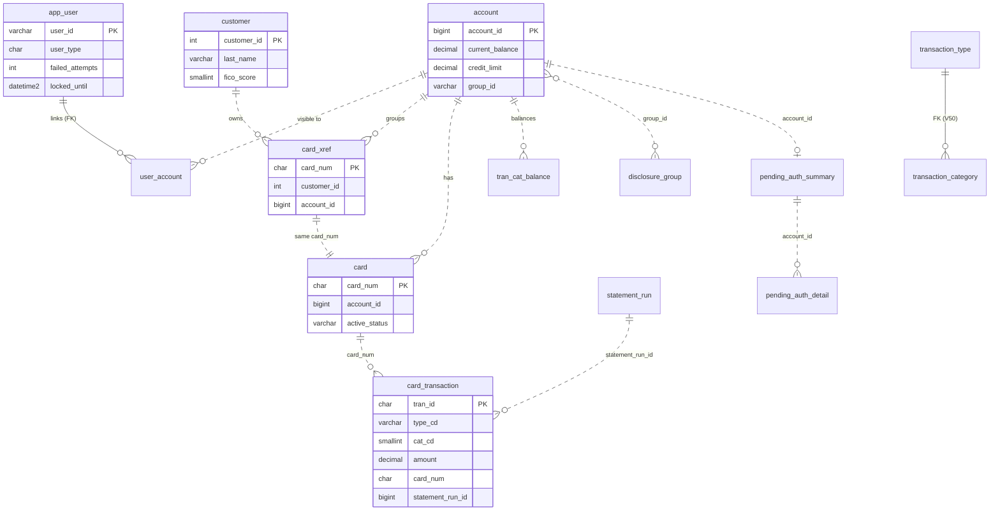

# Data models

The modernized CardDemo keeps all state in one SQL Server database (`carddemo` by default), created by six Flyway migrations in `modernization/backend/schema/src/main/resources/db/migration/`. The tables replace the VSAM files defined by the IDCAMS jobs in `app/jcl`, the Db2 tables of the transaction-type module, and the IMS pending-authorization database. This page lists every table with its key, notable columns, and source entity.

## Overview

| Migration | Lines | Creates |
|:--|--:|:--|
| `modernization/backend/schema/src/main/resources/db/migration/V1__core_schema.sql` | 174 | Core entities: users, accounts, customers, cards, cross-reference, transactions, category balances, rejects, reference data, audit log, ID counter |
| `modernization/backend/schema/src/main/resources/db/migration/V2__spring_batch.sql` | 79 | Spring Batch 5.2 job repository (copied from the spring-batch-core SQL Server script) |
| `modernization/backend/schema/src/main/resources/db/migration/V20__batch_cycle.sql` | 85 | Batch cycle state: interest months, statement runs, pre-posting backups |
| `modernization/backend/schema/src/main/resources/db/migration/V40__report_run.sql` | 15 | CORPT00C report runs |
| `modernization/backend/schema/src/main/resources/db/migration/V50__transaction_category_type_fk.sql` | 5 | Foreign key from category to type (Db2 module rule) |
| `modernization/backend/schema/src/main/resources/db/migration/V60__authorization.sql` | 115 | Pending authorizations, fraud reports, authorization error log |

The entity IDs (`ENT-...`) and copybooks come from the entity index in `modernization/spec/entities.md`. Flyway runs from each runnable jar (`spring.flyway.locations=classpath:db/migration`, see [Configuration](configuration.md)). For the loader that fills these tables from `app/data`, see [Schema and migration](../modules/schema-and-migration.md) and [Data migration](../features/data-migration.md). The original VSAM files are described in [Data stores](../mainframe/data-stores.md).

## Conventions across the schema

These rules are stated in the header comments of `V1__core_schema.sql` and `V60__authorization.sql`:

- Character keys use the `Latin1_General_BIN2` collation, so browse order matches the byte order of the reference runs.
- Text columns hold the COBOL field content with trailing spaces removed. The exporters pad them back.
- `legacy_filler` (and `legacy_status`, `legacy_rba` in V60) keep non-blank FILLER or other bytes of loaded records so an export or IMS unload reproduces the source byte for byte. Rows created by the target leave them blank or NULL.
- `row_version ROWVERSION` columns support optimistic concurrency checks on update screens. They exist on `app_user`, `customer`, `account`, `card`, `transaction_type`, `transaction_category`, `pending_auth_summary`, and `pending_auth_detail`.
- Timestamps that COBOL stored as text are kept twice in `card_transaction`: `*_ts_text` is the exact text each writer produced (shown on screens and reports), `*_ts` is the parsed value used for ordering and filters (Q-ENT-08).
- Most relationships are logical. Declared foreign keys are only `user_account -> app_user`, `transaction_category -> transaction_type` (V50), and the `cycle_backup_*` tables to `cycle_backup`. V60 notes that `account_id` in the authorization tables has no foreign key because the sample loader replaces accounts.

## Entity-relationship diagram

Core tables and their logical relationships. Dashed lines are logical references without a database constraint.

## Tables

### Users and access (V1)

| Table | Key | Notable columns | Source entity | Copybook or origin |
|:--|:--|:--|:--|:--|
| `app_user` | `user_id` VARCHAR(8) | `first_name`, `last_name`, `password_hash` (BCrypt), `user_type` (`A` or `U`, check constraint), `failed_attempts`, `locked_until`, `row_version` | ENT-USER-SECURITY (USRSEC KSDS) | `app/cpy/CSUSR01Y.cpy` |
| `user_account` | (`user_id`, `account_id`) | index `ix_user_account_account` on `account_id`; cascades on user delete | New (D-USER-ACCT linked accounts) | none; see [Account scoping](../features/account-scoping.md) |
| `audit_log` | `audit_id` identity | `recorded_at`, `actor`, `action`, `target`, `fields`, `client_addr` | New (C-AUDIT) | none |

The lockout columns on `app_user` back the lockout rule in `modernization/backend/iam/src/main/java/com/carddemo/iam/security/SecurityProperties.java`.

### Account, customer, and card (V1)

| Table | Key | Notable columns | Source entity | Copybook |
|:--|:--|:--|:--|:--|
| `customer` | `customer_id` INT | name and address lines (`city` holds CUST-ADDR-LINE-3, Q-ENT-04), `state_cd`, `country_cd`, `zip`, `phone1`, `phone2`, `ssn`, `govt_issued_id`, `dob`, `eft_account_id`, `pri_card_holder`, `fico_score`, `row_version` | ENT-CUSTOMER (CUSTDATA KSDS) | `app/cpy/CVCUS01Y.cpy` |
| `account` | `account_id` BIGINT | `active_status`, `current_balance`, `credit_limit`, `cash_credit_limit` (DECIMAL(12,2)), `open_date`, `expiration_date`, `reissue_date`, `curr_cycle_credit`, `curr_cycle_debit`, `addr_zip`, `group_id`, `row_version` | ENT-ACCOUNT (ACCTDATA KSDS) | `app/cpy/CVACT01Y.cpy` |
| `card` | `card_num` CHAR(16) | `account_id`, `cvv_cd`, `embossed_name`, `expiration_date`, `active_status`, `row_version` | ENT-CARD (CARDDATA KSDS) | `app/cpy/CVACT02Y.cpy` |
| `card_xref` | `card_num` CHAR(16) | `customer_id`, `account_id` | ENT-CARD-XREF (CARDXREF KSDS) | `app/cpy/CVACT03Y.cpy` |

`customer.ssn`, `card.card_num`, and `card.cvv_cd` hold sensitive data. Screens mask card numbers and SSNs; see [Security](../security.md).

### Transactions and posting (V1)

| Table | Key | Notable columns | Source entity | Copybook or origin |
|:--|:--|:--|:--|:--|
| `card_transaction` | `tran_id` CHAR(16) | `type_cd`, `cat_cd`, `source`, `description`, `amount` DECIMAL(11,2), merchant fields, `card_num`, `orig_ts_text`/`orig_ts`, `proc_ts_text`/`proc_ts`, `statement_run_id` (D-HISTORY), `inserted_seq` identity | ENT-TRANSACTION (TRANSACT KSDS) | `app/cpy/CVTRA05Y.cpy` |
| `tran_cat_balance` | (`account_id`, `type_cd`, `cat_cd`) | `balance`, `legacy_filler` | ENT-TRAN-CAT-BALANCE (TCATBALF KSDS) | `app/cpy/CVTRA01Y.cpy` |
| `posting_reject` | `reject_id` identity | `run_id`, `business_date`, `record_text` CHAR(350), `reason_code`, `reason_desc`, `created_at` | ENT-DAILY-REJECT (DALYREJS GDG) | inline record in `app/cbl/CBTRN02C.cbl` |
| `id_counter` | `name` | `value`; seeded with row `online_tran_id` = 0 | New (Q-COTRN02C-01, Q-COBIL00C-01: next ID is max(counter, highest numeric ID) + 1) | none |

### Reference data (V1, V50)

| Table | Key | Notable columns | Source entity | Copybook or DDL |
|:--|:--|:--|:--|:--|
| `transaction_type` | `type_cd` VARCHAR(2) | `description`, `legacy_filler`, `row_version` | ENT-TRAN-TYPE; ENT-DB2-TRAN-TYPE in the Db2 module | `app/cpy/CVTRA03Y.cpy`, `app/app-transaction-type-db2/ddl/TRNTYPE.ddl` |
| `transaction_category` | (`type_cd`, `cat_cd`) | `description`, `legacy_filler`, `row_version`; FK `fk_transaction_category_type` to `transaction_type` added by V50 | ENT-TRAN-CATEGORY; ENT-DB2-TRAN-TYPE-CATEGORY | `app/cpy/CVTRA04Y.cpy`, `app/app-transaction-type-db2/ddl/TRNTYCAT.ddl` |
| `disclosure_group` | (`group_id`, `type_cd`, `cat_cd`) | `int_rate` DECIMAL(6,2), `legacy_filler` | ENT-DISCLOSURE-GROUP (DISCGRP KSDS) | `app/cpy/CVTRA02Y.cpy` |

V50 exists because the Db2 module forbids deleting a type that still has categories. SQL Server's default `NO ACTION` rejects the delete the same way, and COTRTLIC and COBTUPDT report the violation (ERR-COTRTLIC-13). See [Reference data](../modules/refdata.md).

### Batch cycle state (V20)

| Table | Key | Notable columns | Purpose |
|:--|:--|:--|:--|
| `interest_account` | (`interest_month` CHAR(7), `account_id`) | `business_date`, `interest_rows`, `total_interest`, `processed_at` | One row per account whose interest for a month was committed. A rerun of INTCALC after an abend in the same month skips these accounts (Q-CBACT04C-08, B-UOW) |
| `statement_run` | `statement_run_id` identity | `business_date`, `started_at`, `transaction_count`, `statement_count` | One row per CREASTMT run; `card_transaction.statement_run_id` points here (Q-CREASTMT-04, D-HISTORY). Replaces the TRXFL work file of ENT-STATEMENT-TRANSACTION (`app/cpy/COSTM01.CPY`) as the record of what a statement covered |
| `cycle_backup` | `backup_id` identity | `business_date`, `created_at`, `max_reject_id`, `max_statement_run_id`, `max_job_instance_id`, row counts, `restored_at` | Header of a BACKUP snapshot taken before POSTTRAN (Q-TRANBKP-01, Q-ACCTFILE-02, B-CYCLE) |
| `cycle_backup_account` | (`backup_id`, `account_id`) | copy of every `account` column except `row_version` | Snapshot of accounts |
| `cycle_backup_transaction` | (`backup_id`, `tran_id`) | `statement_run_id` | Snapshot of transaction keys and statement marks (transactions are only added or marked) |
| `cycle_backup_category` | (`backup_id`, `account_id`, `type_cd`, `cat_cd`) | `balance`, `legacy_filler` | Snapshot of category balances |
| `cycle_backup_interest` | (`backup_id`, `interest_month`, `account_id`) | same columns as `interest_account` | Snapshot of interest tracking |

RESTORE puts the snapshot back and forgets batch runs started after it; the `max_*` columns mark that boundary. See [Daily batch cycle](../features/daily-batch-cycle.md) and [Batch jar](../applications/batch-jar.md).

### Spring Batch job repository (V2)

`BATCH_JOB_INSTANCE`, `BATCH_JOB_EXECUTION`, `BATCH_JOB_EXECUTION_PARAMS`, `BATCH_STEP_EXECUTION`, `BATCH_STEP_EXECUTION_CONTEXT`, `BATCH_JOB_EXECUTION_CONTEXT`, and the sequences `BATCH_STEP_EXECUTION_SEQ`, `BATCH_JOB_EXECUTION_SEQ`, `BATCH_JOB_SEQ`. They give the batch jobs their restart state (B-UOW, Q-CBTRN02C-07). The batch jar sets `spring.batch.jdbc.initialize-schema=never` because Flyway owns these tables.

There is no job log table. The job SYSOUT (the COBOL DISPLAY lines) is written to standard output by `modernization/backend/common/src/main/java/com/carddemo/common/batch/JobLog.java`, and Airflow records it in the task log.

### Report runs (V40)

| Table | Key | Notable columns | Purpose |
|:--|:--|:--|:--|
| `report_run` | `dag_run_id` VARCHAR(250) | `report_type` (`Monthly`, `Yearly`, `Custom`, check constraint), `start_date`, `end_date`, `user_id`, `requested_at`, `state`, `state_checked_at` | One row per `carddemo_transaction_report` DAG run started from CORPT00C. The row is the access check for the download (own runs; admins any). It is written before launch and removed if the launch fails (Q-CORPT00C-07, -09, -10) |

Indexes: `ix_report_run_user` on (`user_id`, `requested_at DESC`) and `ix_report_run_requested` on (`requested_at DESC`). See [Transaction reports](../features/transaction-reports.md).

### Pending authorizations (V60)

| Table | Key | Notable columns | Source entity | Copybook or DDL |
|:--|:--|:--|:--|:--|
| `pending_auth_summary` | `account_id` | `customer_id`, `auth_status`, `account_status` (5 x X(02)), `credit_limit`, `cash_limit`, `credit_balance`, `cash_balance`, approved and declined counts and amounts, `legacy_status`, `legacy_filler`, `legacy_rba`, `row_version` | ENT-AUTH-SUMMARY (IMS root segment PAUTSUM0 of DBPAUTP0) | `app/app-authorization-ims-db2-mq/cpy/CIPAUSMY.cpy` |
| `pending_auth_detail` | `auth_id` identity | `account_id`, `auth_ts`, original date and time, `card_num`, auth type, response code and reason, `transaction_amt`, `approved_amt`, merchant fields, `match_status`, `auth_fraud`, `fraud_rpt_date`, `legacy_filler`, `legacy_rba`, `row_version` | ENT-AUTH-DETAIL (IMS child segment PAUTDTL1) | `app/app-authorization-ims-db2-mq/cpy/CIPAUDTY.cpy` |
| `auth_fraud_report` | (`card_num`, `auth_ts`, `auth_id`) | copy of the detail fields plus `acct_id`, `cust_id` (all nullable) | ENT-AUTH-FRAUD (Db2 `CARDDEMO.AUTHFRDS`); key extended per Q-COPAUS2C-03 | `app/app-authorization-ims-db2-mq/ddl/AUTHFRDS.ddl` |
| `auth_error_log` | `error_id` identity | `logged_at`, `err_date`, `err_time`, `application`, `program`, `location`, `err_level`, `subsystem`, `code1`, `code2`, `message`, `event_key` (masked card number, Q-COPAUA0C-13) | ENT-AUTH-ERROR-LOG | `app/app-authorization-ims-db2-mq/cpy/CCPAUERY.cpy` |

All money columns in V60 are DECIMAL(12,2) (Q-ENT-26). The IMS key of a detail segment (99999 minus YYDDD, 999999999 minus HHMMSSmmm) is not stored; it is derived from `auth_ts` on unload (Q-ENT-27, Q-COPAUA0C-11). See [Pending authorizations](../features/pending-authorizations.md).

## Indexes that replace alternate indexes

| Index | Table and columns | Replaces |
|:--|:--|:--|
| `ix_card_account` | `card` (`account_id`, `card_num`) | AIX on account for CARDDATA (CICS `CARDAIX`) |
| `ix_card_xref_account` | `card_xref` (`account_id`, `card_num`) | AIX on account for CARDXREF (CICS `CXACAIX`) |
| `ix_tran_proc_ts` | `card_transaction` (`proc_ts`) | AIX on `TRAN-PROC-TS` for TRANSACT (`app/jcl/TRANIDX.jcl`) |
| `ix_tran_card` | `card_transaction` (`card_num`, `tran_id`) | New; transaction browse by card |
| `ix_tran_statement` | `card_transaction` (`statement_run_id`) | New; statement runs |
| `ix_user_account_account` | `user_account` (`account_id`) | New; scoping lookups |
| `ux_pending_auth_detail_account_ts` (unique) | `pending_auth_detail` (`account_id`, `auth_ts DESC`, `auth_id DESC`) | IMS child key order under the parent, newest first |
| `ix_pending_auth_detail_ts` | `pending_auth_detail` (`auth_ts`) | New; purge by age |

The AIX-to-CICS-name mapping comes from the entity index in `modernization/spec/entities.md`. The `ix_pending_auth_detail_ts` purpose is inferred from the column; the migration does not state it.

## IDCAMS jobs replaced by V1

The V1 header names the DEFINE jobs it replaces: `app/jcl/ACCTFILE.jcl`, `app/jcl/CARDFILE.jcl`, `app/jcl/CUSTFILE.jcl`, `app/jcl/XREFFILE.jcl`, `app/jcl/TRANFILE.jcl`, `app/jcl/TCATBALF.jcl`, `app/jcl/TRANTYPE.jcl`, `app/jcl/TRANCATG.jcl`, `app/jcl/DISCGRP.jcl`, and `app/jcl/DUSRSECJ.jcl`.
