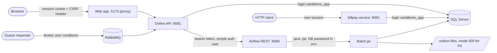

# Security

The modern stack fixes the security gaps of the original sample (plaintext passwords, no authorization checks, full card numbers on screens and in job logs) while keeping its screens and file layouts. This page maps the trust boundaries, then explains authentication, sessions, CSRF, roles, account scoping, masking, audit, PII files, secrets, and the tests that hold it all in place. The governing decisions are D-AUTH, D-FIX-SEC, D-SEC-EXTRAS, and D-USER-ACCT in `modernization/decisions/README.md`, and the C-* conventions in `modernization/decisions/ledger-online.md`.

## Trust boundaries

| Boundary | Who authenticates | How |
|:--|:--|:--|
| Browser to API | The user | Sign-on screen COSGN00C, BCrypt check, server-side session (below) |
| Client to billpay-service | The user, again | Same IAM code in a separate process; sessions are not shared with 8081 (`modernization/README.md`) |
| Queue requester to API | The broker | RabbitMQ user and vhost permissions; RabbitMQ verifies `user_id`. The inquiry listeners add a per-requester rate limit (see [Message queues](api/message-queues.md)) |
| API to SQL Server | Login `carddemo_app` | SQL authentication, password from `CARDDEMO_DB_PASSWORD`; `db_owner` of the one database (`modernization/ops/db-reset.sh`). The JDBC URL uses `encrypt=true;trustServerCertificate=true` |
| API to Airflow | Simple auth manager user `carddemo` | `POST /auth/token` with the generated password, then a bearer token (`modernization/backend/reporting/src/main/java/com/carddemo/reporting/internal/AirflowReportLauncher.java`) |
| Airflow to batch jar | None beyond the OS user | The task runs `java -jar` with the environment, including the DB password (`modernization/airflow/dags/carddemo_batch.py`) |

The real perimeter is the machine: every listener binds to 127.0.0.1 (`server.address=127.0.0.1` in `modernization/backend/app/src/main/resources/application.properties` and the billpay-service properties, `host: '127.0.0.1'` in `modernization/web/vite.config.ts`, `AIRFLOW__API__HOST` in `modernization/airflow/env.sh`, and the RabbitMQ and SQL Server configuration in `modernization/README.md`). There is no TLS on any HTTP port.

## Authentication

`modernization/backend/iam/src/main/java/com/carddemo/iam/internal/SignonService.java` implements sign-on for COSGN00C:

- Passwords are BCrypt hashes in `app_user.password_hash` (`modernization/backend/schema/src/main/resources/db/migration/V1__core_schema.sql`); cost 12 by default (`SecurityProperties.bcryptCost`, Q-COSGN00C-01). The sample loader hashes the USRSEC passwords at load time.
- User IDs are case-insensitive (upper-cased by `SignonController`), passwords case-sensitive (Q-COSGN00C-02).
- An unknown user ID still costs one BCrypt verify against a dummy hash, so timing does not reveal which IDs exist (Q-COSGN00C-04).
- Lockout: after 5 consecutive failures (`lockoutThreshold`) the ID is refused for 15 minutes (`lockoutDuration`), tracked in `app_user.failed_attempts` and `locked_until` (Q-COSGN00C-05). A success resets the counter.
- Every failure, including a locked ID, gets the same text, `Invalid User ID or Password. Try again ...` (`SignonController.INVALID_CREDENTIALS`).

Settings are `carddemo.security.*` in `modernization/backend/iam/src/main/java/com/carddemo/iam/security/SecurityProperties.java`. The end-to-end flow is in [Sign-on and sessions](features/sign-on-and-sessions.md).

## Sessions and cookies

- On success, `SignonController.startSession` invalidates any existing session and creates a new one (session fixation protection, also set as `sessionFixation(newSession)` in `SecurityConfig`), stores the security context in it, and registers it in `modernization/backend/iam/src/main/java/com/carddemo/iam/security/ActiveSessions.java`.
- The cookie is `JSESSIONID`, HttpOnly, SameSite=Strict (`server.servlet.session.cookie.*`).
- Idle timeout: 15 minutes, measured with the application clock by `modernization/backend/iam/src/main/java/com/carddemo/iam/security/IdleTimeoutFilter.java`. An expired session is invalidated and the request continues unauthenticated, so protected endpoints answer 401. The servlet session timeout is also 15 minutes.
- When an admin changes a user's type or password, or deletes the user, `ActiveSessions.endAll` invalidates that user's sessions (Q-COUSR02C-04, Q-COUSR03C-07). The registry is per process.
- PF3 on the sign-on screen invalidates the session and navigates to `EXIT`.
- HTTP Basic, form login, and Spring's logout endpoint are disabled.

## CSRF

`SecurityConfig` uses `CookieCsrfTokenRepository.withHttpOnlyFalse()`: the token is in a JavaScript-readable `XSRF-TOKEN` cookie and must come back in the `X-XSRF-TOKEN` header on every state-changing request. `modernization/backend/iam/src/main/java/com/carddemo/iam/security/CsrfCookieFilter.java` loads the deferred token on every request so the first `GET` already issues the cookie. The web client copies it in `modernization/web/src/api.ts`. A missing or wrong token is a plain 403, not the JSON admin-only answer. Combined with SameSite=Strict on the session cookie, this blocks cross-site form posts.

## Roles (C-ROLE)

`modernization/backend/common/src/main/java/com/carddemo/common/security/Role.java` maps the user type `A` to `ADMIN` and `U` to `USER`. The role comes from the server session, never from client input.

`modernization/backend/iam/src/main/java/com/carddemo/iam/security/SecurityConfig.java` rules, in order:

| Matcher | Rule |
|:--|:--|
| `/api/screens/COSGN00C`, `/api/session` | permit all |
| `/actuator/health`, `/v3/api-docs/**`, `/swagger-ui/**` | permit all |
| `ADMIN_SCREENS`: COADM01C, COUSR00C-03C, COTRTLIC, COTRTUPC | `hasRole("ADMIN")` |
| `/api/**` | authenticated |
| anything else | deny all |

`POST /api/authorizations` adds `@PreAuthorize("hasRole('ADMIN')")` (method security is enabled with `@EnableMethodSecurity`). A USER on an admin screen gets 403 with a `ScreenResponse` that navigates to COMEN01C with `No access - Admin Only option... `, the text reused from the COBOL menu.

## Account scope (C-SCOPE)

A USER may read or change only the accounts linked to their user ID in `user_account`, and the cards, transactions, bill payments, authorizations, and reports of those accounts; an ADMIN is unrestricted. The interface is `modernization/backend/common/src/main/java/com/carddemo/common/security/AccountScope.java`, implemented in `modernization/backend/iam/src/main/java/com/carddemo/iam/internal/JdbcAccountScope.java`. An out-of-scope key is answered exactly like a missing one, with the program's own not-found message, and lists and paging are computed over in-scope rows only. Report runs are limited to the user's own runs. See [Account scoping](features/account-scoping.md).

## Masking (C-MASK, B-MASK)

`modernization/backend/common/src/main/java/com/carddemo/common/mask/Masking.java` holds the renderings:

| Method | Output | Where it is used (main code) |
|:--|:--|:--|
| `card` | `*` for all but the last 4 digits (`************` + last 4 for 16 digits) | Card, transaction, and authorization screens; the authorization error log; the TRANREPT report service |
| `ssnScreen` | `***-**-` + last 4 | Account view (`AccountViewController`) |
| `keepLast(value, n)` | `*` for all but the last n characters | Government ID on account view and update |
| `all` | `*` for every character, length kept | Not called from main code at this commit |

Batch jobs apply B-MASK in their own code: `modernization/backend/dataexchange/src/main/java/com/carddemo/dataexchange/internal/ListingJob.java` (card, cross-reference, and customer listings), `modernization/backend/cycle/src/main/java/com/carddemo/cycle/internal/TransactionVerifier.java` (CBTRN01C), and `modernization/backend/reporting/src/main/java/com/carddemo/reporting/internal/TransactionReportService.java` (CBTRN03C).

- **C-MASK** (online): the server never sends a full card number, SSN, government ID, CVV, or password to the client. Submitting a masked field unchanged means "keep the stored value" (`modernization/decisions/ledger-online.md`).
- **B-MASK** (batch): no job writes a full card number, CVV, SSN, government ID, date of birth, or EFT account to SYSOUT or a log (`modernization/decisions/ledger-batch-data.md`). The batch parity harness applies matching reference patches (for example RP-CBACT02C-1) to the COBOL so outputs still compare.
- The database still stores PAN, CVV, SSN, and government ID as the COBOL did (Q-ENT-33, PRESERVE under D-PII-FILES).

## PII files (D-PII-FILES)

Files that are data contracts keep full PAN, CVV, and SSN content so round trips work, and are created with POSIX permissions `rw-------`:

- POSTTRAN rejects: `modernization/backend/batch/src/main/java/com/carddemo/batch/posting/PosttranStep.java`
- Export and import outputs: `modernization/backend/dataexchange/src/main/java/com/carddemo/dataexchange/internal/FileSinks.java`
- IMS unload files: `modernization/backend/authorization/src/main/java/com/carddemo/authorization/internal/AuthBatchFiles.java`

## Audit (C-AUDIT)

`modernization/backend/common/src/main/java/com/carddemo/common/audit/AuditLog.java` is the interface; `modernization/backend/iam/src/main/java/com/carddemo/iam/internal/JdbcAuditLog.java` inserts one row per event into `audit_log` (`recorded_at`, `actor`, `action`, `target`, `fields`, `client_addr`). Audited: sign-on success, failure, and lockout (actions `SIGNON_SUCCESS`, `SIGNON_FAILURE`, `SIGNON_LOCKOUT`, with the client address), every user add, update, and delete, every account or customer update, and every card update. Audit rows list changed field names, never values, and must never contain passwords, full card numbers, CVVs, SSNs, or government IDs. No screen shows them.

## Secrets

- The three secrets (`MSSQL_SA_PASSWORD`, `CARDDEMO_DB_PASSWORD`, `RABBITMQ_PASSWORD`) live only in `~/.carddemo/secrets.env`, mode 600. Properties files reference them as `${CARDDEMO_DB_PASSWORD}` and `${RABBITMQ_PASSWORD}`; `modernization/ops/stack-env.sh` sources the file only when the variables are unset and never prints them. Only `db-reset.sh` uses the `sa` password.
- The Airflow password is generated by Airflow into `$AIRFLOW_HOME/simple_auth_manager_passwords.json.generated`; `up.sh` reads it into the API's environment.
- `modernization/verification/scan_secrets.py` scans every tracked file for the literal values in the secrets file and for credential patterns (private keys, AWS keys, GitHub and Slack tokens, passwords in URLs and assignments). It prints `file:line` and the kind of finding, never the matched text.
- Gitleaks runs in CI (`secret scan` job in `.github/workflows/ci.yml`, with `--redact`) and as a pre-commit hook (`.pre-commit-config.yaml`).
- The demo sign-on password is documented in the root `README.md`; it is a sample credential, and the README and `docs/data-handling.md` say a real deployment must not use it.

## Response headers

There is no custom header configuration in the backend; Spring Security's default headers apply to API responses (for example `X-Content-Type-Options: nosniff`, `X-Frame-Options: DENY`, and no-cache `Cache-Control`). No test asserts them. Note that `modernization/e2e/tests/headers.spec.ts` checks the screen header (titles, transaction ID, clock) on each page, not HTTP headers.

## Security tests

| Test | What it proves |
|:--|:--|
| `modernization/backend/app/src/test/java/com/carddemo/app/SecurityMatrixTest.java` | Every operation in the live `/v3/api-docs` is classified PUBLIC, AUTHENTICATED, ADMIN_ONLY, or ACCOUNT_SCOPED, then called as anonymous, USER0001, and ADMIN001 against a linked, an unlinked, and a nonexistent account. Every response body is scanned for sample passwords, BCrypt hashes, full sample card numbers, and SSNs. Report in `target/security-matrix.txt`. A new endpoint fails the test until it is classified |
| `modernization/backend/billpay-service/src/test/java/com/carddemo/billpayservice/it/StandaloneSecurityMatrixIT.java` | The same matrix over HTTP against the packaged billpay-service jar on port 8092; report in `target/billpay-security-matrix.txt` |
| `modernization/backend/app/src/test/java/com/carddemo/app/ModuleBoundariesTest.java` | Contexts reach each other only through `api` packages, so security code in IAM is not bypassed by direct access |

See [Testing](how-to-contribute/testing.md) for how to run them.

## The COBOL side

The original application in `app/` keeps its demo-grade security; it is a sample. The root tooling enforces one rule on it: lint rule CD070 (`tools/carddemo/rules.py`, documented in `docs/static-analysis.md`) flags any DISPLAY of a PII field (SSN, card number, CVV, password, date of birth, FICO score) or a record containing one. `docs/data-handling.md` lists the sensitive fields per copybook and the rules for code changes. Existing violations are in the lint baseline (`tools/carddemo/lint-baseline.json`). See [Local tooling](mainframe/local-tooling.md).

## Related pages

- [Sign-on and sessions](features/sign-on-and-sessions.md)
- [Account scoping](features/account-scoping.md)
- [IAM](modules/iam.md) for the code
- [Fidelity ledger](verification/fidelity-ledger.md) for the decision IDs cited here
