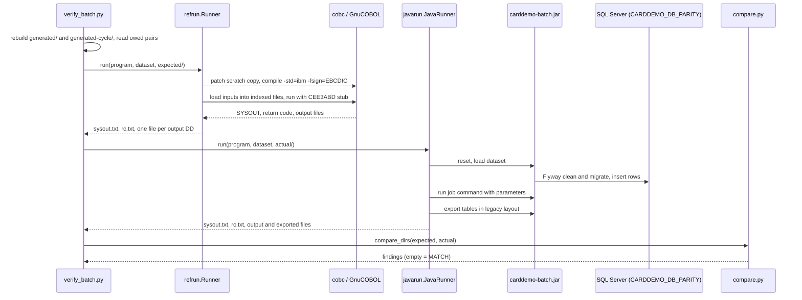

# Batch parity

Active contributors: factory-aj-pahl

`modernization/verification/parity/` is a differential test harness. It compiles the original COBOL batch programs with GnuCOBOL, runs them and the Java Spring Batch jobs on the same input directory, and compares every output file record by record. `make -C modernization verify-batch` runs all 44 owed (program, dataset) pairs listed in `modernization/verification/parity/datasets.md`.

## Purpose

B-PARITY in `modernization/decisions/ledger-batch-data.md` makes the COBOL the oracle for batch behavior. Where the ledger approves a fix, a reference patch changes a scratch copy of the COBOL so the oracle produces the fixed output too. The comparison can therefore stay exact: the only normalized fields are run-time clock values.

## Directory layout

```
modernization/verification/parity/
  README.md               harness description, build details, normalizations, qualification
  refrun.py               GnuCOBOL reference runner
  javarun.py              Java batch-jar runner
  compare.py              record-by-record comparator
  verify_batch.py         driver for make verify-batch
  make_datasets.py        builds generated/ (listing, export, import datasets)
  make_cycle_datasets.py  builds generated-cycle/ (posting, interest, report, statement, abend datasets)
  qualify_harness.py      qualification of the harness (make verify-harness)
  datasets.md             dataset catalogue, owed pairs, rules no dataset can reach
  patches/RP-*.patch      20 reference patches
  .gitignore              generated/, generated-cycle/, __pycache__/
```

## Key abstractions

| Abstraction | Where | Role |
|:--|:--|:--|
| `File` | `modernization/verification/parity/refrun.py` | One DD: file name, record length, key length and offset (None = sequential), binary flag, `missing_if_absent`, alternate key, `abnormal_delete` |
| `Program` | `modernization/verification/parity/refrun.py` | One COBOL program: inputs, outputs, DDs to unload, patches, data patches, extra sources, default PARM, prepare step, SYSOUT mask prefixes |
| `PROGRAMS` | `modernization/verification/parity/refrun.py` | The 10 reference programs: CBTRN02C, CBACT02C, CBACT03C, CBCUS01C, CBEXPORT, CBIMPORT, CBTRN01C, CBACT04C, CBTRN03C, and CBSTM03A+CBSTM03B |
| `Runner` | `modernization/verification/parity/refrun.py` | Compiles, stages inputs, runs, and unloads outputs |
| `Job`, `JOBS` | `modernization/verification/parity/javarun.py` | The batch-jar command for each program (for example CBTRN02C -> `POSTTRAN`, CBACT04C -> `INTCALC`), its input and output parameters, and the tables exported afterwards |
| `JavaRunner` | `modernization/verification/parity/javarun.py` | Resets and loads the scratch database, runs the jar, exports tables |
| `compare_dirs` | `modernization/verification/parity/compare.py` | Compares two output directories and returns findings |

## How one owed pair runs



`verify_batch.py` reads the owed table before anything runs. A pair that raises any error is recorded as failed with `did not run: ...`, never skipped. At the end it writes `<out>/results.json` with `owed`, `matched`, and per-pair verdict, findings, and the "Rules exercised" cell, then prints `batch parity: N/44 owed pairs matched`. It exits 0 only when every pair matches. `ONLY=CBEXPORT` limits the run to one program; `OUT=dir` keeps the outputs.

## The reference runner (refrun.py)

- **Build.** `cobc -x -std=ibm -fsign=EBCDIC -I app/cpy`. The ASCII sample data carries EBCDIC overpunch signs, so `-fsign=EBCDIC` is RP-BUILD-1; `--sign ""` uses the cobc default.
- **Patches.** The program's sources are copied to a temporary directory under the work directory, and each RP- patch is applied with `patch -p1`. With `--unpatched` the originals in `app/cbl` are compiled directly.
- **Data patches.** `RP-DATA-1` is a Python function (`rp_data_1`) applied to the staged `acctdata.txt` of programs that list it.
- **Staging.** Each input is cut into fixed-length records. Indexed inputs are loaded into GnuCOBOL indexed files by small generated COBOL LOAD and UNLD utilities (one per record and key shape). JCL steps with no COBOL source are reproduced in Python: the TRANREPT and CREASTMT SORT steps (`PREPARE`) and the COMBTRAN merge (`combtran()`).
- **PARM.** CBACT04C is called through a generated driver (`PARMDRV`) that passes the PARM as the z/OS linkage area (halfword length plus text). The PARM comes from the dataset's `parm.txt` or the default `2022071800` from `app/jcl/INTCALC.jcl`.
- **Output.** `sysout.txt`, `rc.txt`, and one LF-terminated file per unloaded DD; indexed files are unloaded in key order. CVEXPORT files stay unterminated 500-byte binary records.

### Steps that reproduce z/OS

| Step | Why |
|:--|:--|
| CEE3ABD stub | Off z/OS a `CALL 'CEE3ABD'` fails with "module not found" and exit code 1. `refrun.py` builds a module that does `MOVE 99 TO RETURN-CODE` and `STOP RUN`, placed on `COB_LIBRARY_PATH`, so a reference abend ends with exit code 99 like B-ABEND. It displays nothing |
| SYSOUT clean-up | Compiler warnings and `libcob: warning: implicit CLOSE of ...` lines are removed. GnuCOBOL prints the latter whenever a run unit ends with open files (every abend); z/OS closes files silently |
| Abnormal disposition | After exit code 99, outputs with `DISP=(NEW,CATLG,DELETE)` that are files in the target too (`abnormal_delete`: DALYREJS, TRANREPT, STMTFILE, HTMLFILE, the CBIMPORT outputs) are deleted and not unloaded. The INTCALC SYSTRAN output is kept because the target writes those rows to the transaction table and committed accounts stay (B-UOW) |
| Unopened KSDS | A KSDS the program never opened unloads as an empty file, since on z/OS the cluster exists before the step |
| Missing input | An input marked `missing_if_absent` (DALYTRAN, the CBIMPORT export file) that is absent leaves its DD pointing at no file, so OPEN returns status 35 |
| B-MASK post-filter | The CBTRN03C line `INVALID CARD NUMBER : ` plus a card number is masked to twelve asterisks plus the last 4 in the reference SYSOUT. RP-CBTRN03C-3 masks only the raw record display |

## The Java runner (javarun.py)

`JavaRunner` needs `modernization/backend/batch/target/carddemo-batch.jar` and `CARDDEMO_DB_PASSWORD`. The database is `CARDDEMO_DB_PARITY` (default `carddemo_test`). For each pair it runs `reset` (Flyway clean, enabled with `--spring.flyway.clean-disabled=false`), `load <dataset>`, the job command with parameters (`businessDate=2022-06-10` by default, the INTCALC date from `parm.txt`, the CBTRN03C range from `dateparm.txt`, input and output file paths), and then `export` of the tables the reference unloads. Some jobs need special handling: INTCALC skips loading `transact.txt` and its exported transactions are renamed `systran.txt`, because the reference writes only the new interest rows. See [Batch jar](../applications/batch-jar.md) for the commands.

## The comparator (compare.py)

Every file present in either directory is compared. A file on one side only, a different record count, or any differing byte is a finding; the first differing byte per record is reported, with up to five records per file. `expfile.dat` is split into 500-byte records, and a trailing partial record is flagged.

Normalizations: only run-time clock values, and both sides must hold a well-formed value there.

| File | Zero-based bytes or line | Pattern |
|:--|:--|:--|
| `transact.txt` | 304-330 (TRAN-PROC-TS, BR-CBTRN02C-05) | `YYYY-MM-DD-hh.mm.ss.hh0000` |
| `systran.txt` | 278-304 and 304-330 (interest TRAN-ORIG-TS and TRAN-PROC-TS, BR-CBACT04C-06) | same |
| `expfile.dat` | 1-27 of each record (BR-CBEXPORT-01) | `YYYY-MM-DD hh:mm:ss.00` plus 4 spaces |
| `errout.txt` | 0-21 (FUNCTION CURRENT-DATE, BR-CBIMPORT-07) | `YYYYMMDDhhmmsshh+hhmm` |
| `sysout.txt` | lines starting `CBEXPORT: Export Date:`/`Time:` and `CBIMPORT: Import Date:`/`Time:` | date or clock |

Card numbers and SSNs in printed findings are masked (B-MASK applies to evidence output too). The README table omits the `systran.txt` row; the code in `modernization/verification/parity/compare.py` has it.

## Datasets and owed pairs

`modernization/verification/parity/datasets.md` lists the datasets, the owed pairs, and the rules no dataset can reach.

- **Datasets.** 26 named datasets: `sample` (the shipped `app/data/ASCII`), 9 built by `make_datasets.py` under `generated/` (`empty`, `listing-edge`, `export-sample`, `export-edge`, `export-notran`, `import-sample`, `import-edge`, `import-empty`, `import-missing`), and 16 built by `make_cycle_datasets.py` under `generated-cycle/` (`cycle-edge`, `statement-edge`, `report-sample`, `report-edge`, `report-none`, `empty-input`, `dup-tranid`, `intcalc-noacct`, `intcalc-nocard`, `intcalc-nodefault`, three `tranrept-bad*`, `stmt-nocust`, `stmt-noacct`, `daily-missing`). Both builders are deterministic; `--check` builds twice and compares a SHA-256 digest. The import datasets' `expfile.dat` comes from an encoder written from `spec/programs/CBEXPORT.md`, independent of both the COBOL and the Java.
- **Owed pairs.** 44 rows, each naming program, dataset, directory, and the rules exercised:

| Program | Pairs |
|:--|--:|
| CBTRN02C (POSTTRAN) | 5 |
| CBTRN01C (TRANVERIFY) | 4 |
| CBACT04C (INTCALC) | 6 |
| CBTRN03C (TRANREPT) | 7 |
| CBSTM03A+CBSTM03B (CREASTMT) | 5 |
| CBEXPORT | 4 |
| CBIMPORT | 4 |
| CBACT02C, CBACT03C, CBCUS01C (listings) | 3 each |

- **Abend pairs.** Datasets such as `dup-tranid`, `daily-missing`, `intcalc-*`, `tranrept-bad*`, and `stmt-no*` make the job abend. These pairs compare SYSOUT, the return code (99), and the data files like any other pair.
- **Not reproducible by a dataset.** 29 rows list rules that only table I/O failures, impossible file statuses, or partial updates under B-UOW can reach, each with the covering Java test (for example `ListingJobTest`, `ExportImportJobTest`, `CycleFailuresTest`, `PosttranJobTest`) or an entry in `modernization/verification/trace-exclusions.md`.

The `verify_batch.py` row regex reads the `## Owed pairs` table only, so a new pair is one new table row plus, if needed, a new dataset builder function. The "Rules exercised" cell supports ranges such as `BR-CBTRN02C-01..07`, which `trace.py` expands.

## Harness qualification (qualify_harness.py)

`make -C modernization verify-harness` checks the harness before its verdicts are trusted. It prints PASS or FAIL with evidence for each item and exits non-zero if any fails:

1. **Known outcomes.** Unpatched CBTRN02C on the sample data gives RC 4, 300 processed, 38 rejects all with reason `0102` with `-fsign=EBCDIC`, and 43 rejects with the cobc default sign. This is why the root `make run-batch PROGRAM=CBTRN02C` described in `AGENTS.md` reports 43 rejects: `tools/carddemo/batch.py` compiles with `-std=ibm` but no `-fsign` option.
2. **Listing counts.** Unpatched CBACT02C shows every sample record once; CBACT03C and CBCUS01C show each twice (Q-CBACT03C-01, Q-CBCUS01C-01), framed by the start and end messages.
3. **Patches.** Every RP- ID in `modernization/decisions/*.md` either is implemented in `refrun.py` (RP-BUILD-1, RP-DATA-1) or has a patch file that applies with no fuzz or offset, cumulatively per program, and passes `cobc -fsyntax-only`. `git status --porcelain -- app/` must be empty afterwards.
4. **Comparator mutations.** On a patched CBTRN02C output and a CBEXPORT output, the unmodified pair matches, and each mutation is reported with file and record: flipped byte, dropped record, added trailing record, renamed file, removed table row, flipped SYSOUT byte, malformed timestamp, partial binary record, changed return code.
5. **Abend steps.** `clean()` removes only implicit-CLOSE warnings, `bmask()` masks only after a listed prefix, the `tranrept-badcard` reference ends with RC 99, no report file, no `libcob` line, and a masked card line, and `report-sample` keeps its report.

## Prerequisites

GnuCOBOL 3.x (`cobc`), `patch`, a JDK, the built batch jar (`verify-batch` depends on the `backend` target), SQL Server with the `carddemo_app` login, and the secrets in the environment. The harness writes only to its output or temporary directories and to `generated/` and `generated-cycle/`.

## Key source files

| File | Purpose |
|:--|:--|
| `modernization/verification/parity/refrun.py` | Reference runner, z/OS emulation steps, program table |
| `modernization/verification/parity/javarun.py` | Java runner and job table |
| `modernization/verification/parity/compare.py` | Comparator and normalizations |
| `modernization/verification/parity/verify_batch.py` | Owed-pair driver, `results.json` |
| `modernization/verification/parity/make_datasets.py` | Listing, export, import datasets and the CVEXPORT encoder |
| `modernization/verification/parity/make_cycle_datasets.py` | Cycle, report, statement, and abend datasets |
| `modernization/verification/parity/qualify_harness.py` | Harness qualification |
| `modernization/verification/parity/datasets.md` | Owed pairs and unreachable rules |

Related: [Cycle module](../modules/cycle.md), [Data exchange module](../modules/dataexchange.md), [Batch and JCL](../mainframe/batch-and-jcl.md), [Fidelity ledger](fidelity-ledger.md).
